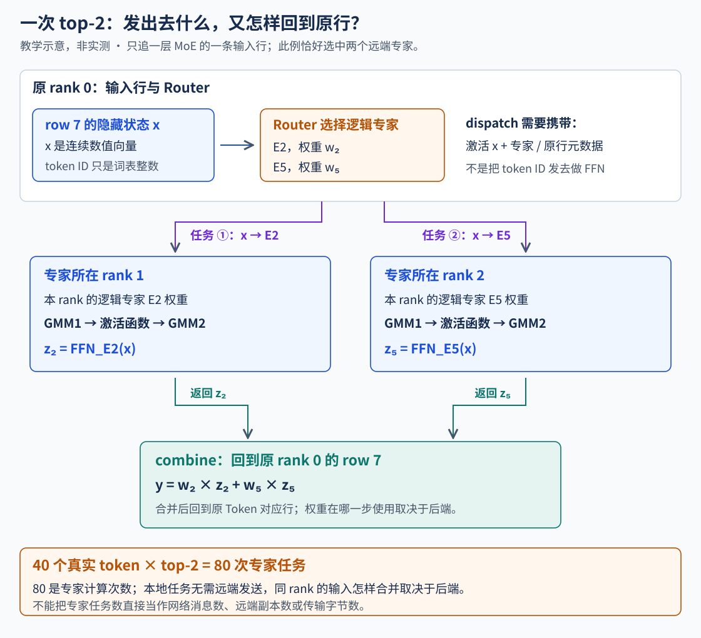
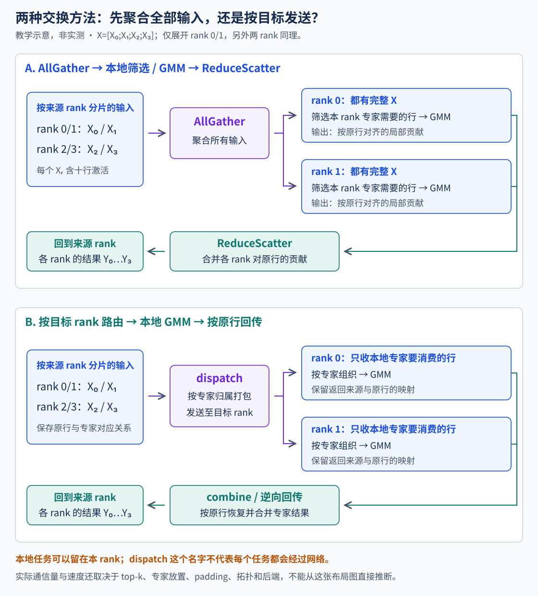
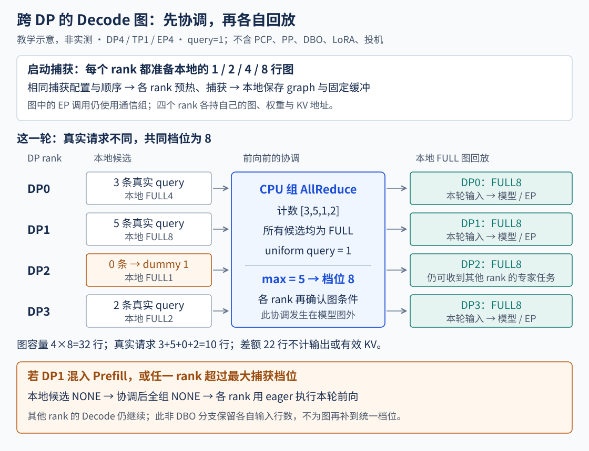
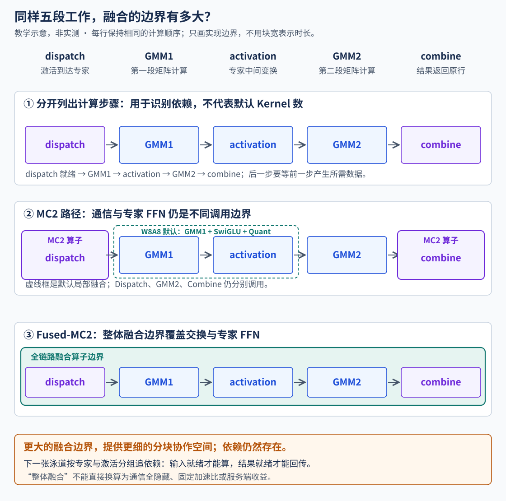
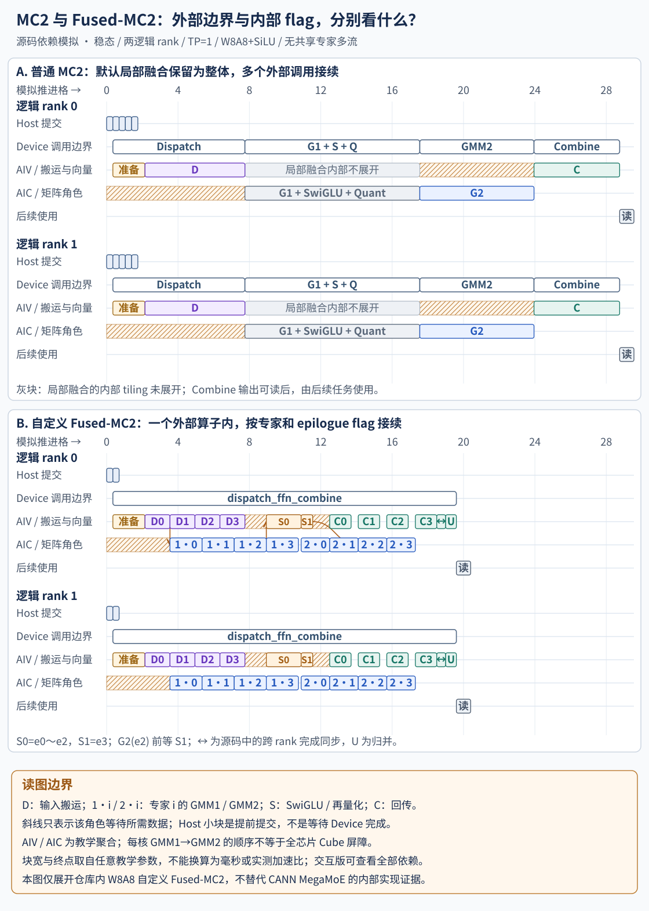
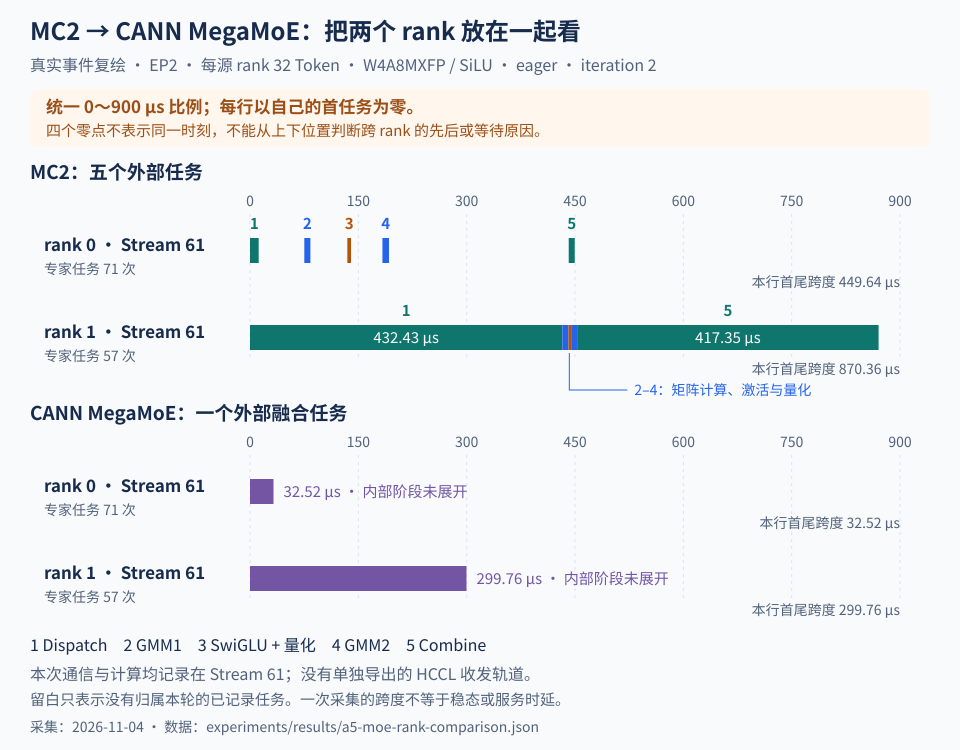
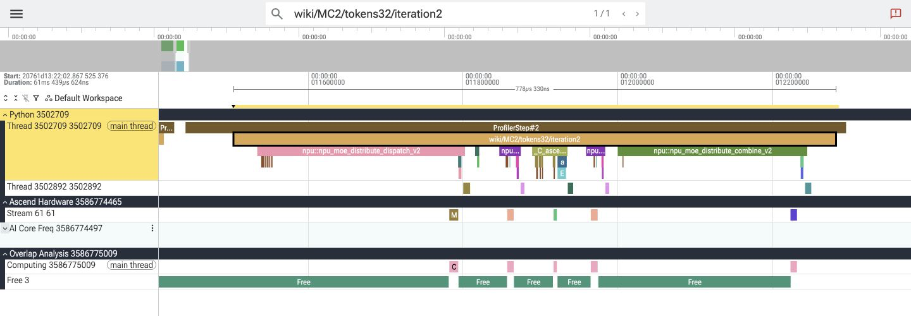
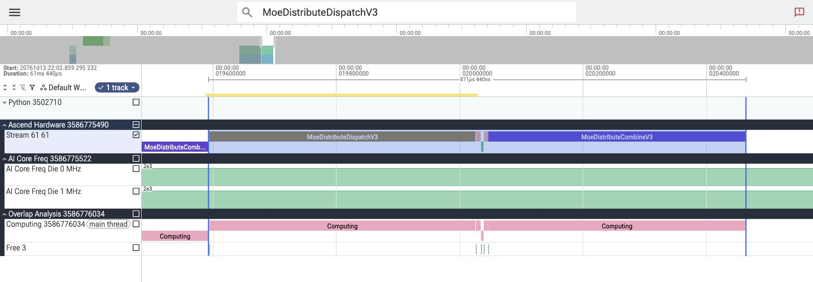
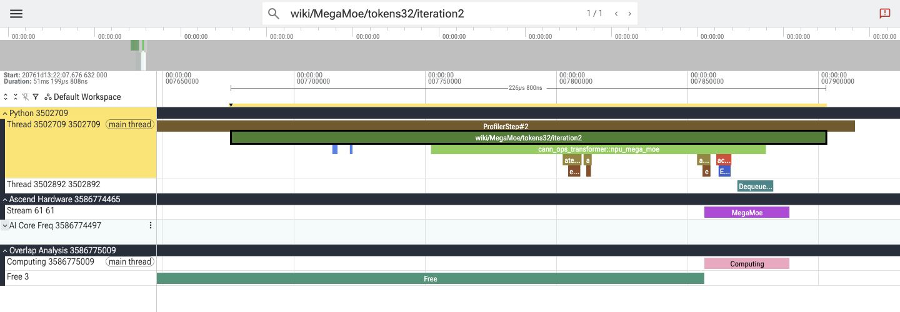
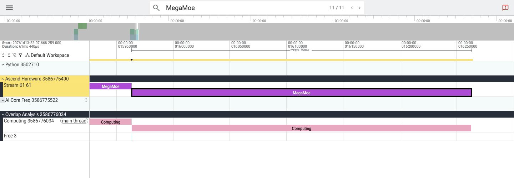

# EP 通信与计算重叠：算子选择与融合执行

一个 Token 选中一位专家，就产生一次专家计算，下面称为“专家任务”。假设一层 MoE 的四个 rank 各承担二十次任务，计算量看起来相同，但它们还要收到输入，并把结果送回原 Token。发送给哪些 rank、同一输入发送几份，都会影响这次往返。

AllGather、AllToAll、MC2 和 MegaMoE 以不同方式组织这次往返。Prefill 与 Decode 的输入行数会改变通信和专家计算的形状。

> 本章以 Ascend 的 EP 实现为主。通信量算例固定四个 rank、TP=1、无 PCP、八个逻辑专家且没有冗余副本，每 rank 两个专家。四十个 token 使用 top-2，产生八十次专家任务。图捕获算例与自定义 Fused-MC2 泳道分别注明自己的输入条件；这些均为教学构造，A5 实操部分另列实测。算子选择条件适用于本章核查的实现。

## Router 选出两个专家后，要发什么？

先看 rank 0 上的一行隐藏状态 `x_i`。它对应一条请求的某个位置，形状可记为 `[H]`。Router 为它选出逻辑专家 E2、E5，并给出权重 `w2、w5`。按当前放置，E2 在 rank 1，E5 在 rank 2。

专家的 FFN 需要这一层的隐藏状态 `x_i`，也叫激活。Token ID 只是词表中的编号，不能代替这个向量。把激活送到专家称为 Dispatch；把专家结果送回并合并称为 Combine。为了正确返回，还要保留目标专家、输入来自哪一行、各段行数和路由权重等信息。它们放在哪个张量、在哪一步使用，取决于具体实现。

```text
原行 i 的 x_i
  ├─ E2 / rank 1 → f_E2(x_i)
  └─ E5 / rank 2 → f_E5(x_i)
原行 i 的结果：y_i = w2 × f_E2(x_i) + w5 × f_E5(x_i)
```



图中的两条专家路径不会产生两个新的输出 token。它们是同一行在一个 MoE 层里的两次专家计算。Combine 后仍要恢复这行的结果，后续层才能继续；新输出 token 则还要经过后面的模型层、输出头和采样。

一个逻辑专家若有多个副本，还要先确定本次使用哪个副本，才能知道发送目标。按专家重新排列输入时，也必须记住每行来自哪里，Combine 才能把结果放回对应的 Token 行。[通信与专家计算的调用边界](https://github.com/vllm-project/vllm-ascend/blob/main/vllm_ascend/ops/fused_moe/moe_comm_method.py) · [路由、计数与结果还原](https://github.com/vllm-project/vllm-ascend/blob/main/vllm_ascend/ops/fused_moe/token_dispatcher.py)

## AllGather 与 AllToAll 的收发路径

先取本章 TP=1 的四 rank 布局，每个 rank 初始持有十行输入。AllGather 让各 rank 获得全部四十行，再由各 rank 只计算自己持有的专家。

AllGather 负责收集输入；ReduceScatter 把各 rank 的专家贡献相加，再把每组输入对应的结果交回原 rank。没有选中本地专家的行，在本 rank 的贡献为零。

```text
AllGather 输入与路由信息
  → 按本地专家筛选、排序和分组计算
  → 还原 token 行并形成各 rank 的贡献
  → ReduceScatter 合并结果，返回本地原行
```

<!-- DETAILS: 源码对照：AllGather 的输入准备、补齐和结果收尾 -->

Ascend 的 `PrepareAndFinalizeWithAllGather` 把跨 rank 的收集和收尾放在 prepare / finalize。普通 DP 路径先按各 DP 最大行数补齐，再收集 hidden states、router logits，最后 ReduceScatter 并裁掉 padding；`TokenDispatcherWithAllGather` 内部主要做本地专家路由与还原。启用序列并行、TP 或 PCP 时，通信组与行布局还会变化，不能把这张四 rank 示意直接当成所有拓扑的调用链。[prepare / finalize 与并行组](https://github.com/vllm-project/vllm-ascend/blob/main/vllm_ascend/ops/fused_moe/prepare_finalize.py)

<!-- /DETAILS -->

AllToAll 类路径先按专家所在的 rank 整理输入，只发给需要它的目标。专家算完后，再把结果送回来源。不同 rank 之间的发送量可以不同，因此除了激活，还要知道每一段发多少行、收多少行，以及怎样恢复原来的顺序。



定向交换减少了发给无关 rank 的激活，但要付出排序、统计发送量和恢复结果的成本。所查 Ascend AllToAllV 还需要把分片长度取到 CPU，再继续通信；这份同步也可能产生等待。[AllToAllV 的预处理与回传](https://github.com/vllm-project/vllm-ascend/blob/main/vllm_ascend/ops/fused_moe/token_dispatcher.py)

因此，两条路线要同时比较数据量和组织这些数据的成本。AllGather 的集合操作规整，但会让没有选中本地专家的行也到达本 rank；定向交换减少这类副本，却需要处理不规则路由。哪条更快，不能只凭通信名称下结论。

<!-- DETAILS: 源码对照：AllToAllV 的分片长度、专家分组和反向交换 -->

### AllToAllV 的张量重排与结果归还

沿 Ascend 的 `TokenDispatcherWithAll2AllV`，设源 rank 的隐藏状态为 `[T,H]`，物理专家 ID 和路由权重均为 `[T,K]`。`_preprocess` 对专家 ID 做直方图，并按目标 rank 求和得到 `input_splits`。各源 rank 再 AllGather 这份直方图，形成 `[EP,E]` 的计数表，`E` 是本次路由使用的物理专家总数。接收者取本地专家的列，沿专家轴求和得到按来源排列的 `output_splits`，沿来源轴求和得到传给 grouped GEMM 的 `group_list`。[直方图与 split 数组](https://github.com/vllm-project/vllm-ascend/blob/1bf75989/vllm_ascend/ops/fused_moe/token_dispatcher.py#L643-L686)

取“每个 token 选下一个 rank 的两位专家”的路由。rank 0 的十行都选 E2、E3，两个专家在 rank 1。rank 0 的 `input_splits=[0,20,0,0]`。rank 1 从 rank 0 接收二十行，所以 `output_splits=[20,0,0,0]`，本地专家计数为 `[10,10]`。`npu_moe_token_permute` 按 `topk_ids.numel()` 生成二十行，原来的每行激活在两个专家的区间各出现一次。[源端重排与 dispatch](https://github.com/vllm-project/vllm-ascend/blob/1bf75989/vllm_ascend/ops/fused_moe/token_dispatcher.py#L502-L584) · [展开行数与排序参数](https://github.com/vllm-project/vllm-ascend/blob/1bf75989/vllm_ascend/ops/fused_moe/token_dispatcher.py#L607-L647)

接收缓冲按来源 rank 分段。多个来源命中同一位专家时，接收侧用第二次重排把它们归到同一个连续专家段，供 grouped GEMM 读取。Combine 先撤销这次重排，再交换 `input_splits` 与 `output_splits` 的收发角色做反向 AllToAll。每个源 rank 最后用自己保存的逆重排索引和 `topk_weights` 归并，恢复 `[T,H]`。这条路径由源 rank 保存权重，并在回收结果时消费。[接收端专家重排](https://github.com/vllm-project/vllm-ascend/blob/1bf75989/vllm_ascend/ops/fused_moe/token_dispatcher.py#L688-L725) · [反向交换](https://github.com/vllm-project/vllm-ascend/blob/1bf75989/vllm_ascend/ops/fused_moe/token_dispatcher.py#L586-L605) · [还原原行和加权](https://github.com/vllm-project/vllm-ascend/blob/1bf75989/vllm_ascend/ops/fused_moe/token_dispatcher.py#L727-L749)

<!-- /DETAILS -->

## 同样八十次专家任务，为什么通信量不同？

把八个专家固定为 `rank 0: E0/E1`、`rank 1: E2/E3`，依次类推。每个源 rank 有十个 token。下面三组构造始终有四十个 token、八十次专家任务，而且每个 rank 都承担二十次任务：

| 构造路由 | 每个 token 选择什么 | 按目标 rank 去重后的远端副本 |
| --- | --- | --- |
| 同一目标 rank 的双专家 | 选下一个 rank 的两位专家 | 40 份 |
| 两个目标 rank | 分别选后续两个 rank 的一位专家 | 80 份 |
| 混合本地与远端 | 每个源前五个 token 选本地双专家，后五个各选后续两个 rank | 40 份 |

这里给定“每个 token 对每个目标 rank 只发一份”的教学规则。同一目标 rank 收到一份激活后，可供该 rank 的两次专家计算使用；本地专家不需要跨 rank 传入。真实后端是否这样去重、在什么阶段展开专家行，应另查实现。

AllGather 对照让每个 token 到达另外三个 rank，远端副本总数固定为 `40×3=120`。选 `H=4096`、BF16，每份激活为 `4096×2=8192 B=8 KiB`，则送达远端的输入激活数据量为：

```text
AllGather 对照：       120 × 8 KiB = 960 KiB
同一远端 rank 双专家：  40 × 8 KiB = 320 KiB
两个远端 rank：         80 × 8 KiB = 640 KiB
混合本地与远端：        40 × 8 KiB = 320 KiB
```

<!-- EP_LAB -->

这里统计的是送达远端的输入激活，不含路由信息、量化尺度、补齐行、协议、结果回传，也没有重复计算中转链路上的搬运。本地计算仍要读取设备内存。因此 `960/320=3` 只表示本例中这一项数据量的比例，不是三倍加速。

Ascend AllToAllV 按专家任务展开行，同一远端 rank 上的双专家各有一行。沿用 BF16、`H=4096`，关闭传输量化，这组路由的 Dispatch 激活量应按 `40×2×8 KiB = 640 KiB` 推导。若专家输出也为 BF16、宽度仍为 4096，源端在归并前还会接回同等大小的结果。这个数对应传输描述的行数，实测链路流量还需计入计数收集与通信实现。[Dispatch 与 Combine 的实际调用](https://github.com/vllm-project/vllm-ascend/blob/1bf75989/vllm_ascend/ops/fused_moe/token_dispatcher.py#L522-L605)

这三组路由的每 rank 专家任务数相同，源 rank 到目的 rank 的流量却不同。评估 EPLB 布局时，两种分布都要核对。

## Prefill 与 Decode 的通信和计算形状

普通单 token Decode 中，一条请求通常只增加一行 query；Prefill 的一个 chunk 可以带来很多行。这会改变本轮输入量，以及分给每个专家的矩阵行数。投机验证又可能让 Decode 请求一次带来多行，所以选择算子时仍要看实际 batch。

对一个专家，设收到 `n_e` 次有效专家任务，FFN 的矩阵乘可以按这个行数组织。较大的 `n_e` 有机会摊薄权重读取和提交成本；很小的 `n_e` 则更容易暴露启动、路由和通信延迟。这是分析形状的起点，实际效率还受量化、分组 GEMM、对齐和设备实现影响。

Decode 一轮包含多次较短调用时，提交、就绪通知和中间处理可能成为显著开销，适合在相同形状下比较不同融合范围的完整执行路径。Prefill 也可能从融合和分块流水获益，大输入还要检查传输吞吐、接收缓冲和大矩阵计算能否匹配。

AllGather 和定向交换也会随形状改变成本。输入多时，要检查全量聚合带来的副本和缓冲压力；输入少时，要检查计数交换、重排、小消息与同步是否占据主要时间。EP 规模和 top-k 又决定一行可能需要到达多少个 rank，节点内与跨节点链路也不能混作同一带宽。

Prefill 或 Decode 这个名称本身不能决定通信方法。有些 Ascend 路径确实会在较大 batch 回到 AllGather，另一些则回到 AllToAll；支持的全链融合路径也可能用于 Prefill。P/D 标签帮助理解负载，真正的选择还要继续追到 token 计数、容量与硬件分支。[运行时通信选择](https://github.com/vllm-project/vllm-ascend/blob/main/vllm_ascend/ascend_forward_context.py)

## Ascend 通信算子的选择条件

框架会结合硬件、EP 规模、量化格式和本轮输入量选择通信方法。容量以内可能使用 MC2，超过容量后则可能转向 AllGather 或 AllToAll；可用的融合路径还可能优先选中。具体分支随硬件变化，不能只按 Prefill、Decode 分类。

<!-- DETAILS: 源码对照：共同入口与 A2、A3、A5 的选择分支 -->

先从 `select_moe_comm_method()` 的共同入口读。非 MoE 不需要选择这条专家通信路径；没有启用 EP，或 EP 组只有一个成员时，会进入 AllGather 类实现，这个类名不表示单成员组还要发生跨卡交换。LoRA 与 EP 的组合则先选择 AllToAll，随后才轮到硬件策略。

下面概括本章核查实现的主要分支，省略模型维度校验等前置条件：

| 硬件策略 | 主要选择条件 | 超出普通 MC2 容量后的路径 |
| --- | --- | --- |
| A2 | 每设备专家数不超过 24、计算出的 EP 规模至少 16，且本轮计数在 MC2 容量内，才走 MC2；否则 AllGather | AllGather |
| A3 | 先检查可用的 CANN MegaMoE；再检查已启用的旧融合路径及 EP≤32 条件；未选融合时，容量内走 MC2 | AllToAll |
| A5 | 可用融合路径优先，MTP drafter 还受量化布局限制；未选融合时，容量内且跨 DP 并行规模大于 1，走 MC2 | 源码的 `world_size_across_dp`≤top-k 时 AllGather，否则 AllToAll |

表中是框架采用的策略，不能据此证明 A2 的 AllGather 在任意大输入上最优，也不能把 A3 的容量分支当成所有硬件的行为。底层算子支持某种产品，也不保证当前框架已把它接进该产品的选择路径。[硬件策略注册](https://github.com/vllm-project/vllm-ascend/blob/main/vllm_ascend/device/hardware_profile.py) · [三个选择函数](https://github.com/vllm-project/vllm-ascend/blob/main/vllm_ascend/ascend_forward_context.py)

<!-- /DETAILS -->

选择函数使用的 Token 数也要查清。Runner 会传入本轮 batch 的 token 计数，并在相关路径取跨 DP 最大值；图 padding、TP 切分和每请求 query 长度又影响后续形状。它不是八十次专家任务，也不能不经核对就当成所有算子实际消费的有效行数。

<!-- DETAILS: 源码对照：用户配置值与运行时融合分支 -->

本章核查的 `enable_fused_mc2` 用户配置有三个取值：0 关闭融合，1 请求旧融合路径，2 请求 CANN MegaMoE。配置初始化会把 2 归一化成内部值 1，再由运行时算子包可用标志区分两条路线。因此后续看到 `enable_fused_mc2 == 1`，还要一起看该标志和 `use_cann_megamoe()`，不能直接认定它只会调用旧算子。

可用性还包括硬件能力、模型、EP 规模和量化等检查。配置值表示请求采用某条路径，不替代实际调用验证；本章也没有在目标机器上执行这些启动组合。[配置校验与归一化](https://github.com/vllm-project/vllm-ascend/blob/main/vllm_ascend/ascend_config.py) · [融合路线的调用方](https://github.com/vllm-project/vllm-ascend/blob/main/vllm_ascend/ops/fused_moe/moe_comm_method.py)

<!-- /DETAILS -->

## 跨 DP 的 FULL_DECODE_ONLY 捕获与回放

设四个 DP rank 分别接了 3、5、0、2 条 Decode 请求，每条本轮只算一个 token，TP=1、EP=4。第三个 rank 没有自己的请求，但它持有的专家仍可能收到其他 rank 的激活。每个 rank 独立挑一个图、空 rank 直接跳过，便不能保证下一层 EP 的参与者和调用顺序对齐。这里要同时解决本地形状匹配与跨 rank 协调。[DP 的同步与 dummy 前向](https://docs.vllm.ai/en/latest/serving/data_parallel_deployment/)

以下沿 ModelRunnerV2 的普通 Decode 路径解释：每条请求本轮都输入一个 Token，源码称为 uniform query。先不加入 PCP、PP、DBO、LoRA 和投机验证。`FULL_DECODE_ONLY` 是配置策略：符合已捕获 Decode 形状的批次使用运行时 `FULL`，其余批次回到 `NONE`。Ascend 沿相同的模式语义执行 ACL graph，具体模型、Attention 和通信算子仍要支持这条路径。[模式语义](https://docs.vllm.ai/en/latest/design/cuda_graphs/) · [Ascend 图执行与后端支持](https://github.com/vllm-project/vllm-ascend/blob/f9c8e0bd/docs/source/user_guide/feature_guide/graph_mode.md)

### 每个 rank 捕获自己的图，使用相同档位

假设预先捕获能容纳 `[1,2,4,8]` 行输入的图，这些容量称为捕获档位。每个 rank 按相同顺序预热和捕获，保存自己设备上的执行图。图内可以包含 MoE 通信，但各设备仍有各自的缓冲地址，通信仍通过 EP 组完成。[描述符与捕获顺序](https://github.com/vllm-project/vllm/blob/ced6857a/vllm/v1/worker/gpu/cudagraph_utils.py#L248-L488)

<!-- DETAILS: 源码对照：捕获条件、NPU 上下文与投机长度对齐 -->

MRV2 的描述符除 `num_tokens` 外还带请求数、uniform query 长度等匹配条件。捕获构造的 `num_tokens_across_dp` 在各项填入相同档位容量；Ascend `ModelAclGraphManager` 继承这段管理流程，捕获时切到 NPU communicator，底层图上下文使用 `torch.npu.graph`。因此启动配置与实际捕获集合需要在参与通信的 rank 间一致，不能只在忙 rank 上单独录图。[捕获输入与 DP 计数](https://github.com/vllm-project/vllm/blob/ced6857a/vllm/v1/worker/gpu/cudagraph_utils.py#L648-L743) · [Ascend 捕获入口](https://github.com/vllm-project/vllm-ascend/blob/f9c8e0bd/vllm_ascend/worker/v2/aclgraph_utils.py#L204-L240) · [NPU 通信与图上下文](https://github.com/vllm-project/vllm-ascend/blob/f9c8e0bd/vllm_ascend/worker/v2/utils.py#L180-L205)

若加入固定的投机 query 长度 `q`，uniform 图的实际 token 数还会向上对齐到 `q` 的倍数，并受最大请求数和最大捕获大小约束。原始配置里的档位数不一定等于最终图数。动态 query 长度和可变长 Decode 又有各自匹配分支，不能直接套用本例的单 token 条件。[uniform 捕获对齐](https://github.com/vllm-project/vllm/blob/ced6857a/vllm/v1/worker/gpu/cudagraph_utils.py#L265-L340) · [Ascend 按实际描述符登记图参数](https://github.com/vllm-project/vllm-ascend/blob/f9c8e0bd/vllm_ascend/worker/v2/aclgraph_utils.py#L56-L68)

<!-- /DETAILS -->

### 一轮请求量不同时，先协调再选共同档位

前向开始前，各 rank 先交换本轮输入量和能否使用图。如果有一个 rank 不满足图执行条件，整组都采用 eager，也就是逐次提交算子。全部满足时，再选一个能容纳最大输入量的共同档位。

<!-- DETAILS: 源码对照：CPU 通信组怎样协调图模式与容量 -->

`dispatch_cg_and_sync_dp()` 先获得本地候选，再由 `sync_cudagraph_and_dp_padding()` 在 DP 的 CPU 通信组上汇总 token 数、候选模式、uniform query 长度、query 上界等字段。普通非 DBO 路径先取模式的最小值；只要一个 rank 选择 `NONE`，整组就回到 eager。全部允许图执行时，再按跨 DP 的最大 token 数和已协调的 query 条件重新匹配描述符，把每个 rank 的运行容量统一到选中的档位。[MRV2 的协调函数](https://github.com/vllm-project/vllm/blob/ced6857a/vllm/v1/worker/gpu/dp_utils.py#L44-L210)

<!-- /DETAILS -->

没有本地请求的 rank 也不能缺席：它还可能需要替其他 rank 计算专家。EngineCore 因此安排一次 dummy 前向，V2 至少放入一行占位输入。本例的真实行数 `[3,5,0,2]` 在协调入口变成 `[3,5,1,2]`；各自先匹配到容量 4、8、1、2，最后统一选择 8。占位输入不产生用户输出，但这个 rank 仍参加本轮 EP。[空闲 DP 的引擎循环](https://github.com/vllm-project/vllm/blob/ced6857a/vllm/v1/engine/core.py#L2204-L2225) · [Ascend dummy 入口](https://github.com/vllm-project/vllm-ascend/blob/f9c8e0bd/vllm_ascend/worker/worker.py#L1432-L1440) · [MRV2 dummy 的 query 形状](https://github.com/vllm-project/vllm/blob/ced6857a/vllm/v1/worker/gpu/model_runner.py#L792-L815)



本例图容量为 `4×8=32` 行，真实请求本轮只贡献 `3+5+0+2=10` 行。剩余 22 行包含 dummy 和 padding，不能记作输出 token 或有效 KV。图中的 EP 节点表示各 rank 按相容的通信顺序执行，块宽没有耗时含义；它也没有假设各 rank 的专家任务数相等。

若第二个 rank 换成五行 Prefill，其本地 batch 就不满足本例的 uniform Decode 图条件，整组转为 `NONE`；其他 rank 仍处理自己的 Decode，只是这一轮不用 full graph。任一 rank 超过最大捕获档位，同样会通过未匹配描述符触发回退。该非 DBO 分支保留各 rank 自己的输入行数，不为图执行强行补到全局最大值。[未命中图的返回值](https://github.com/vllm-project/vllm/blob/ced6857a/vllm/v1/worker/gpu/cudagraph_utils.py#L496-L527) · [全组 eager 分支](https://github.com/vllm-project/vllm/blob/ced6857a/vllm/v1/worker/gpu/dp_utils.py#L156-L173)

### 回放时仍要更新输入，并保持通信路径一致

选中共同档位后，Runner 更新本轮 Token、位置、页表和 Attention 所需信息，再回放图。Ascend 还用单独的更新流修改 Attention 任务参数。回放复用执行结构和图绑定的固定缓冲区。每轮更新的是缓冲区中的 Token、位置、KV 页号等内容；KV 访问位置随请求变化，不等于图绑定的缓冲区地址改变；提交更新也不表示 CPU 已等到设备完成。[MRV2 输入与回放入口](https://github.com/vllm-project/vllm/blob/ced6857a/vllm/v1/worker/gpu/model_runner.py#L1685-L1909) · [Ascend 的参数更新](https://github.com/vllm-project/vllm-ascend/blob/f9c8e0bd/vllm_ascend/worker/v2/aclgraph_utils.py#L126-L202)

通信方法也必须一致。Ascend V2 用跨 DP 的最大 Token 数选择 MoE 通信，避免小批次的 rank 走 MC2、大批次的 rank 走另一条路线。Router 每轮仍可选不同专家，但通信实现必须能在已捕获的容量内处理变化，不能在回放途中随意增加 CPU 分支。[MRV2 跨 DP 统一选择](https://github.com/vllm-project/vllm-ascend/blob/f9c8e0bd/vllm_ascend/platform.py#L727-L744)

例如本章的 AllToAllV 路径会把 split 计数转为 CPU / NumPy 数据。只设置 `FULL_DECODE_ONLY`，不足以证明这条动态 Host 路径能收进 full graph；还要核对实际选择的通信类、量化实现和图支持条件。已有 A5 MC2／MegaMoE 实验采用 eager，尚未验证本节的跨 DP 捕获和回放。后续实测应同时保留各 rank 的协调前后描述符、实际 replay 记录、空 rank 与回退场景，并在同权重、同输入下核对输出，再比较未带 profiler 的整轮时延。[AllToAllV 的 Host split 数据](https://github.com/vllm-project/vllm-ascend/blob/f9c8e0bd/vllm_ascend/ops/fused_moe/token_dispatcher.py#L643-L668)

### 在服务器 CPU 上核对跨 DP 协调

服务器实验启动两个进程，用真实 Gloo CPU 通信验证上述协调规则。测试直接提取固定源码中的协调函数和图匹配方法，函数体未改动；测试程序提供 `[1,2,4,8]` 这组捕获档位和请求形状。它没有启动模型或捕获设备图，验证的是模型图外的模式与容量选择。[脚本与固定来源](https://github.com/Tflowers-0129/inference-wiki/tree/main/experiments/parallel-graph)

| 双 rank 输入场景 | 协调入口 token 数 | 返回模式与各 rank 行数 |
| --- | --- | --- |
| 不等长 Decode | `[3,5]` | FULL，`[8,8]` |
| 第一侧无请求，另一侧 Decode | `[1,5]`，第一侧由夹具提供 dummy | FULL，`[8,8]` |
| 第二侧为五行 Prefill | `[3,5]` | NONE，`[3,5]` |
| 第二侧超过最大捕获档位 | `[3,9]` | NONE，`[3,9]` |
| 两侧都空闲 | `[0,0]` | NONE，`[0,0]` |

五种场景各独立启动两次，共得到 `5 场景×2 rank×2 次=20` 条记录，返回模式和行数全部符合预期。全空闲案例只检查辅助函数返回零行，不表示真实引擎还会执行一次空模型前向。CPU AllReduce、描述符匹配和回退已运行；EP kernel、ACLGraph capture/replay 与服务时延尚未在这组实验中运行。[逐 rank 输入、返回描述符和环境](https://github.com/Tflowers-0129/inference-wiki/blob/main/experiments/parallel-graph/results/dp-protocol-cpu.json)

## MC2 的局部融合与 Fused-MC2 的全链融合

普通 MC2 把发送输入、专家 MLP 和结果回传分成多个外部调用；Fused-MC2 把这整段工作交给一个更大的融合算子。两条路线复用 MC2 的输入准备和收尾布局。源码类分别是 `MC2CommImpl` 与 `FusedMC2CommImpl`，后者覆盖 `fused_experts()`；这个方法名本身不能说明一次调用里融合了多少工作。[两条通信实现](https://github.com/vllm-project/vllm-ascend/blob/main/vllm_ascend/ops/fused_moe/moe_comm_method.py#L136-L196)

### 普通 MC2 的默认局部融合

先固定 W8A8、SiLU、默认开启的 `fusion_ops_gmmswigluquant`。普通 MC2 的主要外部调用是：

```text
npu_moe_distribute_dispatch_v2
  → grouped_matmul_swiglu_quant_weight_nz 〔GMM1 + SwiGLU + Quant〕
  → npu_grouped_matmul                  〔GMM2〕
  → npu_moe_distribute_combine_v2
```

<!-- DETAILS: 源码对照：普通 MC2 的局部融合分支与 tiling -->

专家权重以列表存放时还可能走对应的 tensor-list 接口。只有关闭上述局部融合，才会把中间部分展开为 GMM1、`npu_dequant_swiglu_quant`、GMM2 三个调用。因此普通 MC2 的默认泳道不能直接画成五个完全分离的 Kernel。[W8A8 的局部融合与非融合分支](https://github.com/vllm-project/vllm-ascend/blob/main/vllm_ascend/quantization/methods/w8a8/w8a8_dynamic.py#L415-L552) · [Dispatch / Combine 调用](https://github.com/vllm-project/vllm-ascend/blob/main/vllm_ascend/ops/fused_moe/token_dispatcher.py#L242-L275)

这块局部融合也有不同内部调度：其普通 tiling 先完成主要 GMM 再做向量计算；split-workspace tiling 则通过两份工作区允许下一片矩阵计算与上一片激活、量化交叠。选择受形状和工作区限制影响。下面的默认模拟把它保留成不透明的整体，不借用 Fused-MC2 的 flag 来补画内部时序。[局部融合的两个内核分支](https://github.com/vllm-project/vllm-ascend/blob/main/csrc/gmm/grouped_matmul_swiglu_quant/op_kernel/grouped_matmul_swiglu_quant.cpp#L73-L90) · [tiling 选择](https://github.com/vllm-project/vllm-ascend/blob/main/csrc/gmm/grouped_matmul_swiglu_quant/op_host/grouped_matmul_swiglu_quant_tiling.cpp#L219-L246)

<!-- /DETAILS -->

Python 按顺序提交这几个调用：MLP 等 Dispatch 的输入就绪，Combine 等 MLP 的专家结果就绪。当前普通 routed-expert 主线没有在 Python 里把 Dispatch、MLP、Combine 分别切到三条流；Host 也不必每次等 Device 算完再提交下一项。共享专家的可选多流事件属于另一条协作路径，应与本节分开。[提交与事件位置](https://github.com/vllm-project/vllm-ascend/blob/main/vllm_ascend/ops/fused_moe/moe_comm_method.py#L154-L184)

### 自定义 Fused-MC2 与 CANN MegaMoE

`enable_fused_mc2` 归一化之后，实际调用入口还要看 `FusedMC2CommImpl.fused_experts()` 的分支。

| 路线 | 主要入口 | 执行边界 |
| --- | --- | --- |
| 普通 MC2 | `TokenDispatcherWithMC2`、`apply_moe_mlp()` | Dispatch、MLP、Combine 是不同外部调用；MLP 内可局部融合 |
| 自定义 Fused-MC2 | `torch.ops._C_ascend.dispatch_ffn_combine` | 输入路由、专家 FFN、回传与还原收进一个自定义算子 |
| CANN MegaMoE | `_apply_cann_mega_moe()` 调用算子包接口 | 另一条全链融合实现，使用对应的对称通信缓冲和参数格式 |

Fused 的两条路线都获得权重、路由、概率和通信上下文，但不能把它们的内部调度直接等同。下节能逐行展开的，是仓库内 W8A8 自定义 `dispatch_ffn_combine`；CANN MegaMoE 的内部实现不由这段 C++ 代码证明。[Fused 的两条调用分支](https://github.com/vllm-project/vllm-ascend/blob/main/vllm_ascend/ops/fused_moe/moe_comm_method.py#L563-L615) · [CANN MegaMoE 算子说明](https://gitcode.com/cann/ops-transformer/tree/master/mc2/mega_moe)



图中的五段是计算步骤，不用于数 Kernel。全链融合扩大的是跨 Dispatch、专家计算、Combine 的协作范围；普通 MC2 已有的局部融合仍需保留在比较条件里。DeepGEMM 的同名 Mega MoE 则属于自己的实现，不能据名称互相证明硬件支持或性能。[DeepGEMM Mega MoE](https://github.com/deepseek-ai/DeepGEMM#mega-moe)

## 自定义 Fused-MC2 的通算依赖

一个专家的输入到齐后，能否先开始计算，而不用等其他专家？自定义 W8A8 Fused-MC2 在算子内部安排这种协作：AIC 负责矩阵计算，AIV 负责搬运和向量计算，双方用就绪标记交接。源码入口声明 `KERNEL_TYPE_MIX_AIC_1_2`，AIV 进入 `DispatchAndCombine()`；这里的并行发生在同一算子内部。[混合核入口](https://github.com/vllm-project/vllm-ascend/blob/main/csrc/mc2/dispatch_ffn_combine/op_kernel/dispatch_ffn_combine.cpp#L22-L31)

### AIV 与 AIC 的执行顺序

把同类核的工作聚合起来，可以先读成两行：

```text
AIC 每核：GMM1 的本地专家循环 → 等第一组激活结果 → GMM2 的本地专家循环
AIV：路由/量化与计数交换 → 按专家 Dispatch → 两组 SwiGLU/再量化
     → 跟随 GMM2 进度回传 → 跨 rank 同步 → unpermute / 加权归并
```

<!-- DETAILS: 源码对照：每核顺序、通信窗口和搬运路径 -->

AIC 的顺序是每个核自身的控制流。源码没有在 GMM1 和 GMM2 之间插一个“全设备所有 Cube 都齐了”的屏障，因此聚合图不能用来断言所有 AIC 完成 GMM1 后，任何 AIC 才能开始 GMM2。[AIC / AIV 分支](https://github.com/vllm-project/vllm-ascend/blob/main/csrc/mc2/dispatch_ffn_combine/op_kernel/dispatch_ffn_combine_kernel.hpp#L216-L231)

这条自定义路径用 HCCL 上下文取得本地及远端 window 地址。Dispatch 通过 AIV 的搬运路径，把 peer GM 的激活经 UB 搬到本地 GM；Combine 再把结果写回来源 rank 的窗口。不能据 HCCL 上下文的存在，额外画一条未经确认的独立 HCCL 通信 stream。[通信窗口](https://github.com/vllm-project/vllm-ascend/blob/main/csrc/mc2/dispatch_ffn_combine/op_kernel/utils/hccl_shmem.hpp#L84-L145) · [输入搬运与就绪通知](https://github.com/vllm-project/vllm-ascend/blob/main/csrc/mc2/dispatch_ffn_combine/op_kernel/dispatch_ffn_combine_kernel.hpp#L842-L867)

<!-- /DETAILS -->

### 四个本地专家的就绪与等待

下面用两个 rank、每 rank 四个非空专家观察等待关系，固定 TP=1、W8A8+SiLU，不启用共享专家多流。这与前面四 rank 的副本计数是两个独立例子。专家记作 e0～e3，G1、S、G2 分别表示第一段矩阵计算、SwiGLU/再量化、第二段矩阵计算。先看 e0：它收到输入便可启动 G1，同时 AIV 继续搬运 e1 等专家的输入。后面的交接仍受激活分组和就绪标记约束。

<!-- DETAILS: 源码对照：四个专家的等待点与 Combine 分支 -->

| 交接位置 | 源码中的等待条件 | 四专家示意中的表现 |
| --- | --- | --- |
| Dispatch → GMM1 | 每个本地专家输入完成后发布对应就绪 flag，GMM1 消费前等待 | G1(e0) 可以与 D(e1) 等后续输入搬运交叠 |
| GMM1 → 第一组 S | AIV 先走完全部 Dispatch，再等第一组 GMM1 结果 | `epilogueGranularity=E-1=3`，S0 处理 e0～e2，可与 G1(e3) 交叠 |
| 第一组 S → GMM2 | 当前 AIC 跑完自己的 GMM1，再等第一组向量结果 | G2(e0) 开始；AIV 继续处理第二组 S1(e3) |
| 第二组 S → 后续 GMM2 | `groupIdx+1==epilogueGranularity` 时再次等 flag | 等待发生在 G2(e2) 前，不能擅自挪到 e3 前 |
| GMM2 → Combine | AIV 处理完两组 S 后，再按 GMM2 专家进度等待与回传 | C(e0) 可以与 G2 的后续专家段交叠 |

这里的分组、等待点来自这条 W8A8 内核，不是任意 token 小块的通用规则。[GMM1 等待与两次通知](https://github.com/vllm-project/vllm-ascend/blob/main/csrc/mc2/dispatch_ffn_combine/op_kernel/dispatch_ffn_combine_kernel.hpp#L450-L535) · [GMM2 的第二次等待](https://github.com/vllm-project/vllm-ascend/blob/main/csrc/mc2/dispatch_ffn_combine/op_kernel/dispatch_ffn_combine_kernel.hpp#L555-L591) · [激活分组与回传入口](https://github.com/vllm-project/vllm-ascend/blob/main/csrc/mc2/dispatch_ffn_combine/op_kernel/dispatch_ffn_combine_kernel.hpp#L920-L977)

本 rank 的输入行数 M 与 top-k 的乘积 `M×topK≤4096` 时进入 CombineV2，超过时进入 CombineV1。下面模拟按小输入分支聚合专家进度；真实 CombineV2 继续按 AIC 的 tile 分工和更小的行切片搬运。模拟既没有逐核展开，也没有把四个专家段当成真实 tiling 数。[Combine 分支选择](https://github.com/vllm-project/vllm-ascend/blob/main/csrc/mc2/dispatch_ffn_combine/op_kernel/dispatch_ffn_combine_kernel.hpp#L254-L258) · [更细粒度回传](https://github.com/vllm-project/vllm-ascend/blob/main/csrc/mc2/dispatch_ffn_combine/op_kernel/dispatch_ffn_combine_kernel.hpp#L1025-L1089)

<!-- /DETAILS -->

<!-- EP_TIMELINE -->

默认对照保留普通 MC2 的 GMM1+SwiGLU+Quant 局部融合，只把这个算子的总区间画出来。取消勾选后，才展示关闭局部融合的受控教学配置。两种情况都把 Host 提交与 Device 执行分开，不要求 Host 等每个算子完成才提交下一项。



播放器和静态图使用相同教学时长假设，横轴为自定推进格。块宽、输入晚到和同角色串行都是模型条件，不是实测 Kernel 时长或 stream 编号；默认普通 MC2 局部融合的内部 tiling 未展开，所以也不能拿两图终点计算性能收益。可点击事件，查看源码位置、它需要等待哪些任务，以及哪些后续任务要使用它的结果。

结果回传后还要满足原行输出条件。这条自定义内核明确在 Combine 后进行 `CrossRankSync()`，然后 unpermute 并按概率合并；普通 MC2 的输出则在自身 Combine 接口结果可读后交给下游，不能凭空为它补上同名的显式屏障。融合扩大了协作边界，也保留了这些依赖。[同步与加权还原](https://github.com/vllm-project/vllm-ascend/blob/main/csrc/mc2/dispatch_ffn_combine/op_kernel/dispatch_ffn_combine_kernel.hpp#L957-L977)

## 算子内流水、共享专家多流与 DBO

自定义 Fused-MC2 按专家和激活分组安排算子内流水。满足模型与实现条件时，共享专家计算可以和 routed experts 的部分通信交错。分析这两路工作时，先找出各自的输入就绪点和结果合并点，再检查能否在各自的流上执行。

DBO 在一轮前向内把 batch 拆为两个 microbatch，用一份的计算覆盖另一份的通信。每份仍要保留自己的输入边界、KV 地址和执行状态。vLLM 在 MoE 通信处设置交接点，让两个 microbatch 在通信与计算之间切换。Host 提前安排后续批次则发生在模型前向之外。[DBO 设计](https://docs.vllm.ai/en/latest/design/dbo/)

因此可以分别记录三种粒度：算子内部的数据块、同一前向的独立分支、两份 microbatch。把时间线上的通信和计算放在不同的行，只说明它们被分开记录；要声称发生重叠，还应看到输入已就绪、执行区间实际交叠，并核对后续算子开始使用结果时，还需要等多久。

支持范围也要一起核对。本章所查 Ascend 配置在启用融合 MC2 路线时会关闭共享专家多流选项，不能把二者分别报告的收益直接相加。拆 microbatch 还可能改变每专家的 GEMM 行数和 padding，前后对照需要记录这些变化。[融合与共享专家多流配置](https://github.com/vllm-project/vllm-ascend/blob/main/vllm_ascend/ascend_config.py)

## 融合算子的布局与容量约束

先查量化和布局。通信可以携带量化后的激活及尺度，FFN 又要消费对应的权重格式、尺度与激活函数。CANN MegaMoE 对不同产品支持的组合并不相同；框架还需准备匹配的权重列表、通信缓冲和接口参数。某个 BF16 示例能跑，不能证明同模型的另一量化格式也会走相同内核。[CANN 算子接口](https://gitcode.com/cann/ops-transformer/tree/master/mc2/mega_moe) · [量化与接口适配](https://github.com/vllm-project/vllm-ascend/blob/main/vllm_ascend/ops/fused_moe/moe_utils.py)

融合算子要分别给每 rank 的原始输入行和 Dispatch 后的接收行预留容量。接收行数由所有源 rank 的路由决定，可能远大于本地输入量。全局任务总数相同时，热门专家仍可能让所在 rank 收到更多数据。

当前 CANN 路径的对称缓冲按一致的输入容量建立，另有接收容量设置。`mega_moe_max_tokens` 限制的是接收行数，不能把它当成本地原始输入上限。输入超过已分配容量时，调用方会报错；选择函数优先选中融合分支，也不保证超量后自动切回 AllToAll。[对称缓冲与输入容量检查](https://github.com/vllm-project/vllm-ascend/blob/main/vllm_ascend/ops/fused_moe/moe_comm_method.py)

最后查通信拓扑与实际瓶颈。节点内链路、跨节点 RoCE、通信域规模，以及通信任务与矩阵计算竞争的设备资源，都会影响可以覆盖多少时间。若链路持续是最长的一段，提升计算吞吐甚至可能让通信尾部更明显。融合能否缩短整轮，需要在相同模型、精度、路由和拓扑下对照，不能从算子名字推断。

## 用 Trace 核对算子选择与时延

排查时，把同一轮、同一层的配置输入与实际执行记录放在一起。先记录每 rank 的真实输入行数、padding 后行数、query 长度、top-k、专家任务数，以及本轮选中的通信类和实际算子。P/D 标签可以保留，但它不足以恢复这些字段。

| 要解释的问题 | 需要对齐的证据 | 能排除的误判 |
| --- | --- | --- |
| 为什么这轮走 AllGather / AllToAll / MC2 / 融合路线 | 选择函数输入、硬件策略、容量、量化和有效配置 | 仅凭请求处于 Decode，就认定一定用了 MegaMoE |
| 通信是否真的变少 | 源到目的行数、去重与本地聚合规则、传输格式和链路字节 | 把八十次专家任务直接换成八十份网络载荷 |
| 长通信区间在做什么 | 发送前输入就绪、对端到达、通信事件及后续算子等待输入的区间 | 把等对端生产数据的时间全记成链路慢 |
| 是否形成通算流水 | 相关 rank 的通信与计算区间、分块就绪、计算开始时间 | 把异步 API 返回或两条 stream 当成重叠收益 |
| 融合后服务是否更快 | 同条件的 MoE 层时间、整轮时间、吞吐和 TTFT / ITL / TPOT | 只凭 Kernel 数减少，就认定端到端时延下降 |

对比 AllGather 与定向交换时，固定逻辑路由、专家放置和有效工作量；对比普通 MC2 与全链融合时，还要固定量化、拓扑与可比较的输入形状。若拆批、padding 或专家副本同时改变，就把这些变化单独列出来，否则无法归因。

通信与计算重叠以后，不能再把 Trace 中各区间时长直接相加当作整轮时间。应查看后续算子开始前，还在等待什么：它可能是远端输入、专家结果、回传尾部或缓冲复用。正式采集也要避免随手打印 Device Tensor，防止加入新的 Host 回读。

## A5 实操：MC2 拆分链与 CANN MegaMoE

### 同一份权重与路由的正确性校验

本次使用 Ascend950DT 的两张空闲卡，EP=2、TP=1，八个专家，每 rank 四个，top-k=2，隐藏维度与 FFN 中间维度均为 1024。输入为 BF16，权重与激活采用 W4A8MXFP 路径，激活函数为 SiLU，执行模式为 eager。每 rank 分别输入 8、32 行；不加载模型 checkpoint，也不包含 Attention、Router 网络或在线调度。[固定源码、环境与结果](https://github.com/Tflowers-0129/inference-wiki/blob/main/experiments/results/a5-moe.json)

脚本使用目标实现的权重处理函数，从同一份量化权重分别生成普通 GMM 与 MegaMoE 所需布局。两条链共享输入、top-k 专家 ID 和概率；融合侧直接调用生产 `_apply_cann_mega_moe()` 入口，普通侧按当前测试拆开 Dispatch、GMM1、SwiGLU/量化、GMM2、Combine。权重转换、通信组和对称缓冲初始化放在测量外。本次验证了这些算子的执行，没有覆盖整个配置选择函数。[可复现脚本与来源](https://github.com/Tflowers-0129/inference-wiki/blob/main/experiments/a5-moe.py)

四组 rank／形状结果逐元素一致，最大绝对误差和相对 RMSE 均为 0。独立计数 oracle 先统计各源 rank 的专家 ID，再跨 rank 求和、取本 rank 的专家区间：8 行时两 rank 分别承担 12、20 次任务，总计 `2×8×2=32`；32 行时为 71、57 次，总计 `2×32×2=128`。这也说明同一次对照可以固定不均衡路由，先把算子差异与布局变化分开。

### 设备任务与执行区间

两种形状、两个 rank 的 active iteration 都观察到下列设备任务。表中五段来自本次 W4A8MXFP 拆分链。普通 MC2 的 W8A8 默认局部融合采用另一组条件。

目标源码的 W4A8MXFP+SiLU 生产 MLP 同样先执行 GMM1，再执行 SwiGLU/量化和 GMM2；其中 GMM1 与激活、量化的单算子分支要求 SiTU 等额外条件，本次 SiLU 不触发。这里仍使用直接拆分参考链，没有覆盖生产 prepare／finalize、完整 wrapper 或其他分支。[固定量化实现与来源](https://github.com/Tflowers-0129/inference-wiki/blob/main/experiments/README.md#源码归属)

| 本次 MC2 拆分参考链 | 本次 CANN MegaMoE |
| --- | --- |
| `MoeDistributeDispatchV3` | `MegaMoe` |
| `aclnnGroupedMatmulWeightNz_GroupedMatmul_GroupedMatmul` | 同一个融合任务内，外部 trace 不展开内部阶段 |
| `SwigluGroupQuant` | 同上 |
| 第二个 GroupedMatmul | 同上 |
| `MoeDistributeCombineV3` | 同上 |

<!-- DETAILS: 源码与 Trace 中不同接口层的名称 -->

名称还需按层对齐：Python 调用的是 `npu_moe_distribute_dispatch_v2/combine_v2`，Host trace 记录 `aclnnMoeDistributeDispatchV4/CombineV4`，设备任务名则带 V3。它们属于不同接口层，不能仅凭设备矩形的名字反推 Python 配置。

<!-- /DETAILS -->



先看同一张图里的四行。它们选取每源 rank 32 个 Token、第二个 active iteration，全部保留实际 `Stream 61`。MC2 两卡各有五个外部任务，MegaMoE 两卡各有一个；颜色区分通信、计算和融合任务，条宽来自保存的设备事件，没有为短任务拉长条宽。四行各自以首任务为零，统一使用 0～900 µs 比例，便于比较本地执行过程；这些零点并不表示同一时刻。[双 rank 事件与配对依据](https://github.com/Tflowers-0129/inference-wiki/blob/main/experiments/results/a5-moe-rank-comparison.json)

图中最明显的变化是五个外部任务合成了一个。另一个容易被单 rank 图掩盖的现象是：MC2 的 rank 0 有明显间隙，rank 1 的 Dispatch、Combine 区间却较长。rank 0 普通链的首尾跨度为 449.64 µs，五个任务的时长和为 42.87 µs；融合任务为 32.52 µs。留白只表示没有记录到归属本轮的任务，尚未逐段归因，不能全部标成网络等待；也不能用 rank 0 代表整个通信组。这是一组带 profiling 的执行快照，不是延迟中位数或已对齐时钟的跨 rank 时间线。[原 rank 0 精确数据](https://github.com/Tflowers-0129/inference-wiki/blob/main/experiments/results/a5-moe-swimlane.json)

另在采集外预热，按 MC2→MegaMoE→MegaMoE→MC2 顺序取样，每种方式各 20 个 NPU event 区间，得到以下中位数：

| 每 rank 输入行数 | rank | MC2 区间 / µs | MegaMoE 区间 / µs |
| --- | --- | --- | --- |
| 8 | 0 | 702.99 | 169.75 |
| 8 | 1 | 708.32 | 178.91 |
| 32 | 0 | 770.40 | 160.30 |
| 32 | 1 | 776.58 | 170.31 |

event 包围的是 Python 函数提交的整条链，可能包含设备等待 Host 后续提交及通信伙伴的空隙。它反映这组固定小输入的 eager 执行区间。实验独占这两张设备，同机其他卡仍有服务。大矩阵、graph replay、其他量化或完整模型都需要重新对照。

### 同一轮的双 rank 对照

双 rank 对照取同次实验的每 rank 32 行输入，按 `wiki/MC2/tokens32/iteration2` 和 `wiki/MegaMoe/tokens32/iteration2` 配对。这里沿用正确性校验的权重、输入与不均衡路由。

本组 Level0 导出没有独立的 HCCL 收发轨道、`communication.json` 或可用的集体通信序号。配对依据是同一双进程 job、实现、形状、显式迭代标签及一致的调用顺序；随后在各自文件内沿精确 flow ID 找到设备任务。MC2 与 MegaMoE 各自创建通信组，不能把两条实现的相似编号当成同一个 communicator，也不能把某个 flow ID 当作跨 rank 的消息 ID。[双 rank 原始任务、窗口与正确性记录](https://github.com/Tflowers-0129/inference-wiki/blob/main/experiments/results/a5-moe-rank-comparison.json)

先看 MC2。两卡都是 Dispatch、GMM1、SwiGLU/量化、GMM2、Combine 五个外部设备任务，实际记录在 `Stream 61` 上。任务序列相同，不表示每段耗时、提交间隙或有效专家任务数相同。

<!-- DETAILS: 查看 MC2 两个 rank 的原生 Perfetto 截图 -->





<!-- /DETAILS -->

再看 CANN MegaMoE。两卡各观测到一个外部 `MegaMoe` 任务；这确认了本次调用的融合边界，内部 Dispatch、矩阵与向量计算、回传怎样交错，仍没有从这一级采样展开。

<!-- DETAILS: 查看 CANN MegaMoE 两个 rank 的原生 Perfetto 截图 -->





<!-- /DETAILS -->

| 同一 iteration2 的记录 | rank | 本 rank 专家任务数 | 外部设备任务数 | 关联设备首尾跨度 |
| --- | --- | --- | --- | --- |
| MC2 | 0 | 71 | 5 | 449.64 µs |
| MC2 | 1 | 57 | 5 | 870.36 µs |
| CANN MegaMoE | 0 | 71 | 1 | 32.52 µs |
| CANN MegaMoE | 1 | 57 | 1 | 299.76 µs |

<!-- DETAILS: 复算专家任务数、矩阵形状和接收容量 -->

71 与 57 是 token-expert assignment 数。rank 0 的四位本地专家分别收到 `[15,18,24,14]`，rank 1 为 `[14,15,13,15]`，满足 `71+57=2×32×2=128`。拆分链把这些计数作为 `group_list` 传给两次 grouped GEMM。以 rank 0 第一个专家为例，GMM1 对 15 个有效行做 `[15,1024] × [1024,2048] → [15,2048]`，2048 列包含 gate 与 up 两部分。SwiGLU/量化生成 1024 列供 GMM2 使用，最终仍产生 15 行 1024 维的专家贡献。这里写的是有效计算形状，量化权重和尺度采用脚本中各算子需要的存储布局。[拆分参考链的权重与调用](https://github.com/Tflowers-0129/inference-wiki/blob/main/experiments/a5-moe.py#L86-L225)

本次脚本为 MegaMoE 配置每 rank 32 个原始输入行和 128 个接收行的上限。后者按两个源各 32 行、每行至多两份送到同一目标 rank 预留，实际收到的仍是 71、57。两条实现最终按各自的原始输入行归还 `[32,1024]`，脚本在同一源 rank 上比较输出。[输入和接收容量的配置](https://github.com/Tflowers-0129/inference-wiki/blob/main/experiments/a5-moe.py#L106-L128)

<!-- /DETAILS -->

表中的设备跨度来自单次采集。NPU event 表取多次执行区间的中位数。rank 0 的 32.52 µs 不能代表整个 EP 组。rank 1 的 Dispatch、Combine 区间较长，区间内包含通信和内部同步。本采集缺少每条 peer 消息、发送数据就绪和后续算子等待输入之间的完整因果链，因此对端迟到、链路慢和本卡专家计算慢均待核实。这些数值不用于计算稳态或服务级加速比。

<!-- DETAILS: 采集限制：Host 与设备窗口、flow 归属及未归因任务 -->

这里还有一个定位问题：rank 1 的 Host scope 与其关联设备任务在原始导出轴上相距较远，不能只放大 Host 范围、再把落在范围外的设备任务删掉。图中 rank 1 展示的是精确 flow 找到的设备窗口；rank 0 则保留能同时看到提交与设备链的窗口。每张图独立缩放，画面左边界不是统一起跑线；这些 Host→Device 时间差也不作为已校准的派发延迟。[真实截图来源与选中设备窗口](https://github.com/Tflowers-0129/inference-wiki/blob/main/experiments/results/a5-moe-profiling-screenshots.json)

完整采集还含未归到 active scope 的设备任务。图中只统计经 flow 归属到 iteration2 的任务，留白的原因仍待核实。A5 上的 W4A8MXFP CANN 采集只记录到 `MegaMoe` 的外部设备任务。自定义 W8A8 模拟中的 AIV/AIC flag 关系来自对应内核源码。

<!-- /DETAILS -->

<!-- DETAILS: 实操命令：在 Linux 解析并查看原始 Trace -->

### 在 Linux 上解析并查看 Trace

本次已在服务器的 Linux aarch64 上运行 Perfetto Trace Processor，读取真实 `trace_view.json` 并执行 SQL；随后通过 SSH 转发，把服务器本地解析器接到浏览器 Perfetto UI，实际展开了 Host 线程和 Ascend Hardware 的 stream 泳道。Linux 无桌面也能完成解析，不要求先安装 GUI。官方工具提供 Linux arm64 预编译版本；本次服务器直连二进制下载失败，采用本地下载、核对 SHA256 后传入的方式。[官方下载脚本](https://raw.githubusercontent.com/google/perfetto/main/tools/trace_processor) · [命令行接口](https://perfetto.dev/docs/reference/trace-processor-cli)

把 `TRACE_FILE` 换成自己的文件，已验证的解析与服务命令为：

```sh
TRACE_FILE=/path/to/ASCEND_PROFILER_OUTPUT/trace_view.json
./trace_processor_shell_linux_arm64 query "$TRACE_FILE" \
  'SELECT count(*) AS slice_count FROM slice'
./trace_processor_shell_linux_arm64 server http \
  --ip-address 127.0.0.1 --port 9001 "$TRACE_FILE"
```

本地另开终端运行 `ssh -N -L 9001:127.0.0.1:9001 <SSH别名>`，打开 Perfetto UI，选择匹配版本及“YES, use loaded trace”，即可使用远端解析结果。服务只监听 loopback。小 trace 也可以直接在浏览器打开本地文件；Perfetto 本地查看默认不上传 trace。[远端解析与大 trace](https://perfetto.dev/docs/visualization/large-traces) · [本地数据处理说明](https://perfetto.dev/docs/getting-started/system-tracing)

查看时先定位实验的 `record_function` 范围，再沿原始 flow ID 关联外部调用与设备任务，检查 active iteration 与预热是否混入。本次八份 MoE trace 都能导入 Perfetto，但均出现 flow 的 enclosing-slice 告警；原始导出中也存在 Host→Device 终点早于起点数微秒的情况。因此保留原始 JSON 关联，细粒度派发延迟暂不从这组时间差计算。设备内部阶段或跨 rank 等待，还需要更细的采样及独立时钟校验。

需要 Ascend 专项分析时，MindStudio Insight 提供 Linux x86_64、aarch64 GUI 包；无桌面服务器需配合桌面转发或 VNC。保留完整 `*_ascend_pt` 目录，既可看 Timeline，也保留算子和通信分析所需的 CSV／JSON；只拿走一张截图会丢掉这些证据。[Linux 安装条件](https://msinsight.readthedocs.io/zh-cn/26.1.0/zh/install_guide/mindstudio_insight_install_guide.html) · [采集目录导入](https://www.hiascend.com/doc_center/source/en/mindstudio/830/GUI_baseddevelopmenttool/MindStudioInsight/Insight_userguide_0032.html)

<!-- /DETAILS -->
