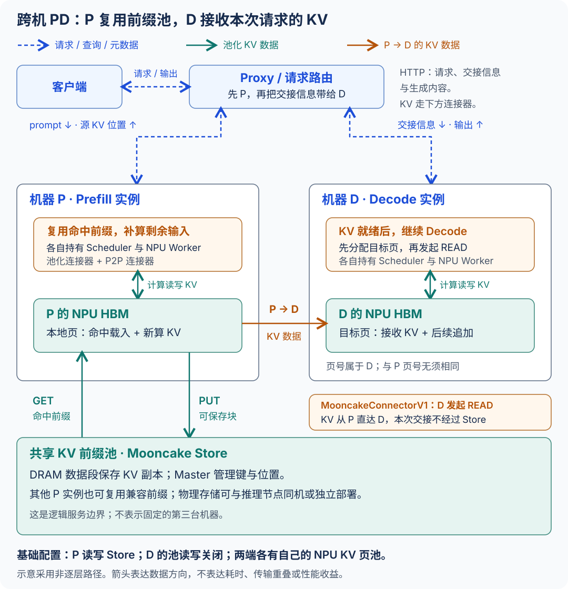
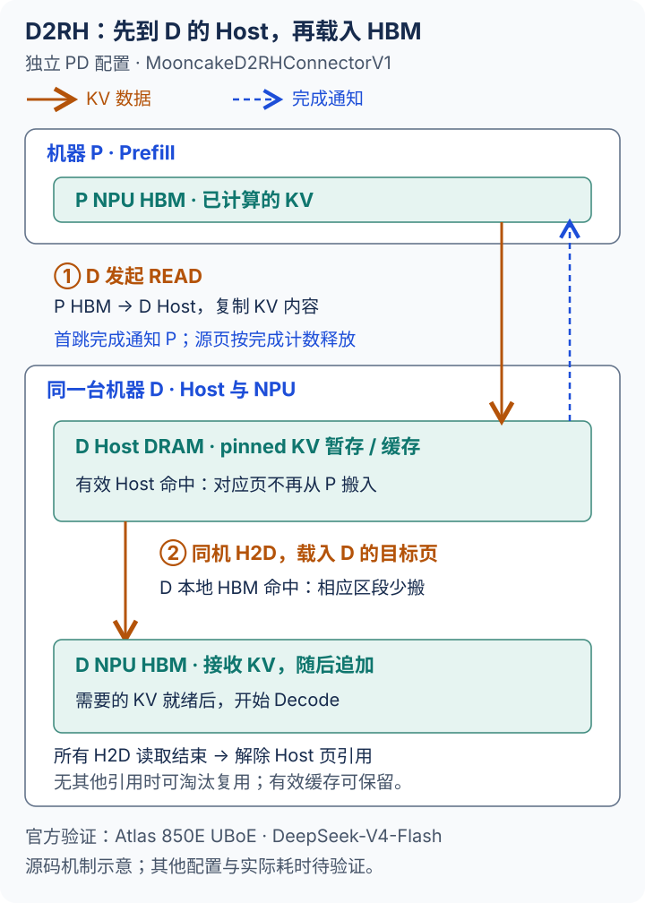

# KV 池化：单机混部与跨机 PD

两条请求共用 128 个 token 的前缀，各带 1 个不同的尾 token。第一条请求算出的 KV 留在哪里？第二条请求换了实例，还能按什么找到它？沿同一个前缀块，看它从 NPU 页写入 Host 内存，再读到另一张页表里。

## 单机混部：一份前缀 KV 怎样存入、读回？

图中 Prefill 与 Decode 共用一个实例，`AscendStoreConnector` 采用 Mooncake 非逐层模式（`kv_both`）。Store 副本落在同机的 Host DRAM，所以写入是 **D2H**，读回是 **H2D**。这里取单层普通 Attention，TP、PP、CP 均为 1，每页 128 个位置，K、V 各有 1 个 64 维的 BF16 头。两份各 16 KiB 的数据组成一个 32 KiB 对象。[混部配置](https://github.com/vllm-project/vllm-ascend/blob/92b6354a/docs/source/user_guide/feature_guide/kv_cache_pool_ascend_store.md#L416-L477) · [Worker 注册各分量地址](https://github.com/vllm-project/vllm-ascend/blob/92b6354a/vllm_ascend/distributed/kv_transfer/kv_pool/ascend_store/pool_worker.py#L750-L825)

第二条请求到来时，假设公共前缀的本地页已被复用，池中副本仍可读。Scheduler 将块哈希、本地命中长度和缓存组发给本实例的查询 Worker。Worker 查到 128 个可复用 token，Scheduler 据此分配目标页。Worker 成功读入第 9 页后，只剩最后 1 个输入 token 要算。若首块仍在本地 HBM，这 32 KiB 就可以原地复用。若两处都没有可用前缀，则需计算全部 129 个输入 token。[查询消息](https://github.com/vllm-project/vllm-ascend/blob/92b6354a/vllm_ascend/distributed/kv_transfer/kv_pool/ascend_store/lookup_key.py#L59-L88) · [命中量与分配](https://github.com/vllm-project/vllm-ascend/blob/92b6354a/vllm_ascend/distributed/kv_transfer/kv_pool/ascend_store/pool_scheduler.py#L247-L402) · [实际 GET](https://github.com/vllm-project/vllm-ascend/blob/92b6354a/vllm_ascend/distributed/kv_transfer/kv_pool/ascend_store/pool_worker.py#L1450-L1512)

<!-- DETAILS: 展开看对象键、块号和两个地址片段 -->

**查找用键，搬运用地址。** 普通完整块的哈希包含父块哈希、本块 token IDs 和适用的额外信息，如 cache salt。Ascend 在哈希前加模型名、DCP、head/TP、PP、缓存组、缓存角色（kv 或 state）和缓存类型等字段。写入者和读取者需使用兼容的权重、缓存布局和键配置。多 rank 配置下，查询端还会检查该组所需的分片，按可恢复的前缀返回长度。[vLLM 块哈希](https://github.com/vllm-project/vllm/blob/ba15685a/vllm/v1/core/kv_cache_utils.py#L703-L732) · [对象键字段](https://github.com/vllm-project/vllm-ascend/blob/92b6354a/vllm_ascend/distributed/kv_transfer/kv_pool/ascend_store/metadata.py#L118-L165) · [分片查询](https://github.com/vllm-project/vllm-ascend/blob/92b6354a/vllm_ascend/distributed/kv_transfer/kv_pool/ascend_store/pool_worker.py#L1047-L1129)

对于图中的完整页，`prepare_value` 在页表找到物理页号，对 K、V 各算一次“视图基址 + 页号 × 该视图页步幅”。本例两个分量各自紧排，取步幅 16,384 B。Worker 把键、地址列表和长度列表交给 `batch_put_from_multi_buffers` 或 `batch_get_into_multi_buffers`。Store 对象中的两个片段依次排列。本地页号、视图基址都可以改变，键仍能指向同一份副本。[地址与长度](https://github.com/vllm-project/vllm-ascend/blob/92b6354a/vllm_ascend/distributed/kv_transfer/kv_pool/ascend_store/metadata.py#L477-L517) · [Store PUT / GET](https://github.com/vllm-project/vllm-ascend/blob/92b6354a/vllm_ascend/distributed/kv_transfer/kv_pool/ascend_store/backend/mooncake_backend.py#L715-L767) · [副本内偏移](https://github.com/kvcache-ai/Mooncake/blob/35f41d98/mooncake-store/src/transfer_task.cpp#L1219-L1237)

默认配置按完整前缀块保存。第 129 个输入单独占用尾页，未凑满第二个传输块。普通加载步骤与保存步骤分开安排，Decode 新生成的 KV 默认留在本地，活动页仍由实例管理。[保存条件](https://github.com/vllm-project/vllm-ascend/blob/92b6354a/vllm_ascend/distributed/kv_transfer/kv_pool/ascend_store/metadata.py#L1129-L1183) · [Decode 保存开关](https://github.com/vllm-project/vllm-ascend/blob/92b6354a/vllm_ascend/distributed/kv_transfer/kv_pool/ascend_store/pool_scheduler.py#L530-L569)

<!-- /DETAILS -->

## 两个 P、两个 D：谁命中，数据从哪台机器来？

图中机器 A 运行 P0、P1，机器 B 运行 D0、D1，每个实例有独立的 HBM 页池。两次请求分别选中 P0/D0、P1/D1。假设机器 C 提供唯一可用的 DRAM 副本，两台 D 的本地前缀均未命中。**rH 表示相对读写 NPU 而言的远端 Host 内存**。实际落点由 Store 按可用内存段和放置偏好决定。[副本偏好](https://github.com/vllm-project/vllm-ascend/blob/92b6354a/vllm_ascend/distributed/kv_transfer/kv_pool/ascend_store/backend/mooncake_backend.py#L626-L631) · [Master 选择内存段](https://github.com/kvcache-ai/Mooncake/blob/35f41d98/mooncake-store/src/master_service.cpp#L4830-L4889)

| 动作 | KV 字节从哪里到哪里 | 本例搬多少 |
| --- | --- | --- |
| P0 冷算，PUT 公共块 | P0 HBM 页 3 → C 的 DRAM 副本。P0 发起 WRITE，方向为 **D2rH** | K、V 合计 32 KiB |
| 随后 P1 本地未命中，GET 公共块 | P1 本实例的查询 Worker 查同一 Store 键。副本已提交且可读，P1 发起 READ，C 的 DRAM → P1 HBM 页 9，方向为 **rH2D** | 32 KiB，另算 1 个尾 token |
| 两个 D 分别接手生成 | D0 发起 READ，从 P0 页 [3,7] 复制到 D0 页 [12,2]。D1 从 P1 页 [9,4] 复制到 D1 页 [6,11] | 每个 D 各搬两整页，即 64 KiB |

这里有两种 READ。**池化 READ** 用对象键查副本，P1 即使从未执行第一条请求，也能把公共前缀搬到自己的页上。**PD READ** 用本次请求选中的 P、源页号和 D 自己的目标页号。在图示的 `MultiConnector` 配置中，`MooncakeConnectorV1` 直接从该 P 的 HBM 交接给一个 D，两个 D 各有自己的接收任务。默认 D 的 Store 读写关闭，另有可选开关。[官方双连接器配置](https://github.com/vllm-project/vllm-ascend/blob/92b6354a/docs/source/user_guide/feature_guide/kv_cache_pool_ascend_store.md#L247-L349) · [D 的接收映射](https://github.com/vllm-project/vllm-ascend/blob/92b6354a/vllm_ascend/distributed/kv_transfer/kv_p2p/mooncake_connector.py#L1947-L2009) · [D 端开关](https://github.com/vllm-project/vllm-ascend/blob/92b6354a/docs/source/user_guide/feature_guide/kv_cache_pool_ascend_store.md#L1603-L1616)

<!-- DETAILS: 展开看远端副本、传输描述符和尾页字节数 -->

PUT 时，Master 根据键、对象长度和放置配置返回副本描述。客户端向副本所在端点提交 WRITE，成功后提交完成状态。GET 时，前缀查询阶段用 `batch_is_exist` 判断哪些键可用，真正搬运时再查询副本描述并提交 READ。Master 处理元数据，Host 数据段由贡献内存的进程持有。[PUT 放置](https://github.com/kvcache-ai/Mooncake/blob/35f41d98/mooncake-store/src/client_service.cpp#L2793-L2805) · [WRITE](https://github.com/kvcache-ai/Mooncake/blob/35f41d98/mooncake-store/src/client_service.cpp#L3029-L3042) · [提交对象](https://github.com/kvcache-ai/Mooncake/blob/35f41d98/mooncake-store/src/client_service.cpp#L3418-L3426) · [存在性查询](https://github.com/vllm-project/vllm-ascend/blob/92b6354a/vllm_ascend/distributed/kv_transfer/kv_pool/ascend_store/backend/mooncake_backend.py#L600-L611) · [GET 的副本查询](https://github.com/kvcache-ai/Mooncake/blob/35f41d98/mooncake-store/src/real_client.cpp#L8764-L8778)

记 C 上副本的起始地址为 s_K。在 Transfer Engine 的分段路径中，第一个片段配对本地 K 地址与远端 s_K，第二个片段配对本地 V 地址与远端 s_K + 16,384 B，每段长度都是 16,384 B。同一组地址在 WRITE 时从本地读、向 C 写，在 READ 时从 C 读、向本地写。D2rH、rH2D 标的是数据端点，传输实现还取决于硬件和 transport 配置，例如 A3 Fabric Memory 可直接访问远端 Host，另有使用中间缓冲区的模式。[TransferRequest 的端点、偏移与长度](https://github.com/kvcache-ai/Mooncake/blob/35f41d98/mooncake-store/src/transfer_task.cpp#L1219-L1242) · [Ascend transport 的缓冲与 Fabric Memory](https://github.com/kvcache-ai/Mooncake/blob/35f41d98/docs/source/design/transfer-engine/transport/ascend_direct_transport.md#L99-L109)

D1 的 P2P 路径使用另一组地址。对每个 K/V 分量，把 P1 页 9 配给 D1 页 6，把 P1 页 4 配给 D1 页 11。四个片段各 16 KiB，D1 用一次 `batch_transfer_sync_read` 提交。第二页只有 1 个有效位置，这条普通全页路径仍复制两页，共 65,536 B。按 129 个有效位置计算则是 33,024 B。[页号到 READ 描述符](https://github.com/vllm-project/vllm-ascend/blob/92b6354a/vllm_ascend/distributed/kv_transfer/kv_p2p/mooncake_connector.py#L1013-L1064) · [P 导出的源页](https://github.com/vllm-project/vllm-ascend/blob/92b6354a/vllm_ascend/distributed/kv_transfer/kv_p2p/mooncake_connector.py#L2075-L2101)

<!-- /DETAILS -->

## 当远端 Host 就在 D 机器上

选用 `MooncakeD2RHConnectorV1` 时，第一跳的接收方变成 **D Worker 注册的 Host 暂存区**。D 上已有有效 Host 缓存的块可以省去第一跳，已有本地 HBM 前缀的部分还可省去第二跳。第一跳完成后可通知 P 释放源页，D 的 Host 页则要等使用它的 H2D 读取全部结束后才解除引用。上游部署示例标明的验证组合为 Atlas 850E（UBoE）与 DeepSeek-V4-Flash。[两跳和两级命中](https://github.com/vllm-project/vllm-ascend/blob/92b6354a/docs/source/developer_guide/Design_Documents/disaggregated_prefill.md#L161-L189) · [首跳 READ 与通知](https://github.com/vllm-project/vllm-ascend/blob/92b6354a/vllm_ascend/distributed/kv_transfer/kv_p2p/mooncake_d2rh_connector.py#L1202-L1238) · [第二跳读取本机暂存](https://github.com/vllm-project/vllm-ascend/blob/92b6354a/vllm_ascend/distributed/kv_transfer/kv_p2p/mooncake_d2rh_connector.py#L1348-L1393) · [官方验证范围](https://github.com/vllm-project/vllm-ascend/blob/92b6354a/docs/source/tutorials/features/pd_disaggregation_mooncake_multi_node.md#L969-L983)

图与地址算例按 2026-11-18 核查的源码绘制。KiB 数值为指定布局下的 KV 载荷推算，池化配置的传输耗时与端到端收益尚待设备实测。[PD 分离系统与 KV 生命周期](PD分离系统与KV生命周期.md)
