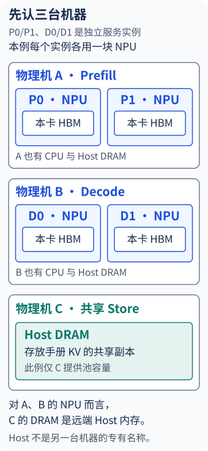
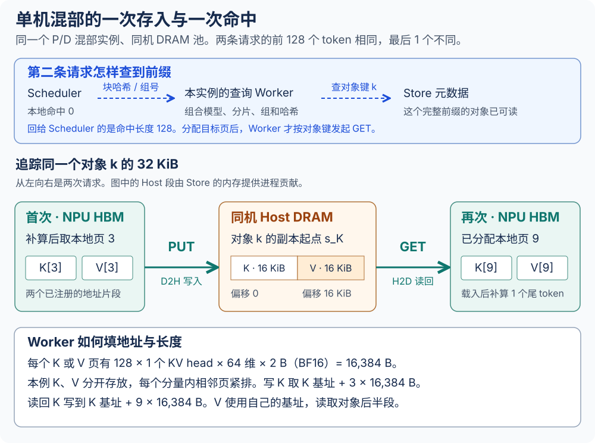

# KV 池化：单机混部与跨机 PD

两个用户把同一本《使用手册》发给模型，问了不同的问题。第一条请求由 P0 处理，第二条换成 P1。P0 算过的哪些 KV 可以留给 P1 复用？P1 怎样找到它们？如果由另一台机器继续生成回答，还需要传哪些 KV？

## 两台 P 机器怎样组成一个共享池？

**机器 A 跑 P0，机器 B 跑 P1。两台机器各拿出一段自己的主机内存，合起来就是本例的共享 KV 池。** P0 和 P1 都负责读输入（Prefill）。同一台机器上，NPU 卡的显存叫 **HBM**，CPU 一侧的主机内存叫 **DRAM**。例如在 A 上，P0 用本卡 HBM 算手册的 KV，又可以把算好的 KV 留一份在 A 贡献的 DRAM 段。

**共享的是什么？** 两个 P 通过同一套 Mooncake Store 按键查找前缀。假设手册保存在 A 段，保修条款保存在 B 段，每个前缀在池中都只存一份。即使 P1 的卡上从没放过手册，它也能找到 A 段里的手册。需要用它计算时，P1 把这份 KV 读进自己的 HBM。KV 就是模型为输入 token 算出的 Key 和 Value，Attention 在本例中从本卡显存读它们。[Mooncake 内嵌客户端与共享内存段](https://github.com/kvcache-ai/Mooncake/blob/35f41d98/docs/source/design/store/mooncake-store.md#L25-L43)

**谁来提供内存？** P0、P1 的 Worker 各自通过 `AscendStoreConnector` 接入 Mooncake。两台机器的 `master_server_address` 指向同一个 Master，各自的 `global_segment_size` 都大于 0。这样两个 Worker 各向池里注册一段本机 DRAM。另一台机器运行 D0、D1，负责接着生成回答（Decode）。本例把它的 Store 贡献容量设为 0，D0、D1 仍可用自己的 HBM 接收 P 交来的 KV。

假设把 `mooncake_master` 也启动在 A。这个进程记录对象键和副本位置。即使它一直运行在 A，某次写入也可以选中 B 段，让手册存进 B 的 DRAM。[Ascend 配置说明](https://github.com/vllm-project/vllm-ascend/blob/0c99d3fc/docs/source/user_guide/feature_guide/kv_cache_pool_ascend_store.md#L145-L155) · [Worker 注册容量](https://github.com/vllm-project/vllm-ascend/blob/0c99d3fc/vllm_ascend/distributed/kv_transfer/kv_pool/ascend_store/backend/mooncake_backend.py#L550-L573) · [Master 的职责](https://github.com/kvcache-ai/Mooncake/blob/35f41d98/docs/source/deployment/mooncake-store-deployment-guide.md#L5-L14)

## 两次请求怎样复用同一份手册的 KV？

把手册缩成恰好 128 个 token，占满一页。两位用户的问题各简写成一个不同的 token，占下一页的第一个位置。Store 用一个键来查找这页手册 KV。下面把这个键简写为 **M**。先跟着“M 存在 A 段”读一遍。B 段已经存了《保修条款》，两位用户都没有用到它。

<!-- POOL_WALK -->

**第一次请求由 P0 和 D0 服务。** 起初 P0 的显存和共享池里都没有手册的 KV。P0 处理完输入，把手册的 KV 写在自己的第 3 页，把第一位用户的问题对应的 KV 写在第 4 页。接下来有两个去向，各有各的用途。

- **给以后的请求留一份。** 假设 Store 为 M 在 A 段分配了空间。P0 把自己显存第 3 页的内容复制到这段 DRAM，写完并成功提交后，M 就可读了。P0 的卡和这段内存在同一台机器，这次写入叫 **D2H**（Device → Host）。本例按完整页保存，只有一个有效位置的第 4 页不单独存成前缀对象。
- **让当前请求继续生成。** D0 的显存里也没有可复用的前缀，先为这条请求分配自己的第 12、13 页。它从 P0 拉取两页，把手册和第一个问题的 KV 都接过来，交接就绪后开始 Decode。这次是 **D2D**，字节从一张卡到另一张卡。D0 的 D 指 Decode，D2D 中的两个 D 都指 Device。共享池的保存和本次交接可以分别进行。[双连接器分工](https://github.com/vllm-project/vllm-ascend/blob/0c99d3fc/docs/source/user_guide/feature_guide/kv_cache_pool_ascend_store.md#L245-L251) · [D 端分配与拉取](https://github.com/vllm-project/vllm-ascend/blob/0c99d3fc/vllm_ascend/distributed/kv_transfer/kv_p2p/mooncake_connector.py#L1947-L2009)

**第二次请求由 P1 和 D1 服务。** 假设此时 P1 的显存中没有手册的 KV，A 段中的 M 仍可读。P1 按键查到 M，获知前 128 个 token 可以复用。**查到的时候，KV 还在机器 A 的 DRAM。** P1 在机器 B 上分配本卡第 9 页，从 A 段把手册 KV 复制进来。站在 P1 这张卡看，A 是远端主机，所以这次读取叫 **rH2D**（remote Host → Device）。P1 的 Attention 现在可以读第 9 页，只需为第二位用户的问题补算一个 token，把它的 KV 写进第 10 页。[查询与可复用长度](https://github.com/vllm-project/vllm-ascend/blob/0c99d3fc/vllm_ascend/distributed/kv_transfer/kv_pool/ascend_store/pool_scheduler.py#L247-L325) · [Store 按地址读入](https://github.com/vllm-project/vllm-ascend/blob/0c99d3fc/vllm_ascend/distributed/kv_transfer/kv_pool/ascend_store/backend/mooncake_backend.py#L748-L767)

此刻，**A 的 DRAM 和 B 上 P1 的显存第 9 页各有一份手册 KV**。B 贡献的那段 DRAM 里仍然只有《保修条款》。P1 的这次读取无需把手册另存进 B 段，用完也无需写回 A。D1 的显存里也没有这段前缀，它要接着回答第二个问题，于是从 P1 的第 9、10 页拉到自己的第 20、21 页。D0 无需为第二条请求收数据。P0 的旧页此时是否仍被本地缓存保留，也不影响这次复用。[完整块保存条件](https://github.com/vllm-project/vllm-ascend/blob/0c99d3fc/vllm_ascend/distributed/kv_transfer/kv_pool/ascend_store/metadata.py#L1153-L1204) · [P 与 D 的页映射](https://github.com/vllm-project/vllm-ascend/blob/0c99d3fc/vllm_ascend/distributed/kv_transfer/kv_p2p/mooncake_connector.py#L1013-L1064)

**如果手册一开始就存到 B 段，哪一跳会变？** 在播放器第 2 步切换“M 落 A 段”和“M 落 B 段”，看 P0 把手册写去哪里。走到第 4 步再切一次，看 P1 从哪里读。两次请求都由原来的卡处理。

| 本次放置 | 第一次，P0 保存手册 | 第二次，P1 读手册 |
| --- | --- | --- |
| M 存在 A 段 | A 的 P0 显存 → A 的 DRAM，**D2H** | A 的 DRAM → B 的 P1 显存，**rH2D** |
| M 存在 B 段 | A 的 P0 显存 → B 的 DRAM，**D2rH** | B 的 DRAM → B 的 P1 显存，**H2D** |

两行是对同一批请求的两种推演，每次只给 M 留一份池内副本。比如优先向本机段分配时，若 A 的段放不下这个对象，Store 可以选有可用空间的 B 段。无论存在哪一段，第二条请求的最后一跳都是 P1 显存 → D1 显存（D2D）。[Ascend 设置放置偏好](https://github.com/vllm-project/vllm-ascend/blob/0c99d3fc/vllm_ascend/distributed/kv_transfer/kv_pool/ascend_store/backend/mooncake_backend.py#L626-L631) · [Master 判断是否优先本机](https://github.com/kvcache-ai/Mooncake/blob/35f41d98/mooncake-store/src/master_service.cpp#L5190-L5197) · [首选段分配失败后的尝试](https://github.com/kvcache-ai/Mooncake/blob/35f41d98/mooncake-store/include/allocation_strategy.h#L377-L435)

**如果有很多个长前缀呢？** 假设手册扩成 384 个 token，即三个完整块，本次请求仍带一个问题 token。池里另有一本从开头就不同的《保修条款》。第二位用户发来手册时，P1 按这条请求从开头匹配。如果手册三个块都在池中而 P1 显存里都没有，P1 读这三个块。如果只有前两个可用，就复用前 256 个 token，余下的输入继续算。《保修条款》留在池里，空闲的 P 和 D 都不用复制。若 P1 自己的显存已有可复用的前缀页，对应部分也省去相应的 Store 读取。[连续前缀与多分片查询](https://github.com/vllm-project/vllm-ascend/blob/0c99d3fc/vllm_ascend/distributed/kv_transfer/kv_pool/ascend_store/pool_worker.py#L1132-L1218)

## 池化和 PD 分离各负责哪一次传输？

**池化管跨请求复用。** 第二位用户即使分到一台从未读过手册的 P，只要连接同一 Store、配置兼容且对象还在，就可以取回手册的 KV。**PD 分离管同一条请求换设备续算。** 哪怕所有用户的输入都不同、共享前缀一次也没命中，选中的 D 仍需要拿到这条请求在 P 上算出的 KV。图中 D0、D1 的 Store 读写按默认设置关闭，由各自的 P 直接交接。[连接器组合](https://github.com/vllm-project/vllm-ascend/blob/0c99d3fc/docs/source/user_guide/feature_guide/kv_cache_pool_ascend_store.md#L245-L251) · [D 端独立开关](https://github.com/vllm-project/vllm-ascend/blob/0c99d3fc/docs/source/user_guide/feature_guide/kv_cache_pool_ascend_store.md#L1603-L1616)

| 部署 | 后来的请求怎样复用手册 | 当前请求怎样从 Prefill 走到 Decode |
| --- | --- | --- |
| 单机混部，开共享池 | 本卡没命中，可以从 Store 读回 | 同一实例在自己的显存页上接着算 |
| 跨机 PD，只开直接交接 | 各实例可用自己的本地前缀缓存 | D 从选中的 P 接收自己缺的 KV |
| 跨机 PD，再开共享池 | P1 按键找到 P0 存入共享池的 M | D1 仍从 P1 接收当前请求缺的 KV |

回到单机混部。假设 Store 的副本放在这台机器自己的 DRAM，第二次请求到来时，本卡原有的手册页已被换用。第一次存入走 **D2H**（卡 → 本机内存），第二次读回走 **H2D**（本机内存 → 卡）。两次请求之间可以复用 KV，而同一请求从 Prefill 转入 Decode 时一直用同一张卡。[混部部署示例](https://github.com/vllm-project/vllm-ascend/blob/0c99d3fc/docs/source/user_guide/feature_guide/kv_cache_pool_ascend_store.md#L416-L477)

<!-- COLLAPSIBLE_FIGURE: 看单机图：同一张卡怎样写入和读回 M -->

## P1 读手册时，谁查键，谁分配页，谁搬字节？

从 P1 查到 128 个可用 token，到 Attention 真能读第 9 页，中间经过这些组件。图里的 P0、P1、D0、D1 各有自己的调度器和执行计算的 Worker。P0 和 P1 通过各自的客户端访问同一个 Store。

| 谁 | 在第二条请求里具体做什么 |
| --- | --- |
| P1 的 Scheduler（调度器） | 确认本地已命中的长度，向连接器询问还能复用多少，再为请求安排本地页。页号 9 属于 P1。 |
| P1 的 AscendStoreConnector、Worker 中的查询线程 | 在查询阶段组合前缀键，查 Store 中哪些块可用，向调度器返回命中长度。随后执行侧 Worker 按本地页表准备 K、V 的目标地址，向 Store 客户端发起 GET。 |
| Mooncake Store 的 Master 和内存提供进程 | Master 管对象键与副本位置。A、B 的 Worker 提供内存段。沿用图中的放置结果，Master 记录 M 在 A 段，保存 KV 字节的是 A 机器的 DRAM。 |
| Mooncake 的 Transfer Engine（传输引擎） | 客户端取得副本描述后，向传输引擎提交 READ，把 A 段内 M 的字节复制到 B 上 P1 提供的显存地址。读完后 P1 才能使用这一页。 |

同一套部署里还有一条独立的调用路径。vLLM 的 **MultiConnector** 把两个连接器接到实例上。**AscendStoreConnector** 按对象键访问共享池，**MooncakeConnectorV1** 负责本次 PD 拉取，由 D 根据请求指定的 P 端点和源页号，将 KV 读入自己的目标页。第一条路径查找可供其他请求复用的前缀，第二条路径传输当前请求继续生成所需的 KV。两者都可以使用 Mooncake 传输数据。[调度器和 Worker 入口](https://github.com/vllm-project/vllm-ascend/blob/0c99d3fc/vllm_ascend/distributed/kv_transfer/kv_pool/ascend_store/ascend_store_connector.py#L190-L201) · [查询消息与键](https://github.com/vllm-project/vllm-ascend/blob/0c99d3fc/vllm_ascend/distributed/kv_transfer/kv_pool/ascend_store/lookup_key.py#L59-L88) · [Store 的存在性查询](https://github.com/vllm-project/vllm-ascend/blob/0c99d3fc/vllm_ascend/distributed/kv_transfer/kv_pool/ascend_store/backend/mooncake_backend.py#L600-L631) · [客户端获取副本描述](https://github.com/kvcache-ai/Mooncake/blob/35f41d98/mooncake-store/src/real_client.cpp#L8764-L8778) · [传输引擎的地址与方向](https://github.com/kvcache-ai/Mooncake/blob/35f41d98/mooncake-store/src/transfer_task.cpp#L1219-L1242)

## 同一块手册 KV，在四处分别是什么地址？

**M 是共享池中的对象键。** P1 用它查找副本，无需知道 P0 原来的页号。开始复制时，才需要源地址和目标地址。下面取单层普通 Attention、单卡、无投机，每个请求的物理页和共享缓存块都是 128 个 token。每个位置的 K 和 V 各有一个 64 维的 BF16 头。一个 K 页占 128 × 64 × 2 B = **16 KiB**，同样大小的 V 页合起来是 **32 KiB**。各卡的 K、V 分开存放，K、V 各自的物理页连续排列。图中的页号均为示例值。

| 存放位置 | 找到手册 K 的起始地址 | 找到同一页的 V |
| --- | --- | --- |
| A，P0，显存页 3 | P0 的 K 基址 + 3 × 16 KiB | P0 的 V 基址 + 3 × 16 KiB |
| A，贡献给 Store 的 DRAM 段，对象 M | 副本在 A 段中的起始地址 s | s + 16 KiB |
| B，P1，显存页 9 | P1 的 K 基址 + 9 × 16 KiB | P1 的 V 基址 + 9 × 16 KiB |
| Decode 机，D1，显存页 20 | D1 的 K 基址 + 20 × 16 KiB | D1 的 V 基址 + 20 × 16 KiB |

如果最初选中 B 段，表中第二行的源地址就换成 M 在 B 段的地址。P1 的目标仍是自己的显存第 9 页。不论源在哪台机器，P1 都只读手册这一页，合计 **32 KiB**。D1 从 P1 接手第二条请求，要取第 9、10 两页。在本例普通 Attention 的整页拉取路径里，即使尾页只有一个位置有效，也按两整页复制，合计 **64 KiB**。129 个有效位置本身只占 129 × 64 × 2 B × 2 = **33,024 B**。D1 按有效长度读这 129 个位置。[Worker 按块表计算分量地址](https://github.com/vllm-project/vllm-ascend/blob/0c99d3fc/vllm_ascend/distributed/kv_transfer/kv_pool/ascend_store/metadata.py#L477-L517) · [D 端按步幅组织整页 READ](https://github.com/vllm-project/vllm-ascend/blob/0c99d3fc/vllm_ascend/distributed/kv_transfer/kv_p2p/mooncake_connector.py#L1013-L1064)

<!-- DETAILS: 看源码中的 M、PUT 和 GET -->

M 是教学简写。两个 P 访问同一 Store，并使用相同的租户命名空间（本例沿用默认的 `tenant_id`）。普通完整块的哈希包含前一块的哈希、本块的 token IDs 和适用的额外信息，例如 cache salt。Ascend 还会在对象键中加入模型名、DCP、head/TP、PP、缓存组、缓存角色和缓存类型。两个请求能否匹配同一个键，取决于前缀 token 是否相同，以及模型、分片和缓存配置是否兼容。[Mooncake 租户配置](https://github.com/vllm-project/vllm-ascend/blob/0c99d3fc/docs/source/user_guide/feature_guide/kv_cache_pool_ascend_store.md#L158-L160) · [vLLM 块哈希](https://github.com/vllm-project/vllm/blob/ba15685a/vllm/v1/core/kv_cache_utils.py#L703-L732) · [Ascend 对象键](https://github.com/vllm-project/vllm-ascend/blob/0c99d3fc/vllm_ascend/distributed/kv_transfer/kv_pool/ascend_store/metadata.py#L118-L167)

本例的非逐层路径中，查询调用 `batch_is_exist`。存入时，客户端取得放置结果后用 WRITE 把 K、V 片段放到副本相应偏移，成功提交对象。读回时，Worker 将键、本卡地址和长度交给 `batch_get_into_multi_buffers`，客户端取得副本描述并发起 READ。不同的硬件和传输配置可能经中间缓冲区。D2rH、rH2D 描述的是起点和终点。[Store PUT / GET](https://github.com/vllm-project/vllm-ascend/blob/0c99d3fc/vllm_ascend/distributed/kv_transfer/kv_pool/ascend_store/backend/mooncake_backend.py#L715-L767) · [提交可读对象](https://github.com/kvcache-ai/Mooncake/blob/35f41d98/mooncake-store/src/client_service.cpp#L3418-L3426) · [Ascend transport 的传输模式](https://github.com/kvcache-ai/Mooncake/blob/35f41d98/docs/source/design/transfer-engine/transport/ascend_direct_transport.md#L99-L109)

<!-- /DETAILS -->

## 更换配置后，KV 的传输路径怎样变化？

**逐层 D2D 改的是 P1 → D1。** 假设 D1 已经准备好目标页。模型有多层时，P1 可以在第 1 层可发送的 KV 写好后就提交传输，继续算后面的层。这样有机会缩短最后一层算完后的交接等待。Ascend 主干已有实验性的 Mooncake V2 逐层推送，D 等本次交接所需的发送端完成后才报告就绪。若手册放在 A 段，P1 从 A 读前缀仍走 rH2D。[Ascend 已合入的逐层推送 PR](https://github.com/vllm-project/vllm-ascend/pull/20940) · [两端的完成条件](https://github.com/vllm-project/vllm-ascend/blob/0c99d3fc/docs/source/developer_guide/Design_Documents/disaggregated_prefill.md#L65-L126)

**池化本身也可以逐层。** 此时分层的是共享 DRAM 段与 P 的显存之间的存取。例如 P1 算当前层时预取下一层的 KV，当前层开算前仍要等自己的数据就绪。社区 RFC 进一步提出让加载、PD 交接、消费确认和块回收按相同粒度配合，以便更早腾出工作页。具体回收哪一侧的资源仍是 RFC 的开放问题。截至 2026 年 11 月 18 日，上游逐层直写 PR 仍在评审。另有一份 Ascend 草案让 P 发布到 DRAM 池、D 从池取回，复用同一批对象来做 PD 交接。[池化逐层读写](https://github.com/vllm-project/vllm-ascend/blob/0c99d3fc/docs/source/user_guide/feature_guide/mooncake_layerwise_adaptation_and_optimization.md#L43-L82) · [含现状图与规划图的 RFC](https://github.com/vllm-project/vllm/issues/61787) · [上游逐层直写 PR](https://github.com/vllm-project/vllm/pull/62504) · [经 DRAM 池交接的草案](https://github.com/vllm-project/vllm-ascend/pull/21000)

<!-- DETAILS: 另一种已实现的两跳交接：先落在 D 所在机器的主机内存 -->

选用 `MooncakeD2RHConnectorV1` 时，D 的 Worker 可以先把 P 的 KV 拉入 D 机器注册的 Host 暂存区，再从这台机器的 DRAM 载入本卡 HBM。套用开头的机器名，就是 **P 机 B 上的 P1 显存 → Decode 机的主机暂存区 → 同一台 Decode 机上的 D1 显存**。第一跳从 P1 看是 D2rH，第二跳从 D1 看是同机 H2D。暂存区由 D 的 Worker 注册，服务于本次交接。若 D 的主机内存中已有有效副本，对应块就可省去第一跳，已有本地 HBM 前缀也可减少第二跳。首跳完成后可通知 P 释放源页。所有依赖的 H2D 结束后，D 才解除 Host 页引用。[两跳与两级命中](https://github.com/vllm-project/vllm-ascend/blob/0c99d3fc/docs/source/developer_guide/Design_Documents/disaggregated_prefill.md#L161-L189) · [官方验证的硬件与模型](https://github.com/vllm-project/vllm-ascend/blob/0c99d3fc/docs/source/tutorials/features/pd_disaggregation_mooncake_multi_node.md#L969-L983)

<!-- /DETAILS -->

本章页号和数据量来自教学算例，箭头表示复制方向。有关实际多卡服务中的地址、传输与完成时序，见相邻章节保存的拉取与推送实验。这里的池化组合及其性能尚待设备实测。[PD 分离系统与 KV 生命周期](PD分离系统与KV生命周期.md)
