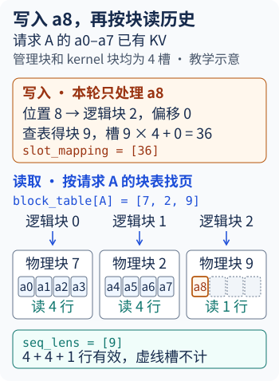
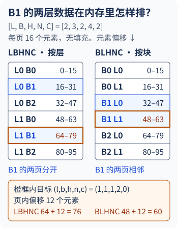

# KV 缓存布局与递归状态

第二章的请求 A 已经算完位置 0～7 的 KV。上一轮采样得到 `a8`，这一轮把它送进模型。在普通因果 Attention 层里，本轮只计算位置 8 的 Q、K、V，Q 却要用到位置 0～8 的 K、V。位置 8 的新 K、V 写到哪里？同一层接下来怎样把分散在设备上的九行历史读回来？[从一轮调度到一次前向](从一轮调度到一次前向.md)

到了 MLA，历史的一行可以是一份压缩 latent。稀疏 Attention 还要先选出本轮要读的位置，某些模型会再压缩历史的行数。Mamba 和 KDA 的后续计算则从某个位置的状态接续，页里保存的是续算快照。

> A 的算例使用缩小的块长，无投机、无上下文分片。模型算例按各自链接的源码、配置和运行条件记账。形状、容量与服务参数依据源码和部署文档核对。本章的服务步骤供复查实际张量。

## 1. 请求 A 怎样从两页接到第三页？

如果把每条请求的历史放在一段连续内存，A 从八个位置长到九个位置时，原缓冲区得留有空位，否则就需要扩容和搬迁。分页缓存把增长单位改成块。A 的历史已经占用两个物理块，调度器在本轮为 A 追加一个空闲块。原有两块留在原处。下面用每块 4 个位置的教学参数，沿用第二章的物理块编号。[调度器调用 allocate_slots](https://github.com/vllm-project/vllm/blob/5df63a72/vllm/v1/core/sched/scheduler.py#L776-L788) · [块表算例](从一轮调度到一次前向.md)

| A 的请求内位置 | 逻辑块号 | 块表中的物理块号 | 本轮写入完成后有效的页内行 |
| --- | --- | --- | --- |
| 0～3 | 0 | 7 | 0～3 |
| 4～7 | 1 | 2 | 0～3 |
| 8 | 2 | 9 | 0 |

块表 `[7,2,9]` 以 A 的逻辑块号为下标，给出页池里的物理块号。新行的 `position=8`，所以 `8 // 4=2`、`8 % 4=0`。Runner 从表里查到 9，给这行生成写入用的 `slot_mapping=9×4+0=36`。36 是本层缓存的扁平 token 槽号，真正的字节地址还要用该层视图的 stride 计算。这里的 `block_size=4` 在管理侧和 kernel 侧相同。[GPU 写槽计算](https://github.com/vllm-project/vllm/blob/5df63a72/vllm/v1/worker/gpu/block_table.py#L308-L353)

<!-- KV_DECODE_PLAYER -->

<!-- COLLAPSIBLE_FIGURE: 查看写槽与读页静态图 -->


写完 A 的新 K、V 后，这次因果 Attention 的有效长度是 9。它按逻辑顺序看物理块 7、2、9，三块分别有 4、4、1 个位置参与计算。块 9 的其余 3 行已经留在分配范围里，等后续位置写入。本轮 Attention 只用当前 Q 和这九个位置的 K、V 计算输出。

## 2. 哪些层使用同一张块表？

A 的块表还缺一个身份，即缓存组 ID。上游用 `KVCacheGroupSpec` 描述共用一张块表的层。在全量 Attention 模型的同一缓存组里，A 查到物理块 9，组内每层都用 9 定位到**本层**的一页。各层的 K、V 由各自的投影产生。到了滑窗、压缩历史或递归状态混用的模型，各类页的保留周期和可寻址单位可能不同，管理器按缓存规格建立相应的组。[上游组定义](https://github.com/vllm-project/vllm/blob/5df63a72/vllm/v1/kv_cache_interface.py#L1432-L1472) · [缓存组与分配构造](https://github.com/vllm-project/vllm/blob/5df63a72/vllm/v1/core/kv_cache_utils.py)

| 对象 | 谁持有 | 在地址链上的用途 |
| --- | --- | --- |
| `KVCacheSpec` | 缓存层与分配计划 | 描述一层的页规格，例如 `block_size`、每页字节数、dtype、滑窗范围或状态组件 |
| `KVCacheGroupSpec` | Cache Manager 与 Runner | 组织层名和组规格。管理器为每条请求在各组维护块号，Runner 按组准备块表 |
| `AttentionGroup` | Runner | 本例的 GPU ModelRunnerV2 在一个缓存组内，按 backend、层 spec 和本地 Q head 数组织 metadata builder |
| `KVCacheTensor` | 分配计划 | 描述一段 backing storage 的大小、层槽、起点、层步幅和块步幅 |

一个缓存组可以供多个 metadata builder 使用。组和物理分配也各有自己的边界，例如分配计划可以让不同组的层覆盖同一片 backing storage，由块号的归属决定谁能写。还有模型会让后层显式读前层的一份 KV，这时需要查共享的源层。GQA 里的「组」则出现在单层内部，描述哪些 Q heads 共用一套 K/V heads。[GPU Runner 分组](https://github.com/vllm-project/vllm/blob/5df63a72/vllm/v1/worker/gpu/attn_utils.py#L196-L280) · [物理分配描述](https://github.com/vllm-project/vllm/blob/5df63a72/vllm/v1/kv_cache_interface.py#L1408-L1429)

## 3. 页覆盖多少位置，实际存多少行？

计算 A 的写槽时，4 是管理器给请求追加一个块所能覆盖的位置数。算子还有自己的块长约束。在所查的上游 GPU ModelRunnerV2 中，Runner 给每个缓存组选择同组 backend 支持的 kernel block size。读取侧的 `AttentionGroup` 可把管理块表展开成 kernel 块表，同时给算子提供相应的缓存视图。[选择 kernel block size](https://github.com/vllm-project/vllm/blob/5df63a72/vllm/v1/worker/utils.py#L515-L682) · [读块表转换](https://github.com/vllm-project/vllm/blob/5df63a72/vllm/v1/worker/utils.py#L368-L395)

以一张单层紧密排布的普通 KV 页为例，假设管理块长为 8，kernel 块长为 4。管理块 3 的八行连续分成 kernel 块 6、7，管理块 2 分成 kernel 块 4、5。管理表 `[3,2]` 因此在读侧展开成 `[6,7,4,5]`。若本轮写位置 13，管理侧得到槽 `2×8+5=21`。读取侧算出 `5×4+1=21`，两种坐标指向同一行。这组小数字用于说明换算。紧密的普通页可以按这个规则切分。所查通用视图代码会检查 manager block 的 stride 是否等于未填充的页大小。[紧密页切分约束](https://github.com/vllm-project/vllm/blob/5df63a72/vllm/v1/kv_cache_interface.py#L377-L425)

每页字节数要从实际存储行数算起。普通 KV 每个位置有一行。压缩历史可能每 4 个原始位置才生成一行，一页覆盖 128 个位置时只为 32 条压缩记录留空间。递归状态的一行则保存一份续算快照。取有效载荷时，把每种组件的元素数乘各自 dtype 的字节数，再把组件相加。取实际分配时，还要核对尺度字段、对齐、页尾 padding、组间复用和池中块数。[状态粒度和页容量接口](https://github.com/vllm-project/vllm/blob/5df63a72/vllm/v1/kv_cache_interface.py#L205-L263)

## 4. 同一张块表，BLHNC 和 LBHNC 怎样寻址？

A 的块表给出了 `b`，位置除以块长的余数给出了 `n`。现在加上层、head 和通道，才可以计算元素地址。上游 `KVCacheLayout` 用 `[L,B,H,N,C]` 描述逻辑坐标，枚举名按物理内存从外到内排列。[布局枚举](https://github.com/vllm-project/vllm/blob/ced6857a/vllm/v1/kv_cache_layout.py)

| 轴 | 在普通 KV 中的单位 | 读哪份配置或 metadata |
| --- | --- | --- |
| `L` | 当前分配的层槽数 | 分配计划的层列表。单层 view 已经选定该轴 |
| `B` | 池中物理块数 | 块分配及 kernel 块切分。请求 batch 有独立的轴 |
| `H` | 每 rank 的 KV heads | 模型头数、TP 切分或复制 |
| `N` | 一张 kernel 页的 token 槽数 | 普通 KV 取 kernel block size。压缩页取实际存储行数 |
| `C` | 每个 head、每行的内容宽度 | 例如等宽 K/V 合在一起时为 `2D` 个元素，打包格式可能以字节计 |

只交换最外面两轴就能看出差别。取 `L=2,B=3,H=2,N=4,C=2` 的紧密分配，一页有 16 个元素。用另一条教学请求的块表 `[2,1]`，位置 6 对应 B1 的第 2 行。选层 1、head 1、内容第 0 项，逻辑坐标为 `(1,1,1,2,0)`，页内元素偏移 `(1×4+2)×2=12`。



```text
LBHNC  (l×B+b)×16+12 = (1×3+1)×16+12 = 76
BLHNC  (b×L+l)×16+12 = (1×2+1)×16+12 = 60
```

选定层 1 后，两种布局都可以暴露 `[3,2,4,2]` 的 `[B,H,N,C]` 视图。LBHNC 的块 stride 是 16 个元素，BLHNC 的块 stride 是 32 个元素，因为到本层下一块之前还跨过另一层的一页。实际 PyTorch 视图的元素偏移等于 `storage_offset + Σ(坐标 × stride)`。乘上 `element_size()` 才得到从 backing storage 起点计的字节偏移。[视图构造](https://github.com/vllm-project/vllm/blob/5df63a72/vllm/v1/kv_cache_interface.py#L377-L441)

### vLLM 与 vLLM-Ascend 的布局由谁选？

这里对照的四种布局由层／块顺序 `LB/BL` 与页内顺序 `HNC/NHC` 组合而来。布局解析接受旧别名 `HND`（`LBHNC`）和 `NHD`（`LBNHC`）。传给 FlashInfer wrapper 的 `HND/NHD` 只描述页内次序，所以 `BLHNC` 和 `LBHNC` 都可以对应 wrapper 的 `HND`。[上游布局解析](https://github.com/vllm-project/vllm/blob/ced6857a/vllm/v1/attention/backends/utils.py)

上游 NIXL 文档中，非 MLA 路径默认用 `LBHNC`。在文档列出的跨层连续传输场景下，`VLLM_KV_CACHE_LAYOUT=BLHNC` 可让同一物理块的各层数据连续。Ascend MooncakeConnectorV2 的普通 GQA 部署则要求 P、D 两端使用一致的 `LBHNC` 或其别名 `HND`。所以在两种部署各抓到一个布局时，可以沿 connector、backend 和实际 stride 对账。[NIXL 兼容矩阵](https://github.com/vllm-project/vllm/blob/ced6857a/docs/features/nixl_connector_compatibility.md) · [Ascend Mooncake 布局配置](https://github.com/vllm-project/vllm-ascend/blob/c09d3e20/docs/source/tutorials/features/pd_disaggregation_mooncake_single_node.md#layout-and-port-configuration)

## 5. GQA 怎样把本轮的 K/V 写进历史？

仍沿一次 paged Attention 看。QKV 投影生成当前 token 的 Q、K、V。写入算子用 `slot_mapping` 把 K/V 写入本层的目标页。Attention 拿当前 Q、块表和有效长度，从同一份缓存读历史。MHA 每个 Q head 对应一个 KV head，GQA 一组 Q heads 共用一个 KV head，MQA 全部 Q heads 共用一个 KV head。因此每层、每位置、每 rank 的有效载荷是 `H×(D_k×K元素字节+D_v×V元素字节)`，其中 `H` 取本地 KV heads。[FlashAttention 写入入口](https://github.com/vllm-project/vllm/blob/ced6857a/vllm/v1/attention/backends/flash_attn.py#L1438-L1470) · [每 rank KV heads](https://github.com/vllm-project/vllm/blob/ced6857a/vllm/config/model.py#L1530-L1550)

取 Qwen3-8B 的 TP4。36 层各有 32 个 Q heads、8 个 KV heads，头宽均为 128。本轮有五个有效 query 位置时，本 rank 的 Q 是 `[5,8,128]`，新 K 和 V 各是 `[5,2,128]`。缓存里的一个历史位置存 `2×(128+128)×2=1024 B`（BF16）。取 16 槽的 CUDA kernel 块，一层一页是 16 KiB。本文所查的 Ascend 普通 Attention 用 128 槽，一层一页是 128 KiB。若本 rank 持有全部 36 层、4096 个历史位置，两者的有效载荷同为 144 MiB。设备分配还要计入未用槽位和对齐。[Qwen3-8B 配置](https://huggingface.co/Qwen/Qwen3-8B/blob/main/config.json) · [Ascend kernel 块长](https://github.com/vllm-project/vllm-ascend/blob/f9c8e0bd/vllm_ascend/attention/attention_v1.py#L153-L155)

| 普通、等宽的 BF16 路径 | 每层持久缓存视图 | 算子入口 |
| --- | --- | --- |
| vLLM CUDA FlashAttention | `[B,H,N,2D]` | 转为 `[B,N,H,2D]`，再沿末轴取两份 `[B,N,H,D]` |
| vLLM CUDA FlashInfer | `[B,H,N,2D]` | 按 stride 交给对应 wrapper，Blackwell TRT-LLM 路径要求 head-major 页内次序 |
| vLLM-Ascend 普通 Attention | K/V 各为 `[B,N,H,D]`，HND 路径各为 `[B,H,N,D]` | backend 的 shape 描述还带首轴 `2`，分别指 K、V。部分 FIA 路径把 K/V 各折成 `[B,N,H×D]` |

这里 `B` 取对应视图的物理块数，`N` 取每块 token 槽数，`D` 是每头元素数。CUDA 可以在满足支持条件时用 `--attention-backend FLASH_ATTN` 或 `FLASHINFER` 选择实现。Ascend 路径由平台和模型配置分派。FIA 的 query `input_layout=TND` 中，`T` 为本轮 query 行，`N` 指 query heads，`D` 是头宽。Cache 参数仍可带物理块表。[CUDA 后端选择](https://docs.vllm.ai/en/latest/design/attention_backends/#setting-the-attention-backend) · [FlashAttention 视图](https://github.com/vllm-project/vllm/blob/ced6857a/vllm/v1/attention/backends/flash_attn.py) · [FlashInfer 视图](https://github.com/vllm-project/vllm/blob/ced6857a/vllm/v1/attention/backends/flashinfer.py) · [Ascend 形状与 FIA](https://github.com/vllm-project/vllm-ascend/blob/f9c8e0bd/vllm_ascend/attention/attention_v1.py)

把上面的 Qwen3-8B 算例放进 CUDA FlashAttention 的紧密 `LBHNC` 布局。本层合并视图为 `[B,2,16,256]`，BF16 元素步幅为 `(8192,4096,256,1)`。写入入口先交换 head 和页内位置轴，再沿末轴拆 K/V。拆出的两个视图各为 `[B,16,2,128]`，步幅都为 `(8192,256,4096,1)`，V 的起点比 K 多 128 个元素（256 B）。同一 head 的下一行 K 要跨过当前行的 V，所以只看拆出的 shape 会算错行步幅。[通用视图构造](https://github.com/vllm-project/vllm/blob/ced6857a/vllm/v1/kv_cache_interface.py#L347-L411) · [FlashAttention 拆分与写入](https://github.com/vllm-project/vllm/blob/ced6857a/vllm/v1/attention/backends/flash_attn.py#L1438-L1472)

当 TP rank 多于总 KV heads，多个 rank 可能保存同一个 head。DCP 还可以切分该 head 的历史位置。容量公式分别代入本地头数和本地位置数。[TP、PCP 与 DCP](上下文并行与Attention归并.md)

### A5 的一张页怎样映射到 K/V 两个视图？

沿用第七章拉取实验的 `prompt129-repetition0`。两层 Qwen2 的全局 Q/KV heads 为 8/2，TP2、DCP1，头宽 64，KV 为 BF16。每个 rank 有 4 个 Q heads、1 个 KV head。Prefill 的 129 个有效位置在每层形成 Q `[129,4,64]` 和新 K、V 各 `[129,1,64]`。Worker 预分配的页池以 128 个位置为一页，单层一页占 `128×1×64×2 B×2=32,768 B`。同一个块号在两层各占一页，合计 64 KiB，按 32 MiB/rank 池预算得到 512 个物理块。[实验配置与请求记录](https://github.com/Tflowers-0129/inference-wiki/blob/main/experiments/pd-disaggregation/results/pull.json) · [池块数计算](https://github.com/vllm-project/vllm/blob/5df63a72/vllm/v1/core/kv_cache_utils.py#L1622-L1629)

这个 eager 配置走普通 FullAttention 的合并分配分支。每层的 backing 按 `[K页0][V页0][K页1][V页1]…` 排列，Runner 用 `as_strided` 从中绑定两份视图。实验两端启动时报告 `LBNHC`，下表按对应的 NHD 形状分支从源码推导。stride 用 BF16 元素计，偏移从本层对齐后的页池起点算。[合并分配条件](https://github.com/vllm-project/vllm-ascend/blob/f9c8e0bd/vllm_ascend/worker/v2/attn_utils.py#L1529-L1568) · [PA 连续分配条件](https://github.com/vllm-project/vllm-ascend/blob/f9c8e0bd/vllm_ascend/attention/utils.py#L288-L321) · [视图步幅](https://github.com/vllm-project/vllm-ascend/blob/f9c8e0bd/vllm_ascend/worker/v2/attn_utils.py#L820-L852) · [形状分支](https://github.com/vllm-project/vllm-ascend/blob/f9c8e0bd/vllm_ascend/attention/attention_v1.py#L114-L124)

| 单层视图 | BF16 shape | stride（元素） | 第 0 页起点（字节） |
| --- | --- | --- | --- |
| K | `[512,128,1,64]` | `(16384,64,64,1)` | 0 |
| V | `[512,128,1,64]` | `(16384,64,64,1)` | 16,384 |

在相同分配条件下，若改用 `LBHNC` 或别名 `HND`，两个视图变为 `[512,1,128,64]`，stride 为 `(16384,8192,64,1)`。本例只有一个本地 KV head，交换 head 和位置轴后的字节偏移相同。[形状分支](https://github.com/vllm-project/vllm-ascend/blob/f9c8e0bd/vllm_ascend/attention/attention_v1.py#L114-L124)

对于块号 `b`、页内行 `n`、通道 `d`，K 的字节偏移为 `b×32,768+n×128+d×2`，V 再加 16,384 B。一个 K 页有 16 KiB，相邻 K 页的起点相距 32 KiB，中间隔着一个 V 页。连接器分别记录每个视图的 `block_len`（一段传多少字节）与 `block_stride`（下一个块从哪里开始）。实测中 P 的 `[1,2]` 交给 D 的 `[5,4]`，每个 D rank 提交 `2 块×2 层×2 组件=8` 段，共 128 KiB。129 行有效 KV 只占 `129×2 层×256 B=66,048 B`，差额来自尾页剩下的 127 个槽。[连接器登记视图](https://github.com/vllm-project/vllm-ascend/blob/f9c8e0bd/vllm_ascend/distributed/kv_transfer/kv_p2p/mooncake_connector.py#L2666-L2709) · [传输记录](https://github.com/Tflowers-0129/inference-wiki/blob/main/experiments/pd-disaggregation/results/pull.json) · [PD 分离系统与 KV 生命周期](PD分离系统与KV生命周期.md)

D 收齐后先重算最后一个 prompt 位置 128，按目标块表写到块 4 的行 0，`slot_mapping=[512]`。等 D 把刚采样的输出作为下一轮输入，位置 129 写到块 4 的行 1，槽号 513。此时 K 第 0 通道的偏移为 `4×32,768+128=131,200 B`，V 为 147,584 B。分页 FIA 在 NHD 路径上把 K、V 各展成 `[512,128,64]`，再用 `block_table=[5,4]` 和 `actual_seq_lengths_kv=[130]` 读取两页中的 128+2 行。块 4 中其余槽仍在分配范围内，随有效长度增长才进入 Attention。[远端加载后重算末位置](https://github.com/vllm-project/vllm/blob/5df63a72/vllm/v1/core/sched/scheduler.py#L3155-L3189) · [FIA 读取视图和长度](https://github.com/vllm-project/vllm-ascend/blob/f9c8e0bd/vllm_ascend/attention/attention_v1.py#L861-L911)

## 6. MLA 的 576 维记录怎样供多个 Q heads 使用？

DeepSeek-V3 与 R1 的 KV 投影为每个位置生成 512 维 latent 和 64 维共享 RoPE Key。需要展开时，`kv_b_proj` 从 latent 生成各头的内容 K/V。使用吸收投影的 MLA 路径则把 Q 变换到 latent 空间，与同一份 latent 计算分数，再把聚合后的 latent 投影回 V 空间。64 维共享 Key 单独参与位置相关打分。缓存 spec 用 `H=1` 保存这条历史记录，BF16 载荷为 `(512+64)×2=1152 B` 每位置。模型的 128 个 Q heads 与展开后的头维不再乘进这笔容量。[DeepSeek-V3 配置](https://huggingface.co/deepseek-ai/DeepSeek-V3/blob/main/config.json) · [DeepSeek-R1 配置](https://huggingface.co/deepseek-ai/DeepSeek-R1/blob/main/config.json) · [投影入口](https://github.com/vllm-project/vllm/blob/ced6857a/vllm/model_executor/models/deepseek_v2.py#L1094) · [MLA 计算与 spec](https://github.com/vllm-project/vllm/blob/ced6857a/vllm/model_executor/layers/attention/mla_attention.py)

| MLA backend 路径 | 每层视图与读入内容 |
| --- | --- |
| vLLM CUDA 合并视图 | 从 `[B,1,N,576]` 绑定成 `[B,N,576]`，压掉单头轴 |
| vLLM-Ascend MRv2 普通拆分 MLA | `[B,N,1,512]` 的 latent 和 `[B,N,1,64]` 的共享 Key。变量名 `k_cache`、`v_cache` 对应该拆分 |
| vLLM-Ascend FlashMLA 路径 | 在平台和 backend 支持时绑定合并视图 |

`N` 在这里仍是页内历史位置数。CUDA 可为兼容的 MLA 路径指定 `--attention-backend FLASHMLA` 等后端，并通过 `attention_config.mla_prefill_backend` 为 Prefill 选择实现。Ascend 的拆分或合并分支要从实际 backend 和 cache dtype 核对。[vLLM 绑定视图](https://github.com/vllm-project/vllm/blob/ced6857a/vllm/model_executor/layers/attention/mla_attention.py#L715) · [CUDA 后端矩阵](https://docs.vllm.ai/en/latest/design/attention_backends/#mla-multi-head-latent-attention-backends) · [Ascend MRv2 KV 视图](https://github.com/vllm-project/vllm-ascend/blob/f9c8e0bd/vllm_ascend/worker/v2/attn_utils.py#L2010-L2070) · [Ascend FlashMLA 选择条件](https://github.com/vllm-project/vllm-ascend/blob/f9c8e0bd/vllm_ascend/attention/mla_v1.py#L1067-L1087)

### Kimi K3 只在 MLA 层逐位置保留历史

Kimi K3 文本主干有 24 层全量 MLA 和 69 层 Kimi Delta Attention（KDA）。MLA 层采用 NoPE，仍写入 512 维 latent 和 64 维共享 Key，计算时跳过旋转。vLLM CUDA 以 `use_sparse=False` 选后端。普通 BF16 和 FP8 的合并视图均为 `[B,N,576]`，每位置分别占 1152 B 和 576 B。Ascend 的 W4A8 检查点保留同样的层型和维度。所查 MRv2 实现分别构造 `AscendKimiMLAAttention` 和 `AscendKimiK3DeltaAttention`，BF16 拆分 MLA 仍使用上表两份视图。KDA 页保存卷积和递归状态，其形状见下文。[模型配置](https://huggingface.co/moonshotai/Kimi-K3/blob/f831ab66/config.json) · [Ascend W4A8 模型配置](https://www.modelscope.cn/models/Eco-Tech/Kimi-K3-w4a8/resolve/master/config.json) · [CUDA MLA 选择](https://github.com/vllm-project/vllm/blob/ced6857afa0e/vllm/models/kimi_k3/nvidia/mla.py#L316-L349) · [CUDA 缓存规格](https://github.com/vllm-project/vllm/blob/ced6857afa0e/vllm/models/kimi_k3/nvidia/mla.py#L412-L434) · [Ascend 主干选层](https://github.com/vllm-project/vllm-ascend/blob/f9c8e0bd/vllm_ascend/models/kimi_k3.py#L514-L554)

vLLM 配方里的 Hopper 示例选 `FLASHMLA`，一条 Blackwell 路径选 `TOKENSPEED_MLA` 和 `--kv-cache-dtype fp8`，Prefill 配置另设 `mla_prefill_backend=TRTLLM_RAGGED`。该命令也显式设 `--mamba-ssm-cache-dtype bfloat16`，控制 KDA 的递归状态。两个 dtype 参数分别作用于两类缓存。Ascend Kimi K3 配方要求 `VLLM_USE_V2_MODEL_RUNNER=1`。[vLLM Hopper 配方](https://github.com/vllm-project/vllm/blob/8d902b41/recipes/models/moonshotai/Kimi-K3.yaml#L181-L220) · [Blackwell 配方](https://github.com/vllm-project/vllm/blob/8d902b41/recipes/models/moonshotai/Kimi-K3.yaml#L452-L461) · [Ascend MRv2 要求](https://github.com/vllm-project/vllm-ascend/blob/1af7c5fc/docs/source/tutorials/models/Kimi-K3.md#L15-L25)

## 7. 稀疏 MLA 怎样从 Indexer 走到主缓存？

DeepSeek-V3.2 在 576 维 MLA 主缓存旁边增加 Lightning Indexer。当前 `T_q` 条 query 产生索引 Q `[T_q,64,128]` 和头权重 `[T_q,64]`，历史每位置持久保存一条 128 维 Indexer K。Indexer 汇总分数并为每条 query 选至多 2048 个位置，得到 `[T_q,K_top]` 的索引，再交给主 Attention。若一条请求的主块表是 `[1,3]`，块长 128，选中请求位置 130 就对应物理块 3 的第 2 行，扁平槽号为 386。CUDA FlashMLA Sparse 的索引转换先算物理槽，Ascend SFA 的算子入口可接收逻辑索引和块表。主 KV 与 Indexer K 按保留的历史增长，TopK 是本轮中间结果。[V3.2 配置](https://huggingface.co/deepseek-ai/DeepSeek-V3.2/blob/main/config.json) · [模型 Indexer](https://huggingface.co/deepseek-ai/DeepSeek-V3.2/blob/main/inference/model.py#L435) · [CUDA 槽转换](https://github.com/vllm-project/vllm/blob/ced6857/vllm/v1/attention/backends/mla/flashmla_sparse.py#L803) · [Ascend SFA 参数](https://github.com/vllm-project/vllm-ascend/blob/f9c8e0bd/vllm_ascend/attention/sfa_v1.py#L229)

| V3.2 路径 | MLA 主 KV | Indexer K |
| --- | --- | --- |
| vLLM CUDA FlashMLA Sparse，主 KV `fp8_ds_mla` | `[B,N,656]` 字节视图，每位置 512 B latent、16 B scale、128 B RoPE | `[B_i,N_i,132]`，FP8 K 128 B 和 FP32 scale 4 B |
| vLLM-Ascend SFA，BF16 主 KV 与 Indexer | `[B,N,1,512]` 和 `[B,N,1,64]`，合计 1152 B | `[B_i,N_i,1,128]`，256 B |
| vLLM-Ascend SFA C8，另启用 Indexer 量化 | `[B,N,1,656]` 字节视图，每位置 512 B latent、128 B RoPE、16 B scale | K 为 `[B_i,N_i,1,128]`，scale 为 `[B_i,N_i,1,1]`。FP8/FP32 合计 132 B，INT8/FP16 合计 130 B |

`B_i,N_i` 取 Indexer 页几何。CUDA 兼容路径可指定 `--attention-backend FLASHMLA_SPARSE` 和 `--kv-cache-dtype fp8_ds_mla`。Ascend SFA 的主 KV 通过 `--additional-config '{"enable_sparse_sfa_c8":true}'` 和相应 `--kv-cache-dtype` 进入 C8 路径，Indexer K 则由 `--attention-config.indexer_kv_dtype` 选择。两种主 KV 都能是 656 B，字节顺序按表中各行读取。取 Ascend BF16 路径的 128 槽页，主 KV 和 Indexer 各分配 4 页时，有效载荷为 `4×128×(1152+256)=704 KiB` 每层。支持同组分配时，同一个 block ID 会分别定位主 KV 视图和 Indexer 视图。后续的稀疏卸载还会增加 Host 和设备工作集之间的映射。[CUDA 缓存记录与后端支持](https://github.com/vllm-project/vllm/blob/ced6857/vllm/v1/attention/backends/mla/flashmla_sparse.py#L76-L142) · [CUDA Indexer spec](https://github.com/vllm-project/vllm/blob/ced6857/vllm/model_executor/models/deepseek_v2.py#L637) · [Ascend 主 KV 开关与打包](https://github.com/vllm-project/vllm-ascend/blob/f9c8e0bd/vllm_ascend/attention/sfa_v1.py#L860-L882) · [Ascend C8 写入](https://github.com/vllm-project/vllm-ascend/blob/f9c8e0bd/vllm_ascend/attention/sfa_v1.py#L1657) · [Indexer 分组](https://github.com/vllm-project/vllm-ascend/blob/f9c8e0bd/vllm_ascend/core/kv_cache_interface.py#L295) · [稀疏 KV 卸载与 HiSparse](稀疏KV卸载与HiSparse.md)

### GLM-5.3 复用 TopK，主 KV 仍由各层持有

`zai-org/GLM-5.3` 的 78 层均走稀疏 MLA。索引 Q 每位置是 `[32,128]`，历史 Indexer K 每位置 128 维，TopK 上限 2048。只有 21 个 `full` 层创建 Indexer 并计算 TopK，层号为 0、1 以及 2、6、10 到 74。其他 57 层取得前一个 `full` 层给出的索引，用这些位置读自己的主 KV。按 Ascend BF16 口径，一份逻辑历史位置合计 `78×1152+21×256=95,232 B`。两类张量的视图沿用上表。量化部署示例中，950DT 选 FP8 主 KV 与 FP8 Indexer，A3 W8A8C8 选 INT8 主 KV 与 INT8 Indexer。CUDA 根据模型和设备约束选择稀疏 MLA backend，例如支持该格式时的 `FLASHMLA_SPARSE` 或 `FLASHINFER_MLA_SPARSE`。[GLM-5.3 配置](https://huggingface.co/zai-org/GLM-5.3/blob/ba32f8c1/config.json) · [vLLM IndexShare 分支](https://github.com/vllm-project/vllm/blob/ced6857a/vllm/model_executor/models/deepseek_v2.py#L1134-L1184) · [Ascend Indexer 分配](https://github.com/vllm-project/vllm-ascend/blob/1af7c5fc/vllm_ascend/worker/v2/attn_utils.py#L347-L383) · [Ascend 启动配置](https://github.com/vllm-project/vllm-ascend/blob/1af7c5fc/docs/source/tutorials/models/GLM5.2.md#L260-L337) · [CUDA 后端矩阵](https://docs.vllm.ai/en/latest/design/attention_backends/#mla-multi-head-latent-attention-backends)

### GLM-5.3-Flash 的 KeyPool 怎样还原主 KV 的位置？

`zai-org/GLM-5.3-Flash` 的文本主干有 11 层稀疏 MLA 和 34 层 KDA。稀疏层的 `qk_rope_head_dim=0`，每位置只写一条 512 维 latent。CUDA BF16 主 KV 绑定成 `[B,N,512]`，每位置 1024 B。Ascend NoPE C8 的主 KV 是 `[B,N,1,528]`，一条由 512 B latent 和 16 B scale 组成。[模型配置](https://huggingface.co/zai-org/GLM-5.3-Flash/blob/46a050be/config.json) · [CUDA NoPE 投影](https://github.com/vllm-project/vllm/blob/ced6857a/vllm/models/glm5next/nvidia/attention.py#L425-L460) · [Ascend NoPE C8](https://github.com/vllm-project/vllm-ascend/blob/1af7c5fc/vllm_ascend/attention/sfa_v1.py#L1722-L1757)

索引 Q 每位置仍为 `[32,128]`。KeyPool 把四个连续位置的 Indexer K 汇成一条 128 维记录，选出最多 `2048/4=512` 个完整 pool，再展开成主 Attention 读取的原始位置。未满的 pool 保留最多三条因果可见的尾部位置。比如当前 query 到位置 10，两个完整 pool 入选后分别展开为 0–3 和 4–7，加上尾部 8–10 后，主 Attention 读这 11 条 latent。[KeyPool 规格](https://github.com/vllm-project/vllm/blob/ced6857a/vllm/models/glm5next/nvidia/attention.py#L78-L156) · [位置展开](https://github.com/vllm-project/vllm/blob/ced6857a/vllm/model_executor/layers/sparse_attn_indexer_kpool.py#L534-L590) · [Ascend 尾部位置](https://github.com/vllm-project/vllm-ascend/blob/1af7c5fc/vllm_ascend/models/glm5next/sparse_attn_indexer_kpool.py#L26-L50)

| Indexer 的两份状态 | vLLM CUDA 所查实现 | vLLM-Ascend 所查实现 |
| --- | --- | --- |
| 完整 KeyPool，每 4 个位置写一条 | `[B_i,N_i,132]` 的 FP8 字节视图，128 B Key 加 4 B scale | BF16 K 为 `[B_i,N_i,1,128]`，FP8 路径另有 `[B_i,N_i,1,1]` 的 scale |
| 未完成的 pool，按请求留 K 与 gate | BF16 `[B_t,2,4,128]`，无投机时每状态槽 2048 B | FP32 `[B_t,R,256]`，`R=4+投机lookahead`，无投机时每状态槽 4096 B |

`N_i` 是一张实际 Indexer 页覆盖的原始位置数除以 4，例如 128 个位置对应 32 条。尾部的 `B_t` 枚举请求状态槽。CUDA 配方在 Hopper 用 BF16 主 KV，在 Blackwell 有 FP8 路径。所查 Hopper 选择器会优先尝试支持 512 维 NoPE 的 `FLASHINFER_MLA_SPARSE_SM90`，还要通过硬件、格式和安装环境校验。Ascend MRv2 950DT 示例用 FP8 主 KV、FP8 KeyPool，A3 示例用 INT8 主 KV、默认 BF16 KeyPool，并单独设 `--mamba-ssm-cache-dtype bfloat16`。这三个配置各自决定对应缓存的格式。[CUDA pool 与 tail](https://github.com/vllm-project/vllm/blob/ced6857a/vllm/models/glm5next/nvidia/attention.py#L159-L205) · [CUDA Indexer 量化规格](https://github.com/vllm-project/vllm/blob/ced6857a/vllm/models/glm5next/nvidia/attention.py#L273-L298) · [Ascend pool 与 tail](https://github.com/vllm-project/vllm-ascend/blob/1af7c5fc/vllm_ascend/models/glm5next/kv_cache.py#L28-L42) · [Ascend Indexer dtype](https://github.com/vllm-project/vllm-ascend/blob/1af7c5fc/vllm_ascend/models/glm5next/attention.py#L111-L127) · [CUDA 配方](https://github.com/vllm-project/vllm/blob/8d902b41/recipes/models/zai-org/GLM-5.3-Flash.yaml) · [CUDA 候选顺序](https://github.com/vllm-project/vllm/blob/ced6857a/vllm/platforms/cuda.py#L82-L153) · [Ascend MRv2 配方](https://github.com/vllm-project/vllm-ascend/blob/1af7c5fc/docs/source/tutorials/models/GLM5.3-Flash.md#L240-L337)

## 8. 压缩 DSA 的一页覆盖多少原始位置？

DeepSeek-V4-Flash 每层先写 128 位置滑窗的原始 KV，Attention 读这个窗口与本层可用的压缩历史。43 个主干层中，2 层只用滑窗，21 层另写 C4，20 层另写 C128。C4 每 4 个原始位置写一条主 KV 和一条 Indexer K，最多选择 512 条压缩记录。C128 每 128 个位置写一条主 KV，Attention 读可见的压缩历史。主记录的 512 个元素由 448 维 NoPE 和 64 维 RoPE 组成。[模型配置](https://huggingface.co/deepseek-ai/DeepSeek-V4-Flash/blob/60d8d707/config.json) · [SWA、压缩器与 Indexer 构造](https://github.com/vllm-project/vllm/blob/ced6857/vllm/models/deepseek_v4/attention.py#L281-L367)

| V4-Flash 路径 | 每页的覆盖范围与视图 | 一条记录的字节 |
| --- | --- | --- |
| vLLM CUDA `FLASHMLA_SPARSE_DSV4` | 主 KV 逻辑块覆盖 256 位置，C4 为 `[B,64,584]`，C128 为 `[B,2,584]`。SWA 独立使用 `[B,64,584]` | 主 KV/SWA 每条 584 B，含 448 B FP8 NoPE、128 B BF16 RoPE、8 B 尺度区。C4 Indexer 为 `[B_i,64,68]`（MXFP4）或 `[B_i,64,132]`（FP8），各含 4 B 尺度 |
| vLLM CUDA FlashInfer 的普通行路径 | 主 KV/SWA 暴露 `[B,N,512]`，`N` 取对应页的存储行数 | BF16 1024 B 或 per-tensor FP8 512 B |
| vLLM-Ascend DSA，`--block-size 32` | SWA/C4/C128 各存 32 行，分别覆盖 32、128、4096 个原始位置。FP8 主缓存为 `[B,32,1,608]`，BF16 为 `[B,32,1,512]` | A5 FP8 行含 448 B NoPE、128 B RoPE、14 B 尺度区、18 B ABI 填充。A3 BF16 行为 1024 B。C4 Indexer 的 K 与 scale 分别是 `[B_i,32,1,128]` 与 `[B_i,32,1,1]`，A5 FP8/FP32 132 B，A3 INT8/FP16 130 B |

CUDA FlashMLA 的 C4 页先放 64 条数据，再放 64 份尺度，得到 `64×(576+8)=37,376 B`，再按后端要求对齐。最后一轴 584 描述字节视图宽度，算子按实际页内偏移分别取数据和尺度。Ascend 指南的 950DT 示例分别用 `--kv-cache-dtype fp8` 和 `--attention_config.indexer_kv_dtype fp8` 选择主 KV 与 Indexer 的精度。A3 示例用 INT8 Indexer；上表的 BF16 主 KV 按相应 cache dtype 计算。[CUDA 256 位置逻辑块](https://github.com/vllm-project/vllm/blob/ced6857/vllm/models/deepseek_v4/sparse_mla.py#L47-L62) · [CUDA 主 KV spec](https://github.com/vllm-project/vllm/blob/ced6857/vllm/models/deepseek_v4/attention.py#L834-L863) · [CUDA SWA spec](https://github.com/vllm-project/vllm/blob/ced6857/vllm/v1/attention/backends/mla/sparse_swa.py#L72-L130) · [CUDA Indexer 字节宽度](https://github.com/vllm-project/vllm/blob/ced6857/vllm/models/deepseek_v4/attention.py#L987-L1004) · [CUDA 页内地址](https://github.com/vllm-project/vllm/blob/ced6857/vllm/models/deepseek_v4/common/ops/cache_utils.py#L67) · [CUDA 格式解析](https://github.com/vllm-project/vllm/blob/ced6857/vllm/models/deepseek_v4/attention.py#L94-L129) · [Ascend 块几何](https://github.com/vllm-project/vllm-ascend/blob/1af7c5fc/vllm_ascend/models/layer/attention/layer.py#L33-L57) · [Ascend 压缩主 KV spec](https://github.com/vllm-project/vllm-ascend/blob/1af7c5fc/vllm_ascend/models/layer/attention/layer.py#L208-L235) · [Ascend SWA 格式](https://github.com/vllm-project/vllm-ascend/blob/1af7c5fc/vllm_ascend/models/deepseek_v4/model.py#L117-L153) · [Ascend Indexer spec](https://github.com/vllm-project/vllm-ascend/blob/1af7c5fc/vllm_ascend/models/deepseek_v4/indexer.py#L98-L158) · [Ascend 配置](https://github.com/vllm-project/vllm-ascend/blob/1af7c5fc/docs/source/tutorials/models/DeepSeek-V4-Flash.md#L195-L258)

### V4.1-Flash 的四份全局记录由谁写？

40 个主干层各用 128 位置滑窗，其中前两层只用滑窗。全局主 KV 与 Indexer K 都由层 2、8、14、20 写入（层号从零开始）。前三个 source 每 2 个原始位置写一条，层 20 逐位置写一条。8 个 Index source 负责选址，例如层 24 用自己的索引 Q 和层 20 的历史索引 K 重新选择位置，随后读层 20 的全局主 KV。论文的 FP4 口径按主 KV 288 B（256 B 数据、32 B scale）和 Indexer K 68 B，得到 `(288+68)×(3/2+1)=890 B` 每原始 token。这个值只计全局主 KV 与 Indexer K。[V4.1-Flash 配置](https://huggingface.co/deepseek-ai/DeepSeek-V4.1-Flash/blob/314113f8/config.json) · [CUDA source 解析](https://github.com/vllm-project/vllm/blob/63ac0a4e/vllm/models/deepseek_v41/attention.py#L375-L422) · [Indexer K 持有者](https://github.com/vllm-project/vllm/blob/63ac0a4e/vllm/models/deepseek_v41/attention.py#L502-L544) · [论文 FP4 记录](https://arxiv.org/html/2609.19969v1#S2.SS4.SSS4)

| V4.1-Flash 路径 | SWA | 全局主 KV | Indexer K 与 scale |
| --- | --- | --- | --- |
| vLLM CUDA SM100，FlashMLA `nvfp4_ds_mla` 与 MXFP4 Indexer | `[B,32,528]`，FP8 512 B 加尺度 16 B | `[B,N,288]`，NVFP4 288 B | `[B_i,N_i,68]`，MXFP4 68 B |
| vLLM-Ascend A5 packed DSA，块长 128 | `[B,128,1,544]`，FP8 512 B 加 BF16 尺度 32 B | `[B,N,1,320]`，FP4 256 B 加 BF16 尺度 64 B | `[B_i,N_i,1,64]` 与 `[B_i,N_i,1,4]`，合计 68 B |
| vLLM-Ascend A3 DSA，块长 128，SWA 选 BF16 | `[B,128,1,512]`，BF16 1024 B | `[B,N,1,512]`，BF16 1024 B | `[B_i,N_i,1,128]` INT8 与 `[B_i,N_i,1,1]` FP16，合计 130 B |

Ascend 示例的全局页用 `--block-size 128`，C2/C1 分别存 64/128 行，Indexer 同 source 采用相同的压缩率。A5 用其硬件配置选择 packed 路径，记录字节复算为 `(320+68)×(3/2+1)=970 B` 每原始 token。层 20 还为候选块选择写一份 folded Indexer `[B_i,16,1,544]`，每 8 条 K 和 scale 重新排列成一条，分配量另计。CUDA 还有 `fp8_ds_mla` 的全局记录和 FlashInfer 普通 BF16/FP8 行，表中只列明确选中的格式。[CUDA 格式解析](https://github.com/vllm-project/vllm/blob/63ac0a4e/vllm/models/deepseek_v41/attention.py#L181-L243) · [CUDA SWA 与全局规格](https://github.com/vllm-project/vllm/blob/63ac0a4e/vllm/models/deepseek_v41/attention.py#L568-L633) · [Ascend 部署](https://github.com/vllm-project/vllm-ascend/blob/1af7c5fc/docs/source/tutorials/models/DeepSeek-V4.1-Flash.md#L271-L291) · [Ascend cache spec](https://github.com/vllm-project/vllm-ascend/blob/1af7c5fc/vllm_ascend/models/deepseek_v41/cache_config.py#L40-L129) · [Folded 视图](https://github.com/vllm-project/vllm-ascend/blob/1af7c5fc/vllm_ascend/worker/v2/attn_utils.py#L1862-L1897)

Ascend 在同一个 source 的物理页内，为全局 KV、Indexer 和 folded Indexer 分配不同区段。分配器也能把 SWA 与压缩器状态安排在同一 backing 的其他块号，页 stride 由槽位可能装入的最大内容决定。跨层共享关系沿模型的 source 层追，显存容量沿分配器的页 stride 和块数追。启用 SWA bounded replay 后，前缀命中可重算滑窗，运行中的滑窗仍需要可写页。[Ascend 分配](https://github.com/vllm-project/vllm-ascend/blob/1af7c5fc/vllm_ascend/models/deepseek_v41/cache_config.py#L154-L213) · [SWA bounded replay](https://vllm-project.github.io/2026/10/07/deepseek-v41-flash.html#swa-bounded-replay)

## 9. Mamba、GDN 和 KDA 怎样从状态页继续计算？

递归层从请求的续算边界取两份状态。卷积 kernel 从 `conv_state` 取最近 `w−1` 行投影输入，SSM 或 Delta Attention kernel 从 `ssm_state` 取递归矩阵，处理新输入后写回相应状态槽。这里 `B` 枚举物理状态槽，一行对应一份续算边界。以 vLLM 的 `SD` 卷积布局为例，第一维是卷积历史行，第二维是投影通道。切换到 `DS` 后两轴互换。下表写单 rank、单层、单边界的 shape，关闭投机和 ReplaySSM。[卷积布局](https://github.com/vllm-project/vllm/blob/ced6857afa0e/vllm/model_executor/layers/mamba/mamba_utils.py#L25-L50) · [状态形状](https://github.com/vllm-project/vllm/blob/ced6857afa0e/vllm/model_executor/layers/mamba/mamba_utils.py#L179-L295)

| 递归路径 | 卷积状态 | 递归状态 |
| --- | --- | --- |
| Mamba1 | `[w−1,I/TP]` | `[I/TP,N_s]` |
| Mamba2 | `[w−1,(I+2·G_eff·N_s)/TP]` | `[H_s/TP,P,N_s]` |
| Gated DeltaNet | `[w−1,(2·Hk·Dk+Hv·Dv)/TP]` | `[Hv/TP,Dv,Dk]` |
| KDA（Q/K/V 每头等宽） | `[w−1,3·H·D]` | `[H,D,D]` |

`I` 是 Mamba 中间投影宽度，`N_s` 是 SSM 状态维。Mamba2 的 `H_s`、`P` 是 SSM 的头数和每头宽，`I=H_s·P`。`G_eff` 计入按 TP 分配时可能的组复制。GDN 的 `Hk/Hv`、`Dk/Dv` 是全模型 key/value 的头数与每头宽。KDA 的 `H` 是本 rank 的头数，`D` 是头宽。分配多个状态槽后，两份视图分别加首轴 `B`。[Mamba 与 GDN 形状实现](https://github.com/vllm-project/vllm/blob/ced6857afa0e/vllm/model_executor/layers/mamba/mamba_utils.py#L179-L295) · [Kimi K3 KDA 状态接入](https://github.com/vllm-project/vllm/blob/ced6857afa0e/vllm/models/kimi_k3/nvidia/kda.py#L540-L574)

| 算例 | BF16 卷积 | FP32 递归 | 单层、单 rank、单边界 |
| --- | --- | --- | --- |
| Nemotron-H-8B-Base-8K，Mamba2，TP4 | `[3,2560]`，15,360 B | `[32,64,128]`，1,048,576 B | 1,063,936 B |
| Qwen3.5-27B，GDN，TP4 | `[3,2560]`，15,360 B | `[12,128,128]`，786,432 B | 801,792 B |
| Kimi K3，KDA，96 头，TP8 | `[3,4608]`，27,648 B | `[12,128,128]`，786,432 B | 814,080 B |
| GLM-5.3-Flash，KDA，64 头，TP4 | `[3,6144]`，36,864 B | `[16,128,128]`，1,048,576 B | 1,085,440 B |

四例都取 `w=4`。Nemotron 的 `H_s=128,P=64,N_s=128,G_eff=8`。Qwen 的 `Hk=16,Hv=48,Dk=Dv=128`。两例的 FP32 来自所查 vLLM 的自动 dtype 解析。Kimi K3 的 KDA 自动 dtype 可得到表中状态，服务命令若指定 BF16 SSM，则对应状态减半。GLM-5.3-Flash 行以 FP32 为算例，34 层合计约 35.195 MiB/rank。上面的 Ascend A3 配方改用 BF16 SSM 时，形状相同，递归部分字节数减半。[Nemotron 模型配置](https://huggingface.co/nvidia/Nemotron-H-8B-Base-8K/blob/94ea861e/config.json) · [Nemotron dtype](https://github.com/vllm-project/vllm/blob/ced6857afa0e/vllm/model_executor/models/config.py#L660-L687) · [Qwen 配置](https://huggingface.co/Qwen/Qwen3.5-27B/blob/fc05daec/config.json) · [Qwen dtype](https://github.com/vllm-project/vllm/blob/ced6857afa0e/vllm/model_executor/models/config.py#L801-L825) · [GLM CUDA KDA](https://github.com/vllm-project/vllm/blob/ced6857a/vllm/models/glm5next/nvidia/kda.py#L158-L180) · [GLM Ascend KDA](https://github.com/vllm-project/vllm-ascend/blob/1af7c5fc/vllm_ascend/models/glm5next/kda.py#L200-L250)

`MambaSpec.shapes`、`dtypes` 定义页内状态，`--mamba-cache-dtype` 和 `--mamba-ssm-cache-dtype` 可以分别指定卷积与递归的 dtype。关闭投机和额外 Prefill 检查点时，所查 vLLM 容量估算的 `mamba_cache_mode=none`、`align`、`all` 分别按一页、两页、`ceil(max_model_len / block_size)` 页计。Kimi K3 的配方还用 `--prefix-match-unit 128` 设置前缀匹配边界，状态页里的 shape 仍由卷积宽度与本地头数决定。[MambaSpec 容量](https://github.com/vllm-project/vllm/blob/ced6857afa0e/vllm/v1/kv_cache_interface.py#L993-L1057) · [Kimi K3 配方](https://github.com/vllm-project/vllm/blob/8d902b41/recipes/models/moonshotai/Kimi-K3.yaml#L452-L461)

Ascend MRv2 通过页 stride 绑定卷积与递归视图。取 Qwen 单行载荷 801,792 B，假设统一后的物理页是 800 KiB，卷积 `[B,3,2560]` 以 BF16 元素计块 stride 为 `819,200/2=409,600`。递归 `[B,12,128,128]` 以 FP32 元素计块 stride 为 `819,200/4=204,800`，若页首和 backing 起点对齐，递归视图的起点为卷积占用之后的 `15,360/4=3840`。GDN 部分 Prefill 路径按状态索引 gather 对应行，算完 scatter 回去。这个例子的 800 KiB 是为说明地址选的页大小，实际值读目标 `MambaSpec` 和已绑定视图。[Ascend 状态视图](https://github.com/vllm-project/vllm-ascend/blob/1af7c5fc8aa2/vllm_ascend/worker/v2/attn_utils.py#L1668-L1686) · [Ascend GDN 状态读写](https://github.com/vllm-project/vllm-ascend/blob/1af7c5fc8aa2/vllm_ascend/ops/gdn.py#L828-L875) · [Ascend Kimi KDA 入口](https://github.com/vllm-project/vllm-ascend/blob/f9c8e0bd/vllm_ascend/ops/kimi_kda.py#L179)

## 10. 回到请求 A，Paged Attention 怎样消费这些页？

在第 1 节的算例里，新 K/V 写入槽 36 后，Attention 需要当前 Q、本层 K/V 视图、A 在该缓存组的块表，以及有效长度和可见范围。块表把请求内的连续位置映射到物理页。算子按本层视图的 stride 取到各页数据，再依据长度和 mask 决定哪些位置参加计算。对 A 的位置 8，三张页进入同一次 Attention，softmax 在九个可见位置上归一化。

```text
写入侧：position=8 → slot_mapping=[36] → 本层物理块 9，第 0 行
读取侧：seq_len=9  → block_table=[7,2,9] → 有效行数 [4,4,1]
输出侧：Q 的一行 × 九个可见 K → 对九个 V 做加权汇总
```

### GPU FlashAttention 和 Ascend 的调用入口

| 路径 | 本轮 K/V 写入 | 历史读取 |
| --- | --- | --- |
| vLLM GPU ModelRunnerV2，普通 FlashAttention | Runner 从各组块表和本轮 `positions` 生成 `slot_mapping`。`do_kv_cache_update()` 拆本层 K/V view，交给 `reshape_and_cache_flash` | `FlashAttentionImpl.forward()` 将本层 K/V、`block_table`、`seqused_k=seq_lens`、`cu_seqlens_q=query_start_loc` 和可见范围交给 FlashAttention |
| vLLM-Ascend，普通 Attention | `DeviceOperator.reshape_and_cache` 用 `slot_mapping` 写入本层 K/V view | 专用 `_npu_paged_attention` 接收 `block_table` 和 `context_lens`。Fused Infer Attention（FIA）的分页路径接收 `block_table`、`block_size`、`actual_seq_lengths_kv` 和 mask 等参数 |

FlashAttention 这条路径把两个层次放在一起：页表提供逻辑位置到设备页的映射，计算 kernel 对 Q/K/V 分块并累积 Attention 结果。上游在 `prepare_attn()` 按当前批次取表和槽，metadata builder 按缓存组分发给层。A 在批内换行时，`query_start_loc`、`seq_lens` 与 A 的块表行也要随批次一起对齐。[GPU Runner 取表与槽](https://github.com/vllm-project/vllm/blob/5df63a72/vllm/v1/worker/gpu/model_runner.py#L1556-L1574) · [按组构建 metadata](https://github.com/vllm-project/vllm/blob/5df63a72/vllm/v1/worker/gpu/attn_utils.py#L495-L569) · [FlashAttention 读和写](https://github.com/vllm-project/vllm/blob/5df63a72/vllm/v1/attention/backends/flash_attn.py#L1399-L1470)

Ascend 在 `DecodeOnly`、无滑窗且通过 `using_paged_attention()` 检查时使用专用 PA 路径。对普通 head dim，检查涉及设备支持、投机配置、`FULL_DECODE_ONLY` 图模式以及 `additional_config.pa_shape_list` 是否包含当前执行形状。其他普通路径可进入 FIA。FIA 在 Decode 和命中前缀的 Prefill 仍可读分页 KV，直接处理无缓存前缀时才可见 `block_table=None` 的分支。排查时从实际算子参数判断它读的缓存。[Ascend 分流与写入](https://github.com/vllm-project/vllm-ascend/blob/f9c8e0bd/vllm_ascend/attention/attention_v1.py#L1185-L1307) · [专用 PA 调用](https://github.com/vllm-project/vllm-ascend/blob/f9c8e0bd/vllm_ascend/attention/attention_v1.py#L1140-L1158) · [FIA 参数分支](https://github.com/vllm-project/vllm-ascend/blob/f9c8e0bd/vllm_ascend/attention/attention_v1.py#L861-L911) · [PA 条件](https://github.com/vllm-project/vllm-ascend/blob/f9c8e0bd/vllm_ascend/attention/utils.py#L288-L306)

### 在服务上对齐分配、写入和读取

用一条请求观察跨页后的 Decode。选能放进目标设备的普通 GQA checkpoint，例如 Qwen3-8B。下面是单 rank 调试配置，分两次在各自的 GPU 和 Ascend 环境运行。GPU 需要兼容 FlashAttention 的硬件与安装环境。Ascend 插件自行选普通 Attention 后端。

```sh
# vLLM + CUDA
VLLM_USE_V2_MODEL_RUNNER=1 vllm serve Qwen/Qwen3-8B \
  --dtype bfloat16 --kv-cache-dtype auto --attention-backend FLASH_ATTN \
  --block-size 16 --max-model-len 512 --max-num-seqs 1 \
  --no-enable-prefix-caching --enforce-eager

# vLLM + vLLM-Ascend
VLLM_USE_V2_MODEL_RUNNER=1 vllm serve Qwen/Qwen3-8B \
  --dtype bfloat16 --kv-cache-dtype auto --block-size 128 \
  --max-model-len 512 --max-num-seqs 1 --no-enable-prefix-caching --enforce-eager
```

向 `/v1/completions` 传一条由模型 tokenizer 得到的 128 个 token ID，设 `max_tokens=3`、`temperature=0`、`ignore_eos=true`。Prefill 覆盖位置 0～127。第一次把采样结果作为 Decode 输入时，`position=128`、有效长度为 129。在上述单组普通 KV 配置下，GPU 查逻辑块 8、Ascend 查逻辑块 1，两边都写入新页的第 0 行。物理块号由各自的池分配。Eager 下 Ascend 这里走分页 FIA，专用 PA 需要按上一段的图模式与形状条件另行核对。[vLLM 后端约束](https://docs.vllm.ai/en/latest/design/attention_backends/) · [Completions token ID 请求](https://github.com/vllm-project/vllm/blob/ced6857a/vllm/entrypoints/openai/completion/protocol.py#L46-L82) · [Ascend 选择器](https://github.com/vllm-project/vllm-ascend/blob/f9c8e0bd/vllm_ascend/platform.py#L305-L352) · [Ascend 块长](https://github.com/vllm-project/vllm-ascend/blob/f9c8e0bd/vllm_ascend/attention/attention_v1.py#L115-L154)


1. 在初始化结束时记下 `kv_cache_config.num_blocks`、每组的 `layer_names` 和 `kv_cache_spec`、选出的 `kernel_block_sizes`。用组内 backend 的类名和层的实现类识别路径。Ascend 的普通 backend 名可能显示为 `CUSTOM`，实际实现由类和运行时分支确定。
2. 在分配和绑定完成后，每组挑一层，在 worker 内用下方的 `describe_cache(layer_name, layer.kv_cache)` 查看该层绑定的缓存。两份视图如果显示相同的 `storage` 编号，就从同一个底层分配的起点算偏移。`offset_bytes` 和 `stride0_bytes` 分别给出视图起点和块轴的步幅，`storage_bytes` 还包含该底层分配里的对齐余量或其他共享视图。如果是 PD 部署，在两端分别记，并对照连接器登记的组件。
3. 在该轮准备 metadata 和调用算子时，各记一次有效的块表行、写槽和长度。若读表被展开成 kernel 页，先换算到同一寻址单位再比。只截取该请求和本轮有效的表项，避免混入图预热和 padding。把数字拷回 Host 可能同步设备，性能测量应关闭这类调试记录。[上游分配和绑定入口](https://github.com/vllm-project/vllm/blob/5df63a72/vllm/v1/worker/gpu/attn_utils.py#L396-L444) · [Ascend MRv2 缓存视图](https://github.com/vllm-project/vllm-ascend/blob/f9c8e0bd/vllm_ascend/worker/v2/attn_utils.py#L2010-L2070) · [Ascend MRv2 块表](https://github.com/vllm-project/vllm-ascend/blob/f9c8e0bd/vllm_ascend/worker/v2/block_table.py)

```python
def describe_cache(layer_name, cache):
    views = cache if isinstance(cache, (tuple, list)) else (cache,)
    storage_ids = {}
    for component, view in enumerate(views):
        storage = view.untyped_storage()
        storage_key = (view.device, storage.data_ptr())
        storage_id = storage_ids.setdefault(storage_key, len(storage_ids))
        element_bytes = view.element_size()
        print(
            layer_name, component, view.device, view.dtype,
            "shape", tuple(view.shape),
            "stride_elements", view.stride(),
            "storage", storage_id,
            "storage_bytes", storage.nbytes(),
            "offset_bytes", view.storage_offset() * element_bytes,
            "stride0_bytes", view.stride(0) * element_bytes,
            "bytes_per_elem", element_bytes,
        )
```

普通全量 Attention 的一次读取可以用块表和有效长度复算。稀疏路径还要查 TopK 产出的编号属于原始位置、压缩行还是设备槽。下一章沿同一条读链追到 Host/Device 之间的地址转换，看所选历史怎样被搬到算子可读的位置。[稀疏 KV 卸载与 HiSparse](稀疏KV卸载与HiSparse.md)
