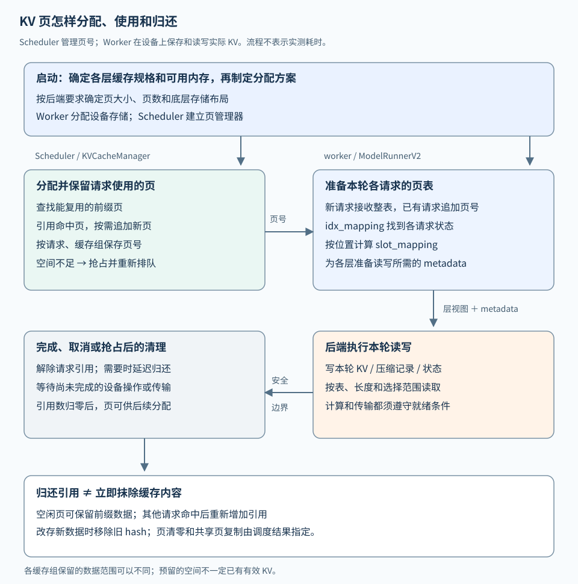
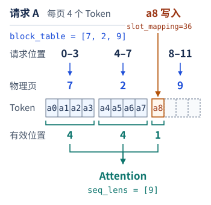
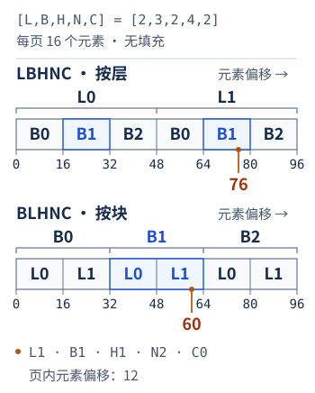
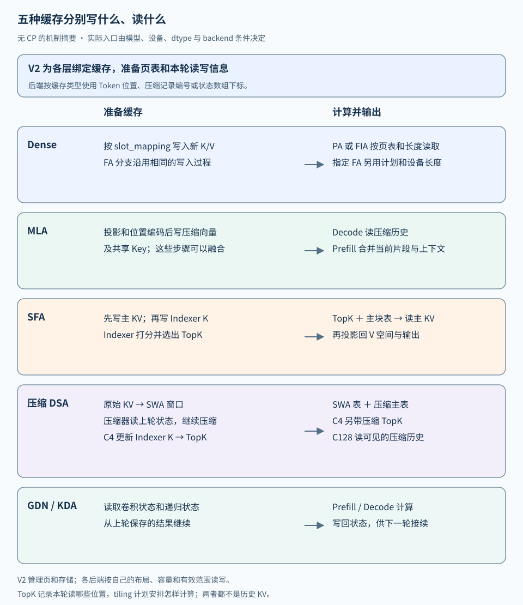

# KV 缓存布局与递归状态

请求 A 的历史写满了两页。下一轮只多一个 Token，需要把前两页搬到一起，才能接着存吗？只要页表记得各页放在哪，就能留着两页原地不动，再分配一页存新的 KV。

先跟着 A 把上次采样得到的 a8 写到第三页，再看 Attention 怎样沿页表读回从 0 到 8 的九个位置。弄清找页的方法后，可以继续对比各类模型在页里究竟存什么。普通 Attention 保存各位置的 K、V，MLA 保存压缩向量，稀疏 Attention 会先挑出要读的位置，有些模型还会把多个位置压成一条记录。Mamba 和 KDA 则保留下一轮接着计算所需的状态。[输入 Token 与 KV 的关系](从一轮调度到一次前向.md)

> 本章的执行主线采用 ModelRunnerV2：上游 `vllm/v1/worker/gpu/model_runner.py` 和 Ascend `worker/v2/model_runner.py`。`attention_v1.py`、`mla_v1.py`、`sfa_v1.py` 是这条路径会调用的 backend 文件名。A 的教学算例使用缩小的块长，无投机、无上下文分片；模型形状按各自固定来源核对。A5 数据仍沿用原实验记录的配置，本章没有据此新增 V2 实测结论。

## 启动时怎样建立页池并选择 Attention 后端？

服务启动时，先确定每层需要保存什么、每页要占多少字节，才能知道显存里能放多少页。每层用 `KVCacheSpec` 描述这些要求：普通 Attention 需要 K/V，MLA 需要压缩向量，Indexer、压缩器和递归层也各有自己的缓存。后层若明确共享前层的 KV，就不再重复申请。Ascend V2 汇总这些规格，再交给 EngineCore 制定分配方案。 [Ascend 规格收集](https://github.com/vllm-project/vllm-ascend/blob/f9c8e0bd/vllm_ascend/worker/v2/attn_utils.py#L215-L333)

EngineCore 根据各 Worker 的缓存规格、兼容布局、内存测算和并行配置，生成 `KVCacheConfig`。它规定缓存分成哪些组、能分配多少物理页、底层存储怎样安排。Scheduler 用这份配置管理页号，Worker 分配设备内存，然后才编译和预热模型。

不能直接用“空闲 HBM ÷ 某一层每页 KV 大小”得到最终页数：还要给非 KV 的运行开销留空间，并计入其他层的缓存、页对齐和实际分配方式。 [启动顺序](https://github.com/vllm-project/vllm/blob/5df63a72/vllm/v1/engine/core.py#L261-L405) · [缓存配置规划](https://github.com/vllm-project/vllm/blob/5df63a72/vllm/v1/core/kv_cache_utils.py)

Attention 后端决定算子接受什么缓存布局，因此要在分配前确定。模型构造 Attention 层时，由平台或模型专用类选择后端；V2 再把兼容的层组织到 `AttentionGroup`，准备调用所需的 metadata，并确定算子支持的页大小和图模式。下表列出 Ascend 的主要分支；具体能否使用，还要检查设备、数据类型、量化和并行配置。 [平台选择](https://github.com/vllm-project/vllm-ascend/blob/f9c8e0bd/vllm_ascend/platform.py#L305-L355) · [V2 初始化](https://github.com/vllm-project/vllm/blob/5df63a72/vllm/v1/worker/gpu/model_runner.py#L605-L804)

| 层的缓存与计算需求 | Ascend 入口 | 怎样读写缓存 |
| --- | --- | --- |
| 普通 MHA/GQA | `AscendAttentionBackend` | 写 K/V，再选择 PA 或 FIA 读取；二者是同一 backend 内的执行分支 |
| 满足 A5 Device-length 条件的指定模型路径 | `AscendFlashAttentionBackend` | 继承普通 K/V 写入，改由 CANN `flash_attn_metadata` / `flash_attn` 读取 |
| 稠密 MLA | `AscendMLABackend` | 生成并写入 latent / 共享 Key，再按 Decode 或 Prefill 路径读取 |
| 带独立 Indexer 的稀疏 MLA | `AscendSFABackend` | 更新主 KV 和 Indexer K，选择 TopK 后读取主 KV |
| DeepSeek-V4 的压缩 Attention | `AscendDSAC4Backend`、`AscendDSAC128Backend`、`AscendDSASWABackend` | 模型按压缩率选择后端类，分别组织压缩记录、压缩状态和滑窗缓存 |
| GDN、KDA 等递归层 | 各层注册的状态后端与模型算子 | 按状态索引读取上次保存的状态，计算后写回 |

<!-- DETAILS: 后端选择的条件与模型专用分支 -->

例如 A5 的 Device-length FlashAttention 分支只对源码指定的 DFlash／DSpark 等模型路径开放，还检查 dtype、KV 量化和 CP 等条件；训练一致性模式另有 FA3 选择。普通 Attention 只有满足所选分支的条件才会调用相应算子。V4 的专用类也不能仅用平台上的 `use_mla/use_sparse/use_compress` 三个布尔值概括。[Device-length 适用条件](https://github.com/vllm-project/vllm-ascend/blob/f9c8e0bd/vllm_ascend/platform.py#L1663-L1712) · [V4 按压缩率选择](https://github.com/vllm-project/vllm-ascend/blob/f9c8e0bd/vllm_ascend/models/layer/attention/layer.py#L127-L161)

<!-- /DETAILS -->

分配完成后，V2 为每层建立指向设备缓存的 Tensor 视图。后续前向反复使用这些存储；请求增长时，通常只需追加页号，并确定本轮 KV 写入页内的哪个位置。

<!-- DETAILS: 从缓存配置到各层视图的初始化入口 -->

Ascend V2 的 `initialize_kv_cache()` 先复制配置，再应用逐层物理分配方案。分配器申请底层存储，`_reshape_kv_cache_v2()` 建立 K/V、MLA、Indexer 或状态视图，`init_kv_cache()` 把视图绑定到各层。EngineCore 通过 `_initialize_kv_caches()` 和 `get_kv_cache_configs()` 规划配置，Worker 通过 `initialize_from_config()` 进入初始化。

[Ascend V2 初始化](https://github.com/vllm-project/vllm-ascend/blob/f9c8e0bd/vllm_ascend/worker/v2/model_runner.py#L484-L538) · [Ascend 分配与视图](https://github.com/vllm-project/vllm-ascend/blob/f9c8e0bd/vllm_ascend/worker/v2/attn_utils.py#L1594-L1699) · [V2 绑定层缓存](https://github.com/vllm-project/vllm/blob/5df63a72/vllm/v1/worker/gpu/attn_utils.py#L396-L443)

<!-- /DETAILS -->

## 一条请求怎样取得、保留和归还 KV 页？

Scheduler 管理每条请求算到了哪里，以及它使用哪些物理页。具体的分配和引用由 `KVCacheManager` 与 `BlockPool` 管理。Worker 保存这些页号对应的设备页表和实际 KV 数据。两边每轮交换进度与页号，不需要把整份历史 KV 重新传一遍。



新请求先查前缀缓存：如果已有相同前缀的 KV，就取得这些页的引用，只计算剩余输入。所有相关缓存组必须能从同一个位置继续；即使 Prompt 全部命中，为生成 logits 仍要重算末尾输入，所以可复用长度最多到 `request.num_tokens−1`，还要满足页对齐要求。

确定可复用部分后，管理器释放已经不再需要的历史页，检查剩余容量，再引用命中页、追加新页。空间不够就无法安排这次计算。投机解码可能额外预留候选 Token 的空间，预留空间里并不一定已有有效 KV。源码中的查询和分配入口分别是 `get_computed_blocks()` 和 `allocate_slots()`。 [前缀查询](https://github.com/vllm-project/vllm/blob/5df63a72/vllm/v1/core/kv_cache_manager.py#L278-L325) · [追加与有效范围](https://github.com/vllm-project/vllm/blob/5df63a72/vllm/v1/core/kv_cache_manager.py#L550-L618)

已有请求保留仍需要的页，跨过页边界时才追加页号。新请求第一次进入 Worker 时收到完整页表；已有请求通常只收到新增页号。需要清零新页，或复制共享页后再修改其中的数据（copy-on-write）时，也由调度结果指定。

V2 先通过 `add_requests()` 或 `update_requests()` 按请求 ID 更新状态和页号，`req_id_to_index` 记录请求在状态数组中的下标。本轮请求顺序可以改变，准备输入时再按本批顺序构造 `idx_mapping`，用它找到各请求保存的状态。这些下标与 KV 页内偏移无关。 [V2 请求更新](https://github.com/vllm-project/vllm/blob/5df63a72/vllm/v1/worker/gpu/model_runner.py#L1181-L1267) · [按本批顺序构造映射](https://github.com/vllm-project/vllm/blob/5df63a72/vllm/v1/worker/gpu/model_runner.py#L1289-L1303)

准备前向时，Runner 为本轮各请求取出页表，并用 Token 位置计算 `slot_mapping`，告诉算子把新 KV 写在哪里。读取历史还需要有效长度、可见窗口或稀疏索引。metadata builder 把这些信息整理成各后端需要的格式，再交给相应层。递归状态不一定使用 `slot_mapping`，它的后端可以改用递归缓存中的状态下标。

<!-- DETAILS: 页表和 metadata 的 V2 调用入口 -->

`prepare_attn()` 按 `idx_mapping` 收集各组页表，并由 `positions` 和请求边界计算各组 `slot_mapping`。Ascend 的 `build_attn_metadata()` 把页表、KV 写入位置和长度交给对应 builder，最后按层名提供给前向。后端通过 `uses_slot_mapping` 声明是否使用普通 Token 的写入方式。

[V2 页表与 slot_mapping](https://github.com/vllm-project/vllm/blob/5df63a72/vllm/v1/worker/gpu/model_runner.py#L1556-L1574) · [各组是否使用 slot_mapping](https://github.com/vllm-project/vllm/blob/5df63a72/vllm/v1/worker/gpu/model_runner.py#L629-L650) · [Ascend metadata 分发](https://github.com/vllm-project/vllm-ascend/blob/f9c8e0bd/vllm_ascend/worker/v2/attn_utils.py#L557-L670)

<!-- /DETAILS -->

页不够时，调度器可能暂停一条正在运行的请求，把它放回等待队列，腾出空间让其他请求继续。调度器解除这条请求对页的引用，把它的计算进度清零。恢复执行时，再查前缀缓存，补算缺失部分。正常完成和取消也会解除请求引用。

归还前仍要确认没有未完成的设备操作或 KV 传输继续使用这些页。源码用延迟归还队列处理这种情况，避免其他请求过早覆盖数据。抢占入口为 `_preempt_request()`。 [抢占](https://github.com/vllm-project/vllm/blob/5df63a72/vllm/v1/core/sched/scheduler.py#L1571-L1617) · [完成与延迟归还](https://github.com/vllm-project/vllm/blob/5df63a72/vllm/v1/core/sched/scheduler.py#L2727-L2777)

一页没有请求继续引用时，`ref_cnt` 变为 0，进入可复用队列。数据不必立即擦除：若它仍带着前缀 hash，下一条请求还可能命中它；此时 `touch()` 把页从空闲队列取出，并增加引用。只有真正把这一页分给新数据时，才移除旧 hash。

因此，即使请求已经结束，其他请求仍可能命中它留下的前缀。一旦物理页被分配给新数据，旧前缀就不能再通过这一页命中。滑窗回收也要等相关计算真正完成，不能只看调度器已经安排到的位置。 [引用与空闲队列](https://github.com/vllm-project/vllm/blob/5df63a72/vllm/v1/core/block_pool.py#L752-L805) · [复用时驱逐](https://github.com/vllm-project/vllm/blob/5df63a72/vllm/v1/core/block_pool.py#L666-L713) · [滑窗安全边界](https://github.com/vllm-project/vllm/blob/5df63a72/vllm/v1/core/kv_cache_manager.py#L550-L559)


## 请求 A 写满两页后，怎样分配和使用第三页？

分页的作用是让请求按需增长，而不必为增长搬动整段历史。假设每页容纳 4 个 Token，A 的前八个 Token 已经占满物理页 7、2。本轮计算位置 8 时，再分配物理页 9，原来的两页保持不动。于是 A 的页表是 `[7,2,9]`。这里使用缩小的页大小，便于把所有位置画出来。 [调度器调用 allocate_slots](https://github.com/vllm-project/vllm/blob/5df63a72/vllm/v1/core/sched/scheduler.py#L776-L788)

| A 的请求内位置 | 页表下标 | 页表中的物理页号 | 本轮写入后有效的页内偏移 |
| --- | --- | --- | --- |
| 0～3 | 0 | 7 | 0～3 |
| 4～7 | 1 | 2 | 0～3 |
| 8 | 2 | 9 | 0 |

页表的第 0、1、2 项分别给出请求前三页的物理页号。位置 `position=8` 除以每页容量 4，商为 2、余数为 0，因此查页表下标 2，得到物理页 9，页内偏移为 0。

```text
页表下标 = position // block_size = 8 // 4 = 2
页内偏移 = position % block_size  = 8 % 4 = 0
物理页号 = block_table[2]         = 9
slot_mapping = 物理页号 × block_size + 页内偏移 = 9 × 4 + 0 = 36
```

这样得到的 36 是按 Token 位置计数的索引，其中已经包含物理页号和页内偏移。算子再结合当前层的布局和步幅，计算实际字节地址。本例的管理器和算子都使用每页 4 个 Token。 [GPU KV 写入位置计算](https://github.com/vllm-project/vllm/blob/5df63a72/vllm/v1/worker/gpu/block_table.py#L308-L353)

<!-- KV_DECODE_PLAYER -->

<!-- COLLAPSIBLE_FIGURE: 查看 KV 写入与分页读取静态图 -->


写完 A 的新 K、V 后，这次因果 Attention 的有效长度是 9。它按请求内的位置顺序读取物理页 7、2、9，三页分别有 4、4、1 个位置参与计算。物理页 9 剩下的三个位置已经分配，要等后续 Token 的 KV 写入后才有效。本轮 Attention 只用当前 Q 和这九个位置的 K、V 计算输出。

**试一试。** 下一轮新增位置 9。用同一张页表，找出要写的页、页内偏移和 `slot_mapping`，再数一数 Attention 能读几个位置。

<!-- DETAILS: 核对答案 -->

`9 ÷ 4 = 2 余 1`，还是查页表下标 2，对应物理页 9。这次写到页内偏移 1，`slot_mapping = 9×4+1 = 37`。写完后有 `4+4+2 = 10` 个有效位置，第三页还有两个位置等着以后写入。

<!-- /DETAILS -->

## 为什么多层可以共用一张页表？

页表通常不必为每层重复维护。缓存管理器把可以共用页表的层放进一个缓存组，用 `KVCacheGroupSpec` 描述。A 在这个组中查到物理页 9，组内每层就使用自己缓存中的第 9 页；它们的页号相同，数据仍各自由本层投影产生。

全量 Attention、滑窗、压缩历史和递归状态，可能需要保留不同范围的数据，管理器因此按缓存规格分组。查询页表时，既要知道请求，也要知道它属于哪个缓存组。 [上游组定义](https://github.com/vllm-project/vllm/blob/5df63a72/vllm/v1/kv_cache_interface.py#L1432-L1472) · [缓存组与分配构造](https://github.com/vllm-project/vllm/blob/5df63a72/vllm/v1/core/kv_cache_utils.py)

<!-- DETAILS: 缓存规格、缓存组与物理分配在源码中的对象 -->

| 对象 | 谁持有 | 怎样用于分配或寻址 |
| --- | --- | --- |
| `KVCacheSpec` | 缓存层与分配计划 | 描述一层的页规格，例如 `block_size`、每页字节数、dtype、滑窗范围或状态组件 |
| `KVCacheGroupSpec` | Cache Manager 与 Runner | 组织层名和组规格。管理器为每条请求在各组维护块号，Runner 按组准备块表 |
| `AttentionGroup` | Runner | GPU ModelRunnerV2 在一个缓存组内，按后端、层规格和本地 Q head 数组织 metadata builder |
| `KVCacheTensor` | 分配计划 | 描述底层存储的大小、层、起点、层步幅和块步幅 |

<!-- /DETAILS -->

缓存组决定哪些层共用页表，metadata builder 决定怎样把信息交给后端，两者不要求一一对应。同组可以使用多个 builder；不同组的层也可能共用底层存储中的不同页号。若模型明确让后层读取前层 KV，还要沿共享关系找到实际保存数据的层。GQA 中的“组”则指单层内多个 Q heads 共用 KV head，与这里的缓存组不同。 [GPU Runner 分组](https://github.com/vllm-project/vllm/blob/5df63a72/vllm/v1/worker/gpu/attn_utils.py#L196-L280) · [物理分配描述](https://github.com/vllm-project/vllm/blob/5df63a72/vllm/v1/kv_cache_interface.py#L1408-L1429)

## 管理器和算子的页大小为什么可能不同？

前面的管理器和算子都按每页 4 个 Token 寻址，但实际后端可能要求另一种页大小。Runner 会选择同组后端支持的 `kernel block size`，必要时把管理器的一页拆成多个算子页，并转换页表。这样，管理器可以按自己的分配单位管理空间，算子仍按支持的单位读取。 [选择 kernel block size](https://github.com/vllm-project/vllm/blob/5df63a72/vllm/v1/worker/utils.py#L515-L682) · [读块表转换](https://github.com/vllm-project/vllm/blob/5df63a72/vllm/v1/worker/utils.py#L368-L395)

例如管理器每页放 8 个 Token，算子每页只处理 4 个。对于紧密排布的普通 KV，一张管理页就对应两张算子页：

```text
管理页号 b → 算子页号 [2b, 2b+1]
管理页表 [3,2] → 算子页表 [6,7,4,5]
```

两张表描述同一份数据。以请求位置 13 为例，管理页号 2、页内偏移 5，与算子页号 5、页内偏移 1，计算出的 `slot_mapping` 都是 21。这种直接拆分要求页内紧密排布；通用视图代码会检查管理页的 stride 是否等于未填充的页大小。 [紧密页切分约束](https://github.com/vllm-project/vllm/blob/5df63a72/vllm/v1/kv_cache_interface.py#L377-L425)

每页字节数要按实际保存的内容计算。普通 KV 为每个 Token 保存一份 K/V；如果每 4 个位置压缩成一条记录，那么覆盖 128 个位置的一页只存 32 条压缩记录。递归模型保存的则是继续计算所需的状态。先把各组件的元素数乘以对应数据类型的字节数并求和，再计入量化尺度、对齐、页尾填充、存储复用和页数，才得到实际分配量。 [状态粒度和页容量接口](https://github.com/vllm-project/vllm/blob/5df63a72/vllm/v1/kv_cache_interface.py#L205-L263)

## 同一张页表，BLHNC 和 LBHNC 怎样寻址？

页表给出物理页号。要在这页中找到具体元素，还需要知道层号、KV head、页内位置和通道。stride（步幅）表示某个数组下标增加 1 时，内存位置要跨过多少个元素。上游 `KVCacheLayout` 用 `[L,B,H,N,C]` 表示这些维度，布局名按物理内存从外到内的顺序排列。 [布局枚举](https://github.com/vllm-project/vllm/blob/ced6857a/vllm/v1/kv_cache_layout.py)

| 轴 | 在普通 KV 中的单位 | 读哪份配置或 metadata |
| --- | --- | --- |
| `L` | 当前分配的层数 | 分配计划的层列表。单层 view 已经选定该轴 |
| `B` | 池中物理块数 | 块分配及 kernel 块切分。请求 batch 有独立的轴 |
| `H` | 每 rank 的 KV heads | 模型头数、TP 切分或复制 |
| `N` | 算子每页容纳的 Token 数 | 普通 KV 取 kernel block size。压缩页取实际存储行数 |
| `C` | 每个 head、每行的内容宽度 | 例如等宽 K/V 合在一起时为 `2D` 个元素，打包格式可能以字节计 |

只交换最外面两轴就能看出差别。取 `L=2,B=3,H=2,N=4,C=2` 的紧密分配，一页有 16 个元素。用另一条教学请求的块表 `[2,1]`，位置 6 对应物理页 B1、页内偏移 2。选层 1、head 1、内容第 0 项，逻辑坐标为 `(1,1,1,2,0)`，页内元素偏移 `(1×4+2)×2=12`。



```text
LBHNC  (l×B+b)×16+12 = (1×3+1)×16+12 = 76
BLHNC  (b×L+l)×16+12 = (1×2+1)×16+12 = 60
```

选定层 1 后，两种布局都可以提供 `[3,2,4,2]` 的 `[B,H,N,C]` 视图。LBHNC 的块 stride 是 16 个元素，BLHNC 的块 stride 是 32 个元素，因为到本层下一块之前还跨过另一层的一页。实际 PyTorch 视图的元素偏移等于 `storage_offset + Σ(坐标 × stride)`。乘上 `element_size()` 才得到从底层存储起点计的字节偏移。[视图构造](https://github.com/vllm-project/vllm/blob/5df63a72/vllm/v1/kv_cache_interface.py#L377-L441)

<!-- DETAILS: vLLM 与 vLLM-Ascend 的布局配置 -->

### vLLM 与 vLLM-Ascend 的布局选择

这里对照的四种布局由层／块顺序 `LB/BL` 与页内顺序 `HNC/NHC` 组合而来。布局解析接受旧别名 `HND`（`LBHNC`）和 `NHD`（`LBNHC`）。传给 FlashInfer wrapper 的 `HND/NHD` 只描述页内次序，所以 `BLHNC` 和 `LBHNC` 都可以对应 wrapper 的 `HND`。[上游布局解析](https://github.com/vllm-project/vllm/blob/ced6857a/vllm/v1/attention/backends/utils.py)

上游 NIXL 文档中，非 MLA 路径默认用 `LBHNC`。在文档列出的跨层连续传输场景下，`VLLM_KV_CACHE_LAYOUT=BLHNC` 可让同一物理块的各层数据连续。Ascend MooncakeConnectorV2 的普通 GQA 部署则要求 P、D 两端使用一致的 `LBHNC` 或其别名 `HND`。比较两种部署的布局时，要分别核对各自使用的连接器、Attention 后端和实际步幅。[NIXL 兼容矩阵](https://github.com/vllm-project/vllm/blob/ced6857a/docs/features/nixl_connector_compatibility.md) · [Ascend Mooncake 布局配置](https://github.com/vllm-project/vllm-ascend/blob/c09d3e20/docs/source/tutorials/features/pd_disaggregation_mooncake_single_node.md#layout-and-port-configuration)

<!-- /DETAILS -->

### 生产案例 · 物理页存在，Mooncake 仍查不到地址

DeepSeek V4 的一次 A3 P/D 部署里，低块号传输正常，拉取到高编号的 Indexer 页时却报远端缓冲区查找失败。这个张量每块有 4096 B 有效数据，两个相邻块起点相隔 4160 B，中间有 64 B 对齐填充。连接器按 4160 B 寻址，原注册逻辑却累加 4096 B 来确定范围。块号越大，实际地址就越靠后，最终会落到注册范围外，尽管它仍在设备的原始分配内。[A3 错误记录与注册跨度修复](https://github.com/vllm-project/vllm-ascend/pull/16129)

把作者报告的第 28738 号块代进去，地址从注册基址算，区间右端不包含。旧代码按 `28743×4096=117,731,328 B` 算注册长度，Mooncake 对齐后登记 **114 MiB（119,537,664 B）**。但传输的起点是 `28738×4160=119,550,080 B`，加上 4096 B 载荷得到右端 `119,554,176 B`。起点已经超过旧登记上界 **12,416 B**。补丁按 `28743×4160=119,570,880 B` 计算步幅覆盖范围，作者报告对齐后的登记是 **116 MiB（121,634,816 B）**，上述区间完整落在其中。这里的两个对齐后长度来自 PR 记录，其余数字是按报告中的块号和步幅复算。[块号、对齐后的注册长度与实际传输报告](https://github.com/vllm-project/vllm-ascend/pull/16129)

围绕同一套 hybrid KV 描述符，主线已合入按物理布局重建共享关系、校验地址和步幅的改动。上述按完整块步幅注册的补丁是另一条 PR，作者报告原出错块在补丁上已传输成功，该补丁仍在审查。定位此类故障时，要同时拿到连接器注册的基址与长度、实际块步幅、出错块号和本次传输长度。只对着张量形状算字节，漏掉的正是块与块之间那段空间。[描述符与地址重建](https://github.com/vllm-project/vllm-ascend/pull/16086) · [物理分配与逻辑视图的注册问题](https://github.com/vllm-project/vllm-ascend/issues/16632) · [跨度补丁验证](https://github.com/vllm-project/vllm-ascend/pull/16129)

## GQA 的 K/V 投影、缓存视图与写入

执行一次分页 Attention 时，QKV 投影先生成当前 token 的 Q、K、V。写入算子用 `slot_mapping` 把 K/V 写入本层的目标页。Attention 拿当前 Q、块表和有效长度，从同一份缓存读历史。MHA 每个 Q head 对应一个 KV head，GQA 一组 Q heads 共用一个 KV head，MQA 全部 Q heads 共用一个 KV head。因此每层、每位置、每 rank 的有效载荷是 `H×(D_k×K元素字节+D_v×V元素字节)`，其中 `H` 取本地 KV heads。[FlashAttention 写入入口](https://github.com/vllm-project/vllm/blob/ced6857a/vllm/v1/attention/backends/flash_attn.py#L1438-L1470) · [每 rank KV heads](https://github.com/vllm-project/vllm/blob/ced6857a/vllm/config/model.py#L1530-L1550)

用 Qwen3-8B、TP4、BF16 作例子：模型有 36 层，每层 32 个 Q heads、8 个 KV heads，头宽 128。每个 rank 分到 8 个 Q heads 和 2 个 KV heads。本轮输入 5 个 Token 时，Q 为 `[5,8,128]`，新 K、V 各为 `[5,2,128]`。

```text
每层每个历史 Token 的 KV = 2 个 KV heads × (128 个 K 元素 + 128 个 V 元素) × 2 B
                         = 1024 B
```

每页 16 个 Token 时，一层一页为 16 KiB；本文所查的 Ascend 普通 Attention 每页 128 个 Token，一层一页为 128 KiB。页大小改变分配粒度，不改变同样历史的有效数据量：每个 rank 保存全部 36 层、4096 个位置时，两者都为 144 MiB，分配时还要留出未用位置和对齐空间。 [Qwen3-8B 配置](https://huggingface.co/Qwen/Qwen3-8B/blob/main/config.json) · [Ascend kernel 块长](https://github.com/vllm-project/vllm-ascend/blob/f9c8e0bd/vllm_ascend/attention/attention_v1.py#L153-L155)

这里的本地 `H` 由总 KV head 数与 TP 大小共同决定。普通 GQA 在 TP 尚未超过总 KV heads 时按 head 分片，超过后进入 head 复制；复制阈值随模型变化。DCP 再决定一个本地 head 保留哪些历史位置，SP 则决定在某些层之间，本轮激活张量的各行分布在哪些 rank 上。三者的算例与实现边界见[上下文并行：KV 分片与 Attention 归并](上下文并行与Attention归并.md)。

<!-- DETAILS: GQA 后端的 Tensor 视图和 stride -->

| 普通、等宽的 BF16 路径 | 每层持久缓存视图 | 算子入口 |
| --- | --- | --- |
| vLLM CUDA FlashAttention | `[B,H,N,2D]` | 转为 `[B,N,H,2D]`，再沿末轴取两份 `[B,N,H,D]` |
| vLLM CUDA FlashInfer | `[B,H,N,2D]` | 按 stride 交给对应 wrapper，Blackwell TRT-LLM 路径要求 head-major 页内次序 |
| vLLM-Ascend 普通 Attention | K/V 各为 `[B,N,H,D]`，HND 路径各为 `[B,H,N,D]` | backend 的 shape 描述还带首轴 `2`，分别指 K、V。部分 FIA 路径把 K/V 各折成 `[B,N,H×D]` |

这里 `B` 取对应视图的物理块数，`N` 取每块 Token 数，`D` 是每头元素数。CUDA 可以在满足支持条件时用 `--attention-backend FLASH_ATTN` 或 `FLASHINFER` 选择实现。Ascend 路径由平台和模型配置分派。FIA 的 query `input_layout=TND` 中，`T` 为本轮 query 行，`N` 指 query heads，`D` 是头宽。Cache 参数仍可带物理块表。[CUDA 后端选择](https://docs.vllm.ai/en/latest/design/attention_backends/#setting-the-attention-backend) · [FlashAttention 视图](https://github.com/vllm-project/vllm/blob/ced6857a/vllm/v1/attention/backends/flash_attn.py) · [FlashInfer 视图](https://github.com/vllm-project/vllm/blob/ced6857a/vllm/v1/attention/backends/flashinfer.py) · [Ascend 形状与 FIA](https://github.com/vllm-project/vllm-ascend/blob/f9c8e0bd/vllm_ascend/attention/attention_v1.py)

把上面的 Qwen3-8B 算例放进 CUDA FlashAttention 的紧密 `LBHNC` 布局。本层合并视图为 `[B,2,16,256]`，BF16 元素步幅为 `(8192,4096,256,1)`。写入入口先交换 head 和页内位置轴，再沿末轴拆 K/V。拆出的两个视图各为 `[B,16,2,128]`，步幅都为 `(8192,256,4096,1)`，V 的起点比 K 多 128 个元素（256 B）。同一 head 的下一行 K 要跨过当前行的 V，所以只看拆出的 shape 会算错行步幅。[通用视图构造](https://github.com/vllm-project/vllm/blob/ced6857a/vllm/v1/kv_cache_interface.py#L347-L411) · [FlashAttention 拆分与写入](https://github.com/vllm-project/vllm/blob/ced6857a/vllm/v1/attention/backends/flash_attn.py#L1438-L1472)

<!-- /DETAILS -->

### A5 合并分配的 K/V 视图

取 A5 拉取实验中的 `prompt129-repetition0`。两层 Qwen2 的全局 Q/KV heads 为 8/2，TP2、DCP1，头宽 64，KV 为 BF16。每个 rank 有 4 个 Q heads、1 个 KV head。Prefill 的 129 个有效位置在每层形成 Q `[129,4,64]` 和新 K、V 各 `[129,1,64]`。Worker 预分配的页池以 128 个位置为一页，单层一页占 `128×1×64×2 B×2=32,768 B`。同一个块号在两层各占一页，合计 64 KiB，按 32 MiB/rank 池预算得到 512 个物理块。[实验配置与请求记录](https://github.com/Tflowers-0129/inference-wiki/blob/main/experiments/pd-disaggregation/results/pull.json) · [池块数计算](https://github.com/vllm-project/vllm/blob/5df63a72/vllm/v1/core/kv_cache_utils.py#L1622-L1629)

<!-- DETAILS: A5 实验的 K/V 视图、字节地址和后续读取 -->

这个 eager 配置走普通 FullAttention 的合并分配分支。每层的底层存储按 `[K页0][V页0][K页1][V页1]…` 排列，Runner 用 `as_strided` 从中绑定两份视图。实验两端启动时报告 `LBNHC`，下表按对应的 NHD 形状分支从源码推导。stride 用 BF16 元素计，偏移从本层对齐后的页池起点算。[合并分配条件](https://github.com/vllm-project/vllm-ascend/blob/f9c8e0bd/vllm_ascend/worker/v2/attn_utils.py#L1529-L1568) · [PA 连续分配条件](https://github.com/vllm-project/vllm-ascend/blob/f9c8e0bd/vllm_ascend/attention/utils.py#L288-L321) · [视图步幅](https://github.com/vllm-project/vllm-ascend/blob/f9c8e0bd/vllm_ascend/worker/v2/attn_utils.py#L820-L852) · [形状分支](https://github.com/vllm-project/vllm-ascend/blob/f9c8e0bd/vllm_ascend/attention/attention_v1.py#L114-L124)

| 单层视图 | BF16 shape | stride（元素） | 第 0 页起点（字节） |
| --- | --- | --- | --- |
| K | `[512,128,1,64]` | `(16384,64,64,1)` | 0 |
| V | `[512,128,1,64]` | `(16384,64,64,1)` | 16,384 |

在相同分配条件下，若改用 `LBHNC` 或别名 `HND`，两个视图变为 `[512,1,128,64]`，stride 为 `(16384,8192,64,1)`。本例只有一个本地 KV head，交换 head 和位置轴后的字节偏移相同。[形状分支](https://github.com/vllm-project/vllm-ascend/blob/f9c8e0bd/vllm_ascend/attention/attention_v1.py#L114-L124)

对于块号 `b`、页内偏移 `n`、通道 `d`，K 的字节偏移为 `b×32,768+n×128+d×2`，V 再加 16,384 B。一个 K 页有 16 KiB，相邻 K 页的起点相距 32 KiB，中间隔着一个 V 页。连接器分别记录每个视图的 `block_len`（一段传多少字节）与 `block_stride`（下一个块从哪里开始）。实测中 P 的 `[1,2]` 交给 D 的 `[5,4]`，每个 D rank 提交 `2 块×2 层×2 组件=8` 段，共 128 KiB。129 行有效 KV 只占 `129×2 层×256 B=66,048 B`，差额来自尾页剩下的 127 个位置。[连接器登记视图](https://github.com/vllm-project/vllm-ascend/blob/f9c8e0bd/vllm_ascend/distributed/kv_transfer/kv_p2p/mooncake_connector.py#L2666-L2709) · [传输记录](https://github.com/Tflowers-0129/inference-wiki/blob/main/experiments/pd-disaggregation/results/pull.json) · [PD 分离系统与 KV 生命周期](PD分离系统与KV生命周期.md)

D 收齐后先重算最后一个 prompt 位置 128，按目标块表写到物理页 4、页内偏移 0，`slot_mapping=[512]`。等 D 把刚采样的输出作为下一轮输入，位置 129 写到物理页 4、页内偏移 1，`slot_mapping=513`。此时 K 第 0 通道的偏移为 `4×32,768+128=131,200 B`，V 为 147,584 B。分页 FIA 在 NHD 路径上把 K、V 各展成 `[512,128,64]`，再用 `block_table=[5,4]` 和 `actual_seq_lengths_kv=[130]` 读取两页中的 128+2 行。块 4 中其余位置仍在分配范围内，随有效长度增长才进入 Attention。[远端加载后重算末位置](https://github.com/vllm-project/vllm/blob/5df63a72/vllm/v1/core/sched/scheduler.py#L3155-L3189) · [FIA 读取视图和长度](https://github.com/vllm-project/vllm-ascend/blob/f9c8e0bd/vllm_ascend/attention/attention_v1.py#L861-L911)

<!-- /DETAILS -->

## MLA 的 576 维记录怎样供多个 Q heads 使用？

MLA 先把每个 Token 的信息压缩成较小的向量，再保存这份压缩结果，避免直接缓存所有头展开后的 K、V。以 DeepSeek-V3 和 R1 为例，每个位置保存 512 维 latent（压缩向量）和 64 维共享 RoPE Key。

计算时有两种用法：需要展开的路径用 `kv_b_proj` 从 latent 恢复各头的内容 K/V；使用吸收投影的路径把 Q 变换到 latent 空间，在压缩空间计算，再把加权结果投影回 V 空间。64 维共享 Key 另外参与位置相关的打分。

因此，用 BF16 保存一个历史位置需要 `(512+64)×2=1152 B`。模型虽然有 128 个 Q heads，也不需要为每个 Q head 再复制这份记录；缓存规格用 `H=1` 表示这一点。 [DeepSeek-V3 配置](https://huggingface.co/deepseek-ai/DeepSeek-V3/blob/main/config.json) · [DeepSeek-R1 配置](https://huggingface.co/deepseek-ai/DeepSeek-R1/blob/main/config.json) · [投影入口](https://github.com/vllm-project/vllm/blob/ced6857a/vllm/model_executor/models/deepseek_v2.py#L1094) · [MLA 计算与 spec](https://github.com/vllm-project/vllm/blob/ced6857a/vllm/model_executor/layers/attention/mla_attention.py)

| MLA backend 路径 | 每层视图与读入内容 |
| --- | --- |
| vLLM CUDA 合并视图 | 从 `[B,1,N,576]` 绑定成 `[B,N,576]`，省去长度为 1 的头维度 |
| vLLM-Ascend MRv2 普通拆分 MLA | `[B,N,1,512]` 的 latent 和 `[B,N,1,64]` 的共享 Key。变量名 `k_cache`、`v_cache` 对应该拆分 |
| vLLM-Ascend FlashMLA 路径 | 在平台和 backend 支持时绑定合并视图 |

`N` 在这里仍是页内历史位置数。CUDA 可为兼容的 MLA 路径指定 `--attention-backend FLASHMLA` 等后端，并通过 `attention_config.mla_prefill_backend` 为 Prefill 选择实现。Ascend 的拆分或合并分支要从实际 backend 和 cache dtype 核对。[vLLM 绑定视图](https://github.com/vllm-project/vllm/blob/ced6857a/vllm/model_executor/layers/attention/mla_attention.py#L715) · [CUDA 后端矩阵](https://docs.vllm.ai/en/latest/design/attention_backends/#mla-multi-head-latent-attention-backends) · [Ascend MRv2 KV 视图](https://github.com/vllm-project/vllm-ascend/blob/f9c8e0bd/vllm_ascend/worker/v2/attn_utils.py#L2010-L2070) · [Ascend FlashMLA 选择条件](https://github.com/vllm-project/vllm-ascend/blob/f9c8e0bd/vllm_ascend/attention/mla_v1.py#L1067-L1087)

Ascend 的 MLA 层先计算当前 Token 的压缩向量和共享 Key，按 `slot_mapping` 写入缓存，再按 Decode 或 Prefill 路径读取。Prefill 还要合并当前片段和已有上下文。实际算子可以把投影、归一化、RoPE 和写缓存融合，但保存的仍是 MLA 需要的内容。

对应源码中，`AscendMLAImpl.forward()` 从 metadata 区分两类输入。普通预处理走 `_mla_preprocess()`，之后分别调用 `_forward_decode()`、明确选中的外部 FlashMLA，或 `_forward_prefill()`。合并缓存可以拆成共享底层存储的视图；代码中即使叫 `key_cache/value_cache`，第二份也不能直接理解成普通 GQA 的 V。 [MLA 写入与通知](https://github.com/vllm-project/vllm-ascend/blob/f9c8e0bd/vllm_ascend/attention/mla_v1.py#L3325-L3360) · [MLA 前向分流](https://github.com/vllm-project/vllm-ascend/blob/f9c8e0bd/vllm_ascend/attention/mla_v1.py#L3385-L3530)

<!-- DETAILS: Kimi K3 的 MLA / KDA 层与部署格式 -->

### Kimi K3 只在 MLA 层逐位置保留历史

Kimi K3 文本主干有 24 层全量 MLA 和 69 层 Kimi Delta Attention（KDA）。MLA 层采用 NoPE，仍写入 512 维 latent 和 64 维共享 Key，计算时跳过旋转。vLLM CUDA 以 `use_sparse=False` 选后端。普通 BF16 和 FP8 的合并视图均为 `[B,N,576]`，每位置分别占 1152 B 和 576 B。Ascend 的 W4A8 检查点保留同样的层型和维度。所查 MRv2 实现分别构造 `AscendKimiMLAAttention` 和 `AscendKimiK3DeltaAttention`，BF16 拆分 MLA 仍使用上表两份视图。KDA 页保存卷积和递归状态，其形状见下文。[模型配置](https://huggingface.co/moonshotai/Kimi-K3/blob/f831ab66/config.json) · [Ascend W4A8 模型配置](https://www.modelscope.cn/models/Eco-Tech/Kimi-K3-w4a8/resolve/master/config.json) · [CUDA MLA 选择](https://github.com/vllm-project/vllm/blob/ced6857afa0e/vllm/models/kimi_k3/nvidia/mla.py#L316-L349) · [CUDA 缓存规格](https://github.com/vllm-project/vllm/blob/ced6857afa0e/vllm/models/kimi_k3/nvidia/mla.py#L412-L434) · [Ascend 主干选层](https://github.com/vllm-project/vllm-ascend/blob/f9c8e0bd/vllm_ascend/models/kimi_k3.py#L514-L554)

vLLM 的 Hopper 部署示例选用 `FLASHMLA`，一条 Blackwell 路径选 `TOKENSPEED_MLA` 和 `--kv-cache-dtype fp8`，Prefill 配置另设 `mla_prefill_backend=TRTLLM_RAGGED`。该命令也显式设 `--mamba-ssm-cache-dtype bfloat16`，控制 KDA 的递归状态。两个 dtype 参数分别作用于两类缓存。Ascend 的 Kimi K3 部署配置要求 `VLLM_USE_V2_MODEL_RUNNER=1`。[vLLM Hopper 部署示例](https://github.com/vllm-project/vllm/blob/8d902b41/recipes/models/moonshotai/Kimi-K3.yaml#L181-L220) · [Blackwell 部署示例](https://github.com/vllm-project/vllm/blob/8d902b41/recipes/models/moonshotai/Kimi-K3.yaml#L452-L461) · [Ascend MRv2 要求](https://github.com/vllm-project/vllm-ascend/blob/1af7c5fc/docs/source/tutorials/models/Kimi-K3.md#L15-L25)

<!-- /DETAILS -->

## 稀疏 MLA 的 Indexer 与主缓存寻址

稀疏 Attention 要先回答“本轮读哪些历史位置”。DeepSeek-V3.2 在 MLA 主缓存之外增加 Lightning Indexer：它为每个历史 Token 保存一条较小的 Key，用当前 query 给历史位置打分，再选出最多 2048 个位置供主 Attention 读取。这份选择结果叫 TopK。

主缓存和 Indexer 缓存都随保留的历史增长；TopK 只是当前调用要读的位置，下一轮可能重新选择，不能据此只分配 2048 个位置的缓存。

具体形状是：本轮 `T_q` 个 query 生成索引 Q `[T_q,64,128]` 和头权重 `[T_q,64]`，每个历史位置保存 128 维 Indexer K，输出索引为 `[T_q,K_top]`。CUDA FlashMLA Sparse 先把选中的请求内位置换成物理位置编号；Ascend SFA 的入口可以接收请求内位置和页表，由算子完成寻址。分页换算与前面的 A 例子相同。 [V3.2 配置](https://huggingface.co/deepseek-ai/DeepSeek-V3.2/blob/main/config.json) · [模型 Indexer](https://huggingface.co/deepseek-ai/DeepSeek-V3.2/blob/main/inference/model.py#L435) · [CUDA 物理位置换算](https://github.com/vllm-project/vllm/blob/ced6857/vllm/v1/attention/backends/mla/flashmla_sparse.py#L803) · [Ascend SFA 参数](https://github.com/vllm-project/vllm-ascend/blob/f9c8e0bd/vllm_ascend/attention/sfa_v1.py#L229)

<!-- DETAILS: V3.2 各后端的缓存格式、容量与配置 -->

| V3.2 路径 | MLA 主 KV | Indexer K |
| --- | --- | --- |
| vLLM CUDA FlashMLA Sparse，主 KV `fp8_ds_mla` | `[B,N,656]` 字节视图，每位置 512 B latent、16 B scale、128 B RoPE | `[B_i,N_i,132]`，FP8 K 128 B 和 FP32 scale 4 B |
| vLLM-Ascend SFA，BF16 主 KV 与 Indexer | `[B,N,1,512]` 和 `[B,N,1,64]`，合计 1152 B | `[B_i,N_i,1,128]`，256 B |
| vLLM-Ascend SFA C8，另启用 Indexer 量化 | `[B,N,1,656]` 字节视图，每位置 512 B latent、128 B RoPE、16 B scale | K 为 `[B_i,N_i,1,128]`，scale 为 `[B_i,N_i,1,1]`。FP8/FP32 合计 132 B，INT8/FP16 合计 130 B |

`B_i` 和 `N_i` 分别表示 Indexer 的物理块数和每块容纳的索引记录数。CUDA 兼容路径可指定 `--attention-backend FLASHMLA_SPARSE` 和 `--kv-cache-dtype fp8_ds_mla`。Ascend SFA 的主 KV 通过 `--additional-config '{"enable_sparse_sfa_c8":true}'` 和相应 `--kv-cache-dtype` 进入 C8 路径，Indexer K 则由 `--attention-config.indexer_kv_dtype` 选择。两种主 KV 都能是 656 B，字节顺序按表中各行读取。以 Ascend BF16 路径为例，每页容纳 128 个 Token。若主 KV 和 Indexer 各分配 4 页，每层的有效载荷为 `4×128×(1152+256)=704 KiB`。支持同组分配时，同一个 block ID 会分别定位主 KV 视图和 Indexer 视图。后续的稀疏卸载还会增加 Host 和设备工作集之间的映射。[CUDA 缓存记录与后端支持](https://github.com/vllm-project/vllm/blob/ced6857/vllm/v1/attention/backends/mla/flashmla_sparse.py#L76-L142) · [CUDA Indexer spec](https://github.com/vllm-project/vllm/blob/ced6857/vllm/model_executor/models/deepseek_v2.py#L637) · [Ascend 主 KV 开关与打包](https://github.com/vllm-project/vllm-ascend/blob/f9c8e0bd/vllm_ascend/attention/sfa_v1.py#L860-L882) · [Ascend C8 写入](https://github.com/vllm-project/vllm-ascend/blob/f9c8e0bd/vllm_ascend/attention/sfa_v1.py#L1657) · [Indexer 分组](https://github.com/vllm-project/vllm-ascend/blob/f9c8e0bd/vllm_ascend/core/kv_cache_interface.py#L295) · [稀疏 KV 卸载与 HiSparse](稀疏KV卸载与HiSparse.md)

<!-- /DETAILS -->

Ascend SFA 每轮先更新主 KV，再计算并保存 Indexer K，随后运行 TopK。这个顺序保证 Indexer 选择历史位置时，能看到本轮刚写入的数据。Attention 根据选中的位置和主缓存的页表读取主 KV，计算结果，再完成 V 空间投影和输出投影。

主缓存和 Indexer 各使用自己的 metadata、页表和写入位置。两份缓存写完后就可以调用 `notify_kv_cache_written()` 通知该层数据已就绪，不必等 Attention 输出；是否发起传输仍由 connector 和 Scheduler 决定。稀疏读取的具体入口是 `_execute_sparse_flash_attention_process()`。 [SFA 缓存与 metadata 取得](https://github.com/vllm-project/vllm-ascend/blob/f9c8e0bd/vllm_ascend/attention/sfa_v1.py#L1723-L1819) · [完整写入、选址与读取顺序](https://github.com/vllm-project/vllm-ascend/blob/f9c8e0bd/vllm_ascend/attention/sfa_v1.py#L1960-L2048)

TopK 复用还要分清两种情况：保留运行时 Indexer 的 `skip_topk` 层仍更新自己的 Indexer K，只跳过本轮选择；静态共享索引的层可以没有自己的运行时 Indexer cache。两者都会继续执行本层主 KV 的写入与读取。TopK 是这次 Attention 读哪些位置的选择结果，不能据它的长度推断已分配页数。

<!-- DETAILS: GLM-5.3 与 GLM-5.3-Flash 怎样共享或汇总索引 -->

### GLM-5.3 复用 TopK，主 KV 仍由各层持有

`zai-org/GLM-5.3` 的 78 层均走稀疏 MLA。索引 Q 每位置是 `[32,128]`，历史 Indexer K 每位置 128 维，TopK 上限 2048。只有 21 个 `full` 层创建 Indexer 并计算 TopK，层号为 0、1 以及 2、6、10 到 74。其他 57 层取得前一个 `full` 层给出的索引，用这些位置读自己的主 KV。按 Ascend BF16 格式，每个历史位置在这些层中合计占用 `78×1152+21×256=95,232 B`。两类张量的视图沿用上表。量化部署示例中，950DT 选 FP8 主 KV 与 FP8 Indexer，A3 W8A8C8 选 INT8 主 KV 与 INT8 Indexer。CUDA 根据模型和设备约束选择稀疏 MLA backend，例如支持该格式时的 `FLASHMLA_SPARSE` 或 `FLASHINFER_MLA_SPARSE`。[GLM-5.3 配置](https://huggingface.co/zai-org/GLM-5.3/blob/ba32f8c1/config.json) · [vLLM IndexShare 分支](https://github.com/vllm-project/vllm/blob/ced6857a/vllm/model_executor/models/deepseek_v2.py#L1134-L1184) · [Ascend Indexer 分配](https://github.com/vllm-project/vllm-ascend/blob/1af7c5fc/vllm_ascend/worker/v2/attn_utils.py#L347-L383) · [Ascend 启动配置](https://github.com/vllm-project/vllm-ascend/blob/1af7c5fc/docs/source/tutorials/models/GLM5.2.md#L260-L337) · [CUDA 后端矩阵](https://docs.vllm.ai/en/latest/design/attention_backends/#mla-multi-head-latent-attention-backends)

### GLM-5.3-Flash 从 KeyPool 展开主 KV 位置

如果想先看为什么合并索引 Key 后仍按 Token 读取主 KV，可以对照[Lightning Indexer 与 KeyPool 的 4099 位置算例](../dist/model-layers.html#keypool-vs-lightning)。下面沿 GLM 的缓存布局计算各部分字节数。

`zai-org/GLM-5.3-Flash` 的文本主干有 11 层稀疏 MLA 和 34 层 KDA。稀疏层的 `qk_rope_head_dim=0`，每位置只写一条 512 维 latent。CUDA BF16 主 KV 绑定成 `[B,N,512]`，每位置 1024 B。Ascend NoPE C8 的主 KV 是 `[B,N,1,528]`，一条由 512 B latent 和 16 B scale 组成。[模型配置](https://huggingface.co/zai-org/GLM-5.3-Flash/blob/46a050be/config.json) · [CUDA NoPE 投影](https://github.com/vllm-project/vllm/blob/ced6857a/vllm/models/glm5next/nvidia/attention.py#L425-L460) · [Ascend NoPE C8](https://github.com/vllm-project/vllm-ascend/blob/1af7c5fc/vllm_ascend/attention/sfa_v1.py#L1722-L1757)

索引 Q 每位置仍为 `[32,128]`。KeyPool 把四个连续位置的 Indexer K 汇成一条 128 维记录，最多选出 `2048/4=512` 个完整的四位置分组，再把它们展开为主 Attention 读取的原始位置。末尾不足一组时，最多还有三个位置满足因果可见条件。比如当前 query 到位置 10，两个完整分组入选后分别展开为 0–3 和 4–7，加上尾部 8–10 后，主 Attention 读这 11 条 latent。[KeyPool 规格](https://github.com/vllm-project/vllm/blob/ced6857a/vllm/models/glm5next/nvidia/attention.py#L78-L156) · [位置展开](https://github.com/vllm-project/vllm/blob/ced6857a/vllm/model_executor/layers/sparse_attn_indexer_kpool.py#L534-L590) · [Ascend 尾部位置](https://github.com/vllm-project/vllm-ascend/blob/1af7c5fc/vllm_ascend/models/glm5next/sparse_attn_indexer_kpool.py#L26-L50)

| Indexer 的两份状态 | vLLM CUDA 所查实现 | vLLM-Ascend 所查实现 |
| --- | --- | --- |
| 完整 KeyPool，每 4 个位置写一条 | `[B_i,N_i,132]` 的 FP8 字节视图，128 B Key 加 4 B scale | BF16 K 为 `[B_i,N_i,1,128]`，FP8 路径另有 `[B_i,N_i,1,1]` 的 scale |
| 未完成的 pool，按请求留 K 与 gate | BF16 `[B_t,2,4,128]`，无投机时每份请求状态 2048 B | FP32 `[B_t,R,256]`，`R=4+投机lookahead`，无投机时每份请求状态 4096 B |

`N_i` 是一张实际 Indexer 页覆盖的原始位置数除以 4，例如 128 个位置对应 32 条。尾部的 `B_t` 表示可保存的请求状态份数。CUDA 的 Hopper 部署示例使用 BF16 主 KV，Blackwell 示例还提供 FP8 路径。所查 Hopper 选择器会优先尝试支持 512 维 NoPE 的 `FLASHINFER_MLA_SPARSE_SM90`，还要通过硬件、格式和安装环境校验。Ascend MRv2 950DT 示例用 FP8 主 KV、FP8 KeyPool，A3 示例用 INT8 主 KV、默认 BF16 KeyPool，并单独设 `--mamba-ssm-cache-dtype bfloat16`。这三个配置各自决定对应缓存的格式。[CUDA pool 与 tail](https://github.com/vllm-project/vllm/blob/ced6857a/vllm/models/glm5next/nvidia/attention.py#L159-L205) · [CUDA Indexer 量化规格](https://github.com/vllm-project/vllm/blob/ced6857a/vllm/models/glm5next/nvidia/attention.py#L273-L298) · [Ascend pool 与 tail](https://github.com/vllm-project/vllm-ascend/blob/1af7c5fc/vllm_ascend/models/glm5next/kv_cache.py#L28-L42) · [Ascend Indexer dtype](https://github.com/vllm-project/vllm-ascend/blob/1af7c5fc/vllm_ascend/models/glm5next/attention.py#L111-L127) · [CUDA 部署示例](https://github.com/vllm-project/vllm/blob/8d902b41/recipes/models/zai-org/GLM-5.3-Flash.yaml) · [CUDA 候选顺序](https://github.com/vllm-project/vllm/blob/ced6857a/vllm/platforms/cuda.py#L82-L153) · [Ascend MRv2 部署示例](https://github.com/vllm-project/vllm-ascend/blob/1af7c5fc/docs/source/tutorials/models/GLM5.3-Flash.md#L240-L337)

<!-- /DETAILS -->

## 压缩 DSA 的页覆盖范围和物理布局

压缩 Attention 把较远的多个历史位置合成一条记录，同时保留最近一段未压缩的窗口。DeepSeek-V4-Flash 的每层先更新最近 128 个位置的滑窗 KV，再读取滑窗和该层可用的压缩历史。

43 个主干层中，2 层只使用滑窗；21 层使用 C4，每 4 个原始位置生成一条主 KV 和一条 Indexer K，再从压缩记录中选最多 512 条；20 层使用 C128，每 128 个位置生成一条主 KV，直接读取可见的压缩历史。每条主记录含 448 维 NoPE 和 64 维 RoPE，共 512 个元素。 [模型配置](https://huggingface.co/deepseek-ai/DeepSeek-V4-Flash/blob/60d8d707/config.json) · [SWA、压缩器与 Indexer 构造](https://github.com/vllm-project/vllm/blob/ced6857/vllm/models/deepseek_v4/attention.py#L281-L367)

<!-- DETAILS: V4-Flash 各后端的压缩页布局与配置 -->

| V4-Flash 路径 | 每页的覆盖范围与视图 | 每条记录的字节数 |
| --- | --- | --- |
| vLLM CUDA `FLASHMLA_SPARSE_DSV4` | 主 KV 逻辑块覆盖 256 位置，C4 为 `[B,64,584]`，C128 为 `[B,2,584]`。SWA 独立使用 `[B,64,584]` | 主 KV/SWA 每条 584 B，含 448 B FP8 NoPE、128 B BF16 RoPE、8 B 尺度区。C4 Indexer 为 `[B_i,64,68]`（MXFP4）或 `[B_i,64,132]`（FP8），各含 4 B 尺度 |
| vLLM CUDA FlashInfer 的普通行路径 | 主 KV/SWA 暴露 `[B,N,512]`，`N` 取对应页的存储行数 | BF16 1024 B 或 per-tensor FP8 512 B |
| vLLM-Ascend DSA，`--block-size 32` | SWA/C4/C128 各存 32 行，分别覆盖 32、128、4096 个原始位置。FP8 主缓存为 `[B,32,1,608]`，BF16 为 `[B,32,1,512]` | A5 FP8 行含 448 B NoPE、128 B RoPE、14 B 尺度区、18 B ABI 填充。A3 BF16 行为 1024 B。C4 Indexer 的 K 与 scale 分别是 `[B_i,32,1,128]` 与 `[B_i,32,1,1]`，A5 FP8/FP32 132 B，A3 INT8/FP16 130 B |

Ascend 指南的 950DT 示例分别用 `--kv-cache-dtype fp8` 和 `--attention_config.indexer_kv_dtype fp8` 选择主 KV 与 Indexer 的精度。A3 示例用 INT8 Indexer；上表的 BF16 主 KV 按相应 cache dtype 计算。[CUDA 256 位置逻辑块](https://github.com/vllm-project/vllm/blob/ced6857/vllm/models/deepseek_v4/sparse_mla.py#L47-L62) · [CUDA 主 KV spec](https://github.com/vllm-project/vllm/blob/ced6857/vllm/models/deepseek_v4/attention.py#L834-L863) · [CUDA SWA spec](https://github.com/vllm-project/vllm/blob/ced6857/vllm/v1/attention/backends/mla/sparse_swa.py#L72-L130) · [CUDA Indexer 字节宽度](https://github.com/vllm-project/vllm/blob/ced6857/vllm/models/deepseek_v4/attention.py#L987-L1004) · [CUDA 页内地址](https://github.com/vllm-project/vllm/blob/ced6857/vllm/models/deepseek_v4/common/ops/cache_utils.py#L67) · [CUDA 格式解析](https://github.com/vllm-project/vllm/blob/ced6857/vllm/models/deepseek_v4/attention.py#L94-L129) · [Ascend 每页容量](https://github.com/vllm-project/vllm-ascend/blob/1af7c5fc/vllm_ascend/models/layer/attention/layer.py#L33-L57) · [Ascend 压缩主 KV spec](https://github.com/vllm-project/vllm-ascend/blob/1af7c5fc/vllm_ascend/models/layer/attention/layer.py#L208-L235) · [Ascend SWA 格式](https://github.com/vllm-project/vllm-ascend/blob/1af7c5fc/vllm_ascend/models/deepseek_v4/model.py#L117-L153) · [Ascend Indexer spec](https://github.com/vllm-project/vllm-ascend/blob/1af7c5fc/vllm_ascend/models/deepseek_v4/indexer.py#L98-L158) · [Ascend 配置](https://github.com/vllm-project/vllm-ascend/blob/1af7c5fc/docs/source/tutorials/models/DeepSeek-V4-Flash.md#L195-L258)

<!-- /DETAILS -->

一组位置尚未凑齐时，压缩器还需要保存中间状态，等下一轮接着处理。因此，Ascend V2 不仅给滑窗和最终压缩记录分配缓存，也给压缩器状态分配缓存；C4 还要保存 Indexer K、量化尺度及其压缩器状态。

源码中，模型通过 `dsa_forward` 取得各层缓存，交给 `AscendDSAImpl.forward()`。`_forward_attention()` 先写入本轮滑窗 KV，压缩器再用 `state_block_table` 和 `start_pos` 找到尚未完成的那组数据。只有产生完整压缩记录时，才会返回有效的写入位置。 [V4 模型组装](https://github.com/vllm-project/vllm-ascend/blob/f9c8e0bd/vllm_ascend/models/deepseek_v4/model.py#L634-L688) · [DSA 前向与 cache tuple](https://github.com/vllm-project/vllm-ascend/blob/f9c8e0bd/vllm_ascend/ops/dsa.py#L149-L244) · [压缩器状态与 KV 写入位置](https://github.com/vllm-project/vllm-ascend/blob/f9c8e0bd/vllm_ascend/models/deepseek_v4/compressor.py#L202-L235)

C4 更新压缩 KV 的同时更新 Indexer，并返回 TopK；C128 更新后直接使用可见的压缩历史。Attention 随后同时读取原始滑窗和压缩记录。源码分别用 `ori_kv/ori_block_table` 和 `cmp_kv/cmp_block_table` 传递两类数据，C4 还传入 `cmp_sparse_indices`；只使用滑窗的层保留第一条读取路径。

各类缓存保存的记录数量和覆盖的位置范围不同，所以必须使用各自的页表和写入位置，不能直接套用普通 Attention 的 `slot_mapping`。 [压缩更新与 Indexer](https://github.com/vllm-project/vllm-ascend/blob/f9c8e0bd/vllm_ascend/attention/dsa_v1.py#L2890-L2967) · [DSA 读写全链](https://github.com/vllm-project/vllm-ascend/blob/f9c8e0bd/vllm_ascend/attention/dsa_v1.py#L2970-L3120) · [Indexer 压缩和量化写入](https://github.com/vllm-project/vllm-ascend/blob/f9c8e0bd/vllm_ascend/models/deepseek_v4/indexer.py#L661-L768)

### C4 的一个 TopK 索引怎样找到数据和尺度？

C4 每收到四个原始 Token，才产生一条完整压缩记录。写入时，先用原始位置算出压缩记录编号。读取时，TopK 给出的已经是压缩记录编号，可以直接查表。两者从这个编号开始，共用压缩 KV 的页表换算：

```text
写侧形成完整记录时：压缩记录编号 = position // 4
页表下标 = 压缩记录编号 // 每页记录数
页内偏移 = 压缩记录编号 % 每页记录数
```

沿 CUDA FlashMLA 的例子，页表为 `[7,3]`，每页覆盖 256 个原始位置，实际保存 64 条压缩记录。位置 260～262 还没有凑齐四个 Token，写入位置标为 `-1`；到位置 263 才形成编号 65 的压缩记录。写入时查页表下标 1，得到物理页 3、页内偏移 1，因此传给算子的编号为 `3×64+1=193`。以后 Indexer 选中记录 65 时，读取方使用同样的换算；滑窗索引由另一个参数传入。 [压缩 KV 写入位置](https://github.com/vllm-project/vllm/blob/ced6857a/vllm/v1/attention/backends/mla/compressor_utils.py#L58-L84) · [读侧换算](https://github.com/vllm-project/vllm/blob/ced6857a/vllm/models/deepseek_v4/nvidia/flashmla.py#L186-L207) · [FlashMLA 入口](https://github.com/vllm-project/vllm/blob/ced6857a/vllm/models/deepseek_v4/nvidia/flashmla.py#L248-L264)

算子从物理页 3 的起点算，编号 1 的压缩记录中，NoPE 数据位于偏移 `1×576=576 B`，RoPE 紧随其后，偏移 `576+448=1024 B`。这条记录的量化尺度放在本页所有记录的数据之后，起点为 `64×576+1×8=36,872 B`，8 字节中含 7 个量化尺度与 1 个填充字节。这三段是同一条压缩记录。spec 把每页 37,376 B 按 576 B 对齐到 37,440 B。计算整层中的绝对位置时，先读实际 byte view 的页轴 stride 来定位物理页 3，再加各段的页内偏移。形状 `[B,64,584]` 的末轴表示每条记录的有效字节数。定位数据和尺度时，仍要按它们在页内各占一段的实际布局计算偏移。[页内数据与尺度地址](https://github.com/vllm-project/vllm/blob/ced6857a/vllm/models/deepseek_v4/common/ops/cache_utils.py#L45-L109) · [对齐参数](https://github.com/vllm-project/vllm/blob/ced6857a/vllm/models/deepseek_v4/attention.py#L841-L863) · [页对齐计算](https://github.com/vllm-project/vllm/blob/ced6857a/vllm/v1/kv_cache_interface.py#L636-L664)

<!-- DETAILS: V4.1-Flash 的跨层共享与各平台缓存格式 -->

### V4.1-Flash 的全局 KV 与 Indexer 来源层

40 个主干层各用 128 位置滑窗，其中前两层只用滑窗。全局主 KV 与 Indexer K 都由层 2、8、14、20 写入（层号从零开始）。前三个来源层每 2 个原始位置写一条记录，层 20 每个位置写一条。共有 8 层负责选择读取位置（Index source）。例如，层 24 用自己的索引 Q 和层 20 保存的历史索引 K 重新选择位置，再读取层 20 的全局主 KV。论文采用的 FP4 格式按主 KV 288 B（256 B 数据、32 B scale）和 Indexer K 68 B，折算到每个原始 token 为 `(288+68)×(3/2+1)=890 B`。这个值只计全局主 KV 与 Indexer K。[V4.1-Flash 配置](https://huggingface.co/deepseek-ai/DeepSeek-V4.1-Flash/blob/314113f8/config.json) · [CUDA source 解析](https://github.com/vllm-project/vllm/blob/63ac0a4e/vllm/models/deepseek_v41/attention.py#L375-L422) · [Indexer K 持有者](https://github.com/vllm-project/vllm/blob/63ac0a4e/vllm/models/deepseek_v41/attention.py#L502-L544) · [论文 FP4 记录](https://arxiv.org/html/2609.19969v1#S2.SS4.SSS4)

| V4.1-Flash 路径 | SWA | 全局主 KV | Indexer K 与 scale |
| --- | --- | --- | --- |
| vLLM CUDA SM100，FlashMLA `nvfp4_ds_mla` 与 MXFP4 Indexer | `[B,32,528]`，FP8 512 B 加尺度 16 B | `[B,N,288]`，NVFP4 288 B | `[B_i,N_i,68]`，MXFP4 68 B |
| vLLM-Ascend A5 packed DSA，块长 128 | `[B,128,1,544]`，FP8 512 B 加 BF16 尺度 32 B | `[B,N,1,320]`，FP4 256 B 加 BF16 尺度 64 B | `[B_i,N_i,1,64]` 与 `[B_i,N_i,1,4]`，合计 68 B |
| vLLM-Ascend A3 DSA，块长 128，SWA 选 BF16 | `[B,128,1,512]`，BF16 1024 B | `[B,N,1,512]`，BF16 1024 B | `[B_i,N_i,1,128]` INT8 与 `[B_i,N_i,1,1]` FP16，合计 130 B |

Ascend 示例的全局页用 `--block-size 128`，C2/C1 分别存 64/128 行，同一来源层的 Indexer 和全局主 KV 使用相同的压缩率。A5 用其硬件配置选择 packed 路径，折算到每个原始 token 为 `(320+68)×(3/2+1)=970 B`。层 20 还为候选块选择写一份 folded Indexer `[B_i,16,1,544]`，每 8 条 K 和 scale 重新排列成一条，分配量另计。CUDA 还有 `fp8_ds_mla` 的全局记录和 FlashInfer 普通 BF16/FP8 行，表中只列明确选中的格式。[CUDA 格式解析](https://github.com/vllm-project/vllm/blob/63ac0a4e/vllm/models/deepseek_v41/attention.py#L181-L243) · [CUDA SWA 与全局规格](https://github.com/vllm-project/vllm/blob/63ac0a4e/vllm/models/deepseek_v41/attention.py#L568-L633) · [Ascend 部署](https://github.com/vllm-project/vllm-ascend/blob/1af7c5fc/docs/source/tutorials/models/DeepSeek-V4.1-Flash.md#L271-L291) · [Ascend cache spec](https://github.com/vllm-project/vllm-ascend/blob/1af7c5fc/vllm_ascend/models/deepseek_v41/cache_config.py#L40-L129) · [Folded 视图](https://github.com/vllm-project/vllm-ascend/blob/1af7c5fc/vllm_ascend/worker/v2/attn_utils.py#L1862-L1897)

Ascend 为同一来源层的全局 KV、Indexer 和 folded Indexer，在物理页内分配不同区段。滑窗和压缩器状态也可能放在同一底层存储的其他页号中。一页要能容纳该页可能保存的最大内容，因此实际显存要按分配器的页步幅和页数计算，不能只加有效记录的字节数。

确定哪些层共用数据时，沿模型的来源层关系核对。启用 SWA bounded replay 后，前缀命中时可以重算滑窗；请求运行期间，滑窗仍然需要可写的页。 [Ascend 分配](https://github.com/vllm-project/vllm-ascend/blob/1af7c5fc/vllm_ascend/models/deepseek_v41/cache_config.py#L154-L213) · [SWA bounded replay](https://vllm-project.github.io/2026/10/07/deepseek-v41-flash.html#swa-bounded-replay)

这套共享关系在 Ascend 的 `AscendDSAV41Impl.forward()` 中也决定谁写、谁读。每层先更新自己的 SWA；只有 `is_kv_source` 的层写全局 KV 和相应 Indexer K。选择阶段由 `is_index_source` 层读取 `index_k_source_prefix` 指向的缓存并计算 TopK，其余层复用共享 TopK；主 Attention 则从 `long_kv_source_prefix` 取得全局 KV，同时读取本层 SWA。V2 builder 为各类缓存分别提供页表、KV 写入位置和长度。复用 TopK、复用 Indexer K、复用主 KV 是三种关系，要分别沿 source 名称核对。[V4.1 缓存更新](https://github.com/vllm-project/vllm-ascend/blob/1af7c5fc/vllm_ascend/attention/dsa_v41.py#L419-L474) · [source 选址与读缓存](https://github.com/vllm-project/vllm-ascend/blob/1af7c5fc/vllm_ascend/attention/dsa_v41.py#L648-L773) · [V4.1 前向](https://github.com/vllm-project/vllm-ascend/blob/1af7c5fc/vllm_ascend/attention/dsa_v41.py#L780-L820)

<!-- /DETAILS -->

### 生产案例 · 长上下文把多少页空间用在了填充上？

DeepSeek V4.1 Flash 的历史 KV 和稀疏索引会随上下文增长，SWA 只保留最近 128 个 Token，压缩器中间状态的大小也有上限。社区 RFC 记录的一套共享页布局，为历史、SWA 和压缩器复用块号。有一处物理槽必须按较大的 128 KiB 状态页设置步幅，分给历史时却只用 72.125 KiB，余下 55.875 KiB 是填充。作者按四处物理槽合计，算出一组用于历史的页占 528.25 KiB，其中 167.625 KiB 是填充，约占 31.73%。这个比例的分母是该组历史页的实际占用。[共享页的容量口径与算例](https://github.com/vllm-project/vllm-ascend/issues/21324)

RFC 提议按用途分别预留池容量：先按最大活跃请求数给 SWA 和压缩状态留位置，再用剩余预算分配历史页。这样长输入和高并发分别消耗不同的池，任意一个池耗尽都可能限制调度。这仍是 RFC 及原型方案。[分池提案与实现原型](https://github.com/vllm-project/vllm-ascend/issues/21324)

## Mamba、GDN 和 KDA 的续算状态

递归层不必像普通 Attention 那样，为继续计算而读取全部历史 K/V。它读取此前保存的两份状态：卷积状态 `conv_state` 保存最近 `w−1` 个位置的投影输入；递归状态 `ssm_state` 保存累计到当前位置的矩阵。处理新输入后，把更新后的状态写回，供下一轮继续。

状态数组的首轴 `B` 表示可保存多少份状态，每份对应一个请求在某个计算位置的结果。下面关闭投机和 ReplaySSM，列出单 rank、单层、一份状态的形状。`SD` 卷积布局先排列历史位置，再排列投影通道；`DS` 把两轴交换。 [卷积布局](https://github.com/vllm-project/vllm/blob/ced6857afa0e/vllm/model_executor/layers/mamba/mamba_utils.py#L25-L50) · [状态形状](https://github.com/vllm-project/vllm/blob/ced6857afa0e/vllm/model_executor/layers/mamba/mamba_utils.py#L179-L295)

<!-- DETAILS: Mamba、GDN、KDA 的状态形状、容量和字节地址 -->

| 递归路径 | 卷积状态 | 递归状态 |
| --- | --- | --- |
| Mamba1 | `[w−1,I/TP]` | `[I/TP,N_s]` |
| Mamba2 | `[w−1,(I+2·G_eff·N_s)/TP]` | `[H_s/TP,P,N_s]` |
| Gated DeltaNet | `[w−1,(2·Hk·Dk+Hv·Dv)/TP]` | `[Hv/TP,Dv,Dk]` |
| KDA（Q/K/V 每头等宽） | `[w−1,3·H·D]` | `[H,D,D]` |

`I` 是 Mamba 中间投影宽度，`N_s` 是 SSM 状态维。Mamba2 的 `H_s`、`P` 是 SSM 的头数和每头宽，`I=H_s·P`。`G_eff` 计入按 TP 分配时可能的组复制。GDN 的 `Hk/Hv`、`Dk/Dv` 是全模型 key/value 的头数与每头宽。KDA 的 `H` 是本 rank 的头数，`D` 是头宽。分配多个状态记录后，两份视图分别加首轴 `B`。[Mamba 与 GDN 形状实现](https://github.com/vllm-project/vllm/blob/ced6857afa0e/vllm/model_executor/layers/mamba/mamba_utils.py#L179-L295) · [Kimi K3 KDA 状态接入](https://github.com/vllm-project/vllm/blob/ced6857afa0e/vllm/models/kimi_k3/nvidia/kda.py#L540-L574)

| 算例 | BF16 卷积 | FP32 递归 | 每层、每 rank 保存一次状态的总字节数 |
| --- | --- | --- | --- |
| Nemotron-H-8B-Base-8K，Mamba2，TP4 | `[3,2560]`，15,360 B | `[32,64,128]`，1,048,576 B | 1,063,936 B |
| Qwen3.5-27B，GDN，TP4 | `[3,2560]`，15,360 B | `[12,128,128]`，786,432 B | 801,792 B |
| Kimi K3，KDA，96 头，TP8 | `[3,4608]`，27,648 B | `[12,128,128]`，786,432 B | 814,080 B |
| GLM-5.3-Flash，KDA，64 头，TP4 | `[3,6144]`，36,864 B | `[16,128,128]`，1,048,576 B | 1,085,440 B |

四例都取 `w=4`。Nemotron 的 `H_s=128,P=64,N_s=128,G_eff=8`。Qwen 的 `Hk=16,Hv=48,Dk=Dv=128`。两例的 FP32 来自所查 vLLM 的自动 dtype 解析。Kimi K3 的 KDA 自动 dtype 可得到表中状态，服务命令若指定 BF16 SSM，则对应状态减半。GLM-5.3-Flash 行以 FP32 为算例，34 层合计约 35.195 MiB/rank。上述 Ascend A3 部署配置改用 BF16 SSM 时，形状相同，递归部分字节数减半。[Nemotron 模型配置](https://huggingface.co/nvidia/Nemotron-H-8B-Base-8K/blob/94ea861e/config.json) · [Nemotron dtype](https://github.com/vllm-project/vllm/blob/ced6857afa0e/vllm/model_executor/models/config.py#L660-L687) · [Qwen 配置](https://huggingface.co/Qwen/Qwen3.5-27B/blob/fc05daec/config.json) · [Qwen dtype](https://github.com/vllm-project/vllm/blob/ced6857afa0e/vllm/model_executor/models/config.py#L801-L825) · [GLM CUDA KDA](https://github.com/vllm-project/vllm/blob/ced6857a/vllm/models/glm5next/nvidia/kda.py#L158-L180) · [GLM Ascend KDA](https://github.com/vllm-project/vllm-ascend/blob/1af7c5fc/vllm_ascend/models/glm5next/kda.py#L200-L250)

`MambaSpec.shapes`、`dtypes` 定义页内状态，`--mamba-cache-dtype` 和 `--mamba-ssm-cache-dtype` 可以分别指定卷积与递归的 dtype。关闭投机和额外 Prefill 检查点时，所查 vLLM 容量估算的 `mamba_cache_mode=none`、`align`、`all` 分别按一页、两页、`ceil(max_model_len / block_size)` 页计。Kimi K3 的部署示例还用 `--prefix-match-unit 128` 设置前缀匹配边界，状态页里的 shape 仍由卷积宽度与本地头数决定。[MambaSpec 容量](https://github.com/vllm-project/vllm/blob/ced6857afa0e/vllm/v1/kv_cache_interface.py#L993-L1057) · [Kimi K3 部署示例](https://github.com/vllm-project/vllm/blob/8d902b41/recipes/models/moonshotai/Kimi-K3.yaml#L452-L461)

Ascend MRv2 通过页 stride 绑定卷积与递归视图。以 Qwen 一份状态占用的 801,792 B 为例，假设统一后的物理页是 800 KiB，卷积 `[B,3,2560]` 以 BF16 元素计块 stride 为 `819,200/2=409,600`。递归 `[B,12,128,128]` 以 FP32 元素计块 stride 为 `819,200/4=204,800`，若页首与底层存储起点重合，递归视图的起点为卷积占用之后的 `15,360/4=3840`。GDN 的部分 Prefill 实现按状态索引读取对应的行（gather），计算后再按索引写回（scatter）。这个例子的 800 KiB 是为说明地址选的页大小，实际值读目标 `MambaSpec` 和已绑定视图。[Ascend 状态视图](https://github.com/vllm-project/vllm-ascend/blob/1af7c5fc8aa2/vllm_ascend/worker/v2/attn_utils.py#L1668-L1686) · [Ascend GDN 状态读写](https://github.com/vllm-project/vllm-ascend/blob/1af7c5fc8aa2/vllm_ascend/ops/gdn.py#L828-L875) · [Ascend Kimi KDA 入口](https://github.com/vllm-project/vllm-ascend/blob/f9c8e0bd/vllm_ascend/ops/kimi_kda.py#L179)

<!-- /DETAILS -->

V2 同样用 `KVCacheConfig` 规划和分配递归状态。这里的一页保存某个计算位置的状态，后端用递归缓存中的状态下标找到它，而不一定生成普通 Token 的 `slot_mapping`。例如 GDN builder 根据递归缓存组的页表和序列长度选择状态；这不是 `idx_mapping` 中的请求状态数组下标。 [GDN 状态下标的来源](https://github.com/vllm-project/vllm/blob/5df63a72/vllm/v1/attention/backends/gdn_attn.py#L249-L261)

以 Ascend KDA 为例，非投机 Prefill 先通过 `state_copy.gather()` 取出初始递归矩阵，处理当前分块，再通过 `scatter()` 写回。Decode 则把状态下标交给 recurrent kernel，直接继续更新。卷积状态另有自己的读取和写回，两份状态一起决定下一轮从哪里继续。

GDN 也有直接把状态池与下标交给 recurrent kernel 的分支。因此，不能把所有递归后端都画成先显式 gather、再计算、再 scatter。metadata 还要说明是否存在初始状态，并区分 Prefill、Decode 和投机状态。 [V2 状态组能力](https://github.com/vllm-project/vllm/blob/5df63a72/vllm/v1/worker/gpu/model_runner.py#L629-L650) · [KDA Prefill 状态读写](https://github.com/vllm-project/vllm-ascend/blob/1af7c5fc/vllm_ascend/ops/kimi_kda.py#L600-L639) · [KDA Decode 与 Prefill 路径](https://github.com/vllm-project/vllm-ascend/blob/1af7c5fc/vllm_ascend/ops/kimi_kda.py#L680-L834) · [GDN recurrent 路径](https://github.com/vllm-project/vllm-ascend/blob/1af7c5fc/vllm_ascend/ops/gdn.py#L720-L877)

请求命中前缀时，递归层必须能提供处理完相同前缀后保存的状态；释放或抢占时，状态块也受同一引用与安全回收规则管理。上表的 Mamba1/Mamba2 是对应实现的形状说明，不能据此推断每种 Ascend 设备都支持所有 Mamba backend。GDN、KDA 的算子链按这里所引的 Ascend 实现核对，实际投机和 prefix-cache 支持仍由所选模型、状态模式及 builder 决定。

### 生产案例 · 重复请求只多一个 Token，前缀命中却归零

在一条 Qwen3.5 的 A3 复现中，开启投机和 Mamba 对齐模式，把前缀匹配粒度设为 16 Token。重复发送 512 Token 的请求，能命中 496 Token。改为重复发送 513 Token，Prefill 按 512 切开，某个 Mamba 组却按投机检查点丢弃规则把边界退到 496。查询端沿单机角色的策略去找 512 处的状态，找不到共同可续算的前缀，最终命中 0。已经保存的全量 Attention 页也要等到同一位置有 Mamba 状态才能一起复用。[复现、边界解释与回归用例](https://github.com/vllm-project/vllm-ascend/pull/21063)

已合入的改动让 Mamba 组设置检查点丢弃标志时，沿用前缀查询已经采用的角色策略。作者在同样条件下用 513 Token 重试，恢复了 512 Token 的命中。Decode 消费端和双角色的丢弃规则保持原有行为。排查混合缓存的命中率时，可以在匹配粒度两侧各取一个长度，比较冷、热请求中每组实际保存的检查点、共同命中长度和输出。[对齐规则及作者的冷、热请求验证](https://github.com/vllm-project/vllm-ascend/pull/21063)

## Paged Attention 读取请求 A 的三页 KV

回到 A：新 K/V 写入物理页 9、页内偏移 0 后，Attention 就可以读取完整的九个有效位置。它按页表找到物理页 7、2、9，用本层视图的 stride 定位数据，并根据有效长度和因果 mask 排除未写入或不可见的位置。这三页的数据共同参与这一次 Attention，softmax 在全部九个可见位置上归一化。

```text
写入侧：position=8 → slot_mapping=[36] → 本层物理页 9、页内偏移 0
读取侧：seq_len=9  → block_table=[7,2,9] → 各页有效 Token 数 [4,4,1]
输出侧：Q 的一行 × 九个可见 K → 对九个 V 做加权汇总
```



<!-- DETAILS: GPU FlashAttention 与 Ascend 各后端的具体调用入口 -->

### GPU FlashAttention 和 Ascend 的调用入口

| 路径 | 本轮 K/V 写入 | 历史读取 |
| --- | --- | --- |
| vLLM GPU ModelRunnerV2，普通 FlashAttention | Runner 从各组块表和本轮 `positions` 生成 `slot_mapping`。`do_kv_cache_update()` 拆本层 K/V view，交给 `reshape_and_cache_flash` | `FlashAttentionImpl.forward()` 将本层 K/V、`block_table`、`seqused_k=seq_lens`、`cu_seqlens_q=query_start_loc` 和可见范围交给 FlashAttention |
| vLLM-Ascend，普通 Attention | `DeviceOperator.reshape_and_cache` 用 `slot_mapping` 写入本层 K/V view | 专用 `_npu_paged_attention` 接收 `block_table` 和 `context_lens`。Fused Infer Attention（FIA）的分页路径接收 `block_table`、`block_size`、`actual_seq_lengths_kv` 和 mask 等参数 |

在这条 FlashAttention 路径中，页表把逻辑位置映射到设备页，计算内核再对 Q/K/V 分块并累积 Attention 结果。上游在 `prepare_attn()` 按当前批次取页表和 KV 写入位置，metadata builder 按缓存组分发给层。A 在批次中的顺序改变时，`query_start_loc`、`seq_lens` 与 A 的块表行也要随批次一起对齐。[GPU Runner 的页表和写入位置](https://github.com/vllm-project/vllm/blob/5df63a72/vllm/v1/worker/gpu/model_runner.py#L1556-L1574) · [按组构建 metadata](https://github.com/vllm-project/vllm/blob/5df63a72/vllm/v1/worker/gpu/attn_utils.py#L495-L569) · [FlashAttention 读和写](https://github.com/vllm-project/vllm/blob/5df63a72/vllm/v1/attention/backends/flash_attn.py#L1399-L1470)

Ascend 在 `DecodeOnly`、无滑窗且通过 `using_paged_attention()` 检查时使用专用 PA 路径。对普通 head dim，检查涉及设备支持、投机配置、`FULL_DECODE_ONLY` 图模式以及 `additional_config.pa_shape_list` 是否包含当前执行形状。其他普通路径可进入 FIA。FIA 在 Decode 和命中前缀的 Prefill 仍可读分页 KV，直接处理无缓存前缀时才可见 `block_table=None` 的分支。排查时从实际算子参数判断它读的缓存。[Ascend 分流与写入](https://github.com/vllm-project/vllm-ascend/blob/f9c8e0bd/vllm_ascend/attention/attention_v1.py#L1185-L1307) · [专用 PA 调用](https://github.com/vllm-project/vllm-ascend/blob/f9c8e0bd/vllm_ascend/attention/attention_v1.py#L1140-L1158) · [FIA 参数分支](https://github.com/vllm-project/vllm-ascend/blob/f9c8e0bd/vllm_ascend/attention/attention_v1.py#L861-L911) · [PA 条件](https://github.com/vllm-project/vllm-ascend/blob/f9c8e0bd/vllm_ascend/attention/utils.py#L288-L306)

沿普通 Ascend Dense 的实际调用，Attention 层取到 V2 已绑定的本层缓存与 metadata，`AscendAttentionBackendImpl.forward()` 在有本轮 K/V 时进入 `reshape_and_cache()`；它裁出有效输入，并把 `slot_mapping` 交给 `DeviceOperator.reshape_and_cache`。随后 `forward_impl()` 才在 PA 与 FIA 间选择读路径。backend 也提供独立的 `do_kv_cache_update()` 接口；分析 trace 时应核对上层的 `forward_includes_kv_cache_update` 约定和实际调用，不能把独立更新与 forward 内更新当成固定要连续执行的两次写入。[Dense 前向](https://github.com/vllm-project/vllm-ascend/blob/f9c8e0bd/vllm_ascend/attention/attention_v1.py#L1185-L1383) · [Attention 层更新约定](https://github.com/vllm-project/vllm/blob/5df63a72/vllm/model_executor/layers/attention/attention.py#L540-L580)

指定的 A5 Device-length FlashAttention 分支继承这套缓存写入，只覆盖 `forward_impl()`。builder 保留设备上的 query 边界和 KV 长度；`flash_attn_metadata()` 为对应头数、head dim、窗口和布局生成 plan，`flash_attn()` 再接收同一批长度、plan、本层 K/V 和块表。plan 在同一 attention group、同一 draft step 的 metadata 对象内复用，页归属仍由原来的 Cache Manager 管理。它既不另建一套请求页池，也不因改用 FA 就省略本轮 KV 写入。[Device-length FA 完整路径](https://github.com/vllm-project/vllm-ascend/blob/f9c8e0bd/vllm_ascend/attention/fa_v1.py#L18-L116) · [metadata 与 tiling 的分工](从一轮调度到一次前向.md)

<!-- /DETAILS -->

### 在服务上对齐分配、写入和读取

用一条请求观察跨页后的 Decode。选能放进目标设备的普通 GQA checkpoint，例如 Qwen3-8B。下面是单 rank 调试配置，分两次在各自的 GPU 和 Ascend 环境运行。GPU 需要兼容 FlashAttention 的硬件与安装环境。Ascend 插件自行选普通 Attention 后端。

```sh
# vLLM + CUDA
VLLM_USE_V2_MODEL_RUNNER=1 vllm serve Qwen/Qwen3-8B \
  --dtype bfloat16 --kv-cache-dtype auto --attention-backend FLASH_ATTN \
  --block-size 16 --max-model-len 512 --max-num-seqs 1 \
  --no-enable-prefix-caching --enforce-eager

# vLLM + vLLM-Ascend
VLLM_USE_V2_MODEL_RUNNER=1 vllm serve Qwen/Qwen3-8B \
  --dtype bfloat16 --kv-cache-dtype auto --block-size 128 \
  --max-model-len 512 --max-num-seqs 1 --no-enable-prefix-caching --enforce-eager
```

用模型的 tokenizer 得到一组 128 个 token ID，将这组 ID 作为一条请求的输入发给 `/v1/completions`，设 `max_tokens=3`、`temperature=0`、`ignore_eos=true`。Prefill 覆盖位置 0～127。第一次把采样结果作为 Decode 输入时，`position=128`、有效长度为 129。在上述单组普通 KV 配置下，GPU 查页表下标 8、Ascend 查页表下标 1，两边都写入新页的页内偏移 0。物理页号由各自的池分配。Eager 下 Ascend 这里走分页 FIA，专用 PA 需要按上一段的图模式与形状条件另行核对。[vLLM 后端约束](https://docs.vllm.ai/en/latest/design/attention_backends/) · [Completions token ID 请求](https://github.com/vllm-project/vllm/blob/ced6857a/vllm/entrypoints/openai/completion/protocol.py#L46-L82) · [Ascend 选择器](https://github.com/vllm-project/vllm-ascend/blob/f9c8e0bd/vllm_ascend/platform.py#L305-L352) · [Ascend 块长](https://github.com/vllm-project/vllm-ascend/blob/f9c8e0bd/vllm_ascend/attention/attention_v1.py#L115-L154)


1. 在初始化结束时记下 `kv_cache_config.num_blocks`、每组的 `layer_names` 和 `kv_cache_spec`、选出的 `kernel_block_sizes`。用组内 backend 的类名和层的实现类识别路径。Ascend 的普通 backend 名可能显示为 `CUSTOM`，实际实现由类和运行时分支确定。
2. 在分配和绑定完成后，从每组中选一层，在 Worker 内用下方的 `describe_cache(layer_name, layer.kv_cache)` 查看该层绑定的缓存。两份视图如果显示相同的 `storage` 编号，就从同一个底层分配的起点算偏移。`offset_bytes` 和 `stride0_bytes` 分别给出视图起点和块轴的步幅，`storage_bytes` 还包含该底层分配里的对齐余量或其他共享视图。如果是 PD 部署，在两端分别记，并对照连接器登记的组件。
3. 在该轮准备 metadata 和调用算子时，各记一次有效的块表行、KV 写入位置和长度。若读表被展开成 kernel 页，先换算到同一寻址单位再比。只截取该请求和本轮有效的表项，避免混入图预热和 padding。把数字拷回 Host 可能同步设备，性能测量应关闭这类调试记录。[上游分配和绑定入口](https://github.com/vllm-project/vllm/blob/5df63a72/vllm/v1/worker/gpu/attn_utils.py#L396-L444) · [Ascend MRv2 缓存视图](https://github.com/vllm-project/vllm-ascend/blob/f9c8e0bd/vllm_ascend/worker/v2/attn_utils.py#L2010-L2070) · [Ascend MRv2 块表](https://github.com/vllm-project/vllm-ascend/blob/f9c8e0bd/vllm_ascend/worker/v2/block_table.py)

```python
def describe_cache(layer_name, cache):
    views = cache if isinstance(cache, (tuple, list)) else (cache,)
    storage_ids = {}
    for component, view in enumerate(views):
        storage = view.untyped_storage()
        storage_key = (view.device, storage.data_ptr())
        storage_id = storage_ids.setdefault(storage_key, len(storage_ids))
        element_bytes = view.element_size()
        print(
            layer_name, component, view.device, view.dtype,
            "shape", tuple(view.shape),
            "stride_elements", view.stride(),
            "storage", storage_id,
            "storage_bytes", storage.nbytes(),
            "offset_bytes", view.storage_offset() * element_bytes,
            "stride0_bytes", view.stride(0) * element_bytes,
            "bytes_per_elem", element_bytes,
        )
```

普通全量 Attention 的一次读取可以用块表和有效长度复算。稀疏路径还要查 TopK 产出的编号属于原始位置、压缩记录还是设备缓存位置。主 KV 卸载到 Host 后，还要定位选中历史位置在 Host 的源地址，以及将要放入的设备缓存位置，再把数据搬到算子可读的位置。[稀疏 KV 卸载与 HiSparse](稀疏KV卸载与HiSparse.md)
