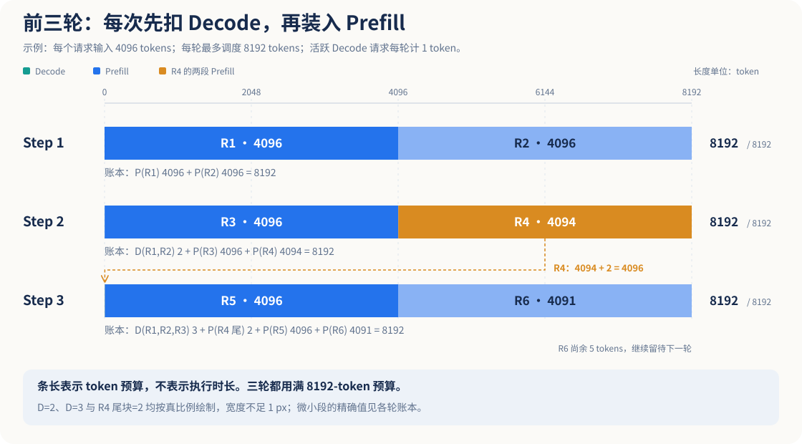
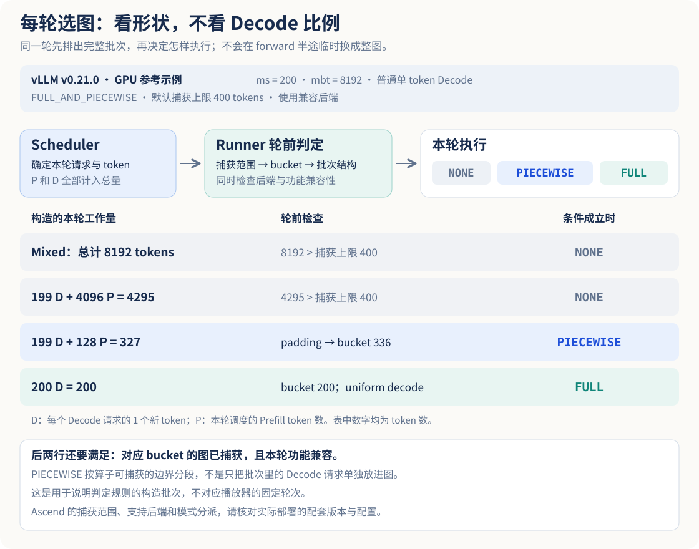
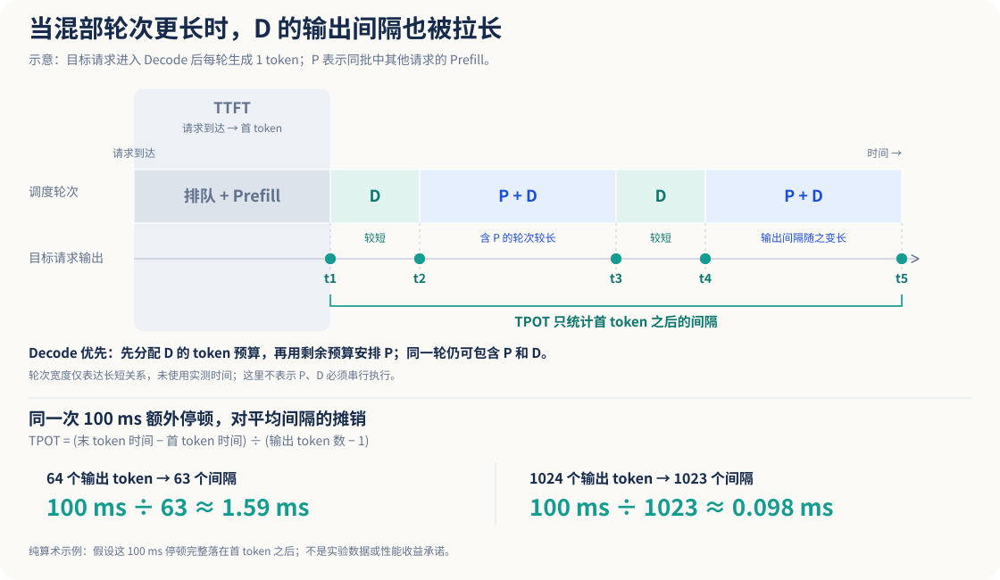
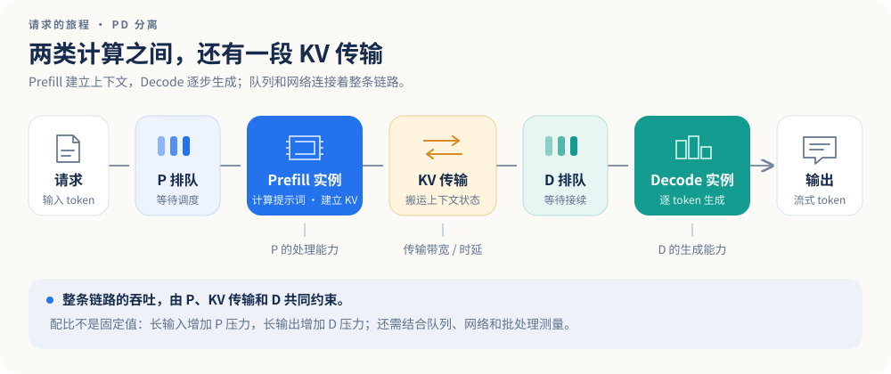
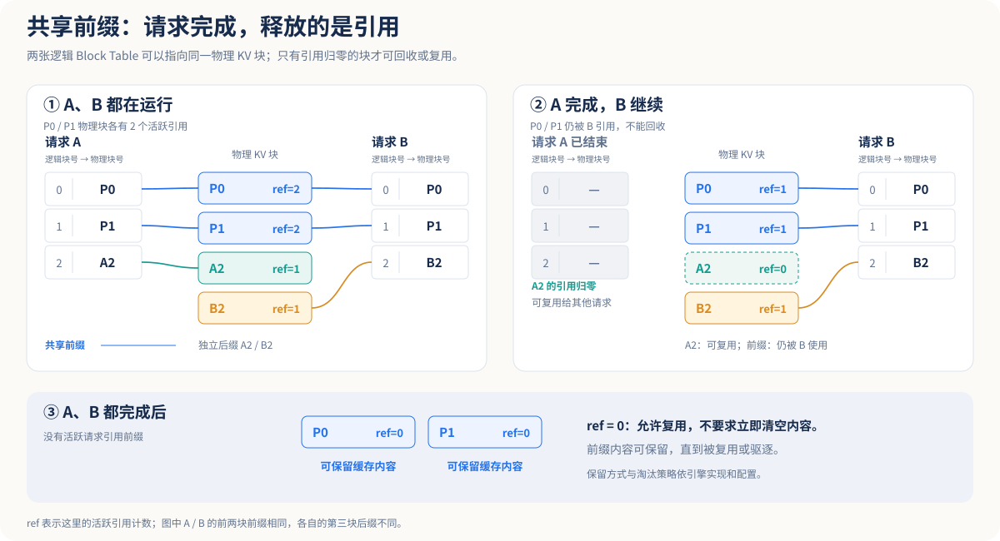
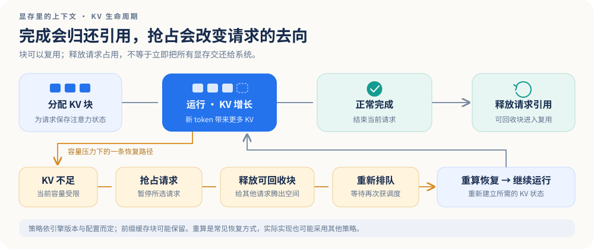

# LLM 推理调度与执行

混部与 PD 分离、逐轮选图、稳态测试及 KV Cache。

先考虑混部场景下，vLLM Ascend 引擎设置了 `max-num-seqs=200`、`max-num-batched-tokens=8192`；后续我会把这两个变量称为 **ms** 与 **mbt**。这时候我使用测试工具，例如 AISBench，往引擎发送请求，始终保持未收回的请求为 200 条，输入为 4K、输出为 1K，这是一个背景信息。

首先在这个混部场景下，我认为可以分阶段来看：第一批 P 请求怎么进来，后面怎么组装 P 和 D，再看请求结束后补入新 P 会发生什么。接着看每一轮怎样选择图执行，以及原来的两个问题：为什么输出短时 TPOT 可能很长、为什么要做稳态测试。之后再看 PD 分离、抢占与 KV Cache 的释放。

> 本文中的数字是教学推演，不是实测结果。具体行为必须结合部署的 vLLM、vLLM Ascend、AISBench 版本、模型和启动日志核对。

## 1. 先约定教学模型

这里的 4K、1K 分别按 **4096 Token**、**1024 Token** 计算。客户端采用闭环补请求：一条返回后再补一条，使有剩余测试数据时在途请求数尽量维持 **200**。实际输入长度要以应用聊天模板、Tokenizer 之后的 Token 数为准，不能把 4096 个字符直接当成 4096 Token。

为了把调度过程画清楚，以下算例额外假设：

- 启用 **Chunked Prefill**；使用“先满足可执行 Decode，再用剩余 Token 预算安排 Prefill”的简化策略。
- 每个请求只有一条输出序列；不启用投机解码；采用同步逐轮示意，一条 Decode 序列每轮计算一个新 Token。
- 没有前缀缓存命中、没有抢占，KV 空间足够；不加入多模态、流水线、异步调度等额外限制。
- Prefill 可以按预算任意切块；不施加额外的单请求 Chunk 上限、部分 Prefill 数量限制或块对齐限制；本例只受 ms、mbt 和请求状态限制。

上述策略与 vLLM 官方 Chunked Prefill 文档的说明相符；真实实现还有其他调度条件，不能将本例当作所有版本、所有 Ascend 配置的保证。[vLLM 优化文档](https://docs.vllm.ai/en/latest/configuration/optimization/)、[固定版本 V1 调度器源码 v0.11.2](https://github.com/vllm-project/vllm/blob/v0.11.2/vllm/v1/core/sched/scheduler.py)

### 1.1 四个容易混淆的量

| 量 | 本例含义 | 容易产生的误解 |
| --- | --- | --- |
| 客户端并发 200 | 已发出、尚未完成的请求数目标，包含服务端等待中的请求 | 200 条都在做 Decode |
| ms = 200 | 每轮可处理的序列数上限；本例每请求一条序列 | 服务端只能接收 200 条请求 |
| mbt = 8192 | 每轮新计算的 Token 预算上限，P 与 D 共用 | KV 只能保存 8192 Token，或每轮必须填满 |
| KV Cache 容量 | 保存已经计算过的上下文状态所需的块空间 | 由 ms 或 mbt 直接决定 |

ms 与 mbt 是不同维度的约束；KV 是否足够还取决于模型结构、精度、并行方式、可用显存、上下文长度和缓存共享情况。新版本也可能把运行态准入与每轮序列容量进一步分开，因此应查看所用版本的参数定义。[vLLM SchedulerConfig](https://docs.vllm.ai/en/latest/api/vllm/config/scheduler/)

## 2. 一个请求的生命周期

```text
客户端发送 → 排队 → Prefill（可分成多块）→ 首 Token → Decode → 完成 → 归还 KV 块引用
                    └────────────── 构建并持续使用 KV Cache ──────────────┘
```

**P（Prefill）**处理输入上下文并构建 KV Cache；**D（Decode）**利用已有 KV Cache，逐步生成后续输出。同一混部实例的一轮计算可以同时包含 P Token 和 D Token。

一次完整 Prefill 结束时，通常已经可以采样首个输出 Token；所以“输出 1024 Token”不能机械地解释成“Prefill 后还必须做 1024 轮 Decode”。在本例同步、无投机的模型里，可以理解为首 Token 后再生成约 1023 个 Token。真实首 Token 发送时点还受到执行和流式返回实现影响。

教学中的 P/D 是工作类型标签。V1 调度器源码以已计算 Token 数和待计算 Token 数统一描述请求，并非必须维护两个独立的 P/D 队列。[V1 调度器源码说明](https://github.com/vllm-project/vllm/blob/v0.11.2/vllm/v1/core/sched/scheduler.py)

### 2.1 一轮调度怎么真正进入模型执行？

**源码事实｜固定 vLLM v0.11.2、UniProcExecutor、GPU Worker 的参考路径。** `EngineCore.step()` 先调用 `Scheduler.schedule()`，拿到 `SchedulerOutput`，再交给执行器；调度器并不直接运行模型。输出结构包括各请求本轮调度的 Token 数、新请求数据与 KV 块编号等信息，因此它描述的是“本轮算哪些 Token、使用哪些状态”。[EngineCore](https://github.com/vllm-project/vllm/blob/v0.11.2/vllm/v1/engine/core.py)、[SchedulerOutput](https://github.com/vllm-project/vllm/blob/v0.11.2/vllm/v1/core/sched/output.py)

```text
EngineCore.step()
  ├─ Scheduler.schedule() → SchedulerOutput
  ├─ UniProcExecutor.execute_model(scheduler_output, non_block=True)
  │    └─ collective_rpc("execute_model", ...) → run_method(driver_worker, ...)
  │         └─ WorkerWrapperBase.execute_model()
  │              └─ Worker.execute_model()
  │                   └─ GPUModelRunner.execute_model()
  │                        └─ 准备输入 / Attention 元数据 → _model_forward() → self.model(...)
  ├─ 等待执行结果；若返回 None，再调用执行器的 sample_tokens(...)
  └─ Scheduler.update_from_output(...) → 更新请求进度、完成状态与输出
```

这里 `self.model_executor` 的具体类型选为 `UniProcExecutor`：它通过 `collective_rpc` 调用持有 Worker 的包装对象，再由 GPU `Worker.execute_model()` 调用 `model_runner.execute_model()`。Runner 更新持久批状态、准备本轮输入和 Attention 元数据，最终进入模型前向。执行器后端、流水线和异步设置会改变具体执行路径，这张调用链只追踪上述参考路径。[UniProcExecutor](https://github.com/vllm-project/vllm/blob/v0.11.2/vllm/v1/executor/uniproc_executor.py)、[WorkerWrapperBase](https://github.com/vllm-project/vllm/blob/v0.11.2/vllm/v1/worker/worker_base.py)、[GPU Worker](https://github.com/vllm-project/vllm/blob/v0.11.2/vllm/v1/worker/gpu_worker.py)、[GPU Model Runner](https://github.com/vllm-project/vllm/blob/v0.11.2/vllm/v1/worker/gpu_model_runner.py)

**教学推导。** “先分配 D 的预算”与“D 在设备上先独立执行完、立刻返回”不是同一件事；本轮调度输出仍可能组织成一个混合批次。调度顺序本身不能给出这轮的毫秒数。

**待验证。** 当前项目没有提供实际部署版本和配置；上述 GPU 类名不代表 vLLM Ascend 的 Worker/Runner 类名。要解释某次 NPU 实测，应先锁定 vLLM Ascend 与 vLLM 的配套版本，再沿对应后端追踪，不能直接套用这里的调用链。

## 3. 混部调度：沿着预算逐轮看

先截取最初到达的 200 条请求，在首个请求完成前推演；这段时间还没有“完成后补入”的新请求。下面总输入 `200 × 4096` 也只计算这最初一批。若是在完整的 200/200 单波测试中，后续没有补入；若继续保持闭环负载，则从首个完成开始，就必须把新来的 P 一起算进去。尤其输出为 64 时，可能在最初 200 条都做完 Prefill 前便开始替换，不能继续套用长输出单波的阶段。

### 3.1 第一轮：只有 Prefill

第一个阶段是第一批到达的 P 请求。这时候还没有 D，能在这一轮做完整 Prefill 的就是两个，`4096 + 4096 = 8192`，这时候就达到了 mbt 的上限：

```text
本轮 Token 预算 8192
┌──────────────────────┬──────────────────────┐
│ R1 Prefill：4096      │ R2 Prefill：4096      │
└──────────────────────┴──────────────────────┘
```

这里限制的是“本轮能够计算多少新 Token”。其他请求仍可处于等待中。ms 的 200 个名额没有填满，也不意味着必须等待更多请求凑成一批。

### 3.2 第二轮：先 D，再用剩余预算放 P

第二个阶段就是前面两条请求开始进入 D 状态。这时候下一个 step 就开始组装 P 和 D，也就是“2D + 2P”。R1、R2 各占本轮 1 个 D Token，剩余 `8192 − 2 = 8190`，够放一个完整的 P，以及另一个 P 的一部分：

```text
R1 D：1 + R2 D：1 + R3 P：4096 + R4 P：4094 = 8192
                                              └─ R4 还差 2 个输入 Token
```

因此，“2D + 2P”只表示四条序列参与本轮，不表示两个 P 都已完成。R4 需要保留已经完成的 Prefill 进度和对应 KV。

### 3.3 第三轮：先补完旧 Chunk，再接新请求

然后来到下一轮，这时候 R1、R2、R3 可以 Decode，R4 还在 Prefill。三条 D 占 3 个 Token，剩余 `8189`；先把 R4 剩下的 2 个补完，再放一个完整 P，最后放进一个不完整 P：

```text
3 个 D：3 + R4 P 尾块：2 + R5 P：4096 + R6 P：4091 = 8192
                                                    └─ R6 还差 5 个
```

| 轮次 | 本轮 D Token | 本轮 P Token 的组成 | 合计 | 轮末结果 |
| --- | ---: | --- | ---: | --- |
| 1 | 0 | R1 4096 + R2 4096 | 8192 | R1、R2 可继续 D |
| 2 | 2 | R3 4096 + R4 4094 | 8192 | R3 可继续 D；R4 剩 2 |
| 3 | 3 | R4 尾块 2 + R5 4096 + R6 4091 | 8192 | R4、R5 可继续 D；R6 剩 5 |

这些计算是本例假设下的手算结果。实际 Trace 可能因为额外限制、缓存命中或调度顺序而不同。



图中每轮总预算都是 8192。R4 在第二轮留下的 2 个 Token 需要在第三轮接续；把请求画成完整色块时，也不能把它误读成已经完成整个 Prefill。

### 3.4 为什么会出现纯 D？会持续多久？

随着更多 Prefill 完成，D 的数量增加。若 200 条在途请求最终都进入 D，那么已经没有待 Prefill 的请求；在本例准入模型里，序列名额也已占满。此时会出现纯 D 轮次。

**纯 D 段不一定短。** 最初 200 条请求总输入为 `200 × 4096 = 819200 Token`，即使完全没有 D 开销，也至少需要 100 个满预算轮次完成全部 Prefill；加上混部 D 开销，还要更多轮。在本例长输出、无抢占的简化模型中，最早请求生成 1024 个输出 Token 所需的轮次远多于这个装填过程，因此首个请求完成前便可能有很长一段纯 D。对 200/200 单波测试，后续会沿着纯 D 继续完成与排空；对持续闭环测试，完成后补入的 P 会再次改变工作组成。

反过来，如果输出较短、请求持续交错到达，或者出现抢占，就可能还没全部进入 D，早到的请求已经完成。实际系统不一定呈现整齐的“纯 P → 混合 P/D → 纯 D”三段。

有请求完成后，客户端若还有数据就补发新请求；新请求经过排队、准入和 Prefill，再进入 D。**空出一个序列名额，只代表具备接入新工作的条件，仍需检查 Token 预算和 KV 空间。**

留两个问题，大家可以思考一下：

1. 为什么输出短的时候，比如 64，会出现 TPOT 很长的情况？
2. 为什么需要稳态测试？使用 AISBench 测试时，并发/总请求 200/200 和 200/800 有什么区别？

### 3.5 D 越来越多，能在中间某一轮改用图吗？

可以，切换点在**某一轮前向开始之前**。Scheduler 给出本轮工作量，Runner 再按当前 batch 选择执行路径；同一个混部实例可以上一轮不用图、下一轮回放图，后续补入新 P 时再重新选择。已经执行到一半的前向，不会因为请求阶段变化而临时把后半接成另一张完整图。[vLLM v0.21.0 逐轮判定源码](https://github.com/vllm-project/vllm/blob/v0.21.0/vllm/v1/worker/gpu_model_runner.py#L3601-L3683)

先分清“图模式”指什么。这里讨论 GPU 的 CUDA Graph、Ascend 的 ACLGraph 捕获与回放。通常启动时先对有限的 batch 档位预热、捕获，运行时更新输入和元数据，选择匹配的图回放；不是线上遇到任何新形状就自动临时捕获。图回放可以减少重复提交设备工作的 CPU 开销，但不代表省掉 Attention 计算或 KV 访问。[vLLM 预捕获流程](https://github.com/vllm-project/vllm/blob/v0.21.0/vllm/v1/worker/gpu_model_runner.py#L6150-L6233)、[Ascend ACLGraph wrapper](https://github.com/vllm-project/vllm-ascend/blob/e8a6393dda93e085cd8210011c6ec12027acb8a0/vllm_ascend/compilation/acl_graph.py#L156-L188)

| 本轮运行时模式 | 怎么执行 |
| --- | --- |
| `NONE` | 不回放设备图；这与代码是否经过 `torch.compile` 是不同问题 |
| `PIECEWISE` | 沿算子边界把支持的计算片段放进图，不兼容部分在图外执行；不是只把 D 请求抽出来进图 |
| `FULL` | 整个模型前向走完整图；能否包含 P/D 混合 batch 要看配置和后端 |

`FULL_AND_PIECEWISE` 是一种配置策略，不是第四种运行时模式：在满足图条件时，uniform decode 走 FULL，其他 batch 走 PIECEWISE；没匹配图则回到 NONE。普通单 Token 解码中，uniform decode 通常要求本轮每条请求都调度 1 个 Token，不能只看请求被标成了 D；投机解码的统一 query length 可能更大。[模式定义](https://github.com/vllm-project/vllm/blob/v0.21.0/vllm/config/compilation.py#L582-L614)、[运行时匹配](https://github.com/vllm-project/vllm/blob/v0.21.0/vllm/v1/cudagraph_dispatcher.py#L234-L319)

**教学对照｜vLLM v0.21.0 的 GPU 参考配置。** 取 ms=200、mbt=8192，普通单 Token D、无 LoRA，使用默认捕获尺寸与 `FULL_AND_PIECEWISE`，假设后端及功能组合兼容。该版本此条件下默认最大捕获尺寸为 `min(200×2, 512)=400`，并受 mbt 约束。8192 是调度预算，不是默认图尺寸。



| 本轮工作量（构造示例） | 新 Token 总量 | 在上述条件下的路径 |
| --- | --- | --- |
| P/D 混合，预算用满 | 8192 | 超过 400，NONE |
| 199 个 D + 1 个 P 的 4096-Token chunk | 4295 | 虽然 99.5% 请求是 D，仍超过 400，NONE |
| 199 个 D + 1 个 P 的 128-Token 尾块 | 327 | padding 到 336 档位，匹配后走 PIECEWISE |
| 200 个 D，每条前进 1 Token | 200 | 匹配 uniform decode 的 200 档位，走 FULL |

这些例子用于隔开“请求比例”和“本轮形状”，不代表播放器必然出现对应轮次。捕获档位还会受自定义配置、并行策略和后端限制；“全部是 D”也不是充分条件。强制 eager、图未启用、没有兼容的捕获图或功能组合受限，都可能让该轮不用完整图。[默认尺寸生成源码](https://github.com/vllm-project/vllm/blob/ad7125a431e176d4161099480a66f0169609a690/vllm/config/vllm.py#L1529-L1587)、[图尺寸与模式匹配](https://github.com/vllm-project/vllm/blob/v0.21.0/vllm/v1/cudagraph_dispatcher.py#L234-L319)

**Ascend 版本边界。** 本节另核对 vLLM Ascend `e8a6393dda93e085cd8210011c6ec12027acb8a0`，它记录的已验证 upstream 为 `544f182d9f0c9bfe8bd7645525951d5e3692a542`，不能当作上面 GPU v0.21.0 或前文 v0.11.2 的同一套配置。Ascend Runner 也会逐轮判断 uniform decode 再派发。当前标准 Attention 声明 `ALWAYS`，MLA 为 `UNIFORM_BATCH`，所以不能写“只要还有 P，就绝对不能 FULL”；`FULL` 与 `FULL_AND_PIECEWISE` 的策略也不同。400 上限更不能直接套给未提供版本的 NPU 部署。[Ascend 轮前判定](https://github.com/vllm-project/vllm-ascend/blob/e8a6393dda93e085cd8210011c6ec12027acb8a0/vllm_ascend/worker/v1/model_runner.py#L3636-L3717)、[标准 Attention 能力](https://github.com/vllm-project/vllm-ascend/blob/e8a6393dda93e085cd8210011c6ec12027acb8a0/vllm_ascend/attention/attention_v1.py#L291-L298)、[MLA 能力](https://github.com/vllm-project/vllm-ascend/blob/e8a6393dda93e085cd8210011c6ec12027acb8a0/vllm_ascend/attention/mla_v1.py#L452-L459)

在 PD 分离里，D 实例通常更容易持续出现 uniform decode 形状，因此可以单独考虑 `FULL_DECODE_ONLY`；它同样需要满足图覆盖和后端条件。P 端能否用图仍应另查，PD 分离本身不保证任何一端采用图。

要确认当前机器有没有切换，先记录配套版本、有效图配置、捕获档位、Attention 后端，再对齐每轮 P/D Token、padding 后形状、runtime mode 和设备 Trace。尚无这些证据时，只能说明“具备逐轮切换机制”，不能认定某次 TPOT 改善来自图执行。

## 4. 思考题一：输出只有 64，为什么 TPOT 可能很长？

先看测量时间线：



```text
请求发送 ─────────── 首 Token ── Token 2 ── Token 3 ───── 最后 Token
         ←── TTFT ──→           ←─ 首 Token 之后的生成时间 ─→
         ←──────────────── E2EL ────────────────────────→
```

AISBench 将 TTFT 描述为首 Token 返回延迟，将 TPOT 描述为排除首 Token 后的平均输出 Token 生成延迟。[AISBench 性能指标](https://github.com/AISBench/benchmark/blob/master/docs/source_en/base_tutorials/results_intro/performance_metric.md)

常用的逐请求口径为 `TPOT = (E2EL − TTFT) / (输出 Token 数 − 1)`，要求输出多于 1 个 Token。vLLM 官方压测代码使用这一口径；使用 AISBench 时还应核对当前版本的计算实现、流式返回与 Token 计数方式。[vLLM 压测指标源码](https://github.com/vllm-project/vllm/blob/v0.11.2/vllm/benchmarks/serve.py)

在当前混部算例中，较短输出可能更早结束：

1. 早到请求的整个 Decode 生命周期都处于后续长输入持续加入的装填期，几乎享受不到长输出请求后面那段纯 D 计算。
2. D 优先只是先分配本轮预算；同一轮混入的长 P 仍可能拉长整轮执行时间，因此 D Token 的返回间隔也会变长。
3. 短输出只有 63 个后续 Token 间隔，少数停顿更容易抬高逐请求均值。例如仅作算术示意：一次 100 ms 的额外停顿，对 64 输出的 TPOT 贡献约为 `100/63 = 1.59 ms`；对 1024 输出约为 `100/1023 = 0.098 ms`。
4. 闭环负载下，短请求完成得快，可能更频繁触发新 Prefill；KV 抢占、网络抖动和客户端瓶颈也可能放大停顿。

所以“短输出 TPOT 超长”是需要验证的现象，不是短输出的必然属性。TTFT 本身较长，也不能直接推出 TPOT 较长，因为上述 TPOT 口径已经扣除了 TTFT。应将请求到达时间、每轮 P/D 组成、逐 Token 间隔和抢占事件放在同一时间线上分析。Chunked Prefill 的预算大小会影响 P/D 干扰与 TTFT/ITL 的取舍。[vLLM Chunked Prefill 调优说明](https://docs.vllm.ai/en/latest/configuration/optimization/)

### 4.1 Decode 优先，为什么仍会受到 Prefill 干扰？

**源码事实。** 前面固定版本的链路说明，预算分配与模型执行是两个层次；`GPUModelRunner` 依据本轮所有请求组织输入，再进入前向。这不等于先跑完一个独立 D batch，再开始 P batch。长 Prefill 混入本轮后，实际耗时还受到算子形状、上下文长度、访存和通信影响。

**教学推导。** 假设一条请求的相邻两个输出，分别来自连续的同步轮次 k 和 k+1，那么它的 ITL 不只取决于“本轮 D 占 1 个预算”，还受后一轮执行与发送等开销影响。如果轮次 k+1 携带较重的 P，即使 D 先拿到了预算，它也没有获得一个固定的时延保证。首 Token 后发生的调度或抢占等待，仍会进入 TPOT；被扣除的是首 Token 之前的 TTFT。

因此 Chunked Prefill 调优是在分配单轮工作量：较小的 mbt 可以限制单轮混入的 P，倾向于保护 ITL，但 P 需要更多轮推进，可能增加 TTFT 与调度/启动开销；较大的 mbt 能一次推进更多输入、减少切块次数，也可能让混合轮次更重。具体吞吐和时延曲线取决于模型、设备、实现与负载，不能由 8192 这个数直接推断最优点。[vLLM v0.11.2 调优文档](https://docs.vllm.ai/en/v0.11.2/configuration/optimization/)

## 5. 思考题二：200/200 和 200/800 测到的是同一种状态吗？

这里的写法是“**客户端最大并发 / 总请求数**”。比较时假设请求结束就补发，且没有额外 QPS 限速；如果使用固定速率发送，负载模型已经改变，不能仅凭这两个数字推断流量形状。AISBench 的 `batch_size` 用来配置发送最大并发，总请求量和发送速率则是另外的设置。[AISBench README](https://github.com/AISBench/benchmark/blob/master/README_en.md)、[性能测试说明](https://github.com/AISBench/benchmark/blob/master/docs/source_en/base_tutorials/scenes_intro/performance_benchmark.md)

| 负载 | 过程 | 能回答什么 | 主要限制 |
| --- | --- | --- | --- |
| 200/200 | 发出一波，之后只等待完成 | 单波突发、排队、装填与排空表现 | 没有持续补请求；客户端并发随完成而下降 |
| 200/800 | 初始最多 200，在前 600 条后续请求仍可补入时持续替换 | 更接近持续负载，能观察补入 P 对 D 的干扰 | 只有有限的替换周期；仍有启动与排空，不能保证达到稳态 |

`200/800` 不是同步执行的四个固定批次。请求按各自完成时间异步补入，P/D、上下文长度和 KV 占用分布可能持续变化；当数据发完后，依然进入排空期。

### 5.1 并发达到 200，是稳态的充分条件吗？

对教学分析而言，**稳态是工作分布在观察窗口内足够稳定**：客户端在途数稳定，同时 P/D 比例、完成速率、排队长度、KV 占用和尾延迟没有持续漂移。并发曲线平了，并不自动证明这些量都稳定。

**教学推导。** 闭环 200 在途还带有反馈：响应变慢，完成与补入的速率就会降低；在足够长的稳定窗口、无客户端思考时间时，平均到达率近似为 `λ ≈ 平均在途数 / 平均 E2EL`。因此“在途始终 200”并不意味着 QPS 固定，也不能证明系统在同等固定 QPS 的开放负载下仍然稳定。两种发送方式要分别报告。

AISBench 的 `stable_stage` 汇总器有基于并发时间段选择样本的计算规则；它不能凭空制造一个足够长的稳定负载。官方说明还提醒窗口边界会影响吞吐统计，并给出最大单请求 E2EL 小于窗口时长三分之一的可靠性条件。应以所安装版本的定义为准。[AISBench 稳态测试说明](https://github.com/AISBench/benchmark/blob/master/docs/source_en/advanced_tutorials/stable_stage.md)

建议把测试曲线画成三段，并明确报告采用的统计窗口：

```text
并发/工作分布
       装填期          候选稳定窗口             排空期
      ╱───────────────╲
     ╱                 ╲
────╱───────────────────╲──────── 时间
```

稳态测试至少要回答：是否完成模型预热，是否排除启动/排空；稳定窗口是否覆盖足够多次请求替换；模型、Tokenizer、输入/输出实际长度、缓存命中和失败请求是否一致。报告 TTFT、TPOT/ITL 的分位数以及成功请求吞吐，并保留完整测试结果供比较。不能把冷缓存单波测试与热前缀持续测试直接当作同一负载。

## 6. PD 分离：拆开计算，也引入交接

PD 分离把 Prefill 与 Decode 放在不同实例或资源池中：



```text
客户端 → Proxy → P 等待队列 → P 计算 → KV 传输/加载 → D 等待队列 → D 计算 → 输出
                                  ↑           ↑
                            传输前需保留源 KV   目标需有可用 KV 空间
```

“两级排队”是理解 P、D 两个计算阶段的起点；完整链路还包括代理路由、网络、KV 传输与目标端加载，不能只看 P 与 D 的算力。

图中箭头表示请求/KV 的依赖关系与可能排队的位置，不要求所有实现把这些阶段整段串行执行。逐层推送可以在 Prefill 尚未全部结束时传输已经产生的层 KV；D 何时获得执行所需状态，以及哪些传输能够重叠，取决于连接器。

先沿着一条请求看交接。**官方文档事实｜vLLM Ascend 的 Mooncake 拉取式例子**，不是所有连接器共用的时序：[PD 设计文档](https://docs.vllm.ai/projects/ascend/en/main/developer_guide/Design_Documents/disaggregated_prefill.html)

1. 请求到 Proxy，先选择 P，P 端负责 Prefill。该例子把 P 请求的输出限制为 1 个 Token，让它完成 Prefill 与本地首 Token 路径；不能据此认为客户端已经收到首 Token，代理如何合并和返回输出还要另看实现。
2. P 算完后返回交接元数据，但 KV 暂时不能覆盖。后面 D 还要读取这些状态，因此这里是“P 端计算结束、等待交接”，整条用户请求并没有结束。
3. Proxy 再选择 D 并转发请求。D 请求先等待远端 KV，调度器为目标 KV 预分配空间；这时候它虽然已经来到 D，也不等于已经开始 Decode。
4. D 发起拉取。拉取完成、确认满足源端释放条件后，才通知 P 归还对应 KV 引用；不能只因为请求已经转发，就把源块拿去覆写。
5. D 有了执行需要的 KV 后继续 Decode。源端释放与 D 后续计算是交接后的两项工作，不能把通知发出当成源块已经在同一瞬间完成回收。D 的 KV 还要保留到后续生成结束或被其他机制回收。

所以 PD 多出来的不只是网络时间，还有 KV 的驻留时间。P 完成到释放确认之间，源 KV 仍可能占着块；D 预分配到实际解码期间，目标块也已经占用。若 D 无法准入或分配目标空间，使拉取迟迟不能开始，P 端 hold 的 KV 就会堆积。若拉取已经完成并确认释放，D 后续的本地排队会继续占用 D 的缓存，但不能再一概说它还占着 P 的源 KV。

P、D 是不同引擎实例，各自有 ms、mbt 与 KV 块池，不能把它们画成共同争抢一份 8192 的预算。PD 也不替代单实例内部调度；P 是否继续使用 Chunked Prefill、D 是否需要本地补算，应查当前版本和连接器配置，这里不假设 D 端永远没有 Prefill。

网页里的 PD 播放器按这些交接事件逐帧演示。一次点击不等于真实引擎的一个 step，动画帧的宽度和播放间隔也不代表传输耗时，不能从动画读出吞吐或 TPOT。

### 交接拥塞时，看哪一段在等

下面是**教学推导，尚无本项目实测**。要定位瓶颈，需要把 P/D 等待队列、P 计算结束时间、未确认释放的 KV、D 缓存水位与传输耗时放在同一时间轴上。这里的 hold 指“已完成 P、尚未满足源端释放条件的 KV”，不是单独一项已确认存在的监控指标名。

| 现象 | 更需要排查的地方 | 能帮助区分的证据 |
| --- | --- | --- |
| 请求在 P 前越等越久，P 产出跟不上输入；D 经常等不到可运行请求 | P 计算能力、P 准入或路由分布 | P 等待队列增长、TTFT 抬高；若传输正常且 D 本身不拥塞，进入 D 后的 ITL 可能仍稳定。还要检查 P 是否因源 KV hold 过多而无法准入，避免把缓存反压误判成纯算力不足 |
| P 已经算完，但交接与 D 等待越积越多 | 传输链路、D 目标 KV 空间或 D 服务能力 | 传输受限时，交接耗时和未确认 KV 可能一起增长；D 算力/驻留压力较大时，D 就绪队列、KV 水位或 ITL 可能先抬高，再反压交接。传输正常但 D 本地队列长，与远端 KV 一直未到，是两种不同的等待 |

TTFT 是否包含全部 D 等待，要看代理何时第一次向客户端输出；已在 D 稳定生成的请求 ITL 也不能代表还没进入 D 的请求没有拥塞。闭环测试还会因响应变慢而减慢补入，因此最终看见队列“停止增长”时，也要确认是不是请求到达率跟着降了。

### 6.1 PD 配比为什么随输入/输出改变？

用相同单位“请求/秒”比较，端到端可持续吞吐受最紧的资源约束。教学上可写成上界：

`可持续请求吞吐 ≤ min(P 有效处理能力, D 有效处理能力, KV 交接能力, 其他链路能力)`

这只是资源上界，不是实测吞吐等式。批处理效率、队列、传输与计算的重叠、负载不均都会影响实际结果。KV 交接能力还与每请求 KV 数据量、有效带宽和目标内存空间有关。

- 长输入、短输出：通常增加 P 与 KV 交接压力。
- 短输入、长输出：通常增加 D 的持续计算与驻留 KV 压力。
- 前缀命中、长度分布、模型结构或网络改变，也会改变合适的 P:D 资源配比。

因此，针对某一种输入/输出组合调好的配比不能直接复用到所有业务。PD 的重要价值是隔离 Prefill 对 Decode 的干扰，让 TTFT 与 ITL 更容易分别调优；它不保证吞吐增加，也不是消除排队和 KV 压力的开关。[vLLM PD 官方说明](https://docs.vllm.ai/en/latest/features/disagg_prefill/)

### 6.2 用服务需求把 P:D 配比推出来

**教学推导｜固定工作负载、固定单实例资源组。** 设每个 P 实例的有效容量为 μP 请求/秒，每个 D 实例为 μD 请求/秒；分别配置 nP、nD 个同类实例，暂不考虑扩展损失和负载不均。稳定运行要求目标到达率 λ 满足 `λ < nP × μP`、`λ < nD × μD`，传输及其他环节也必须满足各自约束。

令 `dP = 1/μP`、`dD = 1/μD`，单位是“实例·秒/请求”，表示在代表性批处理条件下摊到每请求的资源服务需求。它们不是包含排队的 TTFT、E2EL；并发请求可以共享一次批执行，不能直接拿单请求响应时间当服务需求。若希望两边接近容量平衡，则有：

```text
nP / dP ≈ nD / dD
所以 nP : nD ≈ dP : dD
```

再设输入 I、输出 O 固定；RP 是单个 P 实例的有效输入处理速率（输入 Token/秒），RD 是单个 D 实例的有效 Decode 新 Token 计算速率（D Token/秒）。按本例“P 的首 Token 直接计入最终输出、D 只继续 O−1 个”的简化记账方式，可粗估 `dP ≈ I/RP`、`dD ≈ (O−1)/RD`，于是 `nP/nD ≈ I×RD / ((O−1)×RP)`。这解释了为什么输入/输出分布变化会改变配比，但 RP、RD 本身也随批大小、上下文与并行策略变化，需要实测，不能用设备峰值算力替代。

上述 nP、nD 数的是配置固定的实例资源组；如果 P、D 单实例占用设备数不同，还需换算总设备数、成本和 SLO，再比较资源配比。即使理论容量相等，把两边都压到饱和也可能导致排队与尾延迟恶化。

### 6.3 KV 字节量如何约束 PD 传输？

**源码事实。** v0.11.2 的 `AttentionSpec.page_size_bytes` 对普通 Attention 给出一层一块的字节数：`2 × block_size × num_kv_heads × head_size × dtype_size`；MLA 在同一文件中使用独立规格。[KV Cache 规格源码](https://github.com/vllm-project/vllm/blob/v0.11.2/vllm/v1/kv_cache_interface.py)

**教学推导｜标准 MHA/GQA、各层同规格、K/V 头维相同、每元素采用相同标量存储精度，计算完整单副本。** 暂不计压缩、量化元数据或并行切分。设层数 L、KV 头数 Hkv、每头维度 dh、每个缓存元素字节数 s，则逻辑 KV 数据量为：

```text
每 Token 的 KV 字节量：bKV = 2 × L × Hkv × dh × s             [字节/Token]
T 个已计算 Token：   MKV = T × bKV                           [字节]
分块分配近似量：      Malloc ≈ ceil(T/B) × B × bKV             [字节]
```

其中 2 对应 K、V，B 是每块 Token 数；最后一式暂不计块表、元数据、额外预留与共享。MHA 中 Hkv 等于 Query 头数，GQA 中通常更小；估算 KV 应使用 KV 头数。若 200 个请求没有共享、都接近输入 4096 加输出 1024 的上下文长度，总逻辑 KV 会接近 `200 × 5120 × bKV`，这里仅表达量级，末个已采样输出可能尚无对应 KV，分块与具体模型也会改变实际分配。

再假设 D 需要接收全部 I 个 Prompt Token 的 KV，P、D 缓存格式一致、没有压缩或远端命中，则交接数据量 `V ≈ I × bKV`。如果链路可用负载带宽的上限是 Bnet 字节/秒，单次交接的纯数据串行化时间下界为 `tdata ≥ V/Bnet`；同一共享瓶颈链路的容量上界为 `μX ≤ Bnet/V` 请求/秒。这两个式子使用同一个“必须经过该链路的数据量 V”，不能把整模型的 V 除以单个分片链路带宽来估计并行传输。

该下界不包含路由、握手、队列、打包、重排和主机/设备拷贝。逐层推送可以让一部分传输与计算重叠，因此 `V/Bnet` 也不能无条件直接加到完整 P 耗时上；多跳路径需分别检查每段的数据量和带宽。MLA、量化缓存、不同 P/D 并行布局、KV 复制及压缩都需要重新核对字节量，不能把上式直接套到当前 Ascend 部署。应以连接器和后端实际传输格式为准。[Ascend PD 连接器流程](https://docs.vllm.ai/projects/ascend/en/main/developer_guide/Design_Documents/disaggregated_prefill.html)

## 7. 抢占与 KV Cache：预算够，为什么仍然调度不了？

### 7.1 Token 预算每轮重置，KV 需要跨轮驻留

mbt 记录本轮要新计算的 Token；KV 保存请求已经走过的上下文。假设一个请求输入 4096，已输出约 500，其 KV 覆盖的上下文已接近 4596 Token；它下一轮即使只消耗 1 个 D Token 预算，仍需要保留已有 KV，并在必要时申请新块。

若使用每块容纳 B 个 Token 的普通分块示意，单请求逻辑块数约为 `ceil(上下文长度 / B)`。这仅用于理解块边界；滑动窗口、混合模型、MLA、并行切分和缓存共享等会改变实际存储，不能据此凭空估算设备内存。

```text
请求 A： [共同前缀块 0][共同前缀块 1][A 的后缀块]
请求 B： [共同前缀块 0][共同前缀块 1][B 的后缀块]
              共享引用                各自占用
```



这张图看的是块引用：A 完成后，B 仍引用的共同前缀不能回收为可覆写的空闲块；只有活跃引用归零，块才具备被后续分配复用的条件。前缀缓存可以在引用归零后保留内容，不等于该块永远不允许驱逐。

### 7.2 抢占不是请求完成



当无法为某些运行中请求分配所需 KV 块时，调度器可能抢占请求，为其他工作释放空间。被抢占请求仍未完成，之后恢复执行；V1 常见的重计算路径会让请求回到等待状态、归还 KV 引用，并在后续重建必要状态。它会增加额外工作与等待时间，而不是免费暂停。[V1 抢占路径源码](https://github.com/vllm-project/vllm/blob/v0.11.2/vllm/v1/core/sched/scheduler.py)

具体版本、连接器或配置也可能采用换出、卸载或其他恢复机制，不能把所有部署都描述为相同路径。应记录抢占次数和时间，结合 KV 压力判断延迟尖峰；不要仅因为 mbt 尚有剩余，就认定系统还能再接一个 P。

### 7.3 “释放 KV”不等于立即清空设备内存

请求结束通常会解除它对 KV 块的引用。没有其他请求使用的块，可以回到块池供后续分配；共享块要等相关引用都归还。启用前缀缓存时，已无活跃引用的已计算块仍可作为缓存候选保留，后续可能命中，也可能被淘汰复用。[vLLM 前缀缓存块管理设计](https://docs.vllm.ai/en/latest/design/prefix_caching/)

因此，服务进程显存占用没有明显下降，不代表 KV 泄漏：块池可能仍由引擎持有。应观察块使用率、空闲块、缓存命中和抢占，而不是只看进程显存总量。

前缀缓存复用的是相同前缀的计算结果，主要减少重复 Prefill，不会省掉新输出 Token 的自回归生成；仅仅语义相似也不足以命中。PD 发送端的 KV 还可能因尚未完成传输而延迟归还，不能在“P 计算结束”时无条件立即复用这些块。[vLLM 自动前缀缓存](https://docs.vllm.ai/en/latest/features/automatic_prefix_caching/)、[Ascend PD 生命周期](https://docs.vllm.ai/projects/ascend/en/main/developer_guide/Design_Documents/disaggregated_prefill.html)

## 8. 课堂实验：用证据验证推演

在固定模型、设备与引擎版本下，比较以下四组。这里给出实验设计，不虚构部署命令、未安装版本的参数或性能数据。

| 组别 | 输入/输出 | 最大并发/总请求 | 观察重点 |
| --- | --- | --- | --- |
| A | 4096/1024 | 200/200 | 单波装填、纯 D 与排空 |
| B | 4096/1024 | 200/800 | 替换请求带来的 P/D 重叠；是否真有足够稳定窗口 |
| C | 4096/64 | 200/800 | 短输出的生命周期是否落在混合阶段；TPOT 与 ITL 尖峰 |
| D | 与 B 相同 | 足够长的持续负载 | 排除装填、排空后，稳定窗口是否仍漂移 |

对齐记录五条时间线：客户端在途请求数、每轮 P/D Token、成功完成速率、KV 块占用、抢占/传输事件。若条件允许，再以相同总设备资源比较混部与 PD，并分别观察 TTFT、尾 ITL、成功吞吐和 KV 交接耗时。

需要区分三个结论：“手算模型可以解释现象”“Trace 证实当前实现这样调度”“实测证明某配置性能更好”。前者不能代替后两者。

## 当前尚未验证的部分

1. **实际部署的调度与执行路径。** 尚未取得 vLLM Ascend/vLLM 版本、配置和 Trace；Decode 优先、切块粒度、准入、图捕获档位与逐轮模式，以及 NPU Worker/Runner 的实现需要对照部署核实。
2. **输出 64 时 TPOT 升高的根因。** 混合轮次干扰是候选机制；还需用逐 Token 时间、每轮 P/D、抢占及客户端/网络数据排除其他原因。
3. **200/800 是否存在可用稳态窗口。** 尚无时间序列与样本筛选结果，不能承诺该总请求量足够，也不能把客户端并发平台直接当作引擎稳态。
4. **目标业务的 P:D 配比和 KV 传输路径。** 尚未测得 RP、RD、服务需求、实际 KV 字节数及有效带宽；连接器模式、跨设备布局和计算/传输重叠也待验证，公式目前只提供测量与推导框架。

## 修订说明

修订日期：2026-10-28。保留原稿调度 → 稳态 → PD → 抢占/KV 的思路，完成以下修正：

按技术 Wiki 编辑规范恢复原稿的场景开头与逐步推演节奏，保留两个思考题作为分析中心；补充固定版本执行调用链、预算与时延的区别、KV/PD 的符号推导及 6 张机制图，并集中列出当前待验证事项。本文更名为《LLM 推理调度与执行》，覆盖混部与 PD 分离；新增逐轮选图说明，区分捕获尺寸、D 比例和运行时模式。没有把手算、源码事实或候选性能解释写成部署实测结论。

- 将首轮与后续轮次明确为 Chunked Prefill、Decode 优先等假设下的简化教学模型，补齐跨轮尾块的算术。
- 区分客户端并发、ms、mbt 与 KV 容量，删除“未达到上限就一定还能接入”的隐含推断。
- 纠正“纯 D 阶段必定短”“1024 输出必定对应 Prefill 后 1024 个 D step”等表述。
- 为输出 64 的 TPOT 异常提供可检验机制，明确 TTFT 与 TPOT 的不同口径。
- 区分 200/200 的单波测试与 200/800 的持续补入，明确总请求增加不能保证稳态。
- 将 PD 的瓶颈扩展至 KV 传输/加载，补齐交接、抢占、块引用回收与前缀缓存。

### 官方资料与版本边界

以下均为官方文档或官方仓库；`latest`、`main`、`master` 会继续变化，复现实验时应记录安装版本与提交号。固定版本源码用于解释一种实现路径，不代表当前项目已采用该版本。

1. [vLLM：Optimization and Tuning](https://docs.vllm.ai/en/latest/configuration/optimization/) — Chunked Prefill 与调优取舍。
2. [vLLM：SchedulerConfig](https://docs.vllm.ai/en/latest/api/vllm/config/scheduler/) — ms、mbt 与相关限制的定义。
3. [vLLM v0.11.2：V1 Scheduler 源码](https://github.com/vllm-project/vllm/blob/v0.11.2/vllm/v1/core/sched/scheduler.py) — 统一 Token 调度与抢占示例。
4. [vLLM：服务压测源码](https://github.com/vllm-project/vllm/blob/v0.11.2/vllm/benchmarks/serve.py) — TPOT 参考计算口径。
5. [AISBench：性能指标](https://github.com/AISBench/benchmark/blob/master/docs/source_en/base_tutorials/results_intro/performance_metric.md) — TTFT、TPOT、ITL、吞吐与并发。
6. [AISBench：服务性能测试](https://github.com/AISBench/benchmark/blob/master/docs/source_en/base_tutorials/scenes_intro/performance_benchmark.md) — 请求发送与数据规模设置。
7. [AISBench：稳态测试](https://github.com/AISBench/benchmark/blob/master/docs/source_en/advanced_tutorials/stable_stage.md) — 稳态样本选择与统计窗口边界。
8. [vLLM Ascend：Disaggregated Prefill](https://docs.vllm.ai/projects/ascend/en/main/developer_guide/Design_Documents/disaggregated_prefill.html) — Proxy、KV 交接与不同连接器时序。
9. [vLLM：Disaggregated Prefilling](https://docs.vllm.ai/en/latest/features/disagg_prefill/) — PD 的目标与限制。
10. [vLLM：前缀缓存块管理设计](https://docs.vllm.ai/en/latest/design/prefix_caching/) — 引用计数、空闲队列与淘汰。
11. [vLLM：自动前缀缓存](https://docs.vllm.ai/en/latest/features/automatic_prefix_caching/) — 复用效果与 Decode 限制。
12. [vLLM v0.11.2：EngineCore](https://github.com/vllm-project/vllm/blob/v0.11.2/vllm/v1/engine/core.py)、[UniProcExecutor](https://github.com/vllm-project/vllm/blob/v0.11.2/vllm/v1/executor/uniproc_executor.py)、[WorkerWrapperBase](https://github.com/vllm-project/vllm/blob/v0.11.2/vllm/v1/worker/worker_base.py)、[SchedulerOutput](https://github.com/vllm-project/vllm/blob/v0.11.2/vllm/v1/core/sched/output.py) — 调度结果、参考执行入口与输出更新。
13. [vLLM v0.11.2：GPU Worker](https://github.com/vllm-project/vllm/blob/v0.11.2/vllm/v1/worker/gpu_worker.py)、[GPU Model Runner](https://github.com/vllm-project/vllm/blob/v0.11.2/vllm/v1/worker/gpu_model_runner.py) — 已核实的 GPU 参考调用链；不能据此推定 Ascend 类名。
14. [vLLM v0.11.2：KV Cache 规格](https://github.com/vllm-project/vllm/blob/v0.11.2/vllm/v1/kv_cache_interface.py) — 普通 Attention 与 MLA 使用不同规格。
15. [vLLM v0.11.2：Optimization and Tuning](https://docs.vllm.ai/en/v0.11.2/configuration/optimization/) — Chunked Prefill 的预算取舍。
