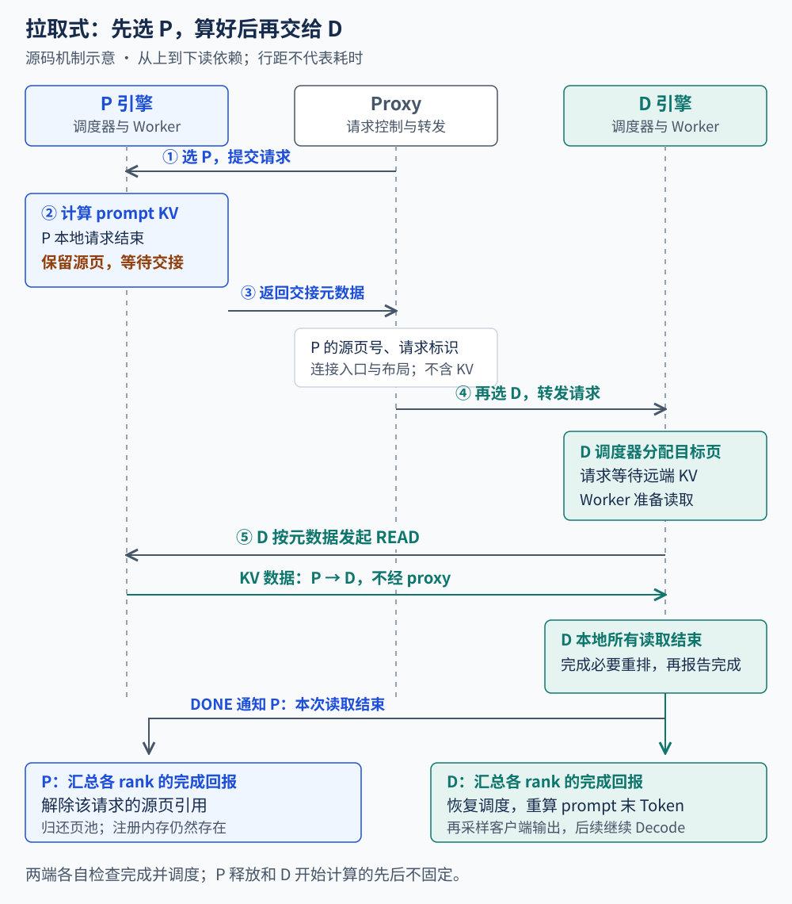
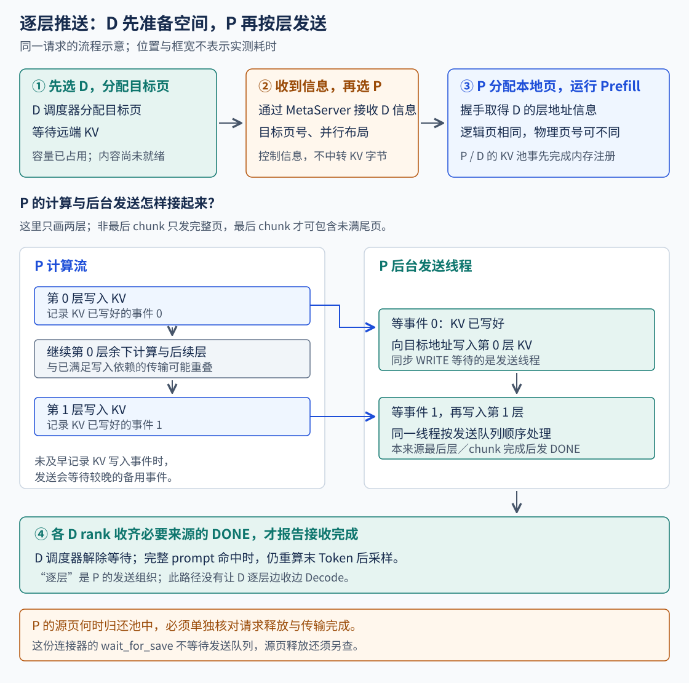
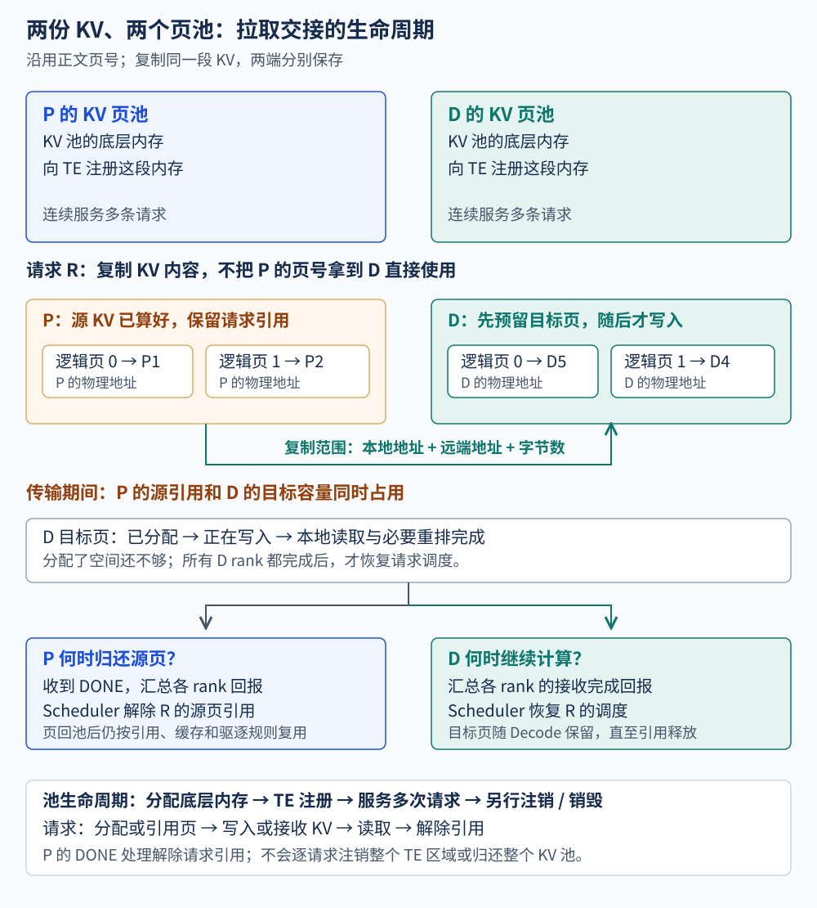
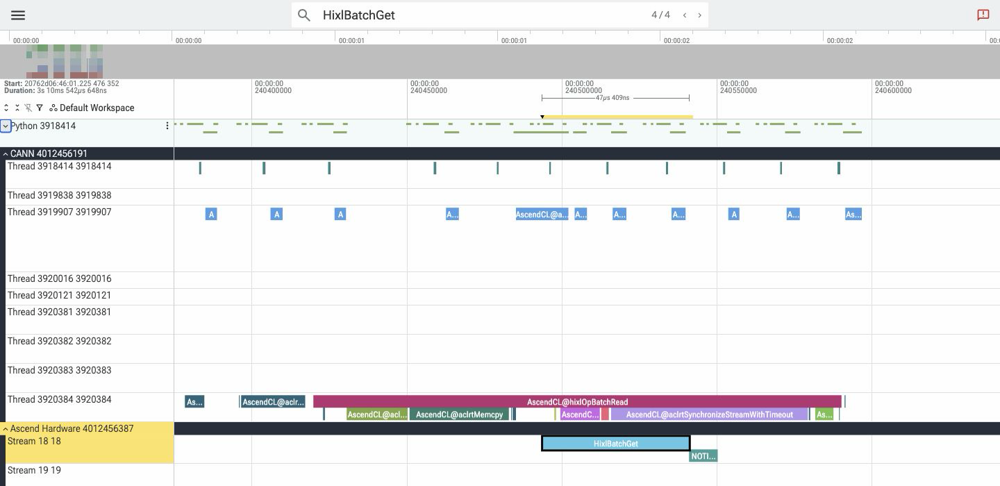
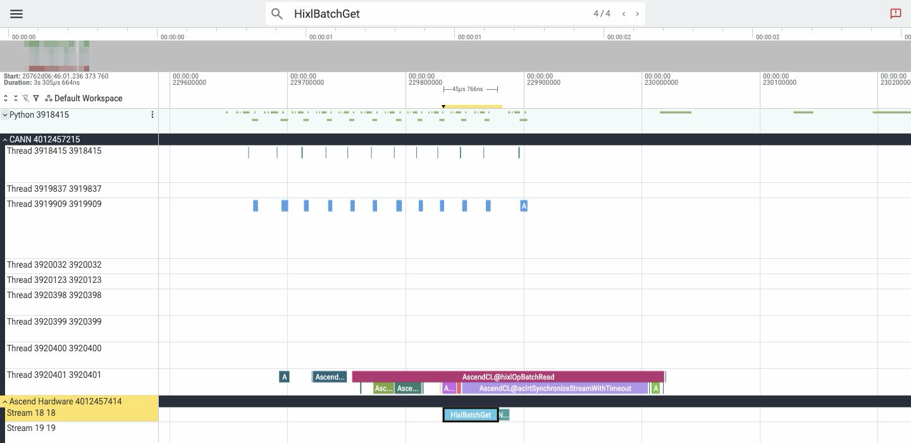
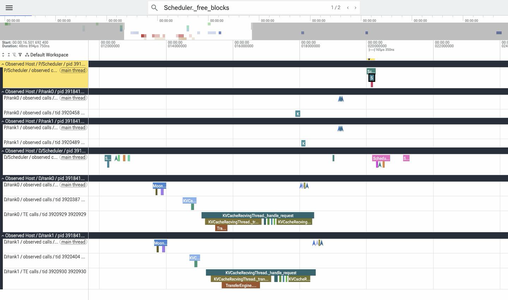
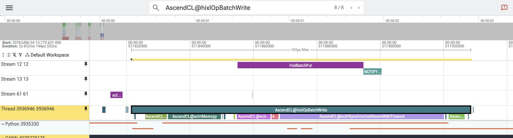
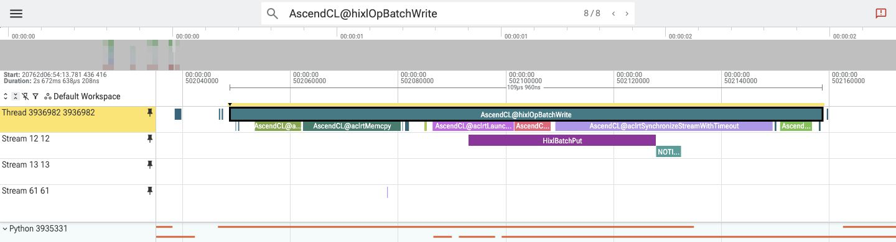
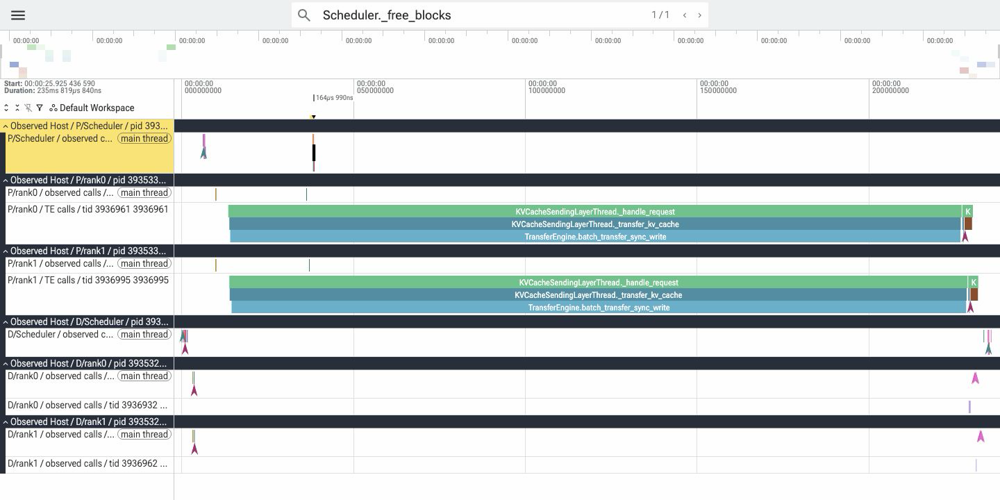

# PD 分离系统：请求交接与 KV 生命周期

PD 分离把输入处理和后续生成交给两套引擎：P 负责 Prefill，D 负责 Decode。P 算好的 KV 要交给 D，D 才能接着生成。两边各有自己的调度器、Worker 和 KV 缓存池，因此交接时既要复制数据，也要告诉 D 这些数据属于哪条请求、放在了哪里。

本章先看两种顺序：拉取式先让 P 算完，再由 D 申请空间并读取；逐层推送先让 D 申请空间，P 每算好一层就可以发送。后面用 A5 实验核对实际传输了多少字节，以及最后一次写入返回与源端调用页释放函数的先后顺序。

> 拉取式采用 `kv_p2p/mooncake_connector.py` 中的 `MooncakeConnectorV1`，逐层推送采用 `MooncakeLayerwiseConnector`。下文结合实验中实际运行的 vLLM Scheduler 和 ModelRunnerV2 解释这两种实现。另一个目录中的 `MooncakePullConnector` 是不同的连接器。固定源码、Mooncake 二进制来源、脚本和结果见实验材料。机制图只说明流程，实测图在后半章单独标出。 [实验材料](https://github.com/Tflowers-0129/inference-wiki/tree/main/experiments/pd-disaggregation)

## P/D 两端的页表与请求状态

KV 缓存按物理页分配，源码中也称 block；`block_size` 就是每页能容纳的 Token 数。页表（`block_table`）按请求中的顺序保存物理页号。

同一段 prompt 在 P 和 D 上占用两份本地缓存。传输复制的是 KV 内容；P 的页号只在 P 的缓存池中有意义，D 需要使用自己的页号。

<!-- DETAILS: 本节实测请求的模型与并行配置 -->

取 A5 拉取实验的 `prompt129-repetition0`。两层 Qwen2 使用 BF16、2 个 KV heads、head_dim=64。P、D 各用 TP2，PCP、DCP 均为 1，关闭前缀缓存。每端的两个 Worker 各持有一个 KV head 的完整历史，D rank 0 从 P rank 0 取自己的 head，rank 1 同理。[实测请求和模型配置](https://github.com/Tflowers-0129/inference-wiki/blob/main/experiments/pd-disaggregation/results/pull.json)

<!-- /DETAILS -->

看这条 129-token 请求。每页容纳 128 个位置，所以两端都需要两页：第一页装满，第二页只保存第 129 个 Token 的 KV。P、D 的调度器分别分配了下面的页号，Worker 用它查找本地的 KV 页。 [两端分配记录](https://github.com/Tflowers-0129/inference-wiki/blob/main/experiments/pd-disaggregation/results/lifecycle-summary-pull.json)

| prompt 的有效位置 | 页表下标 | P 源页号 | D 目标页号 |
| --- | --- | --- | --- |
| 0～127 | 0 | 1 | 5 |
| 128 | 1 | 2 | 4 |

D 从 P 的页 `[1,2]` 读取数据，分别写入自己的页 `[5,4]`。交接后，D 的 Attention 按自己的页表和请求长度读取历史。即使两边碰巧分到相同页号，地址也要从各自 Worker 的缓存起点计算。

如果两端 TP、CP 或页大小不同，还要确认连接器能把同一层、同一个 KV head、同一段历史放到 D 所需的位置。 [拉取式的 head 和页映射](https://github.com/vllm-project/vllm-ascend/blob/f9c8e0bd/vllm_ascend/distributed/kv_transfer/kv_p2p/mooncake_connector.py#L3930-L4054)

KV 之外，D 还需要模型输入、采样参数、请求标识和生成进度。这些信息通过 HTTP 请求交接，KV 数据另由 Worker 传输。因此，复制完 KV 张量只是交接的一部分。 [拉取式连接器](https://github.com/vllm-project/vllm-ascend/blob/main/vllm_ascend/distributed/kv_transfer/kv_p2p/mooncake_connector.py) · [逐层连接器](https://github.com/vllm-project/vllm-ascend/blob/main/vllm_ascend/distributed/kv_transfer/kv_p2p/mooncake_layerwise_connector.py)

两端还要分别经过调度。P 根据自己的 Token 预算和 KV 容量决定何时开始；D 根据自己的空间和执行队列决定何时接收、何时生成。实例之间的 PD 路由，与每个实例内部的 TP 通信，是两层不同的工作。

## Proxy、连接器与 Mooncake 的职责

proxy 选择实例并转发请求。连接器根据两端的页号安排传输，处理完成通知。Mooncake Transfer Engine 负责在已注册的缓冲区之间复制 KV。

| 参与者 | 交换的信息 | 对这条请求的作用 |
| --- | --- | --- |
| Proxy 与 P/D HTTP 服务 | prompt、采样参数、请求标识、`kv_transfer_params` | 选择实例、发起两端请求、向客户端转发 D 输出 |
| 连接器 Scheduler 与 Worker，以及 Worker 侧信道 | 本地/远端页号、布局、内存描述、完成通知 | 分配、生成传输计划、把完成状态送回 Scheduler |
| Mooncake Transfer Engine | 已注册缓冲区之间的 READ / WRITE | 实际搬运 KV payload |

proxy 把交接信息送到 D，不表示 KV 已经到达。D 可以先按预计能从 P 获得的 Token 数分配空间，但 Attention 必须等 Worker 确认目标 KV 可读后才能使用。

<!-- DETAILS: 源码对照：交接字段、两种端口与同步读写接口 -->

拉取时，D 收到 P 的源页信息。推送时，P 收到 D 的目标页信息。源码里的 remote 总是相对于收到这份信息的一方而言。

| 交接信息 | 拉取式：P 返回给 D | 逐层推送式：D 返回给 P |
| --- | --- | --- |
| `remote_block_ids` | P 的源页号 | D 的目标页号 |
| `remote_engine_id`、请求标识 | 定位保留源 KV 的 P 请求 | 定位等待接收的 D 请求 |
| `remote_host`、`remote_port` | P 的连接器侧信道 | D 的连接器侧信道 |
| 交接后的工作 | D 发起 READ | P 按层发起 WRITE |

两个连接器分别构造各自的交接字段。[拉取字段构造](https://github.com/vllm-project/vllm-ascend/blob/main/vllm_ascend/distributed/kv_transfer/kv_p2p/mooncake_connector.py) · [推送字段构造](https://github.com/vllm-project/vllm-ascend/blob/main/vllm_ascend/distributed/kv_transfer/kv_p2p/mooncake_layerwise_connector.py)

本章 P2P 路线直接交接 P、D 的缓存，没有启动 Mooncake Store。Worker 通过 `GlobalTE` 初始化 Transfer Engine，选择 `P2PHANDSHAKE` 和 `ascend` transport。连接器用于交换信息的 `kv_port`，与 TE 对外发布的 RPC 端口不同。 [TE 初始化与注册](https://github.com/vllm-project/vllm-ascend/blob/main/vllm_ascend/distributed/kv_transfer/utils/mooncake_transfer_engine.py)

连接器把 Mooncake 的同步读写放进后台线程，所以引擎仍能推进其他工作。这里的“异步”是相对于 Scheduler 而言，不表示调用了 TE 的异步 API。

实际使用的 `batch_transfer_sync_read/write` 将本地缓冲、远端地址、长度和 READ/WRITE 操作交给 C++，等整个 batch 完成才返回；成功时返回 0。 [Mooncake Python/C++ bridge](https://github.com/kvcache-ai/Mooncake/blob/main/mooncake-integration/transfer_engine/transfer_engine_py.cpp)

<!-- /DETAILS -->

## 拉取式交接

拉取式先让 P 完成 Prefill，proxy 收到源 KV 的位置后，才选择 D 并转发请求。官方 proxy 还要求 P 生成一个 Token，并等待这段非流式 HTTP 请求结束。这个 Token 是否交给客户端，下一节会单独说明。 [Proxy 请求构造与实例选择](https://github.com/vllm-project/vllm-ascend/blob/main/examples/disaggregated_prefill_v1/load_balance_proxy_server_example.py)



<!-- DETAILS: Proxy 如何构造 P 请求 -->

`build_prefill_request` 设置 `do_remote_decode=True`，将 P 请求的 `max_tokens`、`min_tokens` 都设为 1，并关闭这一段 HTTP 的流式返回。

<!-- /DETAILS -->

### P 返回元数据，源页仍被请求持有

普通 FullAttention 路径先算完 prompt。虽然 P 的本地请求已经结束，D 还没读取 KV，因此 P 必须继续保留源页。

连接器的 `request_finished` 会检查 `do_remote_decode`，并判断请求是否因达到输出长度上限而结束。存在待交接的 prompt 块时，它返回 `delay_free_blocks=True`，并记录该请求，以便接收完成通知后释放源页。

此时 HTTP 可以返回交接信息，KV 本身仍留在 P 的已注册缓存中。Scheduler 继续保留源页引用。proxy 再把 `kv_transfer_params` 附到 D 请求，其中包含 P 的请求标识和引擎标识、源页号、侧信道入口和并行布局。 [`request_finished` 与交接字段](https://github.com/vllm-project/vllm-ascend/blob/main/vllm_ascend/distributed/kv_transfer/kv_p2p/mooncake_connector.py) · [Scheduler 的 `_free_request`](https://github.com/vllm-project/vllm/blob/main/vllm/v1/core/sched/scheduler.py)

如果 D 尚未选出，或因容量不足迟迟不能接收，P 的 KV 就会继续占用空间。P 算完 Prefill 到源页可供下一请求使用，中间还可能隔着一段等待；只测 Prefill 内核时间看不到这段占用。

### D 先占空间，再进入接收等待

D 先根据预计可从 P 获得的 prompt 长度申请目标页，再把本地页号与 P 的源信息交给 Worker。源码中，`get_num_new_matched_tokens` 返回预计加载量与异步标记；分配后由 `update_state_after_alloc` 记录双方信息并生成传输计划。

请求随后进入 `WAITING_FOR_REMOTE_KVS`，等待远端 KV。此时 `num_computed_tokens` 可以已经计入预计加载量，但它表示调度进度，不表示数据已经写完。只有 Worker 回报完成后，请求才能恢复正常计算。 [D 的匹配/分配接口](https://github.com/vllm-project/vllm-ascend/blob/main/vllm_ascend/distributed/kv_transfer/kv_p2p/mooncake_connector.py) · [外部 KV 分配与等待状态](https://github.com/vllm-project/vllm/blob/main/vllm/v1/core/sched/scheduler.py)

### D 怎样把两张页表变成 8 条 READ 描述符？

Worker 最后需要一组复制范围：从 P 的哪个字节地址读、写到 D 的哪个地址、复制多少字节。这种范围记录也叫传输描述符。下面沿刚才的 `[1,2] → [5,4]` 计算。

<!-- DETAILS: 源码对照：注册缓存与获取远端内存信息 -->

Worker 初始化 KV 池后，`register_kv_caches` 为每层、每个 K/V 视图记录 `data_ptr()`、单块载荷字节数和页步幅。普通 GQA 路径按底层 storage 合并注册区，同一层的 K/V 视图可以对应同一个注册区。D 第一次接触该 P Worker 时，通过侧信道发送 `GET_META_MSG`，取回 P 的视图基址、页步幅及 TE RPC 端口。D 用 RPC 端口构造 READ 的 session，再把请求级源页号与这些内存描述配对。[注册元数据](https://github.com/vllm-project/vllm-ascend/blob/f9c8e0bd/vllm_ascend/distributed/kv_transfer/kv_p2p/mooncake_connector.py#L2646-L2740) · [Worker 侧握手](https://github.com/vllm-project/vllm-ascend/blob/f9c8e0bd/vllm_ascend/distributed/kv_transfer/kv_p2p/mooncake_connector.py#L1483-L1509)

<!-- /DETAILS -->

这次采用 LBNHC，单层 K、V 各是 `[B,128,1,64]` 的视图，B 是池中页数。一个 K 页的载荷为 `128×1×64×2 = 16,384 B`，V 页也一样。

但底层按 `[K0][V0][K1][V1]…` 存放，从一个 K 页到下一个 K 页，要跨过 32,768 B。下面用 `K_P`、`K_D` 表示配对 Worker 上同一层 K 视图的起始地址，给页号乘以这个间隔，再加起始地址，就得到两条 READ 范围。 [backend 的单层形状](https://github.com/vllm-project/vllm-ascend/blob/f9c8e0bd/vllm_ascend/attention/attention_v1.py#L114-L124) · [packed K/V 的分配条件](https://github.com/vllm-project/vllm-ascend/blob/f9c8e0bd/vllm_ascend/worker/v2/attn_utils.py#L1529-L1568) · [K/V 视图的步幅](https://github.com/vllm-project/vllm-ascend/blob/f9c8e0bd/vllm_ascend/worker/v2/attn_utils.py#L820-L852)

| 页号配对 | P 上的远端地址 | D 上的本地地址 | READ 长度 |
| --- | --- | --- | --- |
| 1 → 5 | `K_P + 32,768` | `K_D + 163,840` | 16,384 B |
| 2 → 4 | `K_P + 65,536` | `K_D + 131,072` | 16,384 B |

V 的范围按相同方法计算，其起始地址比对应的 K 视图大 16,384 B。只有 P、D 两边的字节范围都按顺序相邻，连接器才会合并。本例 K 页之间夹着 V，D 的块顺序又是 5、4，所以每个 D rank 提交 `2 层 × 2 组件 × 2 页 = 8` 条范围，共 131,072 B。

129 个 Token 的有效 KV 只有 `129 × 2 层 × 2 组件 × 64 × 2 B = 66,048 B`。传输量更大，是因为尾页只保存一个 Token 的 KV，却传了整页，剩余 127 个位置也占字节。 [地址、长度和合并条件](https://github.com/vllm-project/vllm-ascend/blob/f9c8e0bd/vllm_ascend/distributed/kv_transfer/kv_p2p/mooncake_connector.py#L1000-L1059) · [实测范围数与字节量](https://github.com/Tflowers-0129/inference-wiki/blob/main/experiments/pd-disaggregation/results/pull.json)

<!-- DETAILS: 源码对照：READ 参数方向与多来源接收 -->

这次 `batch_transfer_sync_read` 由 D 发起。它把上表的 D 地址传入 local buffer 列表（源码的 `src_list`），P 地址传入远端列表（`dst_list`），数据流向为 P→D。如果 D 需要从多个 P Worker 读取数据才能填满一个目标页，计算地址时还要加上各来源对应的页内偏移。D 的本地接收任务全部完成后，再按需要重排。[读描述符与分片偏移](https://github.com/vllm-project/vllm-ascend/blob/f9c8e0bd/vllm_ascend/distributed/kv_transfer/kv_p2p/mooncake_connector.py#L1000-L1059) · [接收后的重排](https://github.com/vllm-project/vllm-ascend/blob/f9c8e0bd/vllm_ascend/distributed/kv_transfer/kv_p2p/mooncake_connector.py#L734-L787)

<!-- /DETAILS -->

### P 和 D 的 TP 不同时，谁来拼回各个 KV head？

D 需要的 KV heads 可能分散在多个 P Worker 上。D 要先收齐这些数据，再按 Attention 读取各 head 的顺序重排目标页。下面按源码推算两端 TP 不同的情况，A5 实验中两端均为 TP2。

<!-- DETAILS: 源码算例：P TP4、D TP2 的 head 合并与页内重排 -->

假设模型共有 4 个 KV head，P 用 TP4，D 用 TP2，两端都不切分上下文或模型层。缓存采用普通 NHD 布局和 BF16，每页容纳 128 个位置，每个 head 的维度为 64。P 的每个 rank 保存一个 KV head，D 的每个 rank 需要两个，因此 `tp_num_need_pulls=2/1=2`。连接器从同一 PP stage 的 P rank 列表中每次取相邻两项为一组，D rank 0 从 P rank 0、1 取 heads 0、1，D rank 1 从 P rank 2、3 取 heads 2、3。[每页来源数与 P rank 选择](https://github.com/vllm-project/vllm-ascend/blob/f9c8e0bd/vllm_ascend/distributed/kv_transfer/kv_p2p/mooncake_connector.py#L4055-L4068) · [rank 分组](https://github.com/vllm-project/vllm-ascend/blob/f9c8e0bd/vllm_ascend/distributed/kv_transfer/kv_p2p/mooncake_connector.py#L4131-L4190)

D rank 0 的一个 K 页有 32 KiB。P rank 0、1 的 K 页各有 16 KiB，READ 分别写到 D 的 K 页起点和起点后 16 KiB，V 同理。两次 READ 完成后，每段连续保存同一个 P rank 的 128 行，D 的页内顺序是 `[来源,位置,来源内 head,通道]`。D 的 NHD 读法需要同一位置的两个 head 相邻。以位置 0 的 head 1 为例，复制后它在 K 页内的偏移为 16,384 B，重排后为 128 B。连接器等本地拉取任务全部结束，再按块交换来源轴和位置轴。融合算子可用时直接重排所选块，另一条路径先用 gather 将数据收集到临时缓冲区，交换两个轴后再用 scatter 写回原位置。重排成功后，连接器才报告本地接收完成。如果重排报错，则按接收失败处理。[目标区段计算](https://github.com/vllm-project/vllm-ascend/blob/f9c8e0bd/vllm_ascend/distributed/kv_transfer/kv_p2p/mooncake_connector.py#L1008-L1035) · [等待与重排](https://github.com/vllm-project/vllm-ascend/blob/f9c8e0bd/vllm_ascend/distributed/kv_transfer/kv_p2p/mooncake_connector.py#L743-L777) · [重排分派](https://github.com/vllm-project/vllm-ascend/blob/f9c8e0bd/vllm_ascend/distributed/kv_transfer/kv_p2p/mooncake_connector.py#L1149-L1181) · [gather 与 scatter](https://github.com/vllm-project/vllm-ascend/blob/f9c8e0bd/vllm_ascend/distributed/kv_transfer/kv_p2p/mooncake_connector.py#L1375-L1461)

<!-- /DETAILS -->

### D 的接收完成与 P 的源页释放

一张卡读完，不代表整条请求就绪。本次 D 有两个 Worker，执行器收齐两者的 `finished_recving` 回报后，才通知 Scheduler。Scheduler 将请求加入 `finished_recving_kv_req_ids`，再处理等待队列。

即使本轮没有模型前向，ModelRunnerV2 也能提交连接器任务并检查回报。 [ModelRunnerV2 的 `no_forward`](https://github.com/vllm-project/vllm/blob/5df63a72/vllm/v1/worker/gpu/kv_connector.py#L130-L167) · [多 rank 聚合](https://github.com/vllm-project/vllm/blob/5df63a72/vllm/distributed/kv_transfer/kv_connector/utils.py#L63-L130) · [Scheduler 的完成状态](https://github.com/vllm-project/vllm/blob/5df63a72/vllm/v1/core/sched/scheduler.py#L3175-L3236)

每个 D Worker 还向对应 P Worker 发 DONE，通知它读取已结束。P 汇总本端的 `finished_sending` 回报，再由 Scheduler 调用 `_free_blocks`。

实测中 rank 0 的 READ 和 DONE 先结束，rank 1 此时仍在读。D 恢复调度与 P 释放源页分别由两边 Scheduler 推进，不能合成一个完成时刻。 [接收任务与 DONE](https://github.com/vllm-project/vllm-ascend/blob/f9c8e0bd/vllm_ascend/distributed/kv_transfer/kv_p2p/mooncake_connector.py#L734-L787) · [两 rank 的完成与释放记录](https://github.com/Tflowers-0129/inference-wiki/blob/main/experiments/pd-disaggregation/results/lifecycle-summary-pull.json)

## P 已经采样，D 为什么还要重算最后一个 prompt Token？

proxy 交给 D 的是原请求和 `kv_transfer_params`。P 采样的 Token 没有追加到 D 的 prompt 中，P 生成的文本也没有发给客户端。元数据中的 `last_token_id` 是否使用，要看后续调用。

本章普通 FullAttention 路径中，D 收到完整 prompt KV 后会退回一个位置，用 prompt 的最后一个 Token 再做一次前向，根据得到的 logits 采样。客户端看到的第一个输出 Token 就来自 D 的这次采样。

对应源码是 `_update_waiting_for_remote_kv`：当 `num_computed_tokens == num_tokens` 时，计算进度回退一位。 [Proxy 的交接处理](https://github.com/vllm-project/vllm-ascend/blob/main/examples/disaggregated_prefill_v1/load_balance_proxy_server_example.py) · [末 Token 重算](https://github.com/vllm-project/vllm/blob/main/vllm/v1/core/sched/scheduler.py)

129-token 实测中，D 从 `WAITING_FOR_REMOTE_KVS` 回到 `WAITING` 时，计算进度从 129 退到 128。下一轮，D 以 prompt 位置 128 的 Token 为输入，将该位置的 KV 写到页号 4、页内偏移 0。页号 4 是 D 页表的第二项，对应的写入位置为 `slot_mapping = 4×128+0 = 512`。前 128 个位置的历史从页 5 读取。

客户端的第一个输出位于位置 129。下一轮以这个 Token 为输入时，D 才会把它的 KV 写到页 4 的页内偏移 1。 [恢复调度的实测记录](https://github.com/Tflowers-0129/inference-wiki/blob/main/experiments/pd-disaggregation/results/lifecycle-summary-pull.json) · [Runner 的 slot mapping](https://github.com/vllm-project/vllm-ascend/blob/f9c8e0bd/vllm_ascend/ops/triton/v2/block_table/compute_slot_mappings.py#L79-L113)

Mamba 或压缩状态不一定能靠重写最后一个 KV 位置恢复，还有 P 端截断 prompt 等额外处理。本节普通 GQA 算例不包含这些路径。

## 逐层推送式交接

推送前必须先知道写到哪里。因此逐层推送先选 D，让 D 分配目标页；proxy 通过自己的 MetaServer 接口收到目标信息后，再选择 P 并派发 Prefill。P 每算好一层，就可以向已知的 D 地址发送。 [逐层 proxy](https://github.com/vllm-project/vllm-ascend/blob/main/examples/disaggregated_prefill_v1/load_balance_proxy_layerwise_server_example.py)



### MetaServer 回传 D 的目标页

D 申请好页后，把目标页号、页大小、并行配置和已命中的前缀长度送回 proxy。P 根据命中前缀确定从哪里开始发送。如果一个 API 请求展开为多个子请求，proxy 要收齐各自的目标信息后才派发 Prefill。

D 请求带 `do_remote_prefill=True` 和 MetaServer 地址。分配后的 `update_state_after_alloc` 将目标页号写入 `remote_block_ids`，将命中前缀记为 `remote_cached_tokens`，proxy 再把这份 metadata 附到 P 请求。 [目标元数据与发送起点](https://github.com/vllm-project/vllm-ascend/blob/f9c8e0bd/vllm_ascend/distributed/kv_transfer/kv_p2p/mooncake_layerwise_connector.py#L1290-L1360)

MetaServer 只是 proxy 接收交接信息的接口，不搬 KV，也不是 Mooncake Store 的对象目录。真正传输前，P Worker 仍要直接取得 D Worker 的内存描述和 TE 入口。

proxy 中 `release_prefiller_kv` 等函数只是调整入口评分计数，不能据名字判断 NPU 缓存页已释放。 [目标分配与 `_access_metaserver`](https://github.com/vllm-project/vllm-ascend/blob/main/vllm_ascend/distributed/kv_transfer/kv_p2p/mooncake_layerwise_connector.py)

### 层内 KV 写入事件与发送队列

发送必须等对应层的 KV 写完。P Scheduler 先按本轮计划生成发送 metadata，ModelRunnerV2 在前向前绑定它并准备逐层状态。Attention 写完一层 KV 后，Ascend hook 在计算流记录事件；`save_kv_layer` 再把事件、层标识和页映射加入后台发送队列。

后台线程等待该层的写入事件完成，再调用 `batch_transfer_sync_write`。主计算流可以继续运行该层余下算子或后续层，所以两者有机会重叠。

某些 Attention 路径没有及早记录写入事件，连接器会在较晚位置补记。发送就要等到那个位置，可用于重叠的时间也会改变。 [KV 写入通知](https://github.com/vllm-project/vllm-ascend/blob/main/vllm_ascend/attention/utils.py) · [逐层发送与写入事件](https://github.com/vllm-project/vllm-ascend/blob/main/vllm_ascend/distributed/kv_transfer/kv_p2p/mooncake_layerwise_connector.py)

分块 Prefill 还要考虑尾页是否写完。非最终 chunk 只发送已覆盖的完整页，最后一个 chunk 才能包含未满尾页。Scheduler 用 `local_computed_tokens` 和 `local_transferred_tokens` 确定本次要发送的范围。后一个字段记录计划传输的进度，远端是否写完还要看完成回报。

### D 收齐 DONE 后恢复调度

D 要等自己需要的各来源都发完，才能报告接收完成。它不会因为第一层已到就开始 Decode。

<!-- DETAILS: 源码对照：DONE 的来源计数与多 Worker 完成 -->

发送线程处理完本来源的最终层和最终 chunk 后，向对应 D Worker 发送 DONE。消息带外部请求 ID、该接收者预期的来源数 `trans_count` 和发送者侧信道地址。D 的接收线程按请求将来源地址加入集合，达到 `trans_count` 后生成本地完成记录。Worker 再把外部请求 ID 映射回引擎内部 ID，报告 `finished_recving`。A5 的 MQA+DCP2 推送中，每个 D Worker 的 `trans_count=1`。执行器仍需收齐两个 D Worker 的完成回报，Scheduler 才能推进整条请求。[消息处理与来源计数](https://github.com/vllm-project/vllm-ascend/blob/f9c8e0bd/vllm_ascend/distributed/kv_transfer/kv_p2p/mooncake_layerwise_connector.py#L884-L947) · [实测 DONE 与完成回报](https://github.com/Tflowers-0129/inference-wiki/blob/main/experiments/pd-disaggregation/results/lifecycle-summary-push.json)

<!-- /DETAILS -->

所查实现的 `wait_for_layer_load` 为空，D 仍要等整条请求的远端 KV 完成，再重算 prompt 末 Token 并继续生成。“逐层”首先改变的是 P 何时能发送，不能据此推断 D 能边收边执行同一请求。 [按来源跟踪与 `get_finished`](https://github.com/vllm-project/vllm-ascend/blob/main/vllm_ascend/distributed/kv_transfer/kv_p2p/mooncake_layerwise_connector.py)

## 源页保留与目标页回收

一条请求结束后，通常归还的是它占用的缓存页，不是销毁整个 KV 池。池的底层内存在创建后向 TE 注册，可以服务多条请求。断开 peer、注销注册区由另外的资源清理过程负责。 [内存注册与注销](https://github.com/vllm-project/vllm-ascend/blob/main/vllm_ascend/distributed/kv_transfer/utils/mooncake_transfer_engine.py)



D 的目标页先分配，再接收数据，加载完成后才参与计算。请求取消时，输出可以停止，但后台写入未必已结束。因此 Scheduler 会保留尚在等待远端 KV 的已终止请求的目标页，等完成回报后才释放，避免新请求占用仍被写入的地址。 [取消与延迟释放](https://github.com/vllm-project/vllm/blob/main/vllm/v1/core/sched/scheduler.py)

P 端不能照搬同一套释放规则。拉取式明确保留源页、等待读取通知；本章核查的逐层推送连接器没有增加这项延迟。

<!-- DETAILS: 源码对照：拉取和逐层推送的释放接口 -->

| 检查点 | 拉取式 | 本章核查的逐层推送式 |
| --- | --- | --- |
| P `request_finished` | 有待交接源页时返回延迟释放 | 返回不延迟释放 |
| P 发送完成回报 | D 通知后，经 Worker 聚合报告 `finished_sending` | `get_finished` 的发送完成集合为空 |
| `wait_for_save` | 不能用函数名代替实际后台完成条件 | 函数体为空，没有等待发送队列 |
| 源端后续处理 | 源端完成跟踪进入 Scheduler | 连接器不额外延迟，继续走 P 请求结束及分配器 fence 路径 |

<!-- /DETAILS -->

在这份推送实现中，P 可以在后台写入全部结束前调用 `_free_blocks`。

还要区分释放调用返回、实际解除页引用，以及下一请求覆盖地址。分配器可能等待在途模型 step 后才归还页，已有的层缓冲复用事件也只保护对应路径。本次实操记录了释放调用和 WRITE 返回的先后，没有覆盖全部实际复用条件。 [连接器实现](https://github.com/vllm-project/vllm-ascend/tree/main/vllm_ascend/distributed/kv_transfer/kv_p2p) · [分配器延后释放路径](https://github.com/vllm-project/vllm/blob/main/vllm/v1/core/sched/scheduler.py)

## 失败、超时与取消的清理路径

拉取失败时，D 仍发 DONE，让 P 结束这次读取的跟踪并清理源引用；失败本身另外报告。普通单缓存组路径报告无效目标页。请求级错误路径则等本地任务收尾，把 `failed_recving` 随 `finished_recving` 上报。

Scheduler 根据策略决定终止还是重新计算。本次 A5 实验使用默认的 `fail`。 [拉取失败的记录条件](https://github.com/vllm-project/vllm-ascend/blob/f9c8e0bd/vllm_ascend/distributed/kv_transfer/kv_p2p/mooncake_connector.py#L619-L649) · [Worker 的失败回报](https://github.com/vllm-project/vllm-ascend/blob/f9c8e0bd/vllm_ascend/distributed/kv_transfer/kv_p2p/mooncake_connector.py#L2791-L2826) · [引擎默认策略](https://github.com/vllm-project/vllm/blob/5df63a72/vllm/config/kv_transfer.py#L88-L91)

如果 D 在分配前拒绝请求，例如 prompt 加最大输出长度超过服务上限，连接器会安排空接收任务。Worker 不读 KV，但仍发 DONE，避免 P 一直保留源页。

DONE 长时间不到时，P 的完成轮询会按 `VLLM_MOONCAKE_ABORT_REQUEST_TIMEOUT` 结束超时请求的发送跟踪，以便释放源引用。 [空接收的入队条件](https://github.com/vllm-project/vllm-ascend/blob/f9c8e0bd/vllm_ascend/distributed/kv_transfer/kv_p2p/mooncake_connector.py#L2047-L2070) · [源端超时跟踪](https://github.com/vllm-project/vllm-ascend/blob/f9c8e0bd/vllm_ascend/distributed/kv_transfer/kv_p2p/mooncake_connector.py#L219-L259)

逐层推送实现了 FAILED 消息和目标页错误报告，但这版代码没有把失败请求加入接收完成集合，也没有完整上报请求级 `failed_recving`。对应的 Scheduler 还在等待接收结束。单凭一条 FAILED 消息，无法确定它会自动转为本地重算。

MetaServer 请求和 DONE 消息各自的重试，也不能保证整条交接在有限时间内恢复。 [逐层失败与 DONE 路径](https://github.com/vllm-project/vllm-ascend/blob/main/vllm_ascend/distributed/kv_transfer/kv_p2p/mooncake_layerwise_connector.py)

客户端断开后，proxy 取消 HTTP task 并清理路由计数，但后台设备传输不一定立即停止，页引用也有各自的释放条件。 [Proxy 取消处理](https://github.com/vllm-project/vllm-ascend/blob/main/examples/disaggregated_prefill_v1/load_balance_proxy_layerwise_server_example.py)

排查时保留请求标识、两端实例、目标是否已分配、还有哪些来源未完成，以及源页和目标页引用是否已归还。HTTP task 取消、页归还分配器、TE 内存注销，不能用其中一项代替其他项。

## A5 拉取式与逐层推送实测

实验独占同一台 A5 主机上的四张健康、空闲的 NPU，先后运行两套 PD 系统。两边都是实际 HTTP 服务、官方 proxy、ModelRunnerV2 与 Mooncake 原生传输，没有用 D 本地重算代替加载成功。采集结束后已确认实验进程退出并释放设备。

两套系统各测量四次，输出 Token IDs 均与自己的本地参考一致。但两套 KV head 数和 DCP 配置不同，不能据此比较 pull 与 push 谁更快。

<!-- DETAILS: 实验配置、请求与运行方式 -->

模型是固定随机种子的两层 Qwen2：hidden=512、Q heads=8、head_dim=64、BF16。两组缓存与并行条件如下：

| 项目 | 拉取式 | 逐层推送式 |
| --- | --- | --- |
| 连接器 | `MooncakeConnectorV1` | `MooncakeLayerwiseConnector` |
| P / D 的 TP | 2 / 2 | 2 / 2 |
| P / D 的 DCP | 1 / 1 | 2 / 2 |
| KV heads | 2，按 TP 分开 | 1，按 DCP 分历史位置 |
| KV 布局 | 实际 GQA 布局 | 连续的独立 K/V 张量 |
| block size / CP interleave | 128 / 128 | 128 / 128 |

每 Worker 固定 32 MiB KV 池预算，模型长度上限 2048，本轮 Token 预算 1024，最大序列数 4，eager，关闭 prefix caching。prompt 取 129、513，各重复两轮，每次输出四个 Token。每组先在同配置 P 上运行普通本地请求作为参考，再预热并采集 PD 请求。[复现命令与结果](https://github.com/Tflowers-0129/inference-wiki/tree/main/experiments/pd-disaggregation)

<!-- /DETAILS -->

与各自本地参考相比，所选 Token 的 logprob 最大绝对差分别约为 0.00766（拉取式）和 0.00789（逐层推送）。两边生成的 Token ID 一致，logprob 仍有差异。随机权重检验的是交接后能否续算，不检验预训练质量。 [拉取结果](https://github.com/Tflowers-0129/inference-wiki/blob/main/experiments/pd-disaggregation/results/pull.json) · [推送结果](https://github.com/Tflowers-0129/inference-wiki/blob/main/experiments/pd-disaggregation/results/push.json)

### 设备可见集与 K/V 布局约束

正式测量前还遇到了设备可见性和缓存布局问题。下面保留当时的对照条件，便于复现时识别相同限制。

<!-- DETAILS: 实操限制：设备可见集与逐层 K/V 布局 -->

首次拉取式把 P、D 的设备可见集分开，两个 rank 都在 TE READ 建连时超时。随后用 2 MiB 对齐缓冲区单独测试 READ 和 WRITE。固定参与传输的两张物理卡、UB 配置和 QoS，只改变各进程可见的设备。四张卡都可见时，READ、WRITE 和全缓冲区校验均通过。P、D 分别只看到自己的设备时，READ 失败。通过引擎已有的 `--device-ids` 保留四卡可见、分别绑定实例后，完整交接通过。这组对照将故障范围缩小到进程的设备可见性，HIXL 内部失败的具体原因仍待确认。

首次逐层推送采用普通 GQA/DCP1。上面拉取算例中 K/V 的页步幅为 32,768 B，单组件一页只占 16,384 B。注册时检查 `stride(0)` 与页内元素数，两者不等会进入 component transfer。这组普通 FullAttention 的 K/V 随后触发该分支的非 MLA 校验。实验改用 MQA+DCP2，分配器为 K 和 V 各开一段连续 storage，此时单组件页步幅与载荷都是 16,384 B。两端 block size 和 interleave 都设为 128，使用生产连接器的普通逐层写入路径通过。[分配分支](https://github.com/vllm-project/vllm-ascend/blob/f9c8e0bd/vllm_ascend/worker/v2/attn_utils.py#L1529-L1568) · [逐层注册的步幅检查](https://github.com/vllm-project/vllm-ascend/blob/f9c8e0bd/vllm_ascend/distributed/kv_transfer/kv_p2p/mooncake_layerwise_connector.py#L1686-L1710) · [component 路径的校验](https://github.com/vllm-project/vllm-ascend/blob/f9c8e0bd/vllm_ascend/distributed/kv_transfer/kv_p2p/mooncake_layerwise_connector.py#L1770-L1834)

<!-- /DETAILS -->

## 拉取式的多 rank READ 记录

下图分别展示同一条 513-token 请求在 D rank 0 和 rank 1 上的记录。数据由 Linux 上的 Perfetto 原生解析器读取，截图来自浏览器查看器。两张卡分别发起 READ，读取各自所需的 KV。

`AscendCL@hixlOpBatchRead` 是 CANN 调用，`HixlBatchGet` 是设备任务；按同文件的 `connection_id` 配对，再用请求记录确认归属。





| 该次请求的接收者 | TE 范围数（5 个逻辑页） | TE 调用中的字节量 | 选中设备 Get 任务 |
| --- | --- | --- | --- |
| D rank 0 | 20 | 327,680 B | 约 47.409 μs |
| D rank 1 | 20 | 327,680 B | 约 45.766 μs |

513 个位置需要五页，第五页只保存一个 Token 的 KV，TE 仍传整页。每 rank 的字节量为 `5 页 × 2 层 × 2 份 K/V × 16,384 B = 327,680 B`。 [该请求的范围数、字节量与设备任务](https://github.com/Tflowers-0129/inference-wiki/blob/main/experiments/pd-disaggregation/results/profiling-events-pull.json)

两图各自缩放，左边缘不是同一同步时刻。Get 持续时间只属于选中的设备任务，不包含整次 TE 调用、排队或端到端交接。

选中任务的 HostToDevice flow 只有终点，所以这里按相同连接字段配对，没有补画原记录中缺失的因果箭头。

### READ 成功后，P 与 D 各自推进

下图用同一台主机的单调时钟排列了这条请求的 CPU 事件，可以比较 READ 返回、D 恢复调度和 P 调用释放函数的先后。脚本把 JSONL 中的 begin/end 记录转换为 Chrome trace，交给 Perfetto 显示。图中只含 Host 记录，所有时间戳均来自主机。

rankS 表示引擎 Scheduler，rankU 表示日志未确定 rank，均不能改称 rank 0。



记录包含两个 D rank 的读取返回、完成通知和 D 状态推进，以及 P 的释放调用。它能核对调用顺序，但两端 Scheduler 各自推进，不能合成一个“交接完成”的时刻。

记录函数调用、写日志和采集事件都会引入开销。这条时间线只用于核对调用顺序，无插桩服务的时延需要单独测量。 [Host 导出脚本与生命周期结果](https://github.com/Tflowers-0129/inference-wiki/tree/main/experiments/pd-disaggregation)

## 逐层推送时，各 rank 的发送量为什么不同？

DCP2 每 128 个位置轮换一个 rank。513 个位置需要五段，所以 rank 0 持有三段，rank 1 只有两段。rank 0 因而要多发一个尾页，即使尾页只写了一个 Token 的 KV。

<!-- DETAILS: 地址复算：513-token 请求的分片与页号 -->

取实测 `prompt513-repetition1`。P 页表是 `[3,2,1]`，D 是 `[1,2,3]`。MQA+DCP2 下，interleave 与页长都是 128 个位置。第 `g` 段由编号为 `g % 2` 的 rank 保存，本地页表下标为 `g // 2`。位置 512 落在全局第 4 段，只有 rank 0 写这一段的页内偏移 0，从 P 页 1 搬到 D 页 3。rank 1 用前两个表项，传输到 D 页 2 就覆盖了自己持有的全部历史。[逐 rank 的页映射](https://github.com/vllm-project/vllm-ascend/blob/f9c8e0bd/vllm_ascend/distributed/kv_transfer/utils/utils.py#L179-L351) · [分配记录和实际发送列表](https://github.com/Tflowers-0129/inference-wiki/blob/main/experiments/pd-disaggregation/results/lifecycle-summary-push.json)

<!-- /DETAILS -->

下面两图分别查看同一条 513-token 请求的 P rank 0、1，聚焦最后一层。每份完整采集有四条请求、每请求两层，共八次 `HixlBatchPut`；对应 CANN 调用是 `AscendCL@hixlOpBatchWrite`。

普通 TP 的 HCCL 通信发生在同一实例的 rank 之间。跨 P/D 的 KV 写入要看 HIXL 任务。





| 513 Token 请求的来源 | 每层页号配对 | 每层 TE 范围数 | 每层 TE 字节量 |
| --- | --- | --- | --- |
| P rank 0 → D rank 0 | 3→1、2→2、1→3 | 6 | 98,304 B |
| P rank 1 → D rank 1 | 3→1、2→2 | 4 | 65,536 B |

每页 K、V 各生成一个范围，再按层提交 WRITE，因此 rank 0 每层六个范围，rank 1 每层四个。所有观察到的 TE 写调用均成功返回。

<!-- DETAILS: 地址与字节量复算：单层、单请求和四次测量 -->

这条连续 K/V 路径按 `视图基址 + 物理页号 × 16,384 B` 计算 WRITE 地址。本次 P 页按 3、2、1 递减，D 页按 1、2、3 递增。连接器为每页的 K 和 V 各生成一个范围，再按层提交批量 WRITE。两层合计，rank 0 传 196,608 B，rank 1 传 131,072 B。129 Token 时，两 rank 每层各传一页。四次测量合计，P rank 0 发送 524,288 B，rank 1 发送 393,216 B，所有观察到的 TE 写调用均成功返回。[WRITE 描述符](https://github.com/vllm-project/vllm-ascend/blob/f9c8e0bd/vllm_ascend/distributed/kv_transfer/kv_p2p/mooncake_layerwise_connector.py#L462-L514) · [逐层范围数、字节量与返回码](https://github.com/Tflowers-0129/inference-wiki/blob/main/experiments/pd-disaggregation/results/profiling-events-push.json)

<!-- /DETAILS -->

分块 Prefill 时，“最后一个 chunk”还要按来源判断。某个来源已覆盖自己的最后一页，就可以完成最后一层并发 DONE；另一个来源可能还有尾页。D 等待映射要求的必要来源，不要求所有 rank 在同一个全局 chunk 边界发送相同消息。

本次两种长度都由一次 P 调度完成，没有实测跨 chunk 场景。两张设备图也未做跨卡时钟校准，不能用作共同时间轴。

### 首次预热的释放调用与 WRITE 返回

首次用 129-token 请求预热时，P 的 `_free_blocks` / `_free_request_blocks` 先返回，约 191 ms 后最后一次 TE WRITE 才返回。下图按同一主机的单调时钟排列两个源 rank、Scheduler 和完成处理的调用记录。



逐层连接器没有采用拉取式 `finished_sending` 的额外保留规则，但分配器仍可能延后归还页。本次没有记录实际 `block_pool.free_blocks` 或下一请求覆盖地址。因此，释放调用先返回不能证明物理页已被覆盖，也不能直接判定输出错误。

预热输出与本地参考仍一致。随后四次测量的顺序与首次预热不同，每次都是四个 WRITE 全部返回后，P 才调用释放函数。

少量成功请求不能证明任意负载下都能安全复用源页，首次建链的长 WRITE 也不能代表稳态传输时间。 [预热观察与边界](https://github.com/Tflowers-0129/inference-wiki/blob/main/experiments/pd-disaggregation/results/lifecycle-summary-push.json)

## 在 Linux 上复查 Perfetto 记录

实际采集使用 Ascend profiler 的 CPU+NPU activities。Worker 处于 daemon 进程，采集目录需在进程退出后用 `torch_npu.profiler.profiler.analyse` 离线解析；本次先得到原始采集，再生成每 rank 的 `trace_view.json`，最后由 Linux Perfetto 原生解析器打开。

```sh
trace_processor_shell --httpd --http-ip-address 127.0.0.1 \
  --http-port 9001 /private/capture/ASCEND_PROFILER_OUTPUT/trace_view.json
```

通过 SSH 将该 loopback 端口转发到本机后，在 Perfetto UI 选择已加载的 trace。拉取搜索 `HixlBatchGet`，推送搜索 `HixlBatchPut`，再用请求标识、层号、字节量和连接字段确认归属，不要直接挑最长的条形。

Host 生命周期图来自另外导出的观察记录，图注与来源清单区分这两种文件。

本次 Python TE 后台的 `record_function` 没有进入 NPU trace，但 JSONL 保留了调用记录，原生 CANN/HIXL 任务也能单独定位。导入器把部分重叠完整事件移入 overflow track，所选 HostToDevice flow 还有缺失端点。限制与原文件校验值一同保存在实验材料中。

空白、缺失函数区间或一次较长调用，都要结合其他证据，才能解释为等待、瓶颈或异常。 [查看步骤、脚本与来源](https://github.com/Tflowers-0129/inference-wiki/tree/main/experiments/pd-disaggregation)