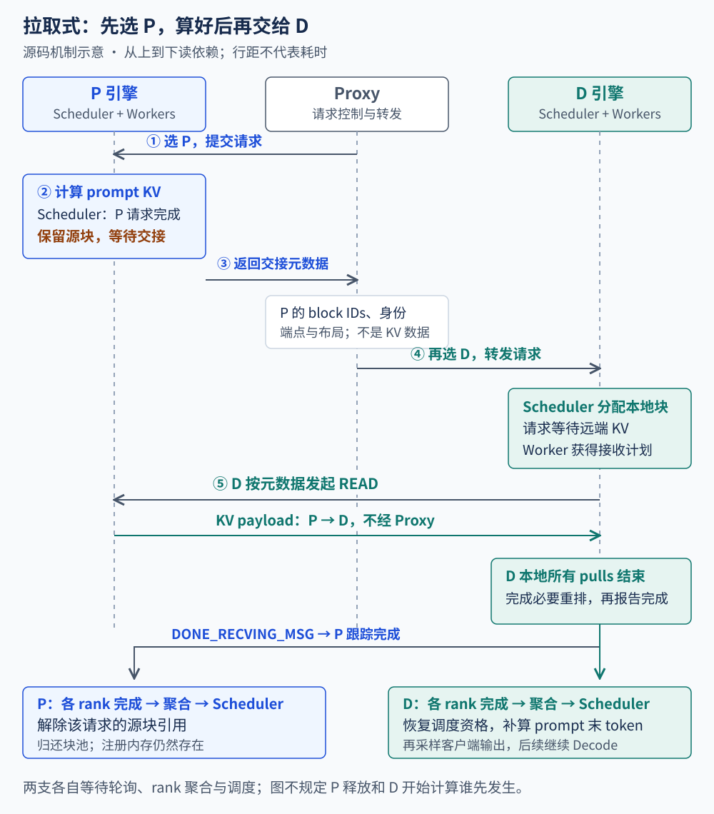
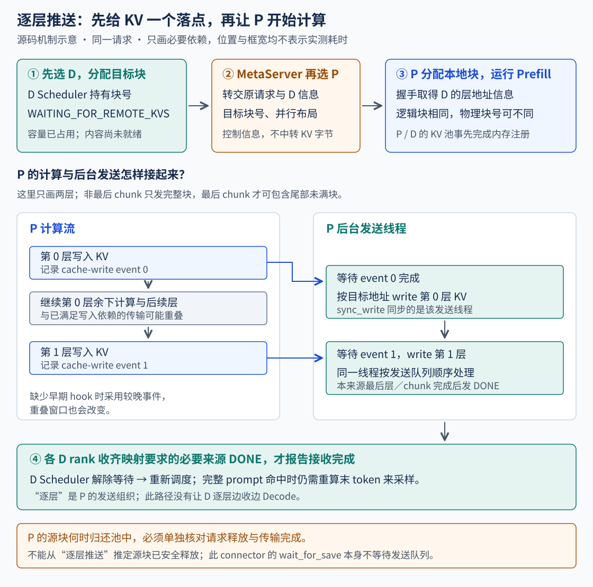
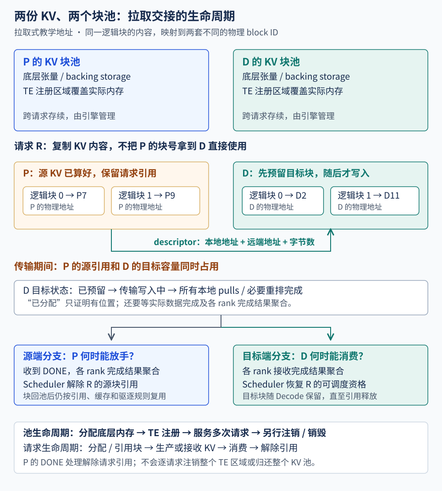
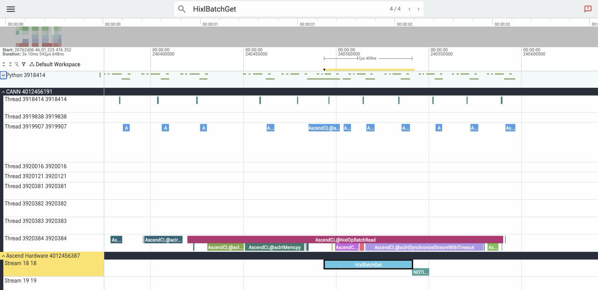
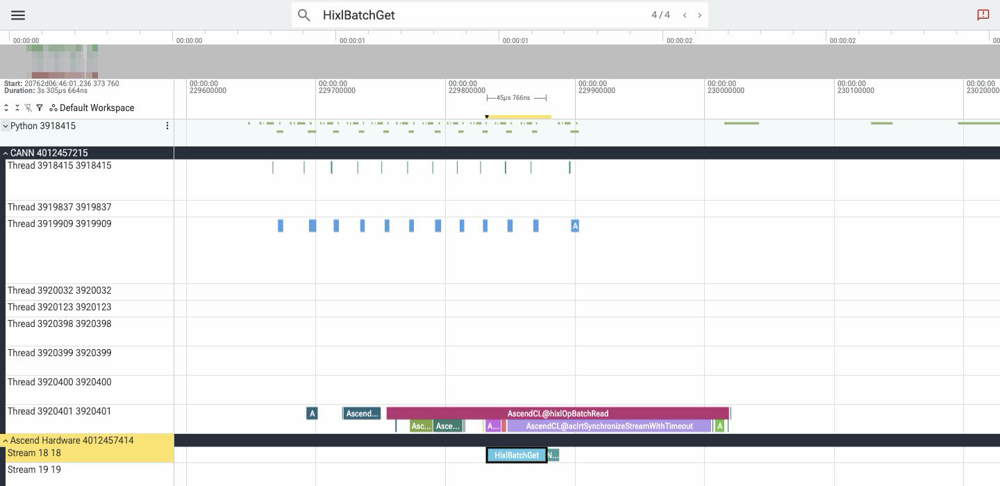
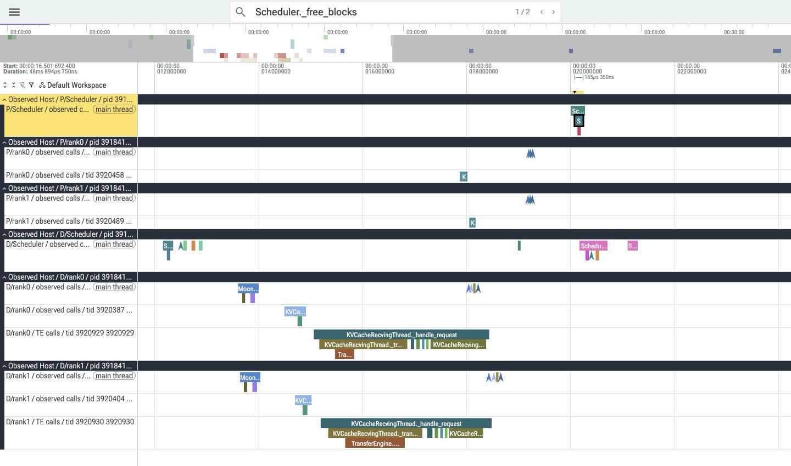
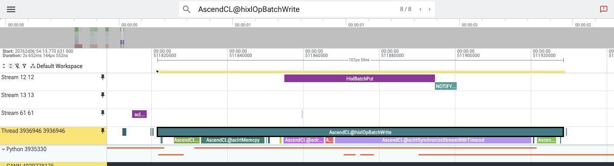
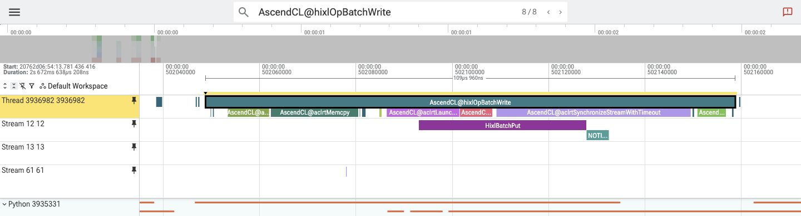
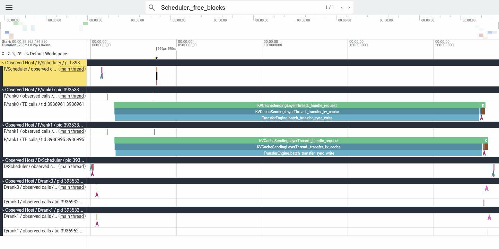

# PD 分离系统：请求交接与 KV 生命周期

第六章把一条请求的 Attention 分到多个 rank，最后归并结果。现在把边界再向外移：Prefill 由一套引擎完成，Decode 交给另一套引擎。两边各有 Scheduler、Worker 和 KV 块池，一条请求怎样从 P 走到 D？

第一章介绍了 PD 的资源组织。这里从 A5 拉取实验的两张块表出发，算出 Worker 提交给 Mooncake 的字节范围，再看逐层推送怎样改变分配顺序、发送时机和完成条件。

> 源码主线是 vLLM-Ascend 的 `MooncakeConnectorV1` 与 `MooncakeLayerwiseConnector`，配对实际使用的 vLLM Scheduler 和 ModelRunnerV2。前者指向 `kv_p2p/mooncake_connector.py`；另一个拆分目录中的 `MooncakePullConnector` 不是本章实验路径。固定源码、Mooncake 二进制来源边界、脚本和结果见[实验材料](https://github.com/Tflowers-0129/inference-wiki/tree/main/experiments/pd-disaggregation)。机制图为教学图，真实采集在后面的实操部分。

## 1. 交出去的是什么？

取 A5 拉取实验的 `prompt129-repetition0`。两层 Qwen2 使用 BF16、2 个 KV heads、head_dim=64。P、D 各用 TP2，PCP、DCP 均为 1，关闭前缀缓存。每端的两个 Worker 各持有一个 KV head 的完整历史，D rank 0 从 P rank 0 取自己的 head，rank 1 同理。[实测请求和模型配置](https://github.com/Tflowers-0129/inference-wiki/blob/main/experiments/pd-disaggregation/results/pull.json)

每块容纳 128 个位置。两边 Scheduler 为同一段 prompt 分别分配了下面的物理块。块号由各自引擎分配，每个 Worker 用它查本地对应层和 head 的页。[两端分配记录](https://github.com/Tflowers-0129/inference-wiki/blob/main/experiments/pd-disaggregation/results/lifecycle-summary-pull.json)

| prompt 的有效位置 | 逻辑块号 | P 源块号 | D 目标块号 |
| --- | --- | --- | --- |
| 0～127 | 0 | 1 | 5 |
| 128 | 1 | 2 | 4 |

P 的块表 `[1,2]` 用于定位源数据。D 完成交接后，Attention 按 D 的表 `[5,4]` 和请求长度读取历史。即使两张表碰巧给出同一个数值，也要用各自 Worker 的缓存基址寻址。若两端的 TP、CP 或块长不同，还要先确认连接器能把相同的层、head 和历史位置映射过去。[拉取式的 head 和块映射](https://github.com/vllm-project/vllm-ascend/blob/f9c8e0bd/vllm_ascend/distributed/kv_transfer/kv_p2p/mooncake_connector.py#L3930-L4054)

请求还有模型输入、采样参数、请求身份与生成进度。HTTP 请求负责把这些信息送给另一套引擎；KV 数据另走 Worker 间的传输。不能只复制一份 KV 张量，就认为 D 已经获得可继续执行的完整请求状态。[拉取式连接器](https://github.com/vllm-project/vllm-ascend/blob/main/vllm_ascend/distributed/kv_transfer/kv_p2p/mooncake_connector.py) · [逐层连接器](https://github.com/vllm-project/vllm-ascend/blob/main/vllm_ascend/distributed/kv_transfer/kv_p2p/mooncake_layerwise_connector.py)

两套引擎也没有共用一份本轮 Token 预算。P 是否能开始 Prefill，由 P 自己的调度与 KV 容量决定；D 是否能接收、接收后何时执行，由 D 的分配和调度决定。PD 请求路由发生在实例之间，TP 通信仍发生在各实例内部。

## 2. Proxy、连接器与 Mooncake 各管哪一段？

沿源码往下，有三种不同的信息交换：

| 参与者 | 交换的信息 | 对这条请求的作用 |
| --- | --- | --- |
| Proxy 与 P/D HTTP 服务 | prompt、采样参数、请求身份、`kv_transfer_params` | 选择实例、发起两端请求、向客户端转发 D 输出 |
| 连接器 Scheduler 与 Worker，以及 Worker 侧信道 | 本地/远端块号、布局、内存描述、完成通知 | 分配、生成传输计划、把完成状态送回 Scheduler |
| Mooncake Transfer Engine | 已注册缓冲区之间的 READ / WRITE | 实际搬运 KV payload |

Proxy 返回了 HTTP 元数据，不表示 KV 已到 D；连接器返回了“外部可命中多少 Token”，也不表示这些 Token 已经可以被 Attention 读取。后面要分别找出对应的完成条件。

同名字段还要看它由谁构造、交给谁消费：

| 交接信息 | 拉取式：P 返回给 D | 逐层推送式：D 返回给 P |
| --- | --- | --- |
| `remote_block_ids` | P 的源块号 | D 的目标块号 |
| `remote_engine_id`、请求身份 | 定位保留源 KV 的 P 请求 | 定位等待接收的 D 请求 |
| `remote_host`、`remote_port` | P 的连接器侧信道 | D 的连接器侧信道 |
| 交接后的工作 | D 发起 READ | P 按层发起 WRITE |

`remote` 是接收这份 metadata 的一方所看到的远端。不能把两种方式的同名字段解释成固定属于 P 的地址。[拉取字段构造](https://github.com/vllm-project/vllm-ascend/blob/main/vllm_ascend/distributed/kv_transfer/kv_p2p/mooncake_connector.py) · [推送字段构造](https://github.com/vllm-project/vllm-ascend/blob/main/vllm_ascend/distributed/kv_transfer/kv_p2p/mooncake_layerwise_connector.py)

本章这条 P2P 路线由 `GlobalTE` 在 Worker 内初始化 Transfer Engine，选择 `P2PHANDSHAKE` 与 `ascend` transport。它直接用于 P/D 交接，没有启动 Mooncake Store。连接器的 `kv_port` 侧信道与 TE 发布的 RPC 端口也不同，不能把它们画成同一个数据入口。[TE 初始化与注册](https://github.com/vllm-project/vllm-ascend/blob/main/vllm_ascend/distributed/kv_transfer/utils/mooncake_transfer_engine.py)

Mooncake 的 Python `batch_transfer_sync_read/write` 把本地缓冲区、远端地址、长度和 READ/WRITE 操作交给 C++；参照源码在提交后等待 batch 完成，成功才返回 0。连接器可以把这个同步调用放到后台线程，使引擎继续推进其他工作。因此“相对 Scheduler 异步”“后台线程执行”和“调用 TE async API”要分开读。本章连接器使用的是同步批量读写接口。[Mooncake Python/C++ bridge](https://github.com/kvcache-ai/Mooncake/blob/main/mooncake-integration/transfer_engine/transfer_engine_py.cpp)

## 3. 拉取式：P 先算好，D 再来取

官方拉取式 proxy 先选 P。`build_prefill_request` 给 P 填入 `do_remote_decode=True`，把 P 请求的 `max_tokens`、`min_tokens` 都设为 1，并关闭这一段 HTTP 的流式返回。P 完成这次本地请求后，proxy 才拿着返回的交接信息选择 D。[Proxy 请求构造与实例选择](https://github.com/vllm-project/vllm-ascend/blob/main/examples/disaggregated_prefill_v1/load_balance_proxy_server_example.py)



### P 返回元数据，源块仍被请求持有

普通 FullAttention 路径中，P 处理完整 prompt。请求因输出长度限制结束后，连接器 Scheduler 的 `request_finished` 检查 `do_remote_decode` 与结束原因，取出需要交接的 prompt 块。只要有源块，就返回 `delay_free_blocks=True`，并把请求放入待发送完成的跟踪集合。

这时 HTTP 可以返回，但上游 Scheduler 会保留请求的块引用。返回的 `kv_transfer_params` 包含远端请求/引擎身份、P 块号、侧信道入口和并行布局。proxy 把它放进 D 请求；KV payload 留在 P 的已注册缓存里，等待 D 读取。[`request_finished` 与交接字段](https://github.com/vllm-project/vllm-ascend/blob/main/vllm_ascend/distributed/kv_transfer/kv_p2p/mooncake_connector.py) · [Scheduler 的 `_free_request`](https://github.com/vllm-project/vllm/blob/main/vllm/v1/core/sched/scheduler.py)

若 D 尚未选出、没有目标块或迟迟不能准入，P 已经算好的 KV 仍占着引用。此时 P 的“计算结束”与“缓存可供下一请求使用”之间出现了一个驻留窗口。这个窗口不能从 P 的 Prefill kernel 耗时里读出来。

### D 先占空间，再进入接收等待

D 的连接器通过 `get_num_new_matched_tokens` 告诉 Scheduler：哪些 prompt Token 预计可以从 P 获得，并返回异步加载标记。Scheduler 先分配目标 slots，再通过 `update_state_after_alloc` 记录本地块号与 P 的信息，生成发给 Worker 的传输计划。

请求随后进入 `WAITING_FOR_REMOTE_KVS`。这时账本里的 `num_computed_tokens` 可以已经计入预计加载的数量，但状态仍禁止它直接进入正常计算。这个字段描述调度进度；设备完成要等 Worker 回报，不能单看数值已经达到 prompt 长度。[D 的匹配/分配接口](https://github.com/vllm-project/vllm-ascend/blob/main/vllm_ascend/distributed/kv_transfer/kv_p2p/mooncake_connector.py) · [外部 KV 分配与等待状态](https://github.com/vllm-project/vllm/blob/main/vllm/v1/core/sched/scheduler.py)

### D 怎样把两张块表变成 8 条 READ 描述符？

Worker 初始化 KV 池后，`register_kv_caches` 为每层、每个 K/V 视图记录 `data_ptr()`、单块载荷字节数和块步幅。普通 GQA 路径按底层 storage 合并注册区，同一层的 K/V 视图可以对应同一个注册区。D 第一次接触该 P Worker 时，通过侧信道发送 `GET_META_MSG`，取回 P 的视图基址、块步幅及 TE RPC 端口。D 用 RPC 端口构造 READ 的 session，再把请求级源块号与这些内存描述配对。[注册元数据](https://github.com/vllm-project/vllm-ascend/blob/f9c8e0bd/vllm_ascend/distributed/kv_transfer/kv_p2p/mooncake_connector.py#L2646-L2740) · [Worker 侧握手](https://github.com/vllm-project/vllm-ascend/blob/f9c8e0bd/vllm_ascend/distributed/kv_transfer/kv_p2p/mooncake_connector.py#L1483-L1509)

这次拉取采用 LBNHC，单层 K、V 各是 `[B,128,1,64]` 的视图，`B` 为池的块数。一个 K 页含 `128×1×64×2 = 16,384 B`，V 页也一样。底层按 `[K0][V0][K1][V1]…` 交错，所以 K 或 V 视图的块步幅都是 32,768 B。下面令 `K_P`、`K_D` 分别为相互配对的 P、D Worker 上同一层的 K 视图基址，按源码推导两条 K 描述符。[backend 的单层形状](https://github.com/vllm-project/vllm-ascend/blob/f9c8e0bd/vllm_ascend/attention/attention_v1.py#L114-L124) · [packed K/V 的分配条件](https://github.com/vllm-project/vllm-ascend/blob/f9c8e0bd/vllm_ascend/worker/v2/attn_utils.py#L1529-L1568) · [K/V 视图的步幅](https://github.com/vllm-project/vllm-ascend/blob/f9c8e0bd/vllm_ascend/worker/v2/attn_utils.py#L820-L852)

| 块号配对 | P 上的远端地址 | D 上的本地地址 | READ 长度 |
| --- | --- | --- | --- |
| 1 → 5 | `K_P + 32,768` | `K_D + 163,840` | 16,384 B |
| 2 → 4 | `K_P + 65,536` | `K_D + 131,072` | 16,384 B |

同一层的 V 描述符使用各自的 V 视图基址，地址在表中对应 K 地址之后 16,384 B。连接器逐层、逐组件组装描述符，只有两端的范围都按顺序在字节地址上相邻时才合并。这里 P 的两个 K 页之间夹着一个 V 页，D 的目标块顺序又是 5、4。每个 D rank 提交 `2 层 × 2 组件 × 2 页 = 8` 条范围，共 131,072 B。有效 KV 按 129 行计算是 `129 × 2 层 × 2 组件 × 64 × 2 B = 66,048 B`，差额来自尾页剩余的 127 个槽。[地址、长度和合并条件](https://github.com/vllm-project/vllm-ascend/blob/f9c8e0bd/vllm_ascend/distributed/kv_transfer/kv_p2p/mooncake_connector.py#L1000-L1059) · [实测范围数与字节量](https://github.com/Tflowers-0129/inference-wiki/blob/main/experiments/pd-disaggregation/results/pull.json)

这次 `batch_transfer_sync_read` 由 D 发起。它把上表的 D 地址传入 local buffer 列表（源码的 `src_list`），P 地址传入远端列表（`dst_list`），数据流向为 P→D。若两端分片要求把一个 D 页拆给多个 P Worker，地址计算还要按来源加上页内偏移，必要的重排在 D 本地接收任务收齐后进行。[读描述符与分片偏移](https://github.com/vllm-project/vllm-ascend/blob/f9c8e0bd/vllm_ascend/distributed/kv_transfer/kv_p2p/mooncake_connector.py#L1000-L1059) · [接收后的重排](https://github.com/vllm-project/vllm-ascend/blob/f9c8e0bd/vllm_ascend/distributed/kv_transfer/kv_p2p/mooncake_connector.py#L734-L787)

### 读完以后，有两条独立的完成路径

D 的本地接收任务全部结束后，Worker 通过 `finished_recving` 回报。ModelRunnerV2 即使在本轮没有前向时，也能提交连接器任务并轮询这些回报。此次 TP2 运行中，执行器收齐 D 的两个 Worker 回报才给 Scheduler 交付请求级完成。Scheduler 将请求加入 `finished_recving_kv_req_ids`，随后在等待队列处理中推进状态。[ModelRunnerV2 的 `no_forward`](https://github.com/vllm-project/vllm/blob/5df63a72/vllm/v1/worker/gpu/kv_connector.py#L130-L167) · [多 rank 聚合](https://github.com/vllm-project/vllm/blob/5df63a72/vllm/distributed/kv_transfer/kv_connector/utils.py#L63-L130) · [Scheduler 的完成状态](https://github.com/vllm-project/vllm/blob/5df63a72/vllm/v1/core/sched/scheduler.py#L3175-L3236)

各 D Worker 也向对应的 P Worker 发回 DONE。P 的执行器汇总自己的 `finished_sending` 回报，P Scheduler 据此调用 `_free_blocks`。拉取实测中，rank 0 的 READ 和 DONE 先结束，rank 1 此时仍在读。D 恢复调度与 P 释放调用各自由本端的 Scheduler 推进。[接收任务与 DONE](https://github.com/vllm-project/vllm-ascend/blob/f9c8e0bd/vllm_ascend/distributed/kv_transfer/kv_p2p/mooncake_connector.py#L734-L787) · [两 rank 的完成与释放记录](https://github.com/Tflowers-0129/inference-wiki/blob/main/experiments/pd-disaggregation/results/lifecycle-summary-pull.json)

## 4. P 算出的首 Token，为什么 D 还会重算？

这里需要回到 proxy 的真实行为。P 虽被要求输出一个 Token，拉取式 proxy 只把返回的 `kv_transfer_params` 交给 D，没有把 P 采样的 Token 追加到 D 的 prompt，也没有先把 P 的文本交给客户端。元数据里的 `last_token_id` 出现了，不代表后续路径实际消费了它。

在本章的普通 FullAttention 路径中，D 收到完整 prompt KV 后，上游 `_update_waiting_for_remote_kv` 发现 `num_computed_tokens == num_tokens`，会退回一个位置。D 重算最后一个 prompt Token，得到 logits，再采样客户端的第一个输出。这条路径不能按“P 贡献第一个输出，D 继续生成剩下的输出”记账。[Proxy 的交接处理](https://github.com/vllm-project/vllm-ascend/blob/main/examples/disaggregated_prefill_v1/load_balance_proxy_server_example.py) · [末 Token 重算](https://github.com/vllm-project/vllm/blob/main/vllm/v1/core/sched/scheduler.py)

129 Token 算例中，实测 D 从 `WAITING_FOR_REMOTE_KVS` 回到 `WAITING` 时，`num_computed_tokens` 从 129 退到 128。下一次前向以 prompt 位置 128 为输入，用目标块表的第二项 4 写回页内第 0 行，`slot_mapping = 4×128+0 = 512`。位置 0～127 的历史从目标块 5 读取。客户端看到的第一个生成 Token 处于位置 129，它在下一次送入模型时才写入块 4 的第 1 行。[恢复调度的实测记录](https://github.com/Tflowers-0129/inference-wiki/blob/main/experiments/pd-disaggregation/results/lifecycle-summary-pull.json) · [Runner 的 slot mapping](https://github.com/vllm-project/vllm-ascend/blob/f9c8e0bd/vllm_ascend/ops/triton/v2/block_table/compute_slot_mappings.py#L79-L113)

Mamba 或压缩状态还有 P 端截断 prompt 等额外处理，因为状态不一定能通过重写最后一个 KV slot 恢复。那是另一条状态契约，本章普通 GQA 的算例不把它拼进来。

## 5. 逐层推送式：D 先占位，再让 P 开始

拉取式要等 P 完成后，才知道它的源块。逐层推送则需要提前知道写到哪里，因此交接顺序反过来：proxy 先选 D，D 分配目标块，再把目标信息送回 proxy 的 MetaServer 接口；此时 proxy 才选 P 并派发 Prefill。[逐层 proxy](https://github.com/vllm-project/vllm-ascend/blob/main/examples/disaggregated_prefill_v1/load_balance_proxy_layerwise_server_example.py)



### MetaServer 交接的是目标位置

D 请求携带 `do_remote_prefill=True` 与 MetaServer 地址。`update_state_after_alloc` 在块分配之后，把 D 的目标块号写入 `remote_block_ids`，同时回传块长、并行配置和本地已命中的前缀 `remote_cached_tokens`。P 用已命中的前缀长度确定发送起点。proxy 把这份 metadata 附到 P 请求里。如果一个 API 请求展开为多个子请求，proxy 先收齐各自的目标信息，再派发 Prefill。[目标元数据与发送起点](https://github.com/vllm-project/vllm-ascend/blob/f9c8e0bd/vllm_ascend/distributed/kv_transfer/kv_p2p/mooncake_layerwise_connector.py#L1290-L1360)

这里的 MetaServer 是 proxy 暴露的请求交接接口，不是 Mooncake Store 的对象目录，也不搬运 KV。P 后续仍要通过 Worker 侧信道取得 D 的内存描述与 TE 入口。proxy 的 `release_prefiller_kv` 等函数调整入口评分计数，不能据名字认作 NPU 分配器已经释放块。[目标分配与 `_access_metaserver`](https://github.com/vllm-project/vllm-ascend/blob/main/vllm_ascend/distributed/kv_transfer/kv_p2p/mooncake_layerwise_connector.py)

### 一层何时允许发送？

P 的 Scheduler 根据本轮计划生成发送 metadata；ModelRunnerV2 在前向前绑定 metadata，并准备逐层状态。Attention 写入该层 KV 后，Ascend hook 在计算 stream 记录事件。`save_kv_layer` 把该事件、层身份和块映射放入后台发送队列。

发送线程先等待这个 KV 写入事件，再调用 `batch_transfer_sync_write`。主计算可以继续执行后续算子或后续层，后台线程处理已经准备好的层。若某条 Attention 路径没有提前发出写入 hook，连接器会在较晚的位置记录备用事件，允许重叠的窗口也相应改变。[KV 写入通知](https://github.com/vllm-project/vllm-ascend/blob/main/vllm_ascend/attention/utils.py) · [逐层发送与写入事件](https://github.com/vllm-project/vllm-ascend/blob/main/vllm_ascend/distributed/kv_transfer/kv_p2p/mooncake_layerwise_connector.py)

Chunked Prefill 又多一条边界：非最终 chunk 只发送已经覆盖的完整块，最后一个 chunk 才包含末尾未满块。Scheduler 根据计划更新的 `local_computed_tokens`、`local_transferred_tokens` 用于构造这些范围；它们不是 TE 已完成传输的回执。不能看字段叫 transferred，就直接把同一时刻画成远端已有效。

### 按层传，不等于 D 按层开始 Decode

发送线程处理完本来源的最终层和最终 chunk 后，向对应 D Worker 发送 DONE。消息带外部请求 ID、该接收者预期的来源数 `trans_count` 和发送者侧信道地址。D 的接收线程按请求将来源地址加入集合，达到 `trans_count` 后生成本地完成记录。Worker 再把外部请求 ID 映射回引擎内部 ID，报告 `finished_recving`。A5 的 MQA+DCP2 推送中，每个 D Worker 的 `trans_count=1`。执行器仍需收齐两个 D Worker 的完成回报，Scheduler 才能推进整条请求。[消息处理与来源计数](https://github.com/vllm-project/vllm-ascend/blob/f9c8e0bd/vllm_ascend/distributed/kv_transfer/kv_p2p/mooncake_layerwise_connector.py#L884-L947) · [实测 DONE 与完成回报](https://github.com/Tflowers-0129/inference-wiki/blob/main/experiments/pd-disaggregation/results/lifecycle-summary-push.json)

本章核查的 `wait_for_layer_load` 为空。D 仍由整条请求的远端 KV 完成状态解除等待，随后重算末 prompt Token 并继续生成。逐层优化首先改变 P 侧“哪一层什么时候能发”，不能据此推断 D 已在第 0 层刚到时启动同一请求的第 0 层 Decode。[按来源跟踪与 `get_finished`](https://github.com/vllm-project/vllm-ascend/blob/main/vllm_ascend/distributed/kv_transfer/kv_p2p/mooncake_layerwise_connector.py)

## 6. 两种方式怎样管理源块与目标块？

先把“块归还”与“内存注销”分开。连接器在 KV 池创建后注册底层 storage，内存描述可以服务多条请求。请求完成时，分配器解除的是它对物理块的引用；池张量和 TE 注册仍可继续存在。只有独立的资源清理路径才会断开 peer 并注销注册区。[内存注册与注销](https://github.com/vllm-project/vllm-ascend/blob/main/vllm_ascend/distributed/kv_transfer/utils/mooncake_transfer_engine.py)



对 D 来说，目标块依次经历已分配、正在写入、加载完成、参与计算。取消请求会终止它的业务输出，但后台写入可能仍在进行；Scheduler 对尚在等待远端 KV 的已终止请求保留目标块，等完成回报后再释放，避免新请求复用仍被写入的地址。[取消与延迟释放](https://github.com/vllm-project/vllm/blob/main/vllm/v1/core/sched/scheduler.py)

P 的两条实现则有直接可见的差异：

| 检查点 | 拉取式 | 本章核查的逐层推送式 |
| --- | --- | --- |
| P `request_finished` | 有待交接源块时返回延迟释放 | 返回不延迟释放 |
| P 发送完成回报 | D 通知后，经 Worker 聚合报告 `finished_sending` | `get_finished` 的发送完成集合为空 |
| `wait_for_save` | 不能用函数名代替实际后台完成条件 | 函数体为空，没有等待发送队列 |
| 源端后续处理 | 源端完成跟踪进入 Scheduler | 连接器不额外延迟，继续走 P 请求结束及分配器 fence 路径 |

因此不能把拉取式的 hold/ACK 释放协议直接画到逐层推送图上。在这一逐层快照中，连接器没有要求普通 P 请求的 `_free_blocks` 调用必定晚于全部后台写完成。分配器仍可能按在途模型 step 延后实际归还；已有的层 buffer reuse 事件也只保护相应复用路径。需要继续区分“释放调用返回”“实际解除块引用”和“下一请求覆写地址”。本次实操记录前一项与写返回的先后，没有覆盖全部实际复用条件。[连接器实现](https://github.com/vllm-project/vllm-ascend/tree/main/vllm_ascend/distributed/kv_transfer/kv_p2p) · [分配器延后释放路径](https://github.com/vllm-project/vllm/blob/main/vllm/v1/core/sched/scheduler.py)

## 7. 失败、超时和取消，分别结束了什么？

拉取式的 DONE 让 P 知道一次读取任务已终结，失败也走这条清理路径。D 另外报告失败。普通单缓存组路径报告无效目标块。启用请求级错误的路径则等本地任务收尾，再随 `finished_recving` 上报 `failed_recving`。Scheduler 结合失败策略决定终止还是重新计算。A5 实验沿用默认的 `fail`。[拉取失败的记录条件](https://github.com/vllm-project/vllm-ascend/blob/f9c8e0bd/vllm_ascend/distributed/kv_transfer/kv_p2p/mooncake_connector.py#L619-L649) · [Worker 的失败回报](https://github.com/vllm-project/vllm-ascend/blob/f9c8e0bd/vllm_ascend/distributed/kv_transfer/kv_p2p/mooncake_connector.py#L2791-L2826) · [引擎默认策略](https://github.com/vllm-project/vllm/blob/5df63a72/vllm/config/kv_transfer.py#L88-L91)

若 D 在分配前拒绝请求，例如 prompt 加最大输出长度超出服务上限，D 的连接器会排入一条空接收任务。Worker 跳过 payload 读取，仍发回 DONE。若 DONE 一直未到，P 的完成轮询会按 `VLLM_MOONCAKE_ABORT_REQUEST_TIMEOUT` 将超时请求纳入发送完成集合，以便释放源引用。[空接收的入队条件](https://github.com/vllm-project/vllm-ascend/blob/f9c8e0bd/vllm_ascend/distributed/kv_transfer/kv_p2p/mooncake_connector.py#L2047-L2070) · [源端超时跟踪](https://github.com/vllm-project/vllm-ascend/blob/f9c8e0bd/vllm_ascend/distributed/kv_transfer/kv_p2p/mooncake_connector.py#L219-L259)

逐层推送也有 FAILED 消息与目标块错误报告，但本章快照中的 Worker 没有把失败请求同时并入接收完成集合，也没有补齐请求级 `failed_recving` 回报；配对 Scheduler 的恢复又要等接收终结。不能仅凭代码里出现 FAILED，就认定错误一定会自动转为本地重算。MetaServer 请求的异常重试、DONE 控制消息的重试，也不能合起来称为整条交接已具备有界超时恢复。[逐层失败与 DONE 路径](https://github.com/vllm-project/vllm-ascend/blob/main/vllm_ascend/distributed/kv_transfer/kv_p2p/mooncake_layerwise_connector.py)

客户端断开连接也不等于所有设备传输立即停止。proxy 取消 HTTP task、清理路由计数，与后台传输终结和块引用释放仍有各自的条件。[Proxy 取消处理](https://github.com/vllm-project/vllm-ascend/blob/main/examples/disaggregated_prefill_v1/load_balance_proxy_layerwise_server_example.py)

排查时至少保留请求身份、P/D 所在实例、目标是否分配、还有哪些来源未完成、源/目标请求引用是否已归还。Proxy 队列清了、HTTP task 取消了、块回到分配器、TE 注册区注销了，分别是不同的事实。

## 8. A5 上，实际跑通了哪两条路径？

这次在同一台 A5 主机上使用四张健康、空闲的 NPU，按排他租约串行运行两套 PD 系统。两边都是实际 HTTP 服务、官方 proxy、ModelRunnerV2 与 Mooncake 原生传输，没有用 D 本地重算代替加载成功。采集结束后已确认实验进程退出并释放设备。

模型是固定随机种子的两层 Qwen2：hidden=512、Q heads=8、head_dim=64、BF16。两组缓存与并行条件如下：

| 项目 | 拉取式 | 逐层推送式 |
| --- | --- | --- |
| 连接器 | `MooncakeConnectorV1` | `MooncakeLayerwiseConnector` |
| P / D 的 TP | 2 / 2 | 2 / 2 |
| P / D 的 DCP | 1 / 1 | 2 / 2 |
| KV heads | 2，按 TP 分开 | 1，按 DCP 分历史位置 |
| KV 布局 | 实际 GQA 布局 | 连续的独立 K/V 张量 |
| block size / CP interleave | 128 / 128 | 128 / 128 |

每 Worker 固定 32 MiB KV 池预算，模型长度上限 2048，本轮 Token 预算 1024，最大序列数 4，eager，关闭 prefix caching。prompt 取 129、513，各重复两轮，每次输出四个 Token。每组先在同配置 P 上运行普通本地请求作为参考，再预热并采集 PD 请求。[复现命令与结果](https://github.com/Tflowers-0129/inference-wiki/tree/main/experiments/pd-disaggregation)

两组四次测量的输出 Token IDs 均与各自参考一致；所选 Token 的 logprob 最大绝对差，拉取式约为 0.00766，逐层推送式约为 0.00789，没有声称逐位相同。随机权重验证交接与续算的一致性，不验证预训练质量。两组 KV head 数与 DCP 条件不同，也不据此比较 pull、push 的耗时或加速比。[拉取结果](https://github.com/Tflowers-0129/inference-wiki/blob/main/experiments/pd-disaggregation/results/pull.json) · [推送结果](https://github.com/Tflowers-0129/inference-wiki/blob/main/experiments/pd-disaggregation/results/push.json)

### 为什么没有直接照抄一组启动参数？

首次拉取式把 P、D 的设备可见集分开，两个 rank 都在 TE READ 建连时超时。随后使用 2 MiB 对齐缓冲区做最小探针：固定物理 pair、UB 配置和 QoS，仅改变进程可见集，四卡都可见时 READ/WRITE 与全缓冲区检查通过，分开可见时 READ 失败。通过引擎已有的 `--device-ids` 保留四卡可见、分别绑定实例后，完整交接通过。这个结果只定位到本次可见性条件，没有定案 HIXL 内部根因。

首次逐层推送采用普通 GQA/DCP1。第 3 节算出的 K/V 步幅为 32,768 B，单组件一页只占 16,384 B。注册时检查 `stride(0)` 与页内元素数，两者不等会进入 component transfer。这组普通 FullAttention 的 K/V 随后触发该分支的非 MLA 校验。实验改用 MQA+DCP2，分配器为 K 和 V 各开一段连续 storage，此时单组件页步幅与载荷都是 16,384 B。两端 block size 和 interleave 都设为 128，使用生产连接器的普通逐层写入路径通过。[分配分支](https://github.com/vllm-project/vllm-ascend/blob/f9c8e0bd/vllm_ascend/worker/v2/attn_utils.py#L1529-L1568) · [逐层注册的步幅检查](https://github.com/vllm-project/vllm-ascend/blob/f9c8e0bd/vllm_ascend/distributed/kv_transfer/kv_p2p/mooncake_layerwise_connector.py#L1686-L1710) · [component 路径的校验](https://github.com/vllm-project/vllm-ascend/blob/f9c8e0bd/vllm_ascend/distributed/kv_transfer/kv_p2p/mooncake_layerwise_connector.py#L1770-L1834)

## 9. 拉取式多 rank：真正的 READ 在哪里？

下面两张是 Linux 原生 Perfetto 解析器与浏览器查看器的真实截图，分别选中同一次 513 Token 测量请求的 D rank 0、1。`AscendCL@hixlOpBatchRead` 是 CANN 调用，`HixlBatchGet` 是对应设备任务；依据同文件的 `connection_id` 字段配对，并用请求观察记录确认归属。





| 该次请求的接收者 | TE 范围数（5 个逻辑块） | TE 调用中的字节量 | 选中设备 Get 任务 |
| --- | --- | --- | --- |
| D rank 0 | 20 | 327,680 B | 约 47.409 μs |
| D rank 1 | 20 | 327,680 B | 约 45.766 μs |

按第 3 节的单页尺寸，这次每 rank 的传输量为 `5 页 × 2 层 × 2 份 K/V × 16,384 B = 327,680 B`。第五页只有一个有效位置，TE 仍传了整页。[该请求的范围数、字节量与设备任务](https://github.com/Tflowers-0129/inference-wiki/blob/main/experiments/pd-disaggregation/results/profiling-events-pull.json)

两张图各自缩放，左边缘没有对齐成同一个同步点。设备 Get 的持续时间也不是整次 TE 调用、排队或端到端交接耗时。选中任务的 HostToDevice flow 只有终点，不能凭查看器补出一根完整的因果箭头；这里使用的是调用与设备任务的相同连接字段。

### READ 成功后，P 与 D 各自推进

下图把同一请求的 Host 观察记录放到一个共享的主机 monotonic 轴上。它由真实 JSONL 的 begin/end 导出为 Chrome trace，再由 Perfetto 显示；没有添加 NPU kernel，也没有把设备时间换算到这根 Host 轴。rankS 表示引擎 Scheduler，rankU 表示日志尚未确定 rank，均不改称 rank0。



观察记录包含两个 D rank 的读取返回、完成通知与 D 状态推进，以及 P 的释放调用。它可以用于核对各自调用的先后，不能把两套 Scheduler 的完成压缩成一个时刻。观察包装、日志记录和采集本身有开销，本项目没有用这根轴测量无插桩服务的延迟。[Host 导出脚本与生命周期结果](https://github.com/Tflowers-0129/inference-wiki/tree/main/experiments/pd-disaggregation)

## 10. 逐层推送多 rank：为什么发送量也不同？

取实测 `prompt513-repetition1`。P 块表是 `[3,2,1]`，D 是 `[1,2,3]`。MQA+DCP2 下，interleave 与页长都是 128 个位置。第 `g` 段的 owner 是 `g % 2`，用 `g // 2` 查该 rank 的本地块表。位置 512 落在全局第 4 段，只有 rank 0 写这一段的第 0 行，从 P 块 1 搬到 D 块 3。rank 1 用前两个表项，传输到 D 块 2 就覆盖了自己持有的全部历史。[逐 rank 的块映射](https://github.com/vllm-project/vllm-ascend/blob/f9c8e0bd/vllm_ascend/distributed/kv_transfer/utils/utils.py#L179-L351) · [分配记录和实际发送列表](https://github.com/Tflowers-0129/inference-wiki/blob/main/experiments/pd-disaggregation/results/lifecycle-summary-push.json)

下面是同一次 513 Token 测量请求的 P rank 0、1，图中聚焦最后一层。每份完整采集包含四条请求、每请求两层，共八次实际 `HixlBatchPut`，在 CANN 侧对应 `AscendCL@hixlOpBatchWrite`；普通 TP 的 HCCL 通信仍是另一路工作，不能把它当作跨 P/D 的 KV payload。





| 513 Token 请求的来源 | 每层块号配对 | 每层 TE 范围数 | 每层 TE 字节量 |
| --- | --- | --- | --- |
| P rank 0 → D rank 0 | 3→1、2→2、1→3 | 6 | 98,304 B |
| P rank 1 → D rank 1 | 3→1、2→2 | 4 | 65,536 B |

这条连续 K/V 路径按 `视图基址 + 物理块号 × 16,384 B` 计算 WRITE 地址。本次 P 块按 3、2、1 递减，D 块按 1、2、3 递增。连接器为每页的 K 和 V 各生成一个范围，再按层提交批量 WRITE。两层合计，rank 0 传 196,608 B，rank 1 传 131,072 B。129 Token 时，两 rank 每层各传一页。四次测量合计，P rank 0 发送 524,288 B，rank 1 发送 393,216 B，所有观察到的 TE 写调用均成功返回。[WRITE 描述符](https://github.com/vllm-project/vllm-ascend/blob/f9c8e0bd/vllm_ascend/distributed/kv_transfer/kv_p2p/mooncake_layerwise_connector.py#L462-L514) · [逐层范围数、字节量与返回码](https://github.com/Tflowers-0129/inference-wiki/blob/main/experiments/pd-disaggregation/results/profiling-events-push.json)

源码的分块路径中，还要按来源判断最终 chunk：某一来源已经覆盖自己的最后一页，可以完成本来源的最后一层与 DONE；另一来源还可能有尾页要处理。D 等的是映射要求的必要来源，不要求所有 rank 在同一个全局 chunk 边界发出相同消息。本轮两种长度均一次 P 调度完成，没有实测这个跨 chunk 场景。两张设备图的区间也不构成未校准的跨卡共同时间轴。

### 首次预热记录：释放调用返回，不代表所有后台写已返回

本次首次 129 Token 预热中，P 的 `_free_blocks` / `_free_request_blocks` 调用已经返回，最后一次 TE 写约在 191 ms 后才返回。下图来自这次真实 Host 观察记录，保留两个来源 rank、Scheduler 与完成处理，共用同一主机 monotonic 轴。



这与第 6 节的接口差异一致：逐层连接器返回“不额外延迟释放”，没有复用拉取式的 `finished_sending` hold 协议。但分配器可能继续使用 deferred-free fence；本次没有记录实际 `block_pool.free_blocks` 或下一请求覆写地址。因此图只能确认这些调用的先后，不能宣称物理块已经被覆盖，也不能直接判定输出错误。

该预热输出仍与本地参考一致。四次测量请求则都是四个写调用返回后，P 才开始释放调用。两种先后都保留在结果中；少量正常请求成功，既不能证明任意负载下的复用安全，也不能用首次建链的长写调用代表稳态传输耗时。[预热观察与边界](https://github.com/Tflowers-0129/inference-wiki/blob/main/experiments/pd-disaggregation/results/lifecycle-summary-push.json)

## 11. 在 Linux 上怎样复查这些图？

实际采集使用 Ascend profiler 的 CPU+NPU activities。Worker 处于 daemon 进程，采集目录需在进程退出后用 `torch_npu.profiler.profiler.analyse` 离线解析；本次先得到原始采集，再生成每 rank 的 `trace_view.json`，最后由 Linux Perfetto 原生解析器打开。

```sh
trace_processor_shell --httpd --http-ip-address 127.0.0.1 \
  --http-port 9001 /private/capture/ASCEND_PROFILER_OUTPUT/trace_view.json
```

通过 SSH 将该 loopback 端口转发到本机后，在 Perfetto UI 选择已载入的 trace。拉取图搜索 `HixlBatchGet`，推送图搜索 `HixlBatchPut`；再用保存的请求身份、层号、字节量与连接字段核对，不能只挑最长的条形当作目标请求。Host 生命周期图使用另行导出的真实观察记录，图注与来源清单区分这两种文件。

本次导出的 Python TE 后台 `record_function` 没有进入 NPU trace，但 JSONL 保留了这些调用，原生 CANN/HIXL 任务也可单独定位。导入器还报告部分完整事件相互重叠并移到 overflow track，选中的 HostToDevice flow 存在缺端；这些限制与原文件校验值一并保存。空白、缺失 scope 或较长调用，都需要补充证据才能解释为等待、瓶颈或异常。[查看步骤、脚本与来源](https://github.com/Tflowers-0129/inference-wiki/tree/main/experiments/pd-disaggregation)
