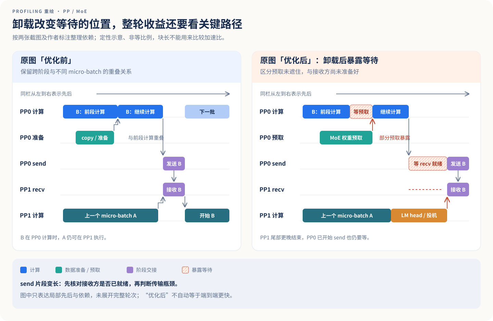
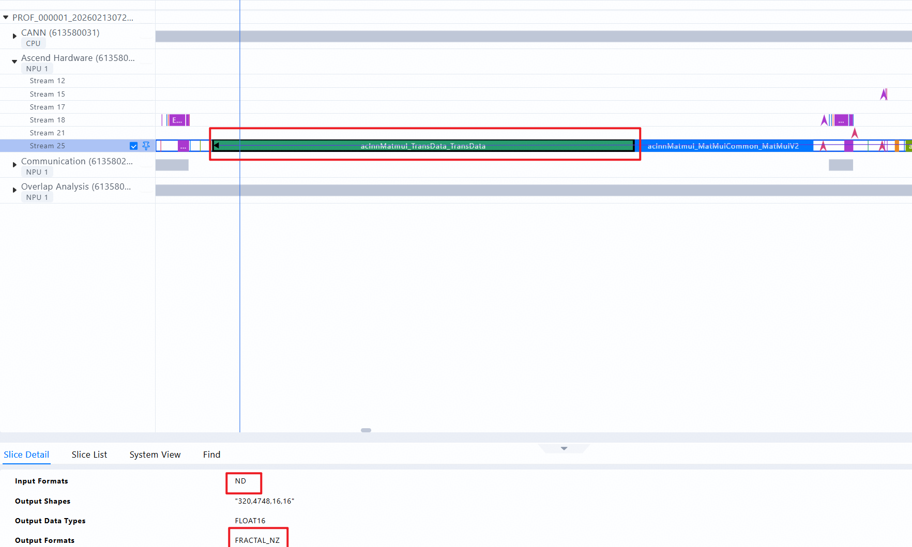
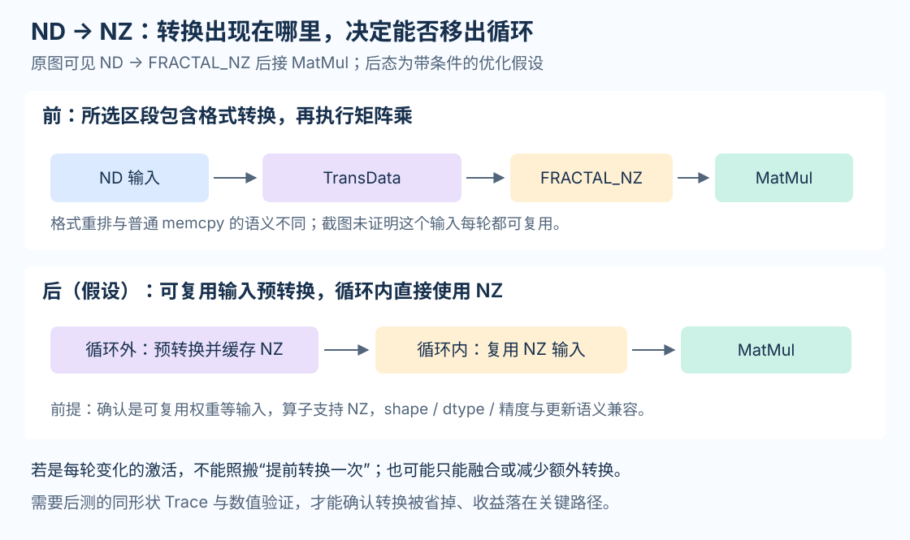
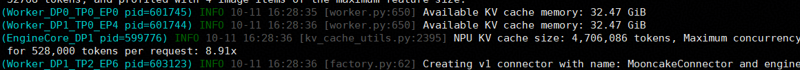
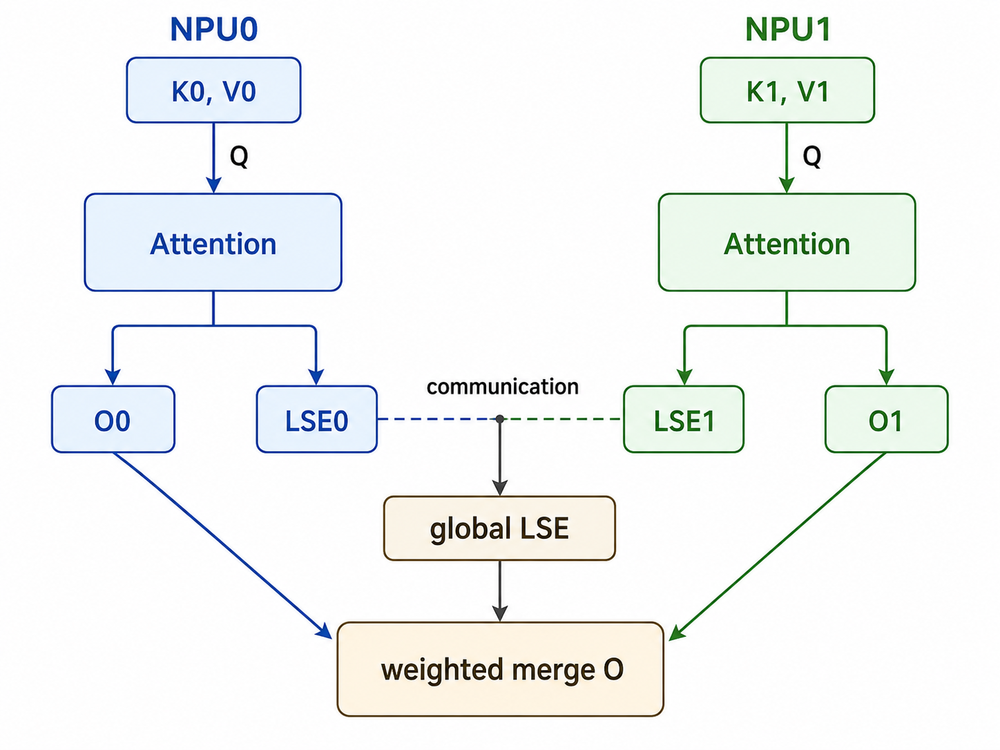
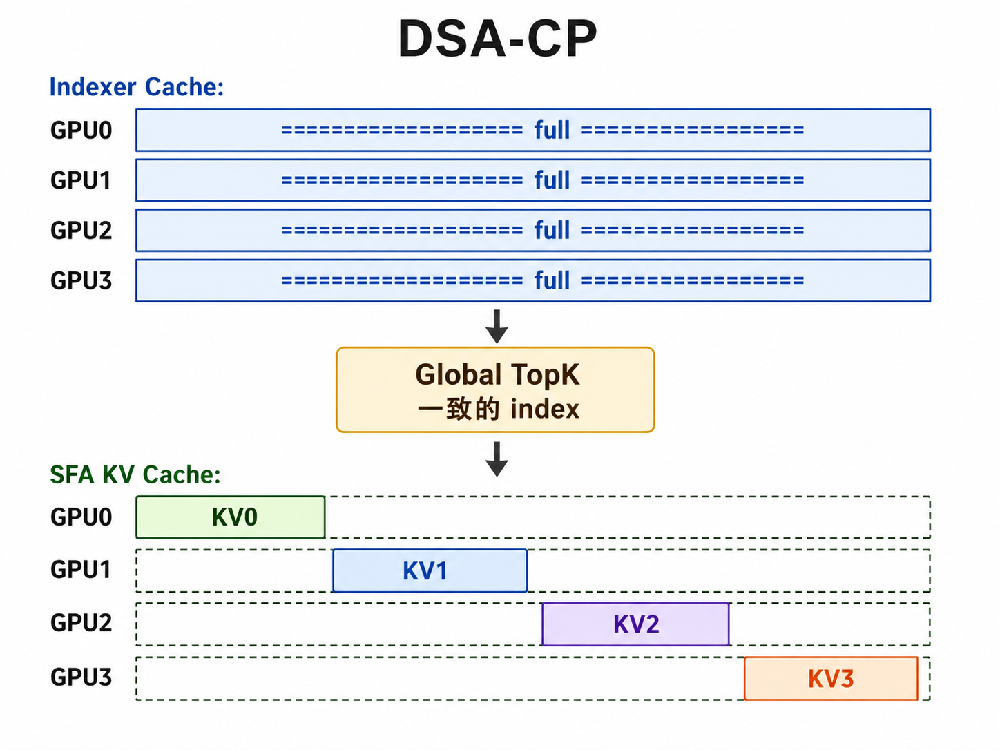

# Profiling 素材与前后对比

本章把本次导入的 [业务研讨仓库图片](https://github.com/Tflowers-0129/module-all-in-one-business-workshop) 接到前三篇的执行链上：哪些图能直接解释现象，哪些只有一侧现场，需要用示意图表达待验证的变化。文件名、去重关系和引用信息可查[素材来源记录](../dist/assets/profile-sources.json)。

> 原始截图记录特定采集窗口，文件名和作者箭头提供场景线索；它们没有给出完整模型、负载、配置和 Trace。本文把可见现象、作者解释和教学重绘分开。示意图的块长不代表实测时间，不能据此计算加速比。上传日期也不等于采集日期。

## 1. 13 张唯一图片分别能说明什么？

本批共 14 个 PNG 文件，`image.png` 与 `draft-model-graph-mode-fixed.png` 的文件内容完全相同，按一张素材使用。表中的适用位置连接到已有讲解；PP 两张原始截图只作为本地分析来源，公开页面采用第 3 节的重绘图。

| 素材 | 图中可见现象 | 适用位置 | 证据边界 |
| --- | --- | --- | --- |
| `关闭异步调度.png` | 多条流上有较长 EVENT_WAIT、密集短算子和一段采样相关算子 | [跨轮异步调度](../dist/execution.html#execution-6) | 截图不含完整 Host 轨道和可比时间轴，不能把所有 EVENT_WAIT 当成可消除空泡 |
| `开启异步调度.png` | 算子与等待的分布改变，部分工作在不同流上交错 | [跨轮异步调度](../dist/execution.html#execution-6) | 两图只能作结构对照；不能直接由截图宽度推出收益百分比 |
| `draft-model-eager-mode.png` | 多条轨道中出现 MODEL_WAIT_COMPLETE 和较长 MoeDistributeDispatchV3 | [投机解码的跨轮依赖](../dist/speculation.html#speculation-5) | Eager 文件名提示运行场景，等待来源仍需完整依赖与配置确认 |
| `draft-model-graph-mode-有问题版.png` | 多条轨道中的长 MoeDistributeDispatchV3 片段集中对齐 | [图模式与投机执行](../dist/speculation.html#speculation-5) | 不能从长 dispatch 区段单独判定根因，也不能把图模式本身等同于性能退化 |
| `draft-model-graph-mode-fixed.png` | fixed 图中重复的密集计算片段更连续，没有前图同样突出的长 Dispatch 形态 | [图模式前后对照](../dist/speculation.html#speculation-5) | 仍需同负载整轮耗时；`image.png` 是这张图的重复文件 |
| `消除copy的例子.png` | 作者标出 Target、Draft 和“72×inplacecopy + 72×memcopyasync”区域 | [执行中的额外搬运](../dist/execution.html#execution-5) | 数量来自作者标注，截图没有展示已消除后的实测现场 |
| `模型初期开箱算子占比.png` | 按 Operator Type 累加的耗时中，索引相关项约 29.28%，TopKV2 约 7.54% | [算子与关键路径](../dist/execution.html#execution-8) | 算子累加时间占比不等于端到端时延占比；跨流重叠时尤其不能直接相加 |
| `NDNZ例子.png` | 选中的 TransData 位于 Matmul 前，详情为 ND 输入、FRACTAL_NZ 输出 | [本章格式转换案例](../dist/profiling.html#profiling-4) | 证明该次有布局转换，不证明转换冗余，更不证明移除后仍正确 |
| `PP+moe卸载-优化前.png` | 作者标注跨 PP 阶段完成前向、不同 micro-batch 部分重叠及阶段间 send/recv | [本章 PP 对照](../dist/profiling.html#profiling-3) | 截取图不能给出完整轮次时延；公开页使用重绘 |
| `PP+moe卸载-优化后.png` | 作者指出 PP0 权重预取难以遮盖，尾部 send 等 PP1 recv 就绪 | [本章 PP 对照](../dist/profiling.html#profiling-3) | 描述瓶颈迁移；不能因文件名有“优化后”就认定整体更快 |
| `kvc余量查看.png` | 启动日志给出 32.47 GiB 可用于 KV、4,706,086 tokens 容量和 8.91x 估算 | [本章启动容量日志](../dist/profiling.html#profiling-5) | 不是运行时空闲块或可持续并发，不能跨 rank 直接相加 |
| `pcp原理.png` | 两侧局部 Attention 输出 O、LSE，合成 global LSE 后加权合并 O | [本章并行原理补充](../dist/profiling.html#profiling-6) | 原理示意，不是 Trace；没有展开 Q 分发及完整通信实现 |
| `dsa-cp原理.png` | Indexer Cache 为 full，共同 TopK index；SFA KV Cache 在四侧分片 | [本章并行原理补充](../dist/profiling.html#profiling-7) | 原理示意，不代表所有缓存都四等分，也不代表四倍性能 |

## 2. 怎样使用现场图和前后示意？

直接引用的原图用于回答“这个窗口里看到了什么”；教学重绘用于表达“某个依赖改变后，哪里可能减少或新增等待”。若只有优化前截图，重绘中的优化后应写成候选方案，不能包装成已经采到的 Trace。

前三篇已经安放了异步调度、Draft 图模式和 copy 的原图与对照。这里补齐 PP、布局、KV 容量和两张并行机制图：先读可见字段，再核对消费者和就绪事件，最后才比较同条件下的耗时。横向缩放、窗口裁切或流数量不同，都足以让截图看起来“更密”或“更短”。

## 3. PP 与 MoE 卸载：看等待迁到哪里

原图“优化前”用方框区分了跨 PP 阶段的同一次前向，以及不同 micro-batch 之间的遮盖。图上的 MEMCPY、EVENT_WAIT 与通信片段说明：计算不是单条流上的连续大块，阶段交接与数据准备会共同决定下一段何时开始。

原图“优化后”的作者标注给出两条分析线索：卸载后 PP0 的 MoE 权重预取更难被计算覆盖；PP1 还承担 LM head 和投机解码，使下一次 recv 较晚就绪，PP0 的 send 片段随之变长。后者意味着要检查接收方准备状态，不能仅凭 send 变长就判定网络有效带宽下降。

重绘只保留上述依赖：前置数据准备完成后，消费者才能继续；发送与接收必须在两侧状态就绪后完成。图中当前 micro-batch 与上一批的关系用来解释重叠，没有展开全部层、全部 batch 和每一个 stream。

完整验证应在同一负载下对齐 PP0 预取完成事件、消费该权重的计算、PP1 尾部工作及 recv 就绪点，再比较整轮时间。若预取完全被覆盖，它就不在该轮关键路径；若 recv 早已就绪，则应继续检查传输、同步或其他依赖。这个案例接续[一次前向中的多卡交接](../dist/execution.html#execution-7)，不能替代 PD 分离里的 KV 传输分析。

## 4. ND 到 NZ：Matmul 前还有一段布局转换

这张图选中的长片段名称包含 `Matmul_TransData_TransData`，随后可见 Matmul 片段。详情中 `Input Formats` 为 `ND`，`Output Formats` 为 `FRACTAL_NZ`，输出数据类型为 `FLOAT16`。这是一段布局转换的证据，不能把它直接记成普通 memcpy。

没有同条件的消除后 Trace，可以先按下面的依赖画候选方案，再验证它是否适用：

候选方案的前提是后端支持对应格式、数据值与布局在复用期间保持有效，且额外存储和准备成本可以接受。若输入每轮改变，不能把静态权重的预转换思路直接套用；若算子契约要求转换，也不能只因为该段很长就将其删除。比较时应同时检查结果精度、转换次数、准备成本、额外内存与整轮耗时。这补充了[线性层的形状与访存分析](../dist/execution.html#execution-3)。

## 5. KV 日志：启动容量不是运行余量

两条 worker 日志可见 `Available KV cache memory: 32.47 GiB`；另一行记录 `NPU KV cache size: 4,706,086 tokens`，以及每请求 `528,000 tokens` 条件下的 `Maximum concurrency: 8.91x`。数值关系约为 `4,706,086 ÷ 528,000 ≈ 8.91`，表达该启动配置下的容量估算。

图中不包含完整模型和并行配置，不能把这些值当作本 Wiki 教学例子的默认容量，也不能跨 worker、rank 或 DP 实例直接求和。日志没有展示运行中已经占用多少块、还有多少空闲块，更不能保证实际业务能以该并发持续满足时延要求。连接器创建日志同样不足以证明 KV 已经开始传输。

分析“预算足够却不能调度”时，应把启动块池容量与运行期的块使用率、空闲块、共享引用、抢占和交接占用分别观察。这张图对应[调度、KV 容量与块池](../dist/index.html#kv)，而 mbt 仍是每轮新增计算的 Token 预算。

## 6. PCP 原理图：局部结果如何合并

图中 NPU0 持有 `K0,V0`，NPU1 持有 `K1,V1`；每侧 Attention 产生局部输出 `O0/O1` 和 `LSE0/LSE1`。图示通过 LSE 通信形成 `global LSE`，再对局部 O 加权合并。LSE 在这里提供局部归一化所需的信息；不同 KV 分片的局部结果不能仅按普通算术平均合并。

这张原理图没有展开 Q 如何分发、局部输出在哪里合并，以及完整通信协议。它说明逻辑上的完整上下文可以由分片共同参与计算，不能据此直接读取某张设备卡的全部 KV 流量或性能收益。前三篇的[单轮前向与 KV 地址示例](../dist/execution.html#execution-4)用于追踪请求和位置；加入这种分片后，还需要保留每个 rank 的布局与通信账。

## 7. DSA-CP 原理图：不同缓存采用不同放置方式

图的上半部分标注四侧 `Indexer Cache` 都是 `full`，经过 `Global TopK` 得到一致的 index；下半部分的 `SFA KV Cache` 则分别放置 `KV0` 到 `KV3`。这里保留素材中的缩写，图意是两种缓存使用不同的放置策略。

不能因为下半部分画了四个 KV 分片，就把整个模型的 KV、索引缓存、工作区和总显存一并除以四。图中也没有展示 TopK 的计算、索引如何获得一致性、选中数据的访问和输出合并成本。因此它适合作为[KV 逻辑字节量估算](../dist/execution.html#execution-3)的边界补充；若要画 profiling 前后图，还需要实际部署的 Trace，当前素材只支持机制图。

## 8. 把图片接回一次完整的排查

从[调度、PD 与 KV](../dist/index.html)先确认实际负载、阶段分工和容量，再到[一次前向](../dist/execution.html#execution-8)对齐 Host、算子、copy、通信和就绪事件；涉及 Draft/Target 时继续核对[投机解码的有效状态与输出](../dist/speculation.html#speculation-5)。

当前素材已经能提供现场形态和优化候选，但“片段看起来更连续”“某个算子占比高”都只是排查入口。可核对的结论应指出具体消费者等哪个依赖，记录同条件的整轮时间与客户端指标，并说明新增准备、内存和通信成本。这也决定一张图应该直接引用、重绘依赖，还是保留为后续实测的原理补充。

本次核对的是 2026-11-01 上传的这批素材；文件名、内容校验值、重复文件关系与引用位置见[素材来源记录](../dist/assets/profile-sources.json)。这里的上传时间不作为 Trace 采集时间。
