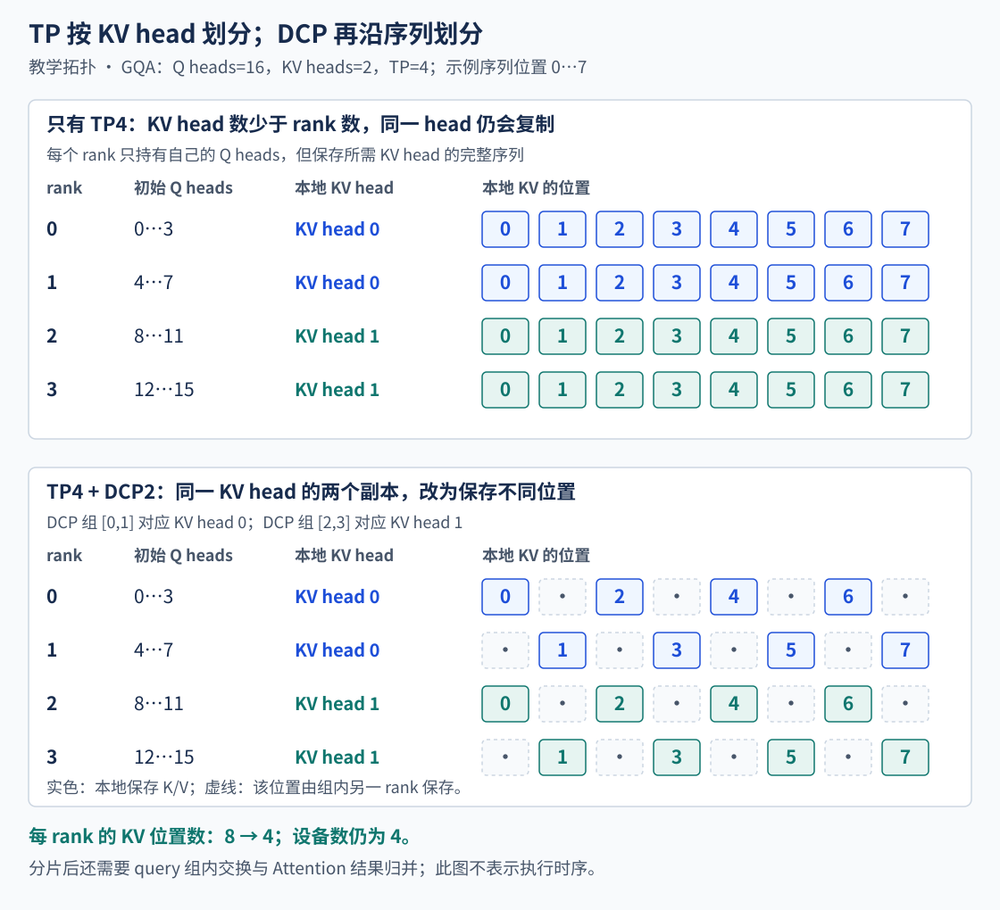
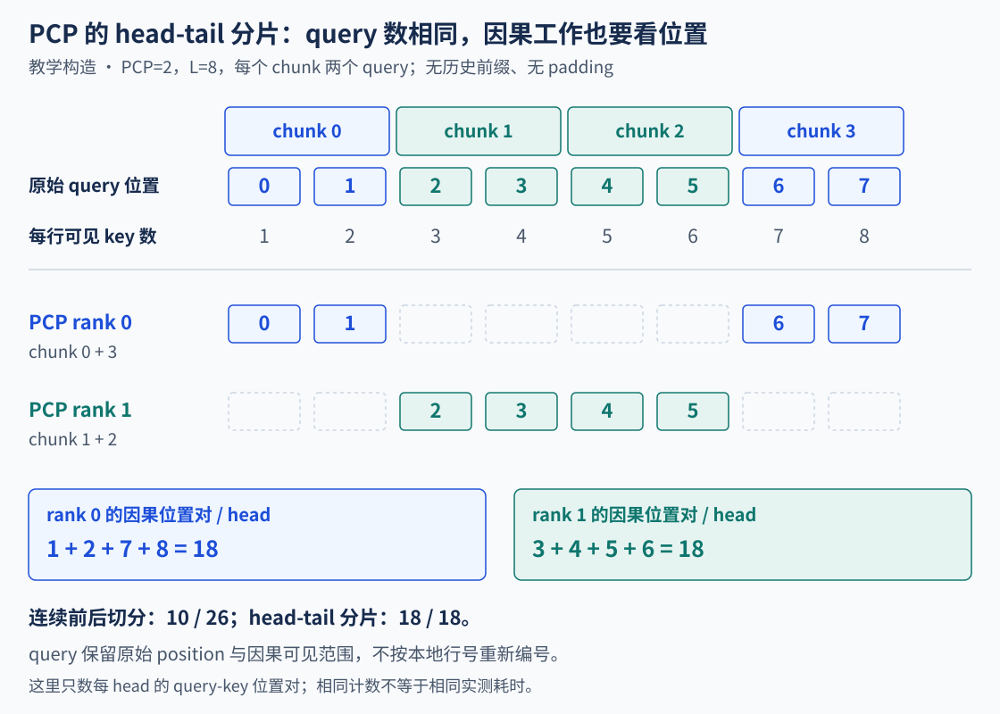
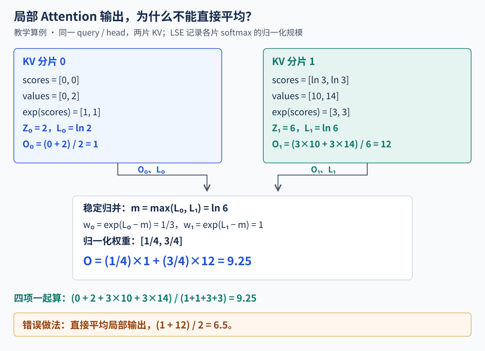
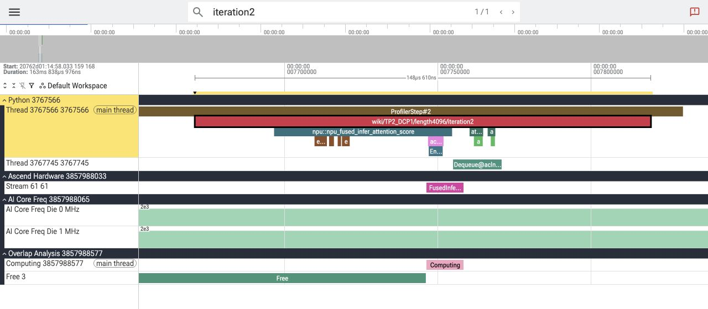
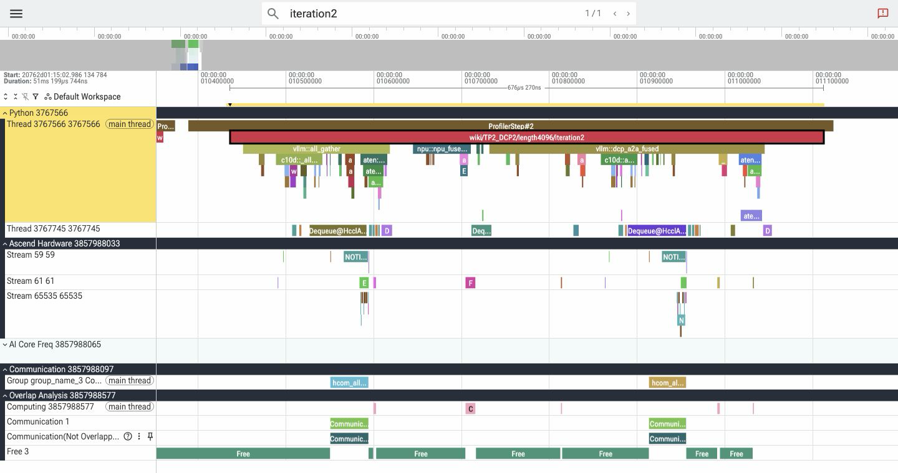
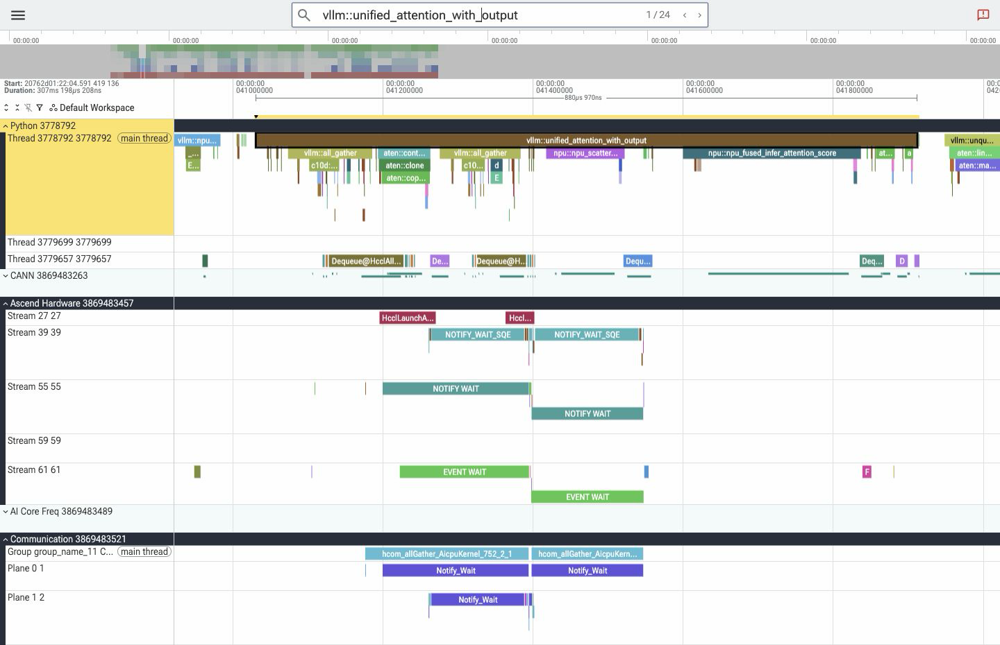

# 上下文并行：KV 分片与 Attention 归并

第五章把一行隐藏状态送到专家，再把专家结果送回来。现在换一个问题：一条请求已经积累了很长的历史，每次 Decode 只增加一行 query，这一行却要读取此前的 KV。增加 TP，能不能顺便把这份历史摊到更多卡上？

先不要急着引入 CP。得先看 TP 已经切了什么、还有什么在复制，才能说明 PCP 与 DCP 分别接手哪一部分。

> 本章沿核查的 vLLM-Ascend ModelRunnerV2 与普通 GQA/MQA Attention 主线展开，MLA 的缓存单独说明。三张 SVG 是可复算的教学构造；A5 实操与 Perfetto 真实截图在第 9、10 节。固定源码、软件环境、脚本与结果保存在[实验材料](https://github.com/Tflowers-0129/inference-wiki/tree/main/experiments/context-parallel)，正文中的源码入口用于定位，不把后续 main 分支的变化当成本次实测。

## 1. TP 先切 head，历史位置仍然完整

取普通 GQA 模型的一层：十六个 Q heads，两个 KV heads，每个 head 的维度为 128。每四个 Q heads 交给一个 TP rank，TP=4 后，Q heads 已经分开了：rank 0 处理 Q0…3，rank 1 处理 Q4…7，依次类推。

但 KV heads 只有两个。四个 rank 都要为自己的 Q heads 计算 Attention，因此不能让其中两个 rank 没有可读的 KV。核查的 `QKVParallelLinear` 在 TP 大于 KV head 数时复制 KV head；同一复制组加载同一份 K/V 投影权重。这个例子里，rank 0、1 都使用 KV head 0，rank 2、3 都使用 KV head 1。[模型的 head 数配置](https://github.com/vllm-project/vllm/blob/main/vllm/model_executor/models/qwen2.py) · [QKV 权重切分与复制](https://github.com/vllm-project/vllm/blob/main/vllm/model_executor/layers/linear.py)

这里切的是 head 维。普通 TP 没有把同一 head 的历史改成“前半段放 rank 0，后半段放 rank 1”，也没有把这个 head 的 128 维再各取一半。本地 KV head 仍保存这条请求的完整历史位置。Ascend 常规缓存布局可写成下面的形式，另一种布局会交换 head 与块内位置的轴：[KV Cache 形状](https://github.com/vllm-project/vllm-ascend/blob/main/vllm_ascend/attention/attention_v1.py)

```text
[K/V, num_blocks, block_size, local_kv_heads, head_dim]
```



图的上半部是 TP4：每个 rank 的本地 KV head 都有完整的位置 0…7。下半部才加入 DCP2，让原来保存同一 KV head 的两个 rank 各持有部分位置。为方便看清，图用交替位置；真实实现按可配置的 interleave 粒度组织，后面再走一次地址计算。图中的 Q heads 是交换前的初始归属，分片后还要处理 query 交换与结果归并。

## 2. 卡更多，为什么每卡 KV 不再下降？

先只算普通 full-attention 的有效 KV 数据。设 batch 为 B，历史长度为 S，本地 KV head 数为 Hkv，head 维度为 D，每个元素 b 字节，则每层有：

```text
有效 K+V 字节数 = 2 × B × S × Hkv × D × b
```

这不是进程 HBM 占用。模型层数、预分配块池、块内空位、对齐、量化 scale 和临时张量，要按各自口径另外计算。现在固定 B=1、S=16384、总 KV heads=2、D=128、BF16，只算一层：

| 配置 | 每 rank Q heads | 每 rank KV heads | 每个 KV head 的副本数 | 每 rank 有效 KV | 全组有效 KV |
| --- | --- | --- | --- | --- | --- |
| TP1 | 16 | 2 | 1 | 16 MiB | 16 MiB |
| TP2 | 8 | 1 | 1 | 8 MiB | 16 MiB |
| TP4 | 4 | 1 | 2 | 8 MiB | 32 MiB |
| TP4、DCP2 | 初始 4 | 1，历史位置约一半 | 同 head 的历史不再重复保存 | 约 4 MiB | 约 16 MiB |

例如 TP2 一行可以复算为 `2×16384×1×128×2=8388608 B=8 MiB`。到了 TP4，Q heads 继续减少，本地 KV head 已经不能再从一个切成半个，单卡 KV 就停在 8 MiB。DCP2 的一行假设序列均衡分片，不含块尾空位；它仍使用原来的四个 worker。

这也解释了几种模型的差异。MHA 的 KV heads 与 Q heads 一样多，在 head 数与配置允许时，TP 可以继续切 KV heads；GQA 更早遇到这个边界；MQA 只有一个 KV head，普通 TP 会让多个 rank 保存这一个 head 的历史。因此，“TP 增大，单卡 KV 按同样比例下降”并不普遍成立。

MLA 还要另算。核查实现中，它的缓存保存压缩 latent 与 RoPE 相关部分，不能套用普通 K/V 的 `2×Hkv×D`；配置接口返回一个 KV head，也不等于缓存里存了普通 MQA 的两份完整 K/V。增加 TP 同样不会自动把 latent 历史沿序列划开。[模型对 MLA KV head 的处理](https://github.com/vllm-project/vllm/blob/main/vllm/config/model.py) · [Ascend MLA 缓存布局](https://github.com/vllm-project/vllm-ascend/blob/main/vllm_ascend/attention/mla_v1.py)

## 3. PCP、DCP 与 Chunked Prefill 各切哪一维？

现在有两个不同的工作量：Prefill 一次带来很多 query 行，Decode 的 query 行很少，已有 KV 历史却可能很长。PCP 与 DCP 面向的切分对象也不同。

PCP 是 Prefill Context Parallel，DCP 是 Decode Context Parallel。名称指出主要面向的阶段；它们对 query、KV 所有权和通信组的影响，还会延续到前向的其他步骤，要沿实现分别核对。

| 机制 | 当前要分什么 | 后面必须补上的工作 |
| --- | --- | --- |
| TP | Q/KV heads、投影权重等模型维度 | 各 rank 的线性贡献按算子要求通信 |
| PCP | 本轮已调度的 query 行 | 让各片段获得正确的因果上下文，恢复全局 token 行顺序 |
| DCP | 同一 KV head 的历史位置 | 同一 query 对不同历史分片的局部 Attention 要归并 |
| Chunked Prefill | 调度器本轮给请求多少 query 预算 | 未调度的后续输入留到以后轮次 |

例如调度器这轮允许请求计算十六行，Chunked Prefill 决定的是“这轮算十六行”；PCP 可以再把这十六行分给多个 rank，在同一次 worker step 内执行。二者可以同时使用，不能用本轮 token budget 推出 PCP 的卡间切分。

本章 PCP 生命周期采用 ModelRunnerV2：Ascend 在模型调用前由 `pcp_manager.partition_batch()` 切分本轮输入，采样前再恢复需要的全局行。核查的实现对非 V2 Runner 的 PCP 配置会直接拒绝。DCP 在其他 Runner 也有入口，这里不把不同 Runner 的准备过程拼成一条调用链。[Runner 入口](https://github.com/vllm-project/vllm-ascend/blob/main/vllm_ascend/worker/v2/model_runner.py) · [配置检查](https://github.com/vllm-project/vllm-ascend/blob/main/vllm_ascend/platform.py)

## 4. PCP 为什么把头尾放在同一个 rank？

取一条没有历史缓存的新请求，这轮 Prefill 八行，位置为 0…7，PCP=2。如果直接前四行给 rank 0、后四行给 rank 1，两个 rank 都拿到四行，但 causal Attention 的工作并不一样：

```text
rank 0：positions 0,1,2,3 → 可见 query-key 对数 1+2+3+4 = 10
rank 1：positions 4,5,6,7 → 可见 query-key 对数 5+6+7+8 = 26
```

越靠后的 query 要看越多历史。“行数相等”没有解决三角形的因果工作分布。

核查的 head-tail 路线把本轮 query 切成 `2×PCP` 个片段。rank r 配对第 r 块与倒数第 r 块：这个例子有四块 `[0,1]、[2,3]、[4,5]、[6,7]`，rank 0 取头尾，rank 1 取中间。

| PCP rank | 原始 query positions | 可见 query-key 对数 |
| --- | --- | --- |
| 0 | 0、1、6、7 | 1+2+7+8=18 |
| 1 | 2、3、4、5 | 3+4+5+6=18 |



总工作仍为 `8×9/2=36` 对。这里计算的是教学 pair 数，不是 NPU 时间：长度不能整除、短请求、padding、后端分块和通信都会影响实际执行，不能由 18 比 18 推出两卡耗时相同。[上游片段与输入映射](https://github.com/vllm-project/vllm/blob/main/vllm/v1/worker/gpu/pcp_manager.py) · [Ascend PCP 划分](https://github.com/vllm-project/vllm-ascend/blob/main/vllm_ascend/worker/v2/pcp_manager.py)

位置身份必须保留。rank 0 拿到的尾部仍是 position 6、7，不能重新编号为 2、3；它们也必须看到此前位置的 KV，不能只看本 rank 的头尾四行。全局的已计算前缀、片段偏移、K/V 收集与因果 metadata 一起保证这个范围。局部一条原请求可能成为头尾两条虚拟请求行，局部 request 行数因此也不一定等于用户请求数。[GQA PCP 的当前 KV 前缀与 Attention](https://github.com/vllm-project/vllm-ascend/blob/main/vllm_ascend/attention/context_parallel/attention_cp.py)

### 分了 query，KV 会不会也变成一半？

不能由上表直接得出这个结论。在核查的普通 GQA 路径中，PCP 会收集本轮生成的 K/V 及相关写入信息，再写入本地 cache。PCP-only、DCP=1 时，PCP ranks 仍保存其 TP 本地 KV head 的完整历史。PCP 分摊 query 工作，与 DCP 决定长期 KV 的位置所有权，是两件事。[`_reshape_and_cache_pcp`](https://github.com/vllm-project/vllm-ascend/blob/main/vllm_ascend/attention/attention_v1.py)

Decode 也不能照搬长 Prefill 的头尾图。普通 PCP-only 路径可按请求轮转 owner，同一请求本轮的 query 行，包括固定长度投机验证行，留在同一 owner 上；没有本地 query 的 rank 仍需要参与必要的通信。有 recurrent state 等例外；叠加 DCP 时又需要各 KV 分片持有相应 query，短 Prefill 还可能走复制分支。判断一条请求被切分还是复制，要看模式和请求分类。[模式判断](https://github.com/vllm-project/vllm-ascend/blob/main/vllm_ascend/attention/context_parallel/common_cp.py)

### PCP 的“合并”是把不同行排回去

rank 0 算出 position 0、1、6、7 的 hidden states，rank 1 算出 2、3、4、5。采样前收集这些行，再按 restore index 还原全局顺序，才能为正确的请求位置取结果。padding 行也要按映射处理。

这一步每行对应不同 query，主要问题是 token 身份和顺序。下一节 DCP 则让多个 rank 为同一个 query 提供局部数值贡献，不能靠收集后重排行完成。[hidden gather 与采样恢复](https://github.com/vllm-project/vllm/blob/main/vllm/v1/worker/gpu/pcp_manager.py)

## 5. DCP 把哪几个位置写进本地 KV？

回到 TP4、两个 KV heads 的例子。对保存 KV head 0 的 rank 0、1 组成 DCP2 组，让它们保存不同历史位置，原来的两份完整历史便可以去重。它们仍需要共同完成各自 Q heads 对完整历史的 Attention。

地址怎么对应？ModelRunnerV2 的 slot mapping 使用虚拟块：若每 rank 物理块容纳 b 个 token，DCP 大小为 C，一个虚拟块覆盖 `b×C` 个全局位置。块内再按 interleave 粒度轮转 owner。[块表调用](https://github.com/vllm-project/vllm-ascend/blob/main/vllm_ascend/worker/v2/block_table.py) · [slot mapping 内核](https://github.com/vllm-project/vllm-ascend/blob/main/vllm_ascend/ops/triton/v2/block_table/compute_slot_mappings.py)

用 b=4、C=2、interleave=2，取第一个虚拟块，全局 position 0…7 的映射如下。假设 rank 0 的本地物理 block ID 为 7，rank 1 为 5，kernel block size 也为 4：

| 全局 position | owner | owner 内的块内偏移 | rank 0 slot | rank 1 slot |
| --- | --- | --- | --- | --- |
| 0、1 | 0 | 0、1 | 28、29 | −1、−1 |
| 2、3 | 1 | 0、1 | −1、−1 | 20、21 |
| 4、5 | 0 | 2、3 | 30、31 | −1、−1 |
| 6、7 | 1 | 2、3 | −1、−1 | 22、23 |

例如 position 4 的本地 slot 是 `7×4+2=30`。非 owner 得到 PAD slot，不写入那一行本地缓存。物理 block ID 由各自块表提供，两个 rank 不必相同；下一虚拟块要继续查块表，不能一直把全局 position 当成本地连续地址。这是简化地址算例，实操使用的块与 interleave 更大。

PCP 收集“本轮需要写的 K/V”与 DCP 决定“这个位置归谁写”在这里衔接。前者不等于每 rank 最终都保留这个位置，最终还要经过本地 slot 所有权。

## 6. 两份局部 Attention，为什么不能取平均？

设同一个 query 的历史被分到两个 rank。每个 rank 可以对本地 scores 做 softmax，再得到一个局部输出，但本地归一化各用了一份分母。两个局部输出直接平均，隐含假设是两边 softmax 总质量相等。

构造一个一维 value 算例，score 已包含缩放与 mask 后的效果：

```text
分片 0：scores=[0,0]，       values=[0,2]
        Z0=2，局部输出 O0=1， LSE0=ln(2)
分片 1：scores=[ln(3),ln(3)]，values=[10,14]
        Z1=6，局部输出 O1=12，LSE1=ln(6)

全局输出 = (Z0×O0 + Z1×O1)/(Z0+Z1)
         = (2×1 + 6×12)/8 = 9.25
直接平均 = (1+12)/2 = 6.5
```



要恢复全局结果，每个分片除 O 外还需要 `LSE=log(sum(exp(scores)))`。直接计算 exp 可能溢出，因此归并先减去各分片 LSE 的最大值：

```text
m = max_j(LSE_j)
w_j = exp(LSE_j - m)
O_global = sum_j(w_j × O_j) / sum_j(w_j)
LSE_global = m + log(sum_j(w_j))
```

这就是局部归一化结果重新按全局质量加权。mask 后没有有效项等边界还需由内核处理。真实 Attention 的每个 query、每个 head 都有相应的输出向量和 LSE，并非整条请求只有一个权重。[DCP 输出交换与归并](https://github.com/vllm-project/vllm-ascend/blob/main/vllm_ascend/ops/triton/dcp/dcp_a2a.py)

至此有三种不同的结果处理：TP 的行并行线性层对局部贡献求和，PCP 按 token 行身份恢复顺序，DCP 对同一 query 的局部 Attention 按 LSE 归并。它们可能都出现 collective，数学含义却不同，不能只凭“AllGather 或 AllReduce”这个名称互相替代。

## 7. 源码里，Q 交换与输出交换如何接起来？

先看 TP-only 叠 DCP 的普通 GQA/MQA 主线。TP rank 原本只拥有部分 Q heads。KV 现在沿序列分片，如果 rank 0 只计算自己的 Q heads 与自己那半份 KV，另一半历史就漏掉了。因此 DCP 组先收集需要的 Q heads，让每个历史分片能够为这些 query 提供局部结果。

```text
本地 TP Q heads
  → DCP 组 Q AllGather
  → 本地历史 KV Attention，得到 output + LSE
  → 打包并 AllToAll，送回目标 head 的 owner
  → 依据 LSE 归并各历史分片
  → 得到本 rank 需要的 Attention heads
```

`common_cp.py` 的 query 准备与 `attention_cp.py` 的 decode 路线连接了这些步骤；输出交换调用注册的 `torch.ops.vllm.dcp_a2a_fused`。PCP+DCP 的 query 是否还需交换，要继续看组覆盖哪些维度，不能机械地再加一遍 AllGather。[公共通信与归并接口](https://github.com/vllm-project/vllm-ascend/blob/main/vllm_ascend/attention/context_parallel/common_cp.py) · [GQA/MQA 的 CP Attention](https://github.com/vllm-project/vllm-ascend/blob/main/vllm_ascend/attention/context_parallel/attention_cp.py)

这里还有一个计算量上的陷阱。后面实操使用 TP2、MQA、总 Q heads=8：普通 TP 每卡四个 Q heads 读取完整 L；DCP2 后每卡收集八个 Q heads，读取 L/2。仅按 query-key 对数算，`4×L` 与 `8×L/2` 相等。KV 去重有明确的容量意义，却不能据此宣称这条分支的 Attention 计算量也减半；还新增了交换、打包与归并。

### “融合归并”里面仍然有通信

注册接口会选择具体实现。核查代码在 BF16、按 head 交换、无额外 PCP 收集、不要求返回 LSE 或延后归并，并满足形状与对齐检查时，可以走 `sfa_dcp_exchange` 路线：打包 output 与 LSE，经 HCCL AllToAll 后由融合内核归并。LSE 的 FP32 位模式装进整数 payload，不能把它描述为先量化成 BF16。[分支选择](https://github.com/vllm-project/vllm-ascend/blob/main/vllm_ascend/ops/triton/dcp/dcp_a2a.py) · [打包、交换与融合内核](https://github.com/vllm-project/vllm-ascend/blob/main/vllm_ascend/ops/triton/dcp/sfa_dcp_exchange.py)

需要返回 LSE、延后归并或不满足条件时，还有通用打包与 combine 路线。因此图上一个 `dcp_a2a_fused` Host scope，不代表设备上只有一个 kernel，更不代表 HCCL 通信消失了。第 10 节截图会把这层展开。

### 历史 KV 与本轮 KV，不能重复计入

多 query 的 causal/投机分支还可能把历史 KV 与本轮新增 KV 分开：历史各分片先产生局部贡献，当前 K/V 按相应因果范围计算，随后在约定的归并点加入一次。核查实现包含侧流执行、事件等待与延后 combine。若把复制的本轮 K/V 当成每个历史分片的一份独立贡献反复加进去，softmax 质量就会重复计数。[历史与当前 KV 的执行依赖](https://github.com/vllm-project/vllm-ascend/blob/main/vllm_ascend/attention/context_parallel/attention_cp.py)

这段是源码机制说明。下文单 query 的算子实验没有覆盖这些投机、多 query 或侧流分支，也不能用它的截图证明所有分支都实现了通算重叠。

## 8. PCP 与 DCP 要额外乘多少卡？

先固定 DP=1、PP=1，使用 TP2、PCP2。worker 网格可以排成：

```text
             TP 列 0    TP 列 1
PCP 行 0       rank 0     rank 1
PCP 行 1       rank 2     rank 3

TP 组：  [0,1]、[2,3]
PCP 组： [0,2]、[1,3]
```

PCP 是 worker 布局中的一维，这里共四个 worker。DCP 则复用这些现有 rank；DCP=2 可以取 `[0,2]、[1,3]`，不会再把设备数乘二。没有 PCP 的 TP4 也可以在 TP ranks 内组织 DCP 组，如第 1 节所示。[并行组初始化](https://github.com/vllm-project/vllm/blob/main/vllm/distributed/parallel_state.py)

但“能组成一个组”不等于后端支持任意组合。核查的普通 GQA/MQA 在 PCP 叠 DCP 时要求二者大小相等；MLA/SFA 还有跨 TP×PCP 的组合与不同 query 交换条件。实际启动应经过模型和平台校验，不能把另一 Attention 后端的合法配置直接套过来。[Ascend 的组合约束](https://github.com/vllm-project/vllm-ascend/blob/main/vllm_ascend/platform.py) · [上下文并行功能说明](https://docs.vllm.ai/projects/ascend/en/latest/user_guide/feature_guide/context_parallel.html)

第四章的 EP 示例限定无 PCP，因此按 DP×TP 解释专家组。加入 PCP 后，核查源码的 MoE EP 组还包含 PCP 维。选择 PCP 可能同时改变专家通信参与者；不能只算 Attention 的收益，而沿用原来更小 EP 组的通信成本。

## 9. A5 上实际确认了什么？

这次使用两张 A5 NPU，分三层验证，避免把一个算子通过写成完整服务通过。所有设备预热、运行与采集在同一双卡排他租约下串行执行；CPU 布局回放不占用 NPU。完整命令与固定环境见[实操 README](https://github.com/Tflowers-0129/inference-wiki/blob/main/experiments/context-parallel/README.md)。

### 先核对 PCP 的位置分配

从已安装源码 AST 提取未修改的 `_iter_rank_chunks` 函数体，在受控 CPU 对象上回放。每轮八组输入、重复两轮，覆盖长度整除、不能整除、极短、零长度及混合请求；确认位置覆盖、owner 与无重复分配。八行 PCP2 得到 `[0,1,6,7]` 与 `[2,3,4,5]`；十六行 PCP4 的四个 rank 各有 34 个教学 query-key 对。

这是源码方法回放，不是整 Runner 的证明。它先让位置算例能复查；完整 Runner 另在下面运行。[位置回放脚本与结果](https://github.com/Tflowers-0129/inference-wiki/tree/main/experiments/context-parallel)

### 再验证真实 Attention 与生产归并接口

使用 TP2、MQA，总 Q heads=8、KV heads=1、head_dim=128、batch=4，KV 长度取 512 与 4096，输入为固定种子的 BF16 数据。对照路线直接计算本地四个 Q heads 的完整历史 Attention；DCP 路线调用实际 Q AllGather、Ascend FIA 和生产 `dcp_a2a_fused` 接口，再与同一组 BF16 输入构造的 CPU FP64 全历史参考比较。

两轮、三组输入、两个 rank 共十二条校验记录全部通过：DCP 输出相对 FP64 参考的最大绝对误差约 0.00131，相对完整 KV NPU 路线约 0.00195；返回全局 LSE 的分支也单独验证，最大绝对误差小于 0.000001。[算子结果](https://github.com/Tflowers-0129/inference-wiki/tree/main/experiments/context-parallel/results)

另有一组故意不均衡的 softmax 质量：两片的 value 分别为 10 与 0，score 让第一片权重约为第二片九倍。BF16 输入对应的 FP64 参考约为 9.00129，NPU 归并得到 9.0，直接平均则为 5.0。它与第 6 节的 9.25 是两个算例，目的相同：让错误平均无法被“恰好两边差不多”掩盖。

长度 4096 时，完整 KV 张量每 rank 为 8 MiB，分片张量为 4 MiB。这是实验张量的有效数据量；为做对照，同一进程同时保留了完整与分片输入，不能称进程 HBM 已减半，也没有用这组算子实验报告模型吞吐加速。

### 最后通过真实 ModelRunnerV2

使用同一份固定种子生成的两层随机 Qwen2 checkpoint，Q heads=8、KV heads=1、head_dim=64；比较三种双卡拓扑。输入四条已知 token ID 序列，长度为 64、129、256、513，每条 greedy 生成四个 token，重复两轮。开启 Chunked Prefill，本轮 token 预算为 512；这也覆盖了“调度先切轮次，PCP 再切本轮”的组合。

| 实际配置 | worker 数 | 相对普通 TP 的生成 token | 固定每卡 32 MiB 缓存预算下报告的 token 容量 |
| --- | --- | --- | --- |
| TP2、PCP1、DCP1 | 2 | 对照 | 65536 |
| TP2、PCP1、DCP2 | 2 | 两轮均一致 | 131072 |
| TP1、PCP2、DCP1 | 2 | 两轮均一致 | 65536 |

容量一列是引擎报告的 KV token capacity，不是本次请求实际占用，也不是进程总 HBM。DCP2 在相同缓存预算下报告双倍容量，与去除 MQA KV 副本的方向一致；不能再把它改写为“本次进程内存下降一半”。

生成 token 一致仍不等于逐位数值一致。DCP2 相对对照的 chosen logprob 最大绝对差约 0.01552，PCP2 约 0.00774；PCP2 自身两轮的 logprob 也有差异。实验保留原始数值与逐项比较，不把 tiny 随机模型的结果推广为任意模型、任意长度的精度或服务吞吐保证。[Runner 脚本、三组输出与比较](https://github.com/Tflowers-0129/inference-wiki/tree/main/experiments/context-parallel)

## 10. 用真实 profiling 看交换发生在哪里

下面两张取自同一组双卡算子实验的 rank 0。原始 trace 在 Linux 上由 Trace Processor 加载，浏览器使用 Perfetto 的 native RPC 查看；图片直接截取查看器，仅裁掉空白区域并转换格式，没有按事件重画泳道。



第一张是 TP2、DCP1、长度 4096 的第二次采样。上面是 Python/Host scope，下面 `Stream 61` 才是设备任务。本实验的 Attention 对照只出现 FIA，不包含完整 Transformer 的投影、FFN 与 TP 收尾，不能把这张图当成整模型没有通信。



第二张展开 DCP2 的相应调用。读图时先找 Host 上的 `all_gather` 与 `dcp_a2a_fused`，再沿设备与通信行确认发生了什么：Q AllGather 后，布局调整和本地 FIA 产生 output/LSE，随后 `_pack_token_peer` 打包，经 AllToAll，最后 `_fused_merge_kernel` 归并。短任务的完整名称在图上会被截断，可对照[原始 flow 关联得到的任务清单](https://github.com/Tflowers-0129/inference-wiki/blob/main/experiments/context-parallel/results/profiling-events.json)。生产接口在这组形状下确实选到了前文描述的融合交换路线。

通信导出行 `Group … Communication` 是 profiler 的通信聚合轨道，不要把它的行号当作真实设备 stream 编号。`RECORD/WAIT` 是流间同步事件，也不是额外的 Attention kernel。两个截图分别缩放到各自的采样窗口，横轴不能用图片宽度直接相除来算加速比。

这组 trace 的导入还有 flow/时钟告警：部分 Host→Device 关联时间差为负，某些 flow 无法配对。因此这里确认算子序列和依赖含义，不用几微秒的连接线间隔推导 launch 延迟，不把两个 rank 的绝对时间直接对齐。截图窗口、源 trace 校验值与这些限制另见[截图来源记录](https://github.com/Tflowers-0129/inference-wiki/blob/main/experiments/context-parallel/results/profiling-screenshots.json)。



第三张来自实际 TP1、PCP2、DCP1 Runner 的 rank 0，选中第一处带 Prefill 的 `unified_attention_with_output`。Host scope 内先有两次 `all_gather`，再调用 `npu_scatter_pa_kv_cache` 与 FIA；下面能看到通信轨道、流间等待和 Stream 61 的设备任务。它对应第 4 节的本轮 K/V 收集与缓存写入，而不是 DCP 的 output/LSE 归并。

这张是一个 Attention scope，既不是整条 513-token 请求的一次完整 Prefill，也不是整个模型的耗时。完整采集里的 AllGather 还有 embedding、输出头和行恢复等用途，不能全部计为 KV 同步；导入的重叠 slice 告警也保留在来源记录中。完整 DCP Runner 还观察到其他打包与 combine 内核，因此前两张算子截图只代表所选分支，不能推广为模型内每次 Attention 的唯一实现。

### 在 Linux 上怎么自己打开？

Ascend 采集导出 `ASCEND_PROFILER_OUTPUT/trace_view.json` 后，可以由 Linux 侧工具解析，再让本地浏览器查询。先在 Linux 仅监听回环地址：

```sh
trace_processor_shell --httpd --http-ip-address 127.0.0.1 \
  --http-port 9001 /path/to/ASCEND_PROFILER_OUTPUT/trace_view.json
```

本地使用已有 SSH 别名建立转发：

```sh
ssh -N -L 127.0.0.1:9001:127.0.0.1:9001 your-a5-alias
```

打开 [Perfetto UI](https://ui.perfetto.dev/)，选择使用已经加载的 native Trace Processor；在 Timeline 展开 Host、Ascend Hardware、通信行，搜索实验 scope，再缩放到选中的区间。原始 trace 留在 Linux，分析不需要公开 trace 文件或服务端口。若只需表格归因，也可在 Linux 用 MindIE profiler 显式选择 full-range 或目标窗口，先核对 scene、rank、warmup 与时钟告警，再看耗时统计。[Perfetto native accelerator 说明](https://perfetto.dev/docs/visualization/large-traces)

## 11. 下一步才是让 KV 离开设备

前五章一直追踪 token 何时被调度、如何进入前向、怎样被验证、专家放在哪里以及数据怎样往返。本章补上长历史的卡间布局：TP 先决定本地有哪些 heads，PCP 分摊本轮 query，DCP 分摊 KV 历史，再通过正确的 Attention 数值归并接回前向。

这仍然是在设备间组织 KV。若工作集继续增大，所有设备的 HBM 合起来仍放不下，或者稀疏 Attention 每轮只访问其中一部分，才接着讨论哪些 KV 留在设备、哪些放到 Host、怎样把选中的页按时带回来。下一章的[稀疏 KV 卸载与 HiSparse](稀疏KV卸载与HiSparse.md)会沿着这些地址与依赖继续展开。
