# 上下文并行：KV 分片与 Attention 归并

一条请求已经有一万多 Token 的历史，现在只想生成下一个 Token。计算这个新位置时，普通全量 Attention 仍要读它已有的历史 KV。能不能加几张卡，让每张卡只存一部分？

先弄清楚分的是什么。张量并行（TP）可以把 Attention 的不同 head 分给不同卡，head 可以先理解成一组独立的注意力计算。只有两组 KV、却有四张卡需要读取时，有些卡会读同一组 KV。上下文并行还可以按 Token 的位置分工。Prefill 侧的 PCP 主要分本轮要处理的输入行。Decode 侧的 DCP 主要分跨轮保存的历史位置。后面用同一条请求看每张卡要怎样接回结果。

> 本章以 vLLM-Ascend 的 ModelRunnerV2 和普通 GQA/MQA Attention 为例，另行说明 MLA 的缓存。SP 的层间激活采用 `DeepseekV2DecoderLayer` 的实现。原理图使用文中可复算的算例，设备实测图另有标注。SP 实验在 CPU 上校验通信与 Norm 的数值，在 A5 双卡上比较分片前后的执行。PCP/DCP 实验分别检查算子和 Runner。实验材料列出了对应的源码版本、环境、脚本和结果。[上下文并行实验材料](https://github.com/Tflowers-0129/inference-wiki/tree/main/experiments/context-parallel)

## TP 下的 KV head 切分与复制

GQA 让多个 Q head 共用一个 KV head。假设一层 GQA 有十六个 Q head、两个 KV head，每个 head 的维度为 128。TP=4 时，每个 rank 处理四个 Q head。rank 0 处理 Q0…3，rank 1 处理 Q4…7，依次类推。

但 KV heads 只有两个。四个 rank 都要为自己的 Q heads 计算 Attention，因此不能让其中两个 rank 没有可读的 KV。当 TP 大于 KV head 数时，`QKVParallelLinear` 会复制 KV head，同一复制组的 rank 加载相同的 K/V 投影权重。这个例子里，rank 0、1 都使用 KV head 0，rank 2、3 都使用 KV head 1。[模型的 head 数配置](https://github.com/vllm-project/vllm/blob/main/vllm/model_executor/models/qwen2.py) · [QKV 权重切分与复制](https://github.com/vllm-project/vllm/blob/main/vllm/model_executor/layers/linear.py)

### TP 增大到多少时会复制 KV head？

上例的“两个”来自模型配置。设总 Q heads 为 `Hq`，总 KV heads 为 `Hkv`，TP 大小为 `T`。在 Qwen2 的普通 GQA 路径上，先要求 `Hq` 能被 `T` 整除，再分两种情况：[模型整除检查](https://github.com/vllm-project/vllm/blob/5df63a72/vllm/model_executor/models/qwen2.py#L137-L149) · [QKV head 分配](https://github.com/vllm-project/vllm/blob/5df63a72/vllm/model_executor/layers/linear.py#L1051-L1058)

| 条件 | 每 rank 的 KV heads | 同一 KV head 的副本数 | 额外整除条件 |
| --- | --- | --- | --- |
| `T ≤ Hkv` | `Hkv/T` | 1 | `Hkv % T = 0` |
| `T > Hkv` | 1 | `T/Hkv` | `T % Hkv = 0` |

所以 KV heads=8、TP4 时仍可切成每 rank 两个 KV heads；到 TP8 时是每 rank 一个；到 TP16 才变为每个 KV head 两份副本，前提是 Q heads 也允许 TP16。KV heads=2 的模型在 TP>2 时进入复制分支。不能把“TP 超过这个模型的 KV head 数”简写成所有 GQA 都在两卡后复制，也不能只看 `Hq/Hkv` 这个 GQA 分组比决定能否切分。

<!-- DETAILS: 源码对照：复制组怎样加载同一份 K/V 权重 -->

在复制分支里，K/V 权重加载用 `shard_rank=tp_rank//(T/Hkv)` 找到源 head。因而相邻的一组 TP ranks 使用同一份 K/V 投影，Q 仍按各自 TP rank 取片。复制的是这些 Q heads 共同需要的 KV head；它没有额外增加模型的逻辑 head 数。[复制组的权重加载](https://github.com/vllm-project/vllm/blob/5df63a72/vllm/model_executor/layers/linear.py#L1299-L1307)

<!-- /DETAILS -->

这里切的是 head 维。普通 TP 没有把同一 head 的历史改成“前半段放 rank 0，后半段放 rank 1”，也没有把这个 head 的 128 维再各取一半。本地 KV head 仍保存这条请求的完整历史位置。Ascend 常规缓存布局可写成下面的形式，另一种布局会交换 head 与块内位置的轴：[KV Cache 形状](https://github.com/vllm-project/vllm-ascend/blob/main/vllm_ascend/attention/attention_v1.py)

```text
[K/V, num_blocks, block_size, local_kv_heads, head_dim]
```

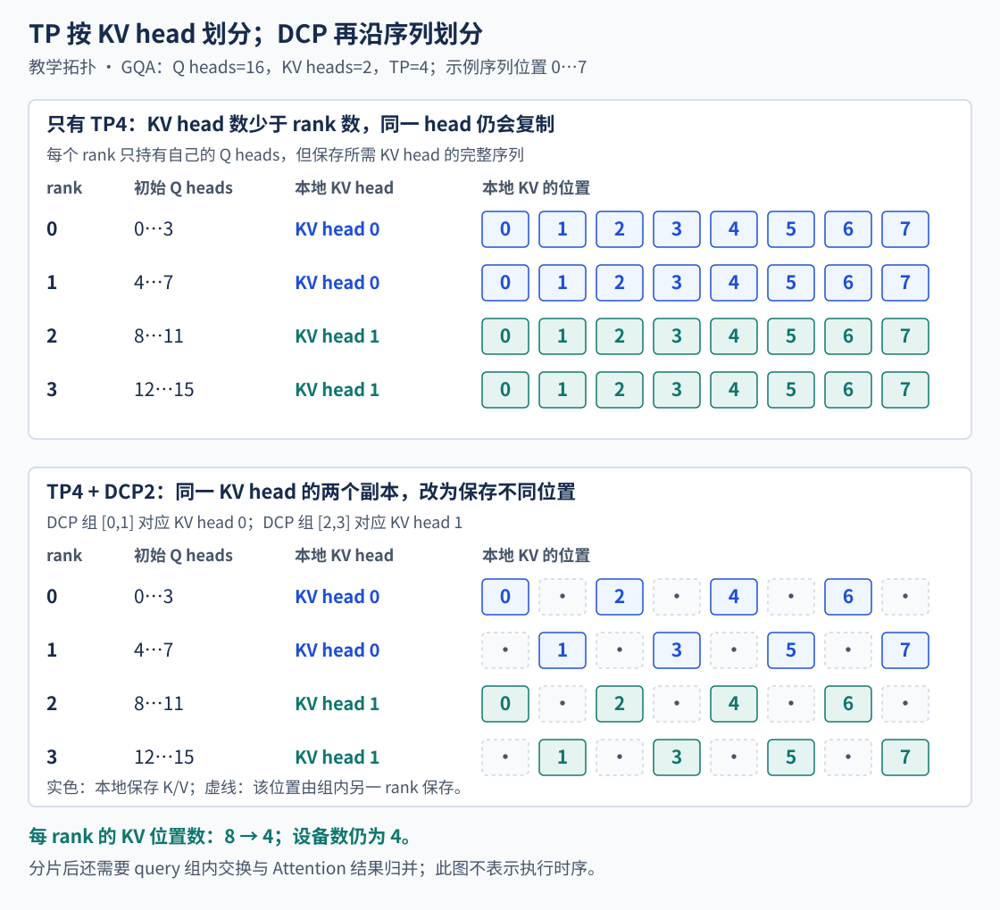

图的上半部是 TP4：每个 rank 的本地 KV head 都有完整的位置 0…7。下半部才加入 DCP2，让原来保存同一 KV head 的两个 rank 各持有部分位置。图中让两个 rank 交替保存相邻位置。实际实现允许配置一次连续分配多少个位置（interleave），后文用它计算写入地址。图中的 Q heads 是交换前的初始归属，分片后还要处理 query 交换与结果归并。

## 加卡以后，为什么每卡 KV 可能不变？

先只算普通 full-attention 的有效 KV 数据。设 batch 为 B，历史长度为 S，本地 KV head 数为 Hkv，head 维度为 D，每个元素 b 字节，则每层有：

```text
有效 K+V 字节数 = 2 × B × S × Hkv × D × b
```

这个式子只计算有效 K/V 数据。进程显存还包括其他层、预先分配的页池、页内空位、对齐、量化尺度和临时张量。现在固定 B=1、S=16384、总 KV heads=2、D=128、BF16，只算一层：

| 配置 | 每 rank Q heads | 每 rank KV heads | 每个 KV head 的副本数 | 每 rank 有效 KV | 全组有效 KV |
| --- | --- | --- | --- | --- | --- |
| TP1 | 16 | 2 | 1 | 16 MiB | 16 MiB |
| TP2 | 8 | 1 | 1 | 8 MiB | 16 MiB |
| TP4 | 4 | 1 | 2 | 8 MiB | 32 MiB |
| TP4、DCP2 | 初始 4 | 1，历史位置约一半 | 同 head 的历史不再重复保存 | 约 4 MiB | 约 16 MiB |

例如 TP2 一行可以复算为 `2×16384×1×128×2=8388608 B=8 MiB`。到了 TP4，Q heads 继续减少，每个 rank 仍须保存一个完整 KV head 的历史，单卡 KV 仍占 8 MiB。DCP2 的一行假设序列均衡分片，不含块尾空位；它仍使用原来的四个 worker。

这也解释了几种模型的差异。MHA 的 KV heads 与 Q heads 一样多，在 head 数与配置允许时，TP 可以继续切 KV heads；GQA 更早遇到这个边界；MQA 只有一个 KV head，普通 TP 会让多个 rank 保存这一个 head 的历史。因此，“TP 增大，单卡 KV 按同样比例下降”并不普遍成立。

MLA 还要另算。核查实现中，它的缓存保存压缩 latent 与 RoPE 相关部分，不能套用普通 K/V 的 `2×Hkv×D`；配置接口返回一个 KV head，也不等于缓存里存了普通 MQA 的两份完整 K/V。增加 TP 同样不会自动把 latent 历史沿序列划开。[模型对 MLA KV head 的处理](https://github.com/vllm-project/vllm/blob/main/vllm/config/model.py) · [Ascend MLA 缓存布局](https://github.com/vllm-project/vllm-ascend/blob/main/vllm_ascend/attention/mla_v1.py)

## SP 为什么也切 token，却没有分掉历史 KV？

先看 Attention 输出投影之后的归一化。设本轮有 N 个 Token，每个 Token 的隐藏向量有 H 个元素。TP 的各 rank 分别用自己的权重计算部分结果，AllReduce 将这些结果相加，使每个 rank 都得到完整的 `[N,H]` 张量。随后 RMSNorm 逐行归一化；每张卡若都保存相同的 N 行，也就重复做了这一步。

Sequence Parallelism（SP，序列并行）把这部分工作分给各张卡。ReduceScatter 先将各 rank 的部分结果求和，再按 Token 分配：行数能整除 TP 时，每张卡保留 `[N/TP,H]`，每行的 H 个元素仍完整。各卡只对自己的行做 Norm；后面需要完整输入时，再用 AllGather 收集。这是 Megatron SP 的基本组织方法；训练中还涉及反向传播与激活保存，本章只沿推理前向解释。[SP 原理](https://arxiv.org/abs/2205.05198) · [逐行分片与通信接口](https://github.com/vllm-project/vllm/blob/5df63a72/vllm/models/common/ops/sequence_parallel.py#L23-L70)

取四个 token、TP2。输出投影的两个 rank 都先产生四行部分和 `P0[t]`、`P1[t]`；ReduceScatter 后，rank 0 得到 token 0、1 的 `P0[t]+P1[t]`，rank 1 得到 token 2、3 各自的和。Norm 必须对归约后的完整行进行计算，不能先对两个部分和各做 Norm 再相加。这里按 token 切行，也没有把同一行的 hidden 维拆给 Norm。

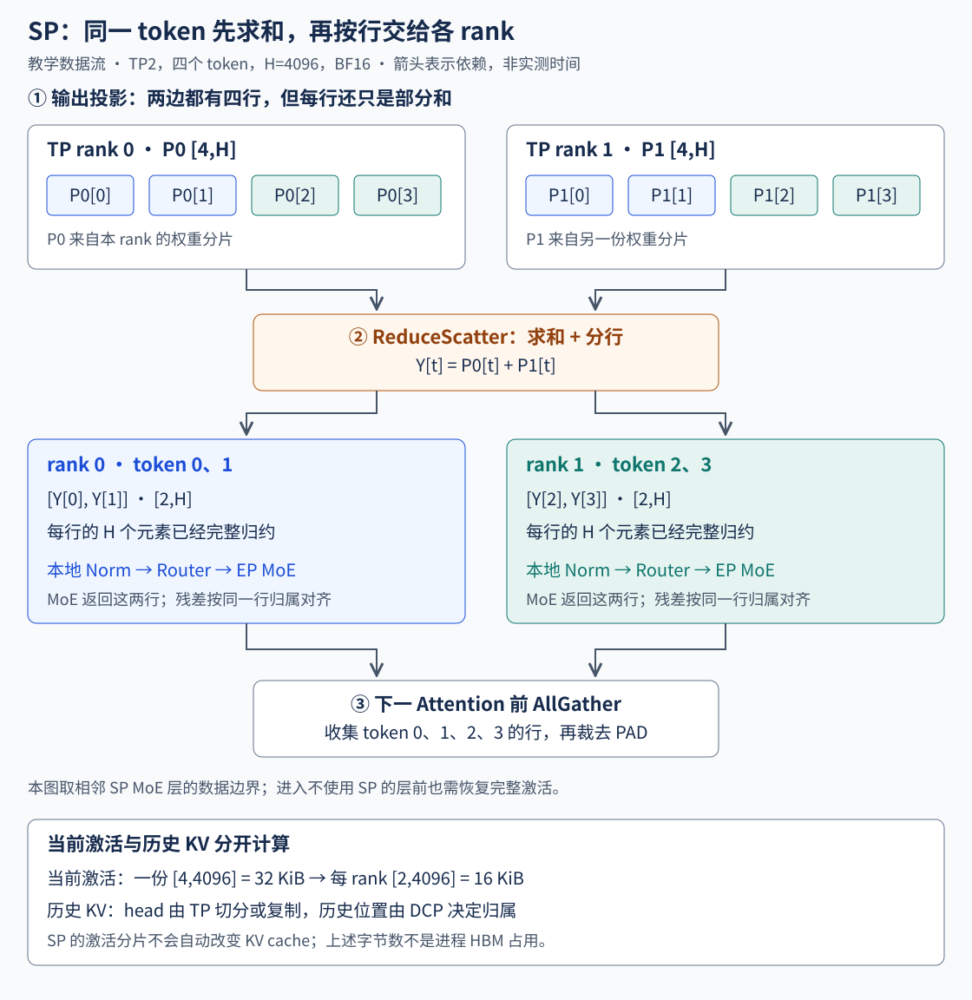

图中固定 `H=4096`、BF16。一份 `[4,4096]` 是 32 KiB，分片后每 rank 的 `[2,4096]` 是 16 KiB。这里只计算 ReduceScatter 前后单个激活张量的有效数据量；Attention 内部的完整输入、通信缓冲、残差和 KV 仍要另计，不能据此断言进程内存减半。

### 推理中的 SP MoE 如何接上 Norm 与专家？

MoE 还要避免重复发送。同一个 Token 经普通 TP AllReduce 后出现在每个 rank；若各 rank 都把它当成独立输入，就会重复分派专家任务。启用 SP MoE 后，TP 组内只有一个 rank 负责按 Router 的选择发送这一行。一个 Token 选中的 TopK 位专家仍都要计算。[SP MoE 的配置动机](https://github.com/vllm-project/vllm/blob/5df63a72/vllm/config/parallel.py#L755-L783) · [EP 的 Token 与专家任务计数](EP通信与通算融合.md)

<!-- DETAILS: 源码对照：DeepSeek 层间 SP、残差对齐与 Ascend 开关 -->

以所查 `DeepseekV2DecoderLayer` 的 MoE 层前向为例，输入和残差可以在相邻层之间保持 token 分片。层入口的 RMSNorm 先处理本地行，进入 Attention 前 AllGather 并裁去 PAD；Attention 输出投影关闭原来的自动归约，随后补齐 token 行并 ReduceScatter。残差按同样的行归属对齐，post-attention RMSNorm 与 MoE 才接着处理本地分片。`already_sequence_parallel=True` 告诉 MoE 输入已经分好，避免再次切片和收集。[层边界与前向实现](https://github.com/vllm-project/vllm/blob/5df63a72/vllm/model_executor/models/deepseek_v2.py#L1296-L1415) · [MoE 入口的两种布局](https://github.com/vllm-project/vllm/blob/5df63a72/vllm/model_executor/models/deepseek_v2.py#L411-L435)

这条 Decoder 实现还要求 PP=1，并只在对应 MoE 层启用该路径；进入不使用 SP 的层前会收集 hidden 与 residual。其他模型可能只在 MoE 入口切行、出口收集，或者采用自己的通信融合。不能把一种模型的层间布局写成所有 SP 实现共有的调用顺序。[层条件](https://github.com/vllm-project/vllm/blob/5df63a72/vllm/model_executor/models/deepseek_v2.py#L1296-L1304) · [恢复完整激活的边界](https://github.com/vllm-project/vllm/blob/5df63a72/vllm/model_executor/models/deepseek_v2.py#L1548-L1562)

在本章固定的 Ascend 源码中，SP MoE 通过 `enable_flashcomm1` 显式开启，还需 TP>1、EP 和支持的通信配置。Ascend 覆写的条件允许 DP=1；本实验对应的上游实现还要求 DP>1。比较两边日志时，应读取实际生效的 `use_sequence_parallel_moe`，不能只凭同名开关判断路径已经进入。[Ascend 开关处理](https://github.com/vllm-project/vllm-ascend/blob/f9c8e0bd/vllm_ascend/ascend_config.py#L748-L769) · [Ascend 的并行条件](https://github.com/vllm-project/vllm-ascend/blob/f9c8e0bd/vllm_ascend/patch/platform/patch_parallel_config.py#L6-L29)

<!-- /DETAILS -->

### 补齐行数不会改变有效 Token，也不会分割历史 KV

本轮若有五行、TP=2，等长 ReduceScatter 可以先补成六行，每 rank 三行。多出的占位行称为 PAD，不能算成真实输入或专家任务。跨 DP 行数不同时，也要记录各处的有效行数，并在通信后去掉补齐部分。Ascend 的 SP 图捕获还会将容量档位限制为 TP 的倍数，补齐行仍然无效。[SP 补行与 mask](https://github.com/vllm-project/vllm/blob/5df63a72/vllm/models/common/ops/sequence_parallel.py#L30-L70) · [MoE 的局部大小上下文](https://github.com/vllm-project/vllm/blob/5df63a72/vllm/model_executor/layers/fused_moe/runner/moe_runner.py#L653-L669) · [Ascend 捕获档位对齐](https://github.com/vllm-project/vllm-ascend/blob/f9c8e0bd/vllm_ascend/platform.py#L1400-L1425)

SP 分配的是本轮部分层的激活计算。Attention 前可以恢复完整输入，每卡的 KV head 仍保存全历史。DCP 才进一步决定每个历史位置由哪张卡保存、每张卡读多长，以及怎样合并 Attention 结果。

### 在服务器 CPU 上核对归约、分片与 Norm

先用双进程 CPU 实验检查分片后的数值等价，再在 A5 双卡上运行实际 HCCL 和 NPU RMSNorm。两组结果分开保留：CPU 检查帮助排除算例错误，设备实验才用于观察通信与计算轨道。

<!-- DETAILS: 服务器 CPU 实验：归约、分片与 Norm 的数值检查 -->

服务器上的双进程 Gloo 实验使用合成的行并行部分和，对照 `AllReduce → 完整 RMSNorm` 与 `ReduceScatter → 本地 RMSNorm → AllGather`。这里取 `H=8`，与上图 `H=4096` 的字节算例不同；有效行数分别为 4、5，后一组补到 6 行，dtype 取 FP32、BF16。四种配置各运行两组确定性输入，两个 rank 共保留 16 条校验记录。RMSNorm 的平方均值按 FP32 累加，再转回输入 dtype；通信仍使用所选的 FP32 或 BF16。[实验脚本与条件](https://github.com/Tflowers-0129/inference-wiki/blob/main/experiments/parallel-graph/sp_gloo_probe.py)

两条通信路线的输出逐元素一致，PAD 行保持为零；相对独立 FP64 参考，FP32 最大绝对误差约 `1.18×10⁻⁷`，BF16 约 `0.0036121`。五行输入时，每 rank 的 Norm 张量从 `[6,8]` 变成 `[3,8]`，元素数由 48 变为 24；rank 0 有三行有效输入，rank 1 有两行有效输入和一行 PAD。[双 rank 结果与误差](https://github.com/Tflowers-0129/inference-wiki/blob/main/experiments/parallel-graph/results/sp-gloo.json)

该实验确认了真实 CPU collective 下的分片与数值等价，没有运行 vLLM 模型、Router、Ascend FlashComm 或 NPU kernel，也没有测服务时延和 KV 容量。本节下面的 A5 微实验进一步验证 HCCL 与 NPU RMSNorm；完整 SP MoE 的输出、专家计数和设备收益仍需另测。

<!-- /DETAILS -->

### A5 双卡：Norm 少算一半，整条路径就更快吗？

这次对照固定 BF16、`H=4096` 和同一组部分和输入。A 路径运行 `AllReduce → 完整 RMSNorm`；B 路径运行 `ReduceScatter → 本地 RMSNorm → AllGather`。128 行时，B 的每个 rank 只计算 64 行 Norm；129 行先补成 130 行，再各算 65 行；收集后仍有 130 行，其中前 129 行有效，补齐行保持为零。

两个 rank、两种行数和两组输入全部通过校验：A/B 输出逐元素相等，padding 输出为零；相对独立 FP64 参考结果，最大绝对误差为 0.003868。之后每组分别采集 50 次无 profiler 样本，按 AB、BA 交替执行，再单独采集前后 Trace。下面列出本地 NPU event 区间的中位数，包含调用提交和通信依赖造成的空隙，不是纯 Norm 时间。

| 有效行数 | rank | A：AllReduce＋完整 Norm | B：分片 Norm＋收集 |
| --- | --- | --- | --- |
| 128 | 0 | 148.92 µs | 200.17 µs |
| 128 | 1 | 147.32 µs | 200.45 µs |
| 129 | 0 | 158.59 µs | 208.23 µs |
| 129 | 1 | 158.95 µs | 209.13 µs |

在这两组输入上，B 路径下每张卡只需对一半的行做 Norm，但整条路径用时都比 A 长。B 把一次 AllReduce 改成了 ReduceScatter 和 AllGather。比较总耗时，还要计入两次通信及相应的提交和同步。这个实验只包含一次 Norm，完整模型的 SP 效果仍需另测。

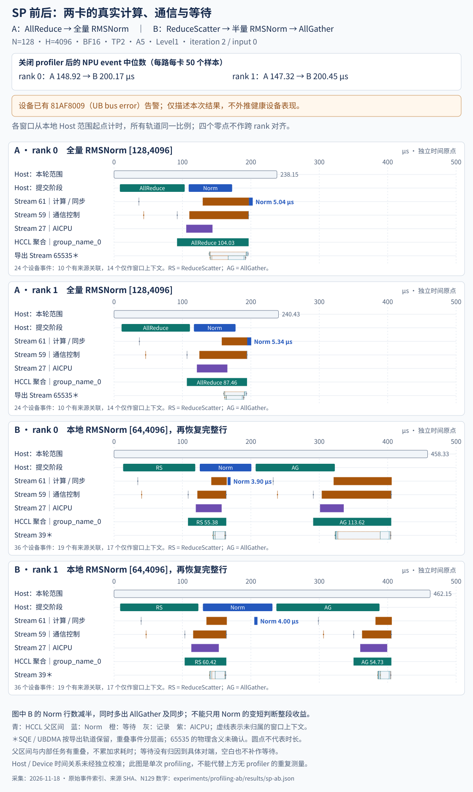

图选取同一次采集中的相同活动迭代，各 rank 内保留真实轨道关系；不同分面使用相同时间比例，但分别归零。它们没有完成跨设备时钟校准，因此不能用条形的左右位置判定哪个 rank 先到或让另一个 rank 等了多久。图内时长来自 profiling，性能表来自前面的独立计时，两者不混用。

实验开始前，设备已有 UB 总线告警 `81AF8009`。输出通过校验，Trace 也采集成功，但告警对计时的影响尚未确定。表中结果只适用于这次环境。完整模型、FlashComm 的 MoE 入口与出口以及 KV 管理都不在测量范围内。[脚本、配置与复现步骤](https://github.com/Tflowers-0129/inference-wiki/tree/main/experiments/profiling-ab) · [无 profiler 样本与 Trace 关联](https://github.com/Tflowers-0129/inference-wiki/blob/main/experiments/profiling-ab/results/sp-ab.json)

## PCP 的 query 分片、DCP 的 KV 分片与调度切块

现在有两个不同的工作量：Prefill 一次带来很多 query 行，Decode 的 query 行很少，已有 KV 历史却可能很长。PCP 与 DCP 面向的切分对象也不同。

PCP 是 Prefill Context Parallel，DCP 是 Decode Context Parallel。名称指出主要面向的阶段；它们对 query、KV 所有权和通信组的影响，还会延续到前向的其他步骤，要沿实现分别核对。

| 机制 | 当前要分什么 | 后面必须补上的工作 |
| --- | --- | --- |
| TP | Q/KV heads、投影权重等模型维度 | 各 rank 的线性贡献按算子要求通信 |
| SP | 层间或 MoE 边界的本轮激活行 | ReduceScatter 后本地计算，在需要完整输入处 AllGather |
| PCP | 本轮已调度的 query 行 | 让各片段获得正确的因果上下文，恢复全局 token 行顺序 |
| DCP | 同一 KV head 的历史位置 | 同一 query 对不同历史分片的局部 Attention 要归并 |
| Chunked Prefill | 调度器本轮给请求多少 query 预算 | 未调度的后续输入留到以后轮次 |

例如调度器这轮允许请求计算十六行，Chunked Prefill 决定的是“这轮算十六行”；PCP 可以再把这十六行分给多个 rank，在同一次 worker step 内执行。二者可以同时使用，不能用本轮 token budget 推出 PCP 的卡间切分。

<!-- DETAILS: 源码对照：V2 的 PCP 切分与采样恢复入口 -->

本章以 ModelRunnerV2 为例。Ascend 在模型调用前使用 `pcp_manager.partition_batch()` 切分本轮输入，采样前再恢复所需的全局行。这里核查的实现只允许在 V2 Runner 上启用 PCP。其他 Runner 也有 DCP 入口，输入准备过程需分别核对。[Runner 入口](https://github.com/vllm-project/vllm-ascend/blob/main/vllm_ascend/worker/v2/model_runner.py) · [配置检查](https://github.com/vllm-project/vllm-ascend/blob/main/vllm_ascend/platform.py)

<!-- /DETAILS -->

## PCP 为什么把头尾放在同一个 rank？

取一条没有历史缓存的新请求，这轮 Prefill 八行，位置为 0…7，PCP=2。如果直接前四行给 rank 0、后四行给 rank 1，两个 rank 都拿到四行，但 causal Attention 的工作并不一样：

```text
rank 0：positions 0,1,2,3 → 可见 query-key 对数 1+2+3+4 = 10
rank 1：positions 4,5,6,7 → 可见 query-key 对数 5+6+7+8 = 26
```

后面的 Token 能看到更多历史，所以即使行数相同，需要计算的 Q–K 配对数也不同。

核查的 head-tail 路线把本轮 query 切成 `2×PCP` 个片段。从首尾各取一块分给 rank 0，再把向内的下一对分给 rank 1，依此类推。这个例子有四块 `[0,1]、[2,3]、[4,5]、[6,7]`，rank 0 取头尾，rank 1 取中间。

| PCP rank | 原始 query positions | 可见 query-key 对数 |
| --- | --- | --- |
| 0 | 0、1、6、7 | 1+2+7+8=18 |
| 1 | 2、3、4、5 | 3+4+5+6=18 |

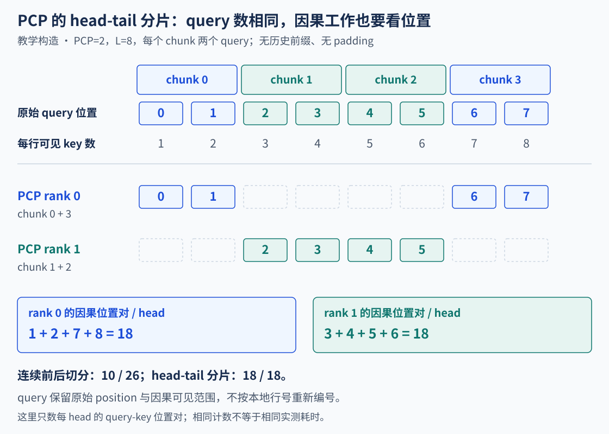

总工作仍为 `8×9/2=36` 对。这里数的是因果掩码允许的 query-key 对。只凭两卡各有 18 对，无法判定它们的 NPU 耗时相同。序列长度不能整除、短请求、padding、后端分块和通信都会影响实际执行。[上游片段与输入映射](https://github.com/vllm-project/vllm/blob/main/vllm/v1/worker/gpu/pcp_manager.py) · [Ascend PCP 划分](https://github.com/vllm-project/vllm-ascend/blob/main/vllm_ascend/worker/v2/pcp_manager.py)

分到 rank 0 的尾部仍是请求位置 6、7，不能按本地顺序改成 2、3。它们要读取此前所有可见位置的 KV，不能只读取本卡的四行。实现因此保留原始位置和已算前缀，并收集所需 K/V、生成因果范围。一条请求的头尾片段还可能在本地表示成两条虚拟请求，因而本地请求条目数未必等于用户请求数。[GQA PCP 的当前 KV 前缀与 Attention](https://github.com/vllm-project/vllm-ascend/blob/main/vllm_ascend/attention/context_parallel/attention_cp.py)

### PCP 分配 query 后，KV 还要收集

query 分给两卡后，每卡并不因此只保存半份历史 KV。所查普通 GQA 路径会收集本轮生成的 K/V 及写入信息，再写入各卡缓存。只启用 PCP、DCP=1 时，各卡仍保存自己所需 KV head 的完整历史；历史位置的分配要由 DCP 进一步处理。[`_reshape_and_cache_pcp`](https://github.com/vllm-project/vllm-ascend/blob/main/vllm_ascend/attention/attention_v1.py)

<!-- DETAILS: 源码对照：Decode、短 Prefill 与递归状态的不同分配方式 -->

Decode 也不能照搬长 Prefill 的头尾图。普通 PCP-only 路径可轮流指定负责各请求的 rank，同一请求本轮的 query 行，包括固定长度投机验证行，留在同一个 rank 上；没有本地 query 的 rank 仍需要参与必要的通信。带有递归状态（recurrent state）的模型可能采用其他分配方式。同时启用 DCP 时，各 KV 分片都需要相应的 query。短 Prefill 的 query 还可能在多个 rank 上复制。判断一条请求被切分还是复制，要看模式和请求分类。[模式判断](https://github.com/vllm-project/vllm-ascend/blob/main/vllm_ascend/attention/context_parallel/common_cp.py)

<!-- /DETAILS -->

### 采样前恢复 query 行顺序

rank 0 算出 position 0、1、6、7 的 hidden states，rank 1 算出 2、3、4、5。采样前收集这些行，再按 restore index 还原全局顺序，才能为正确的请求位置取结果。padding 行也要按映射处理。

PCP 收集的是不同 query 的结果，需要把每一行放回原来对应的 token 位置。DCP 会为同一个 query 得到多份局部 Attention 结果，还要做数值归并。[hidden gather 与采样恢复](https://github.com/vllm-project/vllm/blob/main/vllm/v1/worker/gpu/pcp_manager.py)

## DCP 的本地 KV 写入位置与读取长度

回到 TP4、两个 KV heads 的例子。rank 0 和 rank 1 都持有 KV head 0。让它们组成 DCP2 组，各自保存不同的历史位置，同一个位置的 KV 就只需保存一份。它们仍需要共同完成各自 Q heads 对完整历史的 Attention。

<!-- DETAILS: 配置条件：DCP 组必须位于同一 KV head 的复制组内 -->

对于未开启 PCP 的普通 GQA/MQA，该实现要求 `TP>Hkv`、`DCP≤TP/Hkv`。TP 大小和每个 KV head 对应的 Q head 数也都必须能被 DCP 大小整除。DCP 组要落在同一 KV head 的复制组内：上面的 TP4、Hkv=2 可以用 DCP2，不能把保存不同 KV heads 的四个 rank 当成同一份 KV 的四个历史分片。PCP 叠加后的组关系另见后面的 rank 网格。[GQA/MQA 的 DCP 校验](https://github.com/vllm-project/vllm/blob/5df63a72/vllm/config/model.py#L1565-L1595) · [DCP 与 TP 的整除条件](https://github.com/vllm-project/vllm/blob/5df63a72/vllm/config/parallel.py#L588-L603)

<!-- /DETAILS -->

DCP 需要先决定一个请求位置由哪个 rank 保存，再计算它在本地页中的位置。V2 把组内各 rank 的同号物理页合看成一个“虚拟块”：每张物理页能放 b 个 Token、组内有 C 个 rank，就共同覆盖 `b×C` 个请求位置。`interleave` 决定每连续多少个位置换到下一个 rank。[块表调用](https://github.com/vllm-project/vllm-ascend/blob/main/vllm_ascend/worker/v2/block_table.py) · [slot mapping 内核](https://github.com/vllm-project/vllm-ascend/blob/main/vllm_ascend/ops/triton/v2/block_table/compute_slot_mappings.py)

取 b=4、C=2、interleave=2，假设第一个虚拟块使用页号 7，算子也以 4 行为一页。两个 rank 都用 7 查询各自的缓存池，但各自保存不同位置。这个页号由 Scheduler 随同一份 `SchedulerOutput` 发给 Worker，再由各 rank 的 V2 写入本地页表。[Worker 接收 SchedulerOutput](https://github.com/vllm-project/vllm/blob/5df63a72/vllm/v1/executor/multiproc_executor.py#L341-L352) · [Runner 填写本地块表](https://github.com/vllm-project/vllm/blob/5df63a72/vllm/v1/worker/gpu/model_runner.py#L1181-L1219)

| 请求内 position | 负责保存的 rank | 本地页内偏移 | rank 0 的 slot_mapping | rank 1 的 slot_mapping |
| --- | --- | --- | --- | --- |
| 0、1 | 0 | 0、1 | 28、29 | −1、−1 |
| 2、3 | 1 | 0、1 | −1、−1 | 28、29 |
| 4、5 | 0 | 2、3 | 30、31 | −1、−1 |
| 6、7 | 1 | 2、3 | −1、−1 | 30、31 |

例如位置 4 由 rank 0 保存，写入物理页 7 的第 2 行，`slot_mapping=7×4+2=30`。rank 1 保存位置 6 时也得到 30，但两卡的缓存地址不同，保存的 Token 也不同。同一请求位置只在负责它的 rank 上得到有效写入索引，另一张卡得到 −1，表示不写入。后面的虚拟块继续通过页表定位。

读取历史时，FIA 需要知道本卡有多少行有效 KV。按上表计算，全局长度为 7 时，rank 0 有位置 0、1、4、5，共 4 行；rank 1 有位置 2、3、6，共 3 行。普通分页 Decode 将各自的长度和页表交给 FIA。页尾剩余容量与有效长度分别处理，不能把已分配但尚未写入的行读进 Attention。[本地长度的计算](https://github.com/vllm-project/vllm/blob/5df63a72/vllm/v1/attention/backends/utils.py#L1115-L1160) · [FIA 消费本地长度与块表](https://github.com/vllm-project/vllm-ascend/blob/f9c8e0bd/vllm_ascend/attention/context_parallel/attention_cp.py#L341-L371)

<!-- DETAILS: 复算任意长度在各 rank 的分配 -->

设全局有效长度为 `L`，DCP 大小为 `C`，每连续 `I` 个位置换一个 rank。一个完整周期 `C×I` 给每 rank 分配 `I` 行；余下的位置按 rank 顺序分配。rank `r` 的本地长度为：

```text
floor(L/(C×I))×I + clamp(L%(C×I)−r×I, 0, I)
```

其中 `clamp(x,0,I)` 将 x 限制在 0 到 I 之间。L=7、C=2、I=2 时，两个 rank 分别得到 4 和 3。

<!-- /DETAILS -->

同时启用 PCP 和 DCP 时，PCP 先收集本轮 K/V，DCP 再决定哪些位置写入本卡。收集到数据并不表示最终必须在每张卡各保存一份。

## 两份局部 Attention，为什么不能取平均？

设同一个 query 的历史分到两张卡。每张卡先在自己的位置里算一份加权平均。两张卡都只拿到两个位置时，第二张卡看到的分数仍可能整体更高，因而应该分到更大的权重。两边各保留自己的 softmax 分母，也就是把本地分数取指数后加起来的总量。合并时用这两个总量给局部输出加权。如果两边分母相同，公式就简化为直接平均。

构造一个一维 value 算例，score 已包含缩放与 mask 后的效果：

```text
分片 0：scores=[0,0]，       values=[0,2]
        Z0=2，局部输出 O0=1， LSE0=ln(2)
分片 1：scores=[ln(3),ln(3)]，values=[10,14]
        Z1=6，局部输出 O1=12，LSE1=ln(6)

全局输出 = (Z0×O0 + Z1×O1)/(Z0+Z1)
         = (2×1 + 6×12)/8 = 9.25
直接平均 = (1+12)/2 = 6.5
```

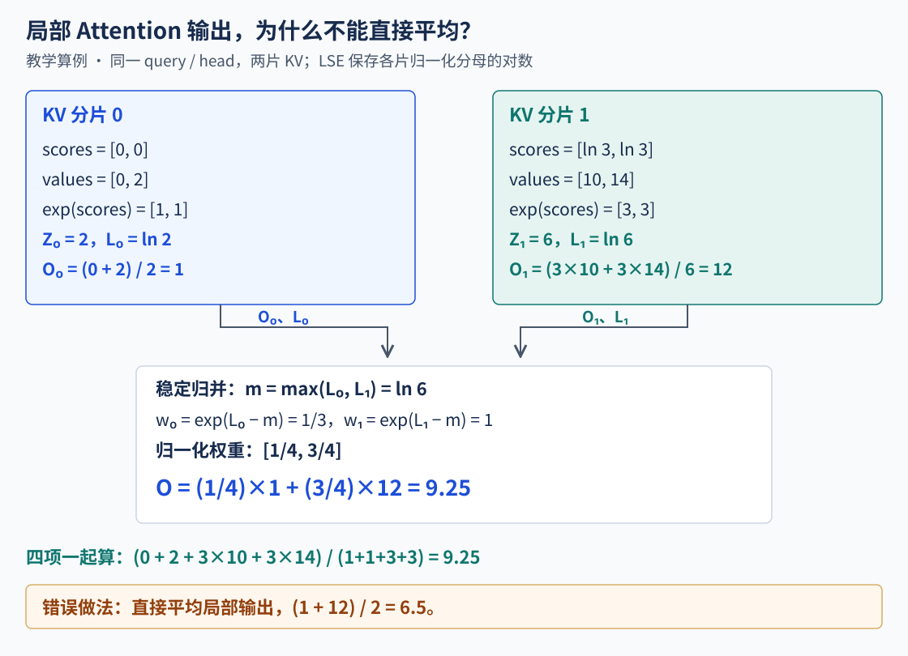

**试一试。** 暂且保持两个局部输出 1 和 12 不变。若第二份的分母从 6 变成 2，全局结果是多少？

<!-- DETAILS: 核对答案 -->

两边的分母现在都是 2，所以各占一半，结果为 `(2×1 + 2×12) / 4 = 6.5`。原例里第二份占 `6/8`，结果 9.25 更靠近 12。

<!-- /DETAILS -->

要恢复全局结果，每个分片除 O 外还需要 `LSE=log(sum(exp(scores)))`。直接计算 exp 可能溢出，因此归并先减去各分片 LSE 的最大值：

```text
m = max_j(LSE_j)
w_j = exp(LSE_j - m)
O_global = sum_j(w_j × O_j) / sum_j(w_j)
LSE_global = m + log(sum_j(w_j))
```

<!-- DETAILS: 源码对照：无效分片和全空行的安全处理 -->

归并权重按 query 和 head 单独计算。DCP 的融合归并内核会把 LSE 非有限值的分片权重和输出贡献都置零，以免 `0×NaN` 传到最终结果。对所有分片都无效的行，内核用安全分母返回零向量。[归并内核的无效分片处理](https://github.com/vllm-project/vllm-ascend/blob/f9c8e0bd/vllm_ascend/ops/triton/dcp/sfa_dcp_merge.py#L46-L75)

<!-- /DETAILS -->

TP 的行并行线性层将部分结果求和，PCP 把不同 Token 的行恢复到原来的顺序，DCP 则按 LSE 将同一 query 的局部 Attention 结果加权合并。

## DCP 的 Q 收集与输出交换

先看普通 GQA/MQA 在 TP 基础上启用 DCP、关闭 PCP 的情况。TP rank 原本只拥有部分 Q heads。KV 现在沿序列分片，如果 rank 0 只计算自己的 Q heads 与自己那半份 KV，另一半历史就漏掉了。因此 DCP 组先收集需要的 Q heads，让每个历史分片能够为这些 query 提供局部结果。

```text
本地 TP Q heads
  → DCP 组 Q AllGather
  → 本地历史 KV Attention，得到 output + LSE
  → 打包并 AllToAll，送回负责该 Q head 的 rank
  → 依据 LSE 归并各历史分片
  → 得到本 rank 需要的 Attention heads
```

<!-- DETAILS: 源码对照：Q 交换与归并接口 -->

`common_cp.py` 的 query 准备与 `attention_cp.py` 的 decode 路线连接了这些步骤；输出交换调用注册的 `torch.ops.vllm.dcp_a2a_fused`。同时开启 PCP 和 DCP 时，是否还要交换 query，取决于通信组覆盖的并行维度。[公共通信与归并接口](https://github.com/vllm-project/vllm-ascend/blob/main/vllm_ascend/attention/context_parallel/common_cp.py) · [GQA/MQA 的 CP Attention](https://github.com/vllm-project/vllm-ascend/blob/main/vllm_ascend/attention/context_parallel/attention_cp.py)

<!-- /DETAILS -->

以 A5 实操的 TP2、MQA 为例，总 Q heads=8。普通 TP 每卡四个 Q heads 读取完整 L。DCP2 后每卡收集八个 Q heads，读取 L/2。两种方式每卡的 query-key 对数分别为 `4×L` 和 `8×L/2`，计算的对数相同。DCP2 减少了重复存储的 KV，同时增加了交换、打包与归并。

### 输出和 LSE 的打包、交换与归并

每张卡算完本地历史后，把局部输出和 LSE 一起交回负责相应 Q head 的 rank，再完成归并。LSE 保持 FP32 信息，不会因为输出是 BF16 就一起降成 BF16；下面的实测形状展示两者怎样装入同一通信缓冲。

<!-- DETAILS: 源码与实测形状：打包、交换和归并怎样对应 -->

注册接口会选择具体实现。核查代码在 BF16、按 head 交换、无额外 PCP 收集、不要求返回 LSE 或延后归并，并满足形状与对齐检查时，可以走 `sfa_dcp_exchange` 路线：打包 output 与 LSE，经 HCCL AllToAll 后由融合内核归并。LSE 的 FP32 位模式装进整数 payload，不能把它描述为先量化成 BF16。[分支选择](https://github.com/vllm-project/vllm-ascend/blob/main/vllm_ascend/ops/triton/dcp/dcp_a2a.py) · [打包、交换与融合内核](https://github.com/vllm-project/vllm-ascend/blob/main/vllm_ascend/ops/triton/dcp/sfa_dcp_exchange.py)

A5 单 query 实验的 batch 有四个请求，TP2、DCP2，每个 rank 初始持有四个 Q heads，head dim 为 128。历史长 4096，按 128 个位置轮转，FIA 在每个 rank 上读取 2048 个历史位置／请求。算子实验把 K/V 存为连续的 TND 输入。完整 Runner 的 paged 路径使用 DCP 的本地读取长度和块表。[实测输入与 FIA 调用](https://github.com/Tflowers-0129/inference-wiki/blob/main/experiments/context-parallel/cp_attention_lab.py)

| 阶段 | 每 rank 的张量形状 | 行和 head 的归属 |
| --- | --- | --- |
| Q AllGather | `[4,4,128] → [4,8,128]` | 每个历史分片获得两边的 Q heads |
| 本地 FIA | 输出 BF16 `[4,8,128]`，LSE FP32 `[4,8,1]` | 八个 heads 的结果都只来自本 rank 历史 |
| AllToAll | `send`、`recv` 各为 INT32 `[2,1040]` | `send` 按负责目标 Q head 的 rank 分段，`recv` 按历史来源分段 |
| 归并 | 输出 BF16 `[4,4,128]` | 两份历史结果按 LSE 合并，归还本 rank 的四个 heads |

Q AllGather 的每 rank 输入为 `4×4×128=2048` 个 BF16 元素。打包时，每个目标 rank 的段有 `4×4×(128/2+1)=1040` 个 INT32 word，其中每两个 BF16 输出元素合占一 word，每个 FP32 LSE 单占一 word。接收端从同一缓冲分别取 `[2,4,4,128]` 的 BF16 输出视图和 `[2,4,4]` 的 FP32 LSE 视图，再沿第一个轴归并。两次通信的元素数分别与 trace 的 BF16 `count=2048`、INT32 `count=1040` 对上。这里核对的是输入张量和发给每个目标的元素数，链路流量还取决于 collective 如何执行。[打包与接收视图](https://github.com/vllm-project/vllm-ascend/blob/f9c8e0bd/vllm_ascend/ops/triton/dcp/sfa_dcp_exchange.py#L155-L201) · [实测通信字段](https://github.com/Tflowers-0129/inference-wiki/blob/main/experiments/context-parallel/results/rank-comparison.json)

需要返回 LSE、延后归并或不满足条件时，还有通用打包与 combine 路线。在 DCP 的设备时间线上，一个 `dcp_a2a_fused` Host scope 内可以对应打包、HCCL 通信和归并任务。

<!-- /DETAILS -->

### 历史 KV 与本轮 KV 的归并边界

多 query 的 causal/投机分支还可能把历史 KV 与本轮新增 KV 分开：历史各分片先产生局部贡献，当前 K/V 按相应因果范围计算，随后在约定的归并点加入一次。核查实现包含侧流执行、事件等待与延后 combine。若把复制的本轮 K/V 当成每个历史分片的一份独立贡献反复加进去，这些位置在 softmax 分子和分母中的贡献就会重复计入。[历史与当前 KV 的执行依赖](https://github.com/vllm-project/vllm-ascend/blob/main/vllm_ascend/attention/context_parallel/attention_cp.py)

这段是源码机制说明。下文单 query 的算子实验没有覆盖这些投机、多 query 或侧流分支，也不能用它的截图证明所有分支都实现了通算重叠。

## PCP 与 DCP 的 rank 分组

先固定 DP=1、PP=1，使用 TP2、PCP2。worker 网格可以排成：

```text
             TP 列 0    TP 列 1
PCP 行 0       rank 0     rank 1
PCP 行 1       rank 2     rank 3

TP 组：  [0,1]、[2,3]
PCP 组： [0,2]、[1,3]
```

PCP 是 worker 布局中的一维，这里共四个 worker。DCP=2 复用这四个 rank，可以取 `[0,2]、[1,3]`。TP4 未开启 PCP 时也可以在 TP ranks 内组织 DCP 组。[并行组初始化](https://github.com/vllm-project/vllm/blob/main/vllm/distributed/parallel_state.py)

但“能组成一个组”不等于后端支持任意组合。核查的普通 GQA/MQA 在 PCP 叠 DCP 时要求二者大小相等；MLA/SFA 还有跨 TP×PCP 的组合与不同 query 交换条件。实际启动应经过模型和平台校验，不能把另一 Attention 后端的合法配置直接套过来。[Ascend 的组合约束](https://github.com/vllm-project/vllm-ascend/blob/main/vllm_ascend/platform.py) · [上下文并行功能说明](https://docs.vllm.ai/projects/ascend/en/latest/user_guide/feature_guide/context_parallel.html)

负载均衡的 EP 算例限定无 PCP，因此专家组按 DP×TP 计算。所查 MoE 实现的 EP 组还包含 PCP 维。启用 PCP 时，评估 Attention 收益也要重算专家通信的参与者和成本。[负载均衡的 EP 算例](负载均衡与专家并行.md)

## A5 上的布局、算子与 Runner 校验

实验分别检查 PCP 的位置分配、DCP 的 Attention 算子和 ModelRunnerV2 的输出。位置分配在 CPU 上验证。设备实验都独占同一组两张 A5 NPU，依次完成预热、运行和采集。完整命令与固定环境见[实操 README](https://github.com/Tflowers-0129/inference-wiki/blob/main/experiments/context-parallel/README.md)。

<!-- DETAILS: CPU 源码回放：PCP 的位置分配 -->

### PCP 位置分配的源码回放

从已安装源码 AST 提取未修改的 `_iter_rank_chunks` 函数体，在受控 CPU 对象上回放。每轮八组输入、重复两轮，覆盖长度整除、不能整除、极短、零长度及混合请求；确认各位置由哪一 rank 负责、没有遗漏或重复分配。八行 PCP2 得到 `[0,1,6,7]` 与 `[2,3,4,5]`；十六行 PCP4 的四个 rank 各有 34 个符合因果掩码的 query-key 对。

这项检查只执行位置分配函数。后面的双卡实验再运行完整 Runner。[位置回放脚本与结果](https://github.com/Tflowers-0129/inference-wiki/tree/main/experiments/context-parallel)

<!-- /DETAILS -->

### DCP Attention 与归并接口的算子校验

使用 TP2、MQA，总 Q heads=8、KV heads=1、head_dim=128、batch=4，KV 长度取 512 与 4096，输入为固定种子的 BF16 数据。对照路线直接计算本地四个 Q heads 的完整历史 Attention；DCP 路线调用实际 Q AllGather、Ascend FIA 和生产 `dcp_a2a_fused` 接口，再与同一组 BF16 输入构造的 CPU FP64 全历史参考比较。

两轮、三组输入、两个 rank 共十二条校验记录全部通过：DCP 输出相对 FP64 参考的最大绝对误差约 0.00131，相对完整 KV NPU 路线约 0.00195；返回全局 LSE 的分支也单独验证，最大绝对误差小于 0.000001。[算子结果](https://github.com/Tflowers-0129/inference-wiki/tree/main/experiments/context-parallel/results)

另有一组测试刻意让两个分片的归一化分母不同。两片的 value 分别为 10 和 0，score 让第一片权重约为第二片九倍。BF16 输入对应的 FP64 参考约为 9.00129，NPU 归并得到 9.0，直接平均则为 5.0。前面的 9.25 是另一组教学数据，同样用不等的权重检验直接平均的误差。

长度 4096 时，完整 KV 张量每 rank 为 8 MiB，分片张量为 4 MiB。这是实验张量的有效数据量；为做对照，同一进程同时保留了完整与分片输入，不能称进程 HBM 已减半，也没有用这组算子实验报告模型吞吐加速。

### ModelRunnerV2 的输出与容量校验

使用同一份固定种子生成的两层随机 Qwen2 checkpoint，Q heads=8、KV heads=1、head_dim=64；比较三种双卡拓扑。输入四条已知 token ID 序列，长度为 64、129、256、513，每条 greedy 生成四个 token，重复两轮。开启 Chunked Prefill，本轮 token 预算为 512；这也覆盖了“调度先切轮次，PCP 再切本轮”的组合。

| 实际配置 | worker 数 | 相对普通 TP 的生成 token | 固定每卡 32 MiB 缓存预算下报告的 token 容量 |
| --- | --- | --- | --- |
| TP2、PCP1、DCP1 | 2 | 对照 | 65536 |
| TP2、PCP1、DCP2 | 2 | 两轮均一致 | 131072 |
| TP1、PCP2、DCP1 | 2 | 两轮均一致 | 65536 |

最后一列是引擎按缓存预算计算的 Token 容量（KV token capacity）。DCP2 在相同预算下报告的容量翻了一倍，与 MQA KV 按位置分片、避免重复保存相符。表中没有测量请求实际占用的 KV 空间或整个进程占用的 HBM。

生成 token 一致仍不等于逐位数值一致。DCP2 相对对照的 chosen logprob 最大绝对差约 0.01552，PCP2 约 0.00774；PCP2 自身两轮的 logprob 也有差异。原始结果列出了逐项差值。这些测量只覆盖该随机初始化的小模型及所测输入长度，服务吞吐仍需另测。[Runner 脚本、三组输出与比较](https://github.com/Tflowers-0129/inference-wiki/tree/main/experiments/context-parallel)

## TP、DCP 与 PCP 的设备时间线

只看一个 rank，可以解释本地调用链；要看分片后各卡参与了什么、通信伙伴如何配合，就要把同一轮的多个 rank 放在一起核对。本节为普通 TP、DCP 算子实验和完整 PCP Runner 分别展示 rank 0、rank 1。两卡数据来自同一次对应采集，不是重新挑选两次运行拼成对照。

先用一张同尺度的事件图对照 DCP 关闭与开启，再按需查看原生截图。下图来自已保存的设备事件，四个 rank / 配置窗口分别以自己的首事件为零，统一使用 0～600 µs 比例；同一 rank 内的流间相对位置保持不变，跨 rank 的零点则不表示同一时刻。[事件数据与 flow 关联](https://github.com/Tflowers-0129/inference-wiki/blob/main/experiments/context-parallel/results/profiling-events.json)

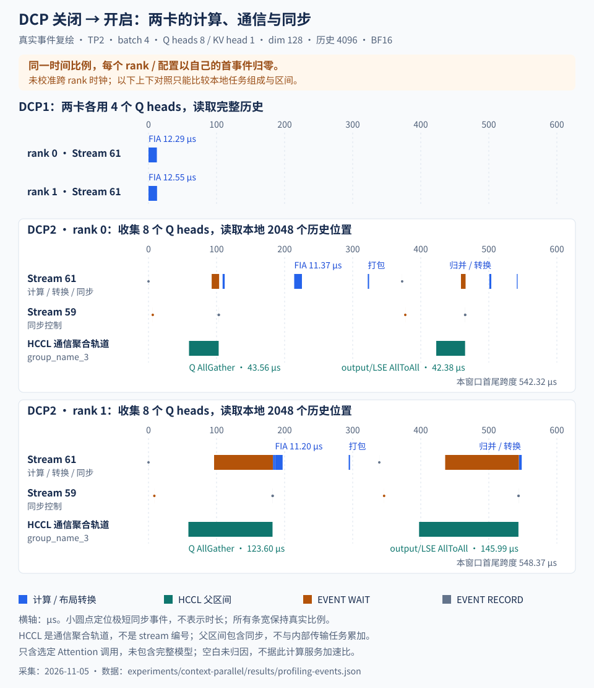

DCP1 的每个 rank 只记录到一个 FIA。DCP2 除 FIA 外，还增加 Q AllGather、output/LSE 的打包与 AllToAll、归并，以及流间同步。FIA 在这个例子里没有缩到一半：每卡读取的历史位置从 4096 减为 2048，但计算的 Q heads 从 4 增为 8。本实验说明 KV 分片后增加了哪些工作，不能仅凭缓存容量增加就推导整轮更快。

橙色块对应实测的流间等待事件 `EVENT WAIT`。profiler 把 HCCL 通信汇总在单独一行，这一行没有对应的物理 stream 编号。rank 1 的长通信区间旁也记录到较长的流间等待。由于两卡的时钟未经校准，仅凭图中位置无法判定是哪一侧造成了等待。

原生截图由 Linux Trace Processor 加载原始 trace，浏览器通过 Perfetto native RPC 查看后直接截取，仅裁掉空白并转换格式。每张截图独立缩放，画面宽度不能相除计算加速比。[截图来源与窗口](https://github.com/Tflowers-0129/inference-wiki/blob/main/experiments/context-parallel/results/profiling-screenshots.json)

<!-- DETAILS: Trace 配对方法：迭代、通信序号与时钟限制 -->

### 双 rank 的迭代与通信配对

DCP 算子实验有显式的 `length4096/iteration2` 标签。两个 rank 先按同一 job、输入与迭代配对，再核对通信组和操作序号：这轮 Q AllGather 为 `_503_2_1`，output/LSE AllToAll 为 `_503_3_1`。flow ID 只在各自 trace 内连接 Host 与设备，不能拿它跨 rank 寻找对端。

完整 PCP Runner 没有显式的 global-step/layer 标签。这里按模型调用顺序重建对应关系，并用同一 communicator 的 collective 序列、dtype 和 count 交叉核对，不能只因两边都叫 AllGather 就认定是同一次通信。首个 Attention 的两次收集在两卡上均为 `_752_2_1`、`_752_3_1`，BF16 count 均为 14464。[两 rank 配对、任务与正确性记录](https://github.com/Tflowers-0129/inference-wiki/blob/main/experiments/context-parallel/results/rank-comparison.json)

两卡在同一主机，Host 时钟转换记录也很接近；这支持保留原始导出时间轴查看，却没有给出跨设备对齐的最大误差界。尤其不能把两份文件各自的首事件归零后，就称为同一时刻。已有 flow/重叠 slice 告警也继续保留，微秒级连接线差值不用于推导 launch 延迟。

<!-- /DETAILS -->

### 普通 TP：两卡各算自己的 Q heads

TP2、DCP1 的 Attention 对照里，两卡各有一个 FIA 设备任务，使用各自四个 Q heads 读取完整历史。它们的输出不是同一组 heads，不要求互相相等；正确性应分别对照完整 FP64 结果中对应的 head 范围。

<!-- DETAILS: 展开普通 TP 的 rank 0 / rank 1 真实对照 -->

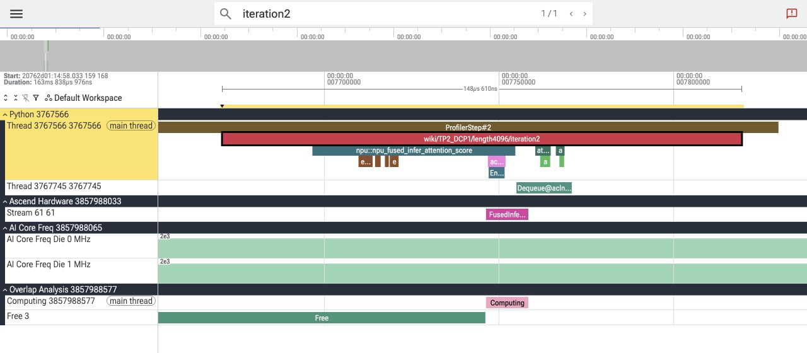

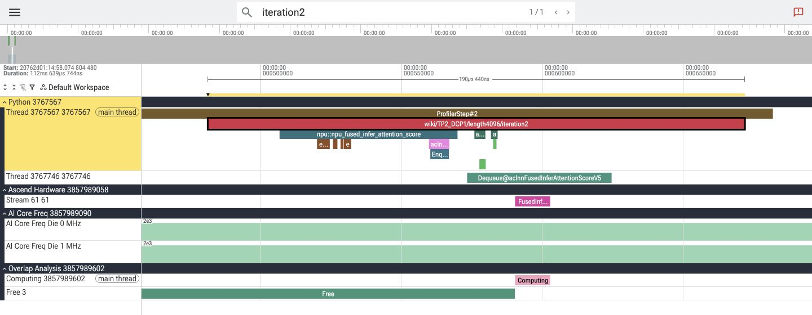

<!-- /DETAILS -->

上面是 Python/Host scope，`Stream 61` 才是设备任务。本算子对照没有包含完整 Transformer 的投影、FFN 与 TP 收尾，不能把图中没有 Q 交换解释为整模型没有通信。

### DCP：两边都要交换、计算和归并

<!-- DETAILS: 查看 DCP2 两个 rank 的原生 Perfetto 截图 -->

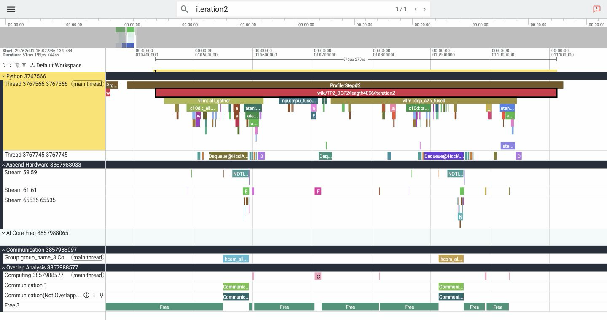

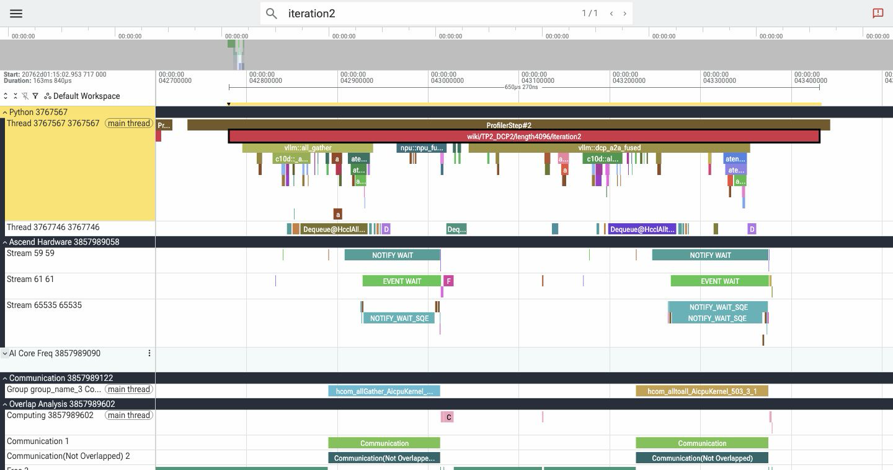

<!-- /DETAILS -->

两卡都先收集需要的 Q heads，再读取各自历史分片，产生 output/LSE；随后 `_pack_token_peer` 打包，经 AllToAll 送回负责该 Q head 的 rank，再由 `_fused_merge_kernel` 归并。短任务的标签会被截断，可对照[各 rank 的完整任务名与 flow 关联](https://github.com/Tflowers-0129/inference-wiki/blob/main/experiments/context-parallel/results/profiling-events.json)。这组形状下，两边都选到了前文的融合交换路线。

| 同一 DCP2 iteration2 的设备记录 | rank 0 | rank 1 |
| --- | --- | --- |
| FIA / 打包 / 融合归并任务数 | 各 1 | 各 1 |
| Q AllGather 的导出区间 | 43.565 µs | 123.603 µs |
| output/LSE AllToAll 的导出区间 | 42.377 µs | 145.990 µs |

只看这张表，很容易把 collective 更长的 rank 1 判为慢卡。在未经跨卡时钟校准的原始导出时间轴上，rank 1 的两个通信起点都画得较早，两卡的结束位置接近。较长的区间可能包含等待其他参与者的时间。要确定原因，还需核对两卡在进入通信前各有哪些计算尚未完成。表中记录的是 HCCL AICPU 父区间，包含同步等开销。统计耗时时还要避免重复累加其中嵌套的 transport 子任务。

通信导出行 `Group … Communication` 是 profiler 的通信聚合轨道，不是真实设备 stream 编号。`RECORD/WAIT` 是流间同步控制，也不是额外的 Attention kernel。判断一处等待是否由对端造成，还需要同一轮的输入数据就绪、collective 提交与完成、后续算子等待输入等因果证据；当前截图缺少这组完整记录。

### PCP：首个与第九个 Attention 窗口

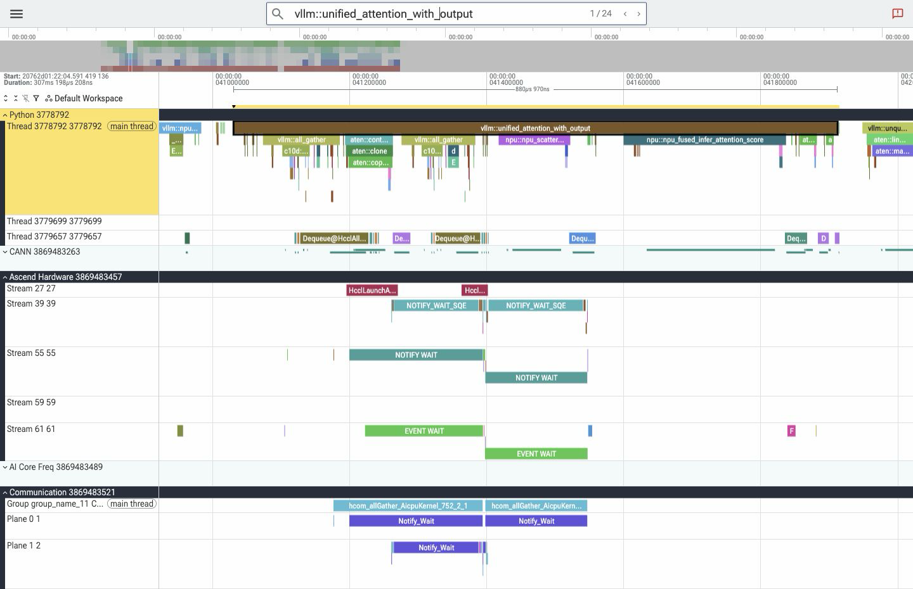

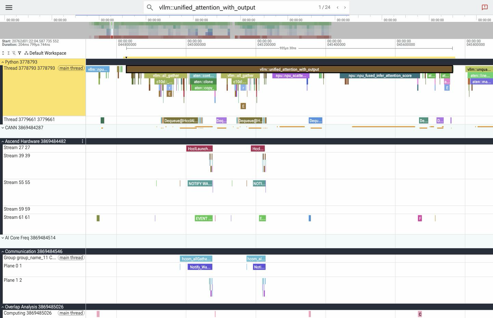

这对 TP1、PCP2、DCP1 窗口里，两卡的 Host scope 都先有两次 K/V AllGather，再调用 `npu_scatter_pa_kv_cache` 与 FIA，并各观测到一个关联的设备 FIA。这个窗口覆盖 PCP 的本轮 K/V 收集与缓存写入。它的范围只到本次 Attention，无法代表整条 513-token 请求的完整 Prefill。

继续配对同一捕获的第九个 Attention，就不能再概括为“两卡做完全相同的事”：两卡仍有同一 communicator 的 `_752_34_1`、`_752_35_1`，BF16 count 均为 64；两边也都有 Host FIA 调用，但 rank 1 未观测到从该调用关联出的设备 FIA。

| 同一 PCP 捕获中的记录 | rank 0 | rank 1 |
| --- | --- | --- |
| 首个 Attention：CPU FIA 调用 / 关联设备 FIA | 1 / 1 | 1 / 1 |
| 第九个 Attention：CPU FIA 调用 / 关联设备 FIA | 1 / 1 | 1 / 0 |
| 完整捕获：CPU FIA 调用 / 设备 FIA 记录 | 30 / 30 | 30 / 22 |

<!-- DETAILS: 展开第九个 Attention 的双 rank 真实窗口与观测差异 -->

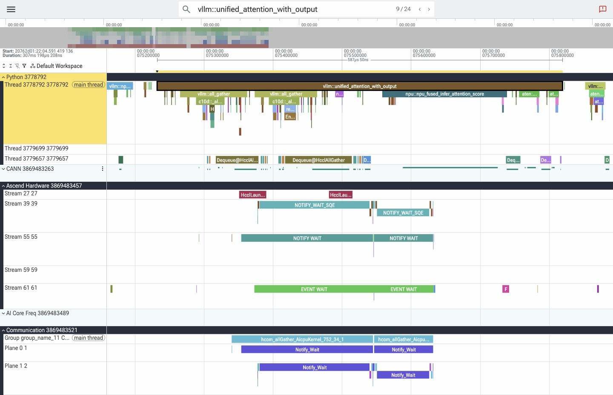

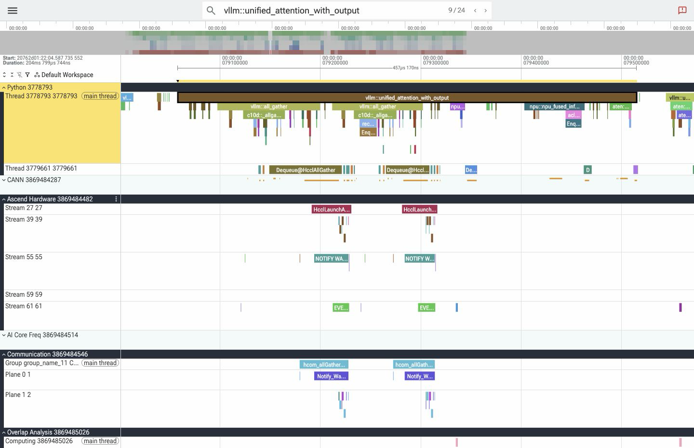

<!-- /DETAILS -->

这里“未观测到”只描述 trace。当前采集没有每层的有效 query、请求位置和显式 step 标记，不能把这个差异直接归因为空 query、实际跳过计算、丢采样或计算失败，更不能用 30/22 推算负载均衡度或加速比。需要进一步解释时，应补这些 metadata，再按同一迭代核对 Host 调用、设备任务和输出校验结果。

两卡完整采集中的 AllGather 还包含 embedding、输出头和行恢复等用途，不能全部计为 KV 同步。完整 DCP Runner 也观察到其他打包与 combine 内核；算子实验展示的单条路径，不是模型内每次 Attention 的唯一实现。

<!-- DETAILS: 实操命令：在 Linux 解析并查看原始 Trace -->

### 在 Linux 上解析并查看 Trace

Ascend 采集导出 `ASCEND_PROFILER_OUTPUT/trace_view.json` 后，可以由 Linux 侧工具解析，再让本地浏览器查询。先在 Linux 仅监听回环地址：

```sh
trace_processor_shell --httpd --http-ip-address 127.0.0.1 \
  --http-port 9001 /path/to/ASCEND_PROFILER_OUTPUT/trace_view.json
```

本地使用已有 SSH 别名建立转发：

```sh
ssh -N -L 127.0.0.1:9001:127.0.0.1:9001 your-a5-alias
```

打开 [Perfetto UI](https://ui.perfetto.dev/)，选择使用已经加载的 native Trace Processor；在 Timeline 展开 Host、Ascend Hardware、通信行，搜索实验 scope，再缩放到选中的区间。原始 trace 留在 Linux，分析不需要公开 trace 文件或服务端口。若只需表格归因，也可在 Linux 用 MindIE profiler 显式选择 full-range 或目标窗口，先核对 scene、rank、warmup 与时钟告警，再看耗时统计。[Perfetto native accelerator 说明](https://perfetto.dev/docs/visualization/large-traces)

<!-- /DETAILS -->

## 从多卡 Attention 到 P/D 交接

同一引擎的 Worker 可以用相同页号查询各自的 KV 池。分成 P、D 两套引擎后，D 从自己的池里分配目标页，再按源页到目标页的映射接收 KV。[PD 分离系统与 KV 生命周期](PD分离系统与KV生命周期.md)
