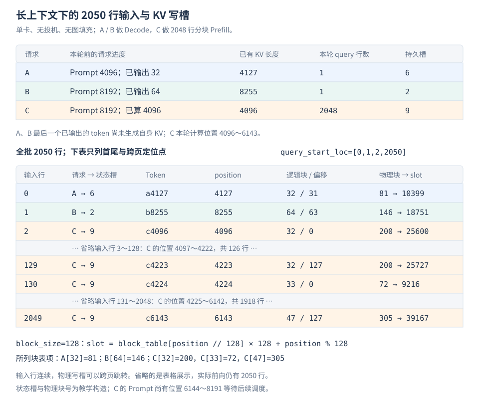
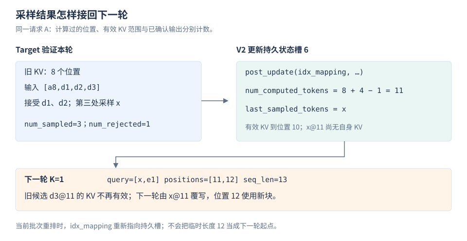
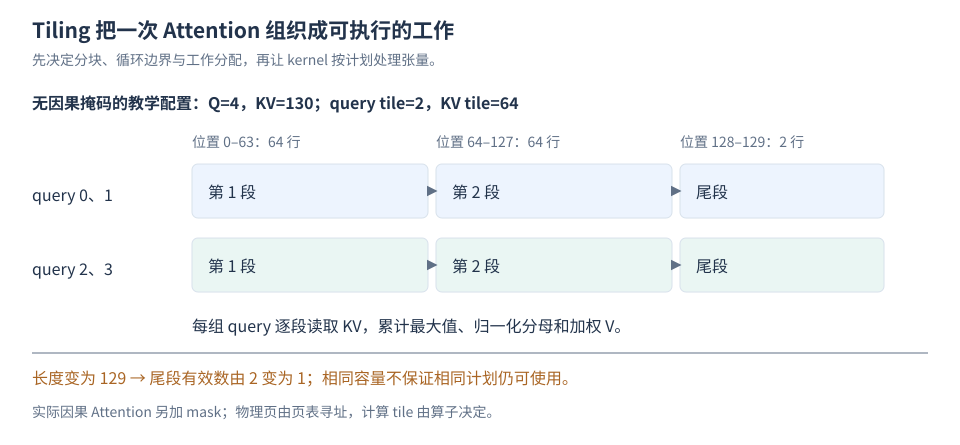
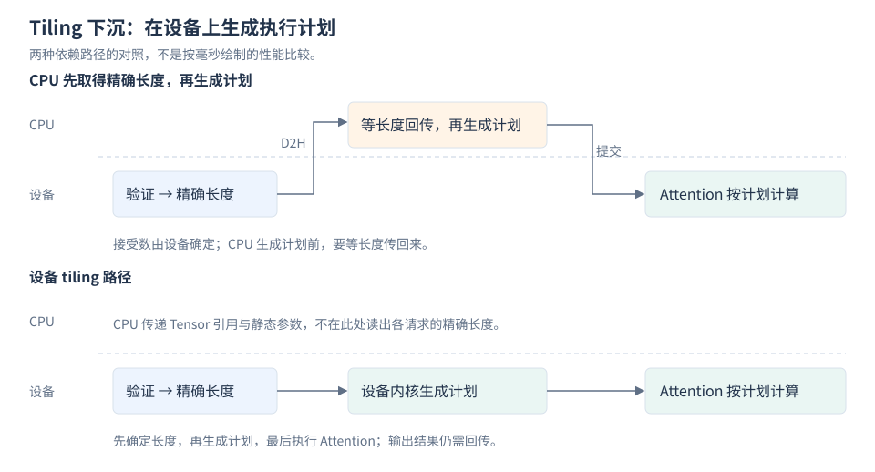
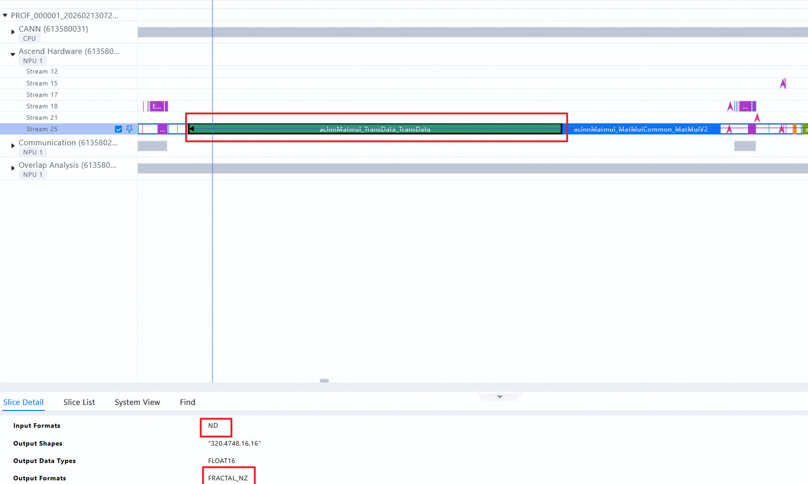

# 从一轮调度到一次前向

上一章的混部调度排出了第二轮：`R1 D：1 + R2 D：1 + R3 P：4096 + R4 P：4094 = 8192`。这张表确定了本轮推进哪些位置，却还不能直接交给模型。Runner 要找到每个位置的 Token、历史 KV 和新 KV 写入地址；前向结束后，还要把采样结果接回下一轮。

下面另取一个混合批次：两条请求正在 Decode，一条 8K Prompt 按 2048 Token 分块推进。沿这个批次，从收到 `SchedulerOutput` 一直算到下一轮。每增加一个字段，都先看下游哪一步需要它。后半章再让同一请求携带投机候选，追出精确长度、tiling 和异步执行之间的依赖。

> 本章以 Ascend ModelRunnerV2 为教学主线，沿 `vllm_ascend/worker/v2/model_runner.py` 及其继承的 `vllm/v1/worker/gpu/model_runner.py` 阅读。后者目录中的 `v1` 是引擎命名空间。基础算例采用文本、稠密 Decoder、标准因果 Attention，先固定单卡、无投机、无图填充；并行、其他缓存类型和图执行在相应位置说明边界。图为机制示意，不表示实测耗时。

## 调度结果进入 Runner 后，哪些状态已经在那里？

### 每轮下发的是变化，KV 和请求状态跨轮保留

请求 A 的 Prompt 有 4096 Token，已经输出 32 Token；B 的 Prompt 有 8192 Token，已经输出 64 Token。两者都在生成中，本轮各输入上一轮采样出的一个 Token。C 是另一条 8192 Token 的 Prompt，前 4096 Token 已完成 Prefill，本轮分到 2048 Token，之后还剩最后一块 2048 Token。

A、B 最后采样出的 Token 尚未作为输入计算自身 KV，因此本轮开始前，有效 KV 长度分别为 `4096+32−1=4127`、`8192+64−1=8255`。这份调度结果和后面的物理块号是教学构造，不代表一次实测。

| 请求 | 本轮工作 | 本轮开始前的有效 KV 长度 | 本轮 query 行数 | 请求内位置 |
| --- | --- | --- | --- | --- |
| A | Decode | 4127 | 1 | 4127 |
| B | Decode | 8255 | 1 | 8255 |
| C | 分块 Prefill | 4096 | 2048 | 4096～6143 |

调度器拥有请求的调度进度和 KV 块引用，把本轮数量、新请求内容及新增块号交给 Worker。Worker 的模型权重、KV Tensor 和 `req_states` 已经驻留；不会每轮从 Scheduler 收一份完整历史 KV。V2 的 `execute_model()` 先处理结束、释放、新增和更新的请求，再应用暂存的块表写入，随后才准备本轮输入。[V2 状态更新入口](https://github.com/vllm-project/vllm/blob/ced6857a/vllm/v1/worker/gpu/model_runner.py#L1631-L1660)

`req_states` 按持久槽位保存请求状态，`InputBatch` 描述本轮选中的请求。设 A、B、C 当前分别占状态槽 6、2、9，本轮排列为 `[A,B,C]`，则 `idx_mapping=[6,2,9]`。它把“批内第几条请求”映射到“状态存在哪个槽”，不要求两者相同。请求退出后槽位可以复用，因此也不能把槽 6 永久当成 A。[请求状态容器](https://github.com/vllm-project/vllm/blob/ced6857a/vllm/v1/worker/gpu/states.py) · [本轮映射生成](https://github.com/vllm-project/vllm/blob/ced6857a/vllm/v1/worker/gpu/model_runner.py#L1217-L1268)

### 先分清三种“位置”

同一行会有批内行号、请求内位置和物理 KV 槽号。批内行号用来索引本轮隐藏状态；请求内位置送入位置编码和长度计算；物理槽号决定新 KV 写入哪里。下面沿这三个编号把 2050 行输入接起来。块池如何在启动时建立、前缀命中后谁持有引用、完成与抢占如何释放，完整流程见[KV 缓存管理与后端访问](KV缓存布局与递归状态.md)。

## 把三条请求变成 2050 行输入和对应写槽

### Prompt 从已知序列取，Decode 从设备状态取

V2 的输入准备先按 `[1,1,2048]` 累加 query 边界。`prepare_prefill_inputs()` 从请求保存的已知 Token 中取 C 的 Prompt 片段；`prepare_pos_seq_lens()` 读取设备上的 `num_computed_tokens`，生成位置与有效长度；`combine_sampled_and_draft_tokens()` 再把 A、B 上次采样留下的 Token 填入对应输入行。本节没有 draft，因此每条 Decode 请求只填一个 Token。[Ascend V2 输入准备](https://github.com/vllm-project/vllm-ascend/blob/f9c8e0bd/vllm_ascend/worker/v2/model_runner.py#L1046-L1092) · [设备端输入函数](https://github.com/vllm-project/vllm/blob/ced6857a/vllm/v1/worker/gpu/input_batch.py)

```text
批内请求顺序    = [ A, B, C ]
状态槽映射      = [ 6, 2, 9 ]          # 本文构造的持久槽位
query_start_loc = [ 0, 1, 2, 2050 ]
input_ids       = [ a4127, b8255, c4096, c4097, …, c6143 ]
positions       = [  4127,  8255,  4096,  4097, …,  6143 ]
seq_lens        = [ 4128, 8256, 6144 ]
```

`a4127` 表示 A 在位置 4127 的 Token，实际数组保存词表 ID。A 上轮已经输出它，本轮才计算它自己的 KV。`query_start_loc` 划出 `[0,1)`、`[1,2)`、`[2,2050)` 三段，最后一个边界 2050 等于真实输入行数。图和数组中的省略号仅省去中间行，C 的 2048 行都参加前向；`seq_lens` 给出各请求算完本轮后的有效长度。

### 已经知道 position，还要经过块表

Scheduler 分配的是物理块，模型写入的是块内某一行。这里固定每块 128 个 Token，只列出本轮用到的几个块表项；完整历史块表仍然存在。实际块大小由缓存配置与后端约束决定。

```text
A：block_table[32] = 81
B：block_table[64] = 146
C：block_table[32] = 200，block_table[33] = 72，…，block_table[47] = 305
逻辑块号 = position // 128
块内偏移 = position % 128
slot     = block_table[逻辑块号] × 128 + 块内偏移
```

A 的位置 4127 对应逻辑块 32、偏移 31，查到物理块 81，写槽为 `81×128+31=10399`。B 得到 `146×128+63=18751`。C 本轮覆盖逻辑块 32～47，共 16 页：开头位置 4096 写槽为 25600；到位置 4223，写槽为 25727；下一位置 4224 换到物理块 72，写槽跳到 9216；末尾位置 6143 写槽为 39167。V2 的块表先按 `idx_mapping` 收集本轮请求的条目，再由位置和后端所需的分片参数计算 slot mappings。[V2 块表](https://github.com/vllm-project/vllm-ascend/blob/f9c8e0bd/vllm_ascend/worker/v2/block_table.py) · [写槽内核](https://github.com/vllm-project/vllm-ascend/blob/f9c8e0bd/vllm_ascend/ops/triton/v2/block_table/compute_slot_mappings.py)



到这里，前向已具备两种地址信息：2050 项 `slot_mapping` 指明各行新 K/V 写哪里，块表指明历史 KV 去哪里读。物理页可以不连续，C 的 2048 行仍按请求内位置排列。它们虽然与 A、B 排在同一个 Tensor 中，仍受请求边界约束，不能读到 A、B 的历史。TP、CP 或多个 KV 组会进一步改变本地布局；第六章解释[并行时的 KV 分片](上下文并行与Attention归并.md)，第八章继续追到元素 stride。

## Attention 怎样使用这些字段，2048 行 Prefill 为什么没有生成输出？

### 通用输入交给后端，后端组织一次实际访问

Runner 的 `prepare_attn()` 取得块表与写槽，`model_state.prepare_attn()` 按 Attention group 调用 metadata builder。这里的 metadata 是一次调用所需的描述：query 边界、有效长度、块表、写槽及后端扩展字段。builder 把这些信息组织成具体后端能使用的对象；有些对象引用设备 Tensor，有些路径还需要 CPU 长度。**Python 对象已经构造好，并不等于它引用的设备数值已经生产完毕。**[V2 Attention 准备](https://github.com/vllm-project/vllm/blob/ced6857a/vllm/v1/worker/gpu/model_runner.py#L1710-L1825)

进入一层之后，隐藏状态先做归一化与 QKV 投影，位置编码使用 `positions`；backend 把本轮 K/V 写到对应槽位，让 Q 按因果范围读取该请求的历史和当前 KV。Attention 输出经过投影、残差和 MLP，进入下一层。图中按数据依赖分步；实际实现可以把投影、位置编码、写缓存等操作融合。


固定无并行、32 个 Q heads、8 个 KV heads、头宽 128 的 GQA 配置，每层 Q 为 `[2050,32,128]`，新 K、V 各为 `[2050,8,128]`。A 的 Q 可见自己的 4128 个位置，B 可见 8256 个；C 的 2048 个 Q 则依次可见 4097～6144 个位置。因此每个 Q head 的有效 query–key 配对数为 `4128+8256+(4097+6144)×2048/2=10,499,168`。C 这一块承担了其中绝大多数计算，不能把三条请求看成同样大小的工作。这个数反映因果计算范围，HBM 实际读取还取决于片上复用和内核组织。[GQA 与缓存形状](KV缓存布局与递归状态.md)

同一套请求管理不意味着所有 backend 都写两份普通 K/V。MLA 保存压缩 latent 与位置编码部分；稀疏 Attention 还要维护索引或压缩缓存，再选择读取的历史。它们都要接住分配、位置与有效范围，实际写入和读取流程在[各 Attention backend 的缓存路径](KV缓存布局与递归状态.md)逐条展开。

### 2050 行前向、三行 logits、两个有效输出

模型末层仍得到 2050 行隐藏状态。本例没有 draft，V2 为每条请求准备一行 logits：`combine_sampled_and_draft_tokens()` 选 query 末行，得到 `[0,1,2049]`。`sample()` 从隐藏状态中取这三行，再调用 `compute_logits()`；无词表或批次并行时，logits 为 `[3,词表大小]`。[选行内核](https://github.com/vllm-project/vllm/blob/ced6857a/vllm/v1/worker/gpu/input_batch.py) · [V2 选行与 LM Head](https://github.com/vllm-project/vllm/blob/ced6857a/vllm/v1/worker/gpu/model_runner.py#L1512-L1540)

C 的 `seq_len=6144` 仍小于 `prefill_len=8192`，采样计数函数将它的 `num_sampled` 置为 0；A、B 各为 1。于是本轮有效输出是 a4128、b8256，C 新增的 2048 行 KV 仍然保留，下一轮从已知 Prompt 的 c6144 继续。不能用“两个输出”反推只做了两行 LM Head，也不能因为 C 没有输出就撤销本轮 Prefill 工作。[采样后的有效计数](https://github.com/vllm-project/vllm/blob/ced6857a/vllm/v1/worker/gpu/sample/sampler.py)

## 采样之后，下一轮从哪里接上？

### V2 在设备端更新持久请求状态

V2 的 `postprocess_sampled()` 调用 `post_update()`，用本轮 `idx_mapping` 找回持久状态槽。它把最后一个有效采样 Token 写入 `last_sampled_tokens`，并按本轮 query 长度减去拒绝数，推进设备上的 `num_computed_tokens`。普通 Decode 没有拒绝，A 的有效 KV 长度变成 4128，最后采样 Token 为 a4128；C 虽然没有采样输出，计算进度仍从 4096 推进到 6144。[V2 采样后更新](https://github.com/vllm-project/vllm/blob/ced6857a/vllm/v1/worker/gpu/model_runner.py#L1590-L1619) · [设备状态更新内核](https://github.com/vllm-project/vllm/blob/ced6857a/vllm/v1/worker/gpu/input_batch.py#L552-L650)

如果下一批重排为 `[B,C,A]`，并继续给 C 最后 2048 行，新的 `idx_mapping` 就是 `[2,9,6]`。B、A 从各自状态槽取到 b8256、a4128；C 从已知 Prompt 取 c6144～c8191。输入为 `[b8256,c6144,…,c8191,a4128]`，位置为 `[8256,6144,…,8191,4128]`。这次 C 到达 Prompt 末尾，才具备产生首个输出的条件。这里跟踪的是持久请求状态，不需要把当前第 0 行认成上一批第 0 行。

### 投机拒绝改变有效长度，也改变下一次访问

回到最初这轮开始前，让 A 改走投机验证，作为普通 Decode 的对照：旧 KV 长度仍为 4127，anchor 为 a4127，Target 输入 `[a4127,d1,d2,d3]`，位置 `[4127,4128,4129,4130]`，临时长度 4131。假设接受 d1、d2，在第三个候选处拒绝并采样 x，结果有 3 个有效输出，拒绝数为 1。

V2 在采样后就把设备计算进度改为 `4127+4−1=4130`，把 x 记为最后一个采样 Token。位置 4130 中曾经写过 d3 的 KV，但正确历史到位置 4129 为止；x@4130 还没有自己的 KV。下一轮若只带一个候选 e1，输入就是 `[x,e1]`，位置 `[4130,4131]`，Attention 的有效长度为 4132。[V2 拒绝采样](https://github.com/vllm-project/vllm/blob/ced6857a/vllm/v1/worker/gpu/spec_decode/rejection_sampler.py) · [接受与输出边界](投机解码与流式指标.md)



有效长度回退不要求擦掉整页。只要后续读取范围正确，旧候选尾部可以在再次使用时覆盖；块是否归还由缓存管理决定。下一轮位置 4130、4131 仍在 A 的逻辑块 32，对应物理块 81、块内偏移 34、35，写槽为 `[10402,10403]`，这次无需追加页。请求地址准备到这里仍能在设备上接续，问题出在接下来的消费者：它能直接读设备长度 4132，还是必须先取得一个 Python 整数 4132？

## Tiling 下沉：把执行计划的生成接到设备长度后面

### 算子为什么还需要一份 tiling 计划？

输入有了 Q、KV 和长度，Attention kernel 仍要决定怎样把工作分给设备计算单元。一次请求的历史可能长到片上存储放不下，需要分段读 KV；多个 query、head 和请求也需要安排到计算任务中。**Tiling 就是为这些计算划分块、确定循环边界和工作分配，并准备执行所需的参数。** 它影响内核怎样完成同一个 Attention 结果。[FlashAttention 的分块与片上计算](https://arxiv.org/abs/2205.14135)

用一个不加因果掩码的教学矩阵看它需要什么：4 行 Q、130 行 KV，假设每个 query tile 放 2 行、每段 KV 放 64 行。于是有 2 组 query，每组依次处理 3 段 KV，长度是 `[64,64,2]`。内核逐段维护最大值、归一化分母和加权 V 的累计量，得到整段历史的 Attention 结果，不能简单平均每段的 softmax。实际因果 Attention 还要按 query 位置屏蔽不可见部分，完全不可见的 tile 可以跳过。实际选择多大 tile、是否拆分 KV 并归并、如何分配计算单元，由具体算子决定。



若有效长度改成 129，容量仍可保持 130，尾段有效数却变成 1。一个依赖精确长度生成工作表的接口就需要看到这个变化；一个按上界生成计划、在 kernel 内按设备长度屏蔽的接口，则必须明确定义这种能力。不能只看 Tensor shape 没变，就断言旧计划可以复用。

这里的 KV 物理块由缓存管理分配，计算 tile 由算子组织。二者可以同时存在：kernel 先通过块表定位历史，再把适合片上处理的一段数据送入计算。前图的 64 是教学 tile 大小，不是框架固定块大小，也不是某个 CANN 内核的配置值。

在 Ascend C 的 Host tiling 接口中，准备结果可以包括传给 kernel 的 `TilingData`、启动分块数 `block_dim`、实现分支 `TilingKey` 和 workspace 大小。搬运块大小、循环次数、末块有效数是典型的切分参数。具体 Attention 接口未必公开这些字段，但它必须让执行端知道本轮如何分工和访问边界。[Ascend C 的 Host Tiling 契约](https://www.hiascend.com/doc_center/source/zh/canncommercial/80RC1/developmentguide/opdevg/Ascendcopdevg/CANN%208.0.RC1%20Ascend%20C%E8%87%AA%E5%AE%9A%E4%B9%89%E7%AE%97%E5%AD%90%E5%BC%80%E5%8F%91%E6%8C%87%E5%8D%97%2001.pdf)

### metadata 提供问题，tiling 准备执行方法

A 的 query 边界、有效长度 4132、块表和写槽，描述本轮实际要算的请求。backend 进一步根据布局、head 数、head dim、mask、长度等信息准备执行计划。代码中两者都可能被称为 metadata，阅读时要根据消费者区分：请求字段交给 builder 或算子接口，计划交给真正计算 Attention 的 kernel。

在 `AscendFlashAttentionBackend` 中，这个边界很直接：builder 保留 Device query 边界和 KV 长度；`forward_impl()` 调用 `flash_attn_metadata(...)` 得到 plan，再由 `flash_attn(..., metadata=plan)` 使用。计划的具体编码是该算子接口的内部约定，不能把框架层看到的 Tensor 当作普通 KV 数据。[builder 与计划生产者](https://github.com/vllm-project/vllm-ascend/blob/f9c8e0bd/vllm_ascend/attention/fa_v1.py#L19-L100)

普通 FIA 路径中的 `seq_lens.tolist()` 则是明确的 Host 数值消费者：CPU 要先拿到每请求长度，才能继续相应准备。在投机场景，真实接受结果刚在 Device 上产生。如果这条 Host 依赖保留，下一轮提交就可能等前轮结果回读。[FIA 长度准备](https://github.com/vllm-project/vllm-ascend/blob/f9c8e0bd/vllm_ascend/attention/attention_v1.py#L334-L455)

### “下沉”改变的是哪条依赖？

Host tiling 路径要先把精确长度送到 CPU，再生成算子所需的调度信息；设备 tiling 路径让计划生产者直接消费设备长度，输出设备计划，随后由 Attention 消费。它要消除的是这段执行路径对 Host 精确值的依赖。输出 Token 最终仍要回传给客户端，tiling 下沉并不取消所有 D2H。



因此，输入准备融合与 tiling 下沉分别处理不同工作。`prepare_pos_seq_lens()` 可以在设备上生成正确的长度，但只要下游还调用 `.tolist()`，Host 等待就仍然存在。把计划生产者放到侧流又是下一步：它尝试与独立计算重叠，需要等长度就绪，也要让首次消费计划的 Attention 等计划完成。[Host Tiling Elimination RFC](https://github.com/vllm-project/vllm-ascend/issues/19523)

V2 的长度回读也有明确入口。需要精确 CPU 长度的投机路径在 `postprocess_sampled()` 后，由 `_copy_num_computed_tokens_to_cpu()` 在侧流复制设备计算进度；下一轮 `_update_seq_lens_cpu()` 等 `num_computed_tokens_event` 完成，再生成 CPU `seq_lens`。符合 `_can_skip_spec_cpu_length_sync()` 条件的路径才跳过这份回读，设备上的 `prepare_pos_seq_lens()` 仍读取精确状态。能否跳过，要同时核对 target、draft、并行与传输分支的消费者。[V2 生产与消费 CPU 镜像](https://github.com/vllm-project/vllm-ascend/blob/f9c8e0bd/vllm_ascend/worker/v2/model_runner.py#L1348-L1472)

### 为什么路线图按模型与后端推进？

投机解码路线图中的 Host Tiling Elimination 覆盖 attention 算子、metadata builder、speculator 和 Runner。不同模型可能分别使用 FIA、MLA、稀疏 Attention 或独立 draft backend；只让 target 读 Device 长度，draft 仍索取 CPU 长度时，整轮依赖还没有打通。Q4 路线图与独立 RFC 给出的是这组联动工作的范围，不能据此把所有模型都写成已经完成下沉。[投机解码路线图](https://github.com/vllm-project/vllm-ascend/issues/18827) · [多模型迁移要求](https://github.com/vllm-project/vllm-ascend/issues/19523)

| 路径 | 已核实的实现或范围 | 仍需区分的条件 |
| --- | --- | --- |
| A5 GLM DSA target 与 DFlash2 draft | 新 CANN FlashAttn 路径使用 Device 长度与计划，相关接入已合入 | 本章固定源码中，GLM DFlash2 的这条 draft 后端选择要求 eager；不能由此推出所有 draft 图路径使用同一后端 |
| A5 MLA Decode | 外部 FlashMLA 的设备 metadata 接入覆盖符合条件的 V2 Decode | 要核对外部包、设备、数据类型及支持的形状，不能推广到全部 MLA 分支 |
| FIA、其他 FlashAttn／FlashMLA 接口 | RFC 继续推进设备 metadata 和多硬件覆盖 | 是否支持 exact Device lengths、capture/replay、CP 等组合须逐条验证 |
| Kimi／MiniMax 等 target、draft 组合 | RFC 分别追踪后端接入与 CPU 长度同步消除 | 固定源码已含部分跳过条件，但新增组合的 PR、支持范围与状态不能互相替代 |

上表依据[FlashAttn 接入](https://github.com/vllm-project/vllm-ascend/pull/18717)、[FlashMLA 接入](https://github.com/vllm-project/vllm-ascend/pull/18742)、[后端选择条件](https://github.com/vllm-project/vllm-ascend/blob/f9c8e0bd/vllm_ascend/platform.py#L1663-L1712)及 RFC。这里没有测量各模型的端到端收益；已有输入准备实验也不能替代 tiling 实验。

两条尚未合入的工作说明了边界：所查 DSpark MLA draft 的非 DCP 分支仍把 Device 长度复制到 CPU，真实 Prefill 仍有 FIA 消费者；移除这类同步的[专项 PR](https://github.com/vllm-project/vllm-ascend/pull/19037)仍在推进。覆盖 A2/A3 FIA 与 A5 bundled FA／MLA 的[设备 metadata PR](https://github.com/vllm-project/vllm-ascend/pull/15336)也尚未合入，不能把它的算子实现算作固定源码已有能力。[DSpark 精确长度回读](https://github.com/vllm-project/vllm-ascend/blob/f9c8e0bd/vllm_ascend/worker/v2/spec_decode/dspark/speculator.py#L261-L275)

计划复用同样受作用域约束。上述 FlashAttn 实现把计划字典放在本次 metadata 对象里，同一 attention group、同一 draft step 可跨层复用，并用 head 数、head dim、滑窗和布局区分计划。长度没有出现在字典键中，所以 metadata 对象的生命周期本身就是正确性条件。请求重排、接受数变化、下一 draft step 都需要重新保证语义输入一致，不能把这个字典搬成仅按 shape 命中的跨轮缓存。[plan 的键与生命周期](https://github.com/vllm-project/vllm-ascend/blob/f9c8e0bd/vllm_ascend/attention/fa_v1.py#L70-L114)

## 异步提交与图回放还要守住哪些依赖？

前面已经把下一轮的真实 Token、有效进度和计划准备接起来。异步执行可以让 Host 提前排工作，图回放可以复用提交结构；两者都不能让消费者越过尚未完成的生产者。

### 提前调度与真实 Token 的接续

EngineCore 的批队列可以在先前结果尚未回收时继续提交后续工作。Scheduler 提前推进的进度表示已安排工作，不能当作 NPU 已完成的事件；Worker 的真实 Token 则来自前述设备持久状态。V2 创建 `AsyncOutput` 发起结果与有效输出数的异步复制，随后更新设备状态，并在适用路径继续提议；后台取输出时，仍须等复制完成并按 `num_sampled` 裁剪。[引擎批队列](https://github.com/vllm-project/vllm/blob/ced6857a/vllm/v1/engine/core.py) · [V2 输出与状态更新顺序](https://github.com/vllm-project/vllm/blob/ced6857a/vllm/v1/worker/gpu/model_runner.py#L2070-L2130) · [异步输出回收](https://github.com/vllm-project/vllm/blob/ced6857a/vllm/v1/worker/gpu/async_utils.py)

这两条流可以分别前进：给用户的输出在回传，设备已为下一轮准备状态。但若某个 backend 还需要精确 CPU 长度，上一节的 `num_computed_tokens_event` 仍会阻塞准备。判断异步是否有效，要同时看 EngineCore 有没有继续调度、Worker 有没有继续提交，以及设备是否在等待必要数据。

### 图中地址稳定，数值仍按轮更新

捕获图保存执行结构和对应的缓冲地址。本轮换成 `[x,e1]` 后，Token、位置、长度、块表与写槽仍要更新；捕获档位中的 padding 也不能成为有效请求数据。跨 DP 且有 EP 通信时，还要统一图模式、桶与集体通信参与者，完整过程见[跨 DP 的图捕获与回放](https://tflowers-0129.github.io/inference-wiki/ep-communication.html#ep-communication-6)。

外部 FlashMLA 的实际实现能说明地址与内容的区别。初始化用 Meta device 查询 schedule 所需容量，再分配真实设备 buffer；这时还没有算出本轮计划。每轮 refresh 更新精确长度、query 边界等输入，并执行下面的操作：

```python
flash.schedule.copy_(
    flash.adapter.build_metadata(flash.cache_lens, flash.cu, flash.used_q)
)
```

图看到的 `schedule` 地址可以保持不变，里面的计划却按本轮长度重新生成。该 refresh 的调用流与下述可延迟 producer 协议要分别核对，不能仅凭框架存在 metadata 侧流就断言所有后端都已实现重叠。[FlashMLA 容量、持久 buffer 与 refresh](https://github.com/vllm-project/vllm-ascend/blob/f9c8e0bd/vllm_ascend/attention/flashmla.py#L335-L461)

支持延迟 metadata producer 的 V2 target builder 由 `TargetDeviceMetadata` 管理。eager 时，准备完成后提交 producer；FULL 捕获时，把 producer、首次消费前的等待和末尾 join 一起放进图。回放前只更新持久输入，回放运行已捕获的 producer 节点，不能另在 Host 重复提交同一份任务。[V2 target 的捕获与回放协议](https://github.com/vllm-project/vllm-ascend/blob/f9c8e0bd/vllm_ascend/worker/device_metadata.py#L174-L252)


图中有两个等待方向：Attention 等本轮计划就绪；下一轮覆写输入前，要保证上一轮仍在读取这些输入的 producer 已结束。同样，异步 H2D 的源内存也要保留到 DMA 读完。固定地址省去了重新建立执行结构的工作，数据就绪与缓冲复用依赖仍需逐项保持。

## 回到 Trace：这一轮到底卡在哪里？

现在可以把一轮标成输入准备、metadata／tiling、模型前向、采样与状态更新、输出回收。选稳定区间，保留能关联批次的标识，将 Host runtime、设备 kernel、拷贝和流间事件放到同一条时间线上。正式采集时不要临时打印设备 Tensor，以免自己引入数值回读。

| 现象 | 沿本章调用链检查什么 | 判断成立所需的证据 |
| --- | --- | --- |
| Host 在前向前停住 | CPU 长度消费者、`num_computed_tokens_event`、结果队列 | 能关联到对应 D2H 与消费者；不能只凭空白归因 metadata |
| 已提交但 Attention 未开始 | metadata producer、copy 或通信前置任务 | 找到首次消费者等待的具体事件，以及该事件何时就绪 |
| 短 kernel 多、提交有间隙 | 输入准备和后端计划分别提交了什么 | 同输入对照任务数、Host 区间及整轮耗时，不能只比较 kernel 个数 |
| 设备连续忙、时间随上下文增长 | 有效长度、KV 访问范围、实际 Attention backend | 工作量与模式对齐后，再判断内存流量或计算是否占主要时间 |
| Worker 持续运行，客户端间隔仍大 | 输出回收、发送批次、PD 交接与服务排队 | 将设备完成、结果回收和客户端接收分开计时 |

### 设备连续忙时，再算线性层与 KV 的工作量

对 `Y=XW`，取 `X=[T,H]`、`W=[H,F]`，一次乘加计两次浮点运算，有 `C≈2THF`。若输入与权重各读一次、输出写一次，理想数据量为 `M≈s(TH+HF+TF)`，s 为每元素字节数。增大 T 会让更多行共用权重读取；实际值还受切块、量化、片上容量和工作区影响。[矩阵乘法计算与访存](https://docs.nvidia.com/deeplearning/performance/dl-performance-matrix-multiplication/index.html)

普通 Decode 的全 Attention 可用 `2×L×Hkv×dh×sKV×ΣS_i` 估计跨层逻辑 KV 数据规模，2 对应 K、V。这不是实测 HBM 字节数，却能说明同为 200 条 Decode 请求，2K 和 32K 上下文的工作量不同。实际并行分片、缓存与片上复用须另算。简化 Roofline 的时间下界为 `max(C/P,M/B)`，其中 P、B 是相应精度下的计算与带宽上限；它不覆盖提交空隙和通信等待。[性能约束分析](https://docs.nvidia.com/deeplearning/performance/dl-performance-gpu-background/)

<!-- DETAILS: 原始 Trace 对照：MatMul 周围的 ND → FRACTAL_NZ 转换 -->

下图所选事件的输入格式是 ND、输出格式是 FRACTAL_NZ，后续区段可见 MatMul。布局处理应与矩阵乘法分别记账，再结合输入形状与整轮关键路径判断开销。该工作坊截图只支持这段事件观察，不用于证明 V2 某配置的端到端收益。



<!-- /DETAILS -->

针对 tiling 的实验，需要固定模型、后端、硬件、query／上下文分布和图模式，分别比较 Host 精确长度依赖是否消失、计划生产是否与独立计算重叠、整轮与端到端时间是否改善。一个 metadata kernel 出现了，不足以证明这三件事都发生。投机接受数怎样改变每轮工作、一次验证又怎样对应客户端内容事件，接着看[《投机解码与流式指标》](投机解码与流式指标.md)。
