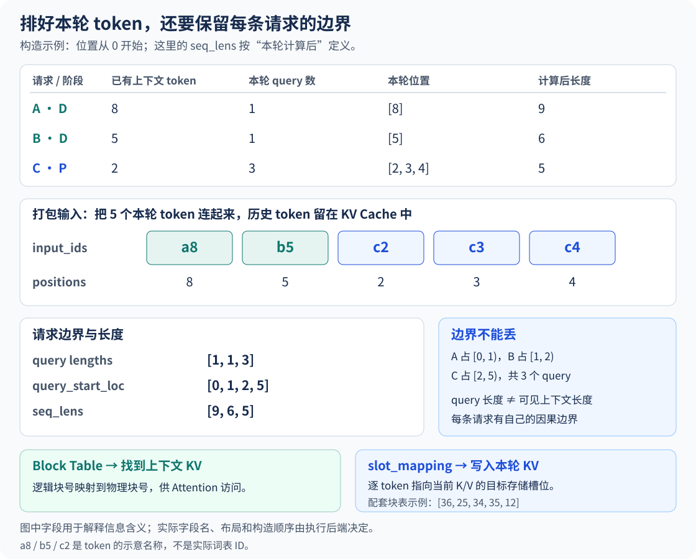
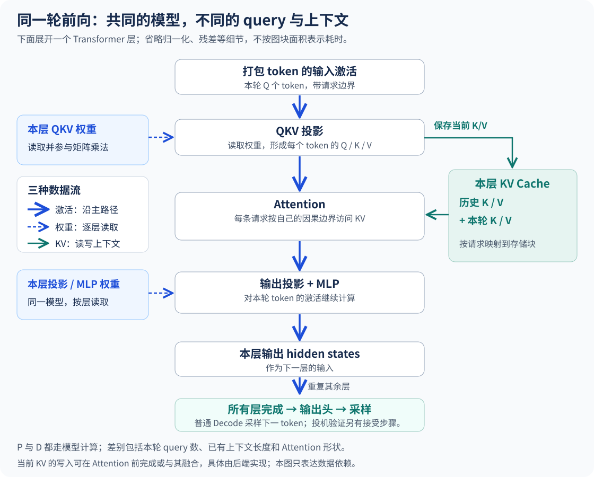
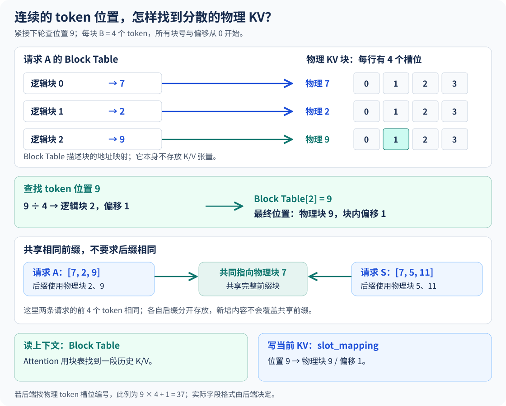
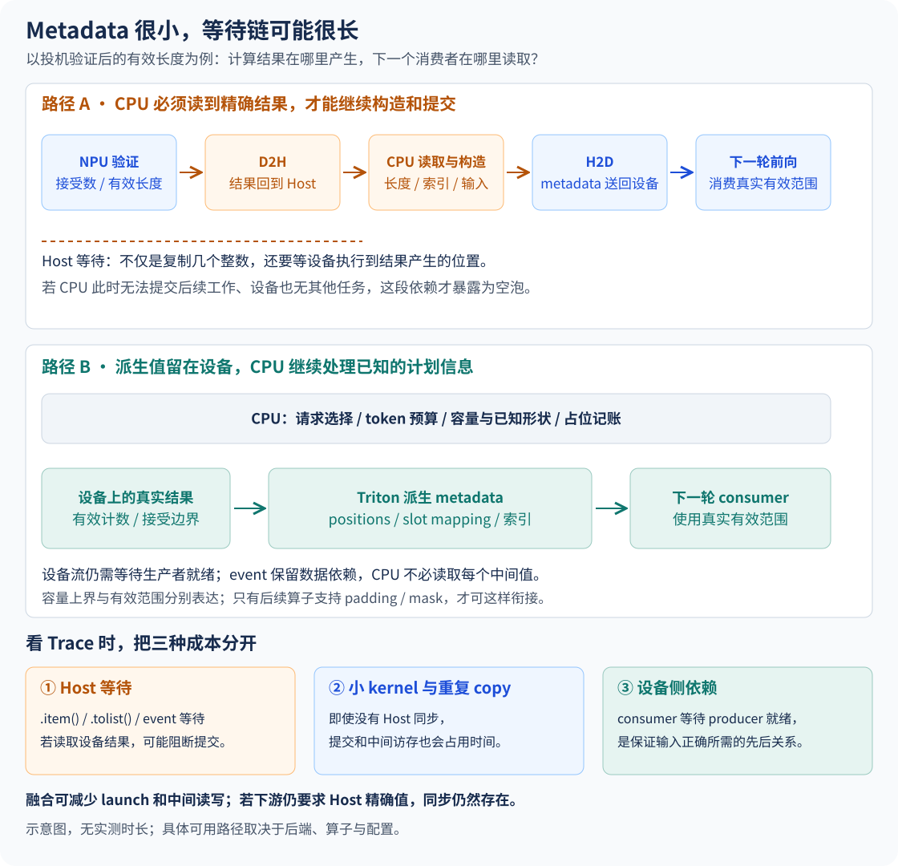
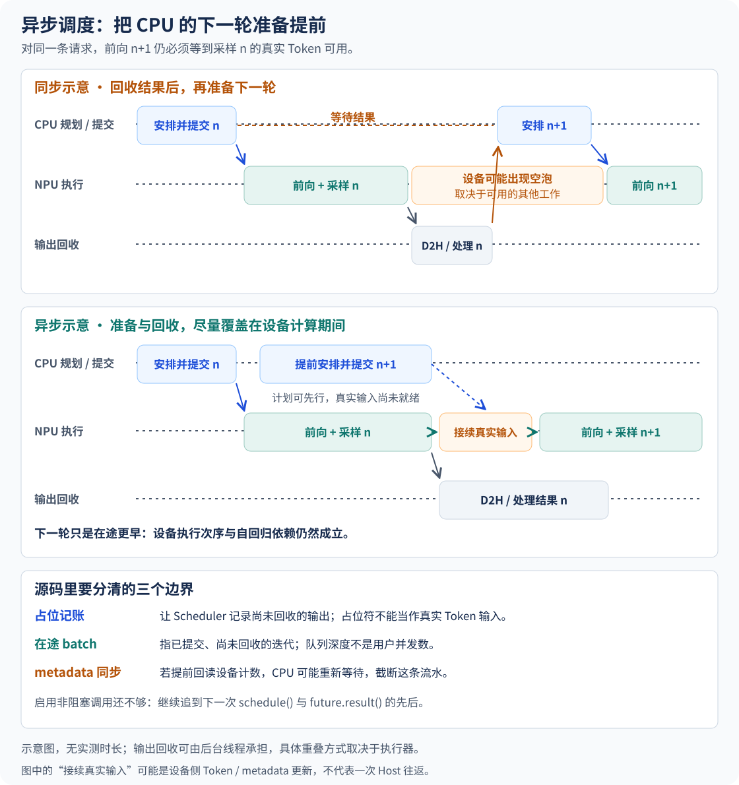

# 从一轮调度到一次前向

上一章的第二轮是 `R1 D：1 + R2 D：1 + R3 P：4096 + R4 P：4094 = 8192`。这个等式只说明调度器决定推进多少个位置，还没说明这些位置在输入张量的哪几行、读取哪条请求的历史、把新 KV 写到哪里。

如果 Trace 中两次前向之间出现空白，问题也不能从这个等式直接推出：可能是 Host 还在打包，可能是它正在等待设备结果，也可能任务已提交，但设备正在等另一条流。下面沿输入的去向读代码，再把这些情况分开。

> 数字例子采用文本、稠密 Decoder、标准因果自注意力，先不加入投机。源码主线选 Ascend `worker/v1/NPUModelRunner` 及它继承的上游方法；涉及另一条 Runner 路径时单独标明。后半章加入异步调度与投机状态接续，图中的时间线表示依赖，不表示测得的耗时。

## 1. 从调度表找到五行输入

### 1.1 调度数先变成请求边界

8192 行不便逐项核对，缩成三条请求，保留两条 Decode 加一条分块 Prefill 的关系：

| 请求 | 本轮工作 | 已有 KV 长度 | query 长度 | 本轮请求内位置 |
| --- | --- | --- | --- | --- |
| A | Decode | 8 | 1 | 8 |
| B | Decode | 5 | 1 | 5 |
| C | 分块 Prefill | 2 | 3 | 2、3、4 |

Worker 按当前 `input_batch.req_ids = [A,B,C]` 取出各请求的调度数，得到 `[1,1,3]`。`NPUModelRunner._prepare_inputs()` 内的 `req_indices = np.repeat(...)` 则得到 `[0,1,2,2,2]`：它告诉后续准备逻辑，每一行属于当前批次的第几条请求。请求 ID 到行号的映射会随加入、退出和重排变化，不能永久把第 0 行理解成 A。[Ascend 输入准备源码](https://github.com/vllm-project/vllm-ascend/blob/main/vllm_ascend/worker/v1/model_runner.py)

把 query 长度累加，得到 `cu_num_tokens = [1,2,5]`，前面补 0 就是 `query_start_loc`。再用已有计算进度加请求内偏移，得到：

```text
input_ids       = [ a8, b5, c2, c3, c4 ]
req_indices     = [  0,  1,  2,  2,  2 ]
query_pos       = [  0,  0,  0,  1,  2 ]
positions       = [  8,  5,  2,  3,  4 ]
query_start_loc = [ 0, 1, 2, 5 ]
seq_lens        = [ 9, 6, 5 ]
```

`a8` 是符号名，表示 A 在位置 8 的 Token，实际输入存放词表 ID。A、B 的输入是上一轮已经采样出来、尚未计算 KV 的 Token；C 的输入从 Prompt 中继续取第 2～4 个位置。`positions` 是各请求内部的位置，不是展平后的行号。



### 1.2 哪个字段错了，会错在哪里？

`query_start_loc` 划出 `[0,1)`、`[1,2)`、`[2,5)`。它回答“哪几行属于同一个 query”；`seq_lens` 在这个例子里是已有长度加本轮 query 长度，回答 Attention 可见的总长度。C 的位置 2 只能看自己的 0～2，位置 4 才能看自己的 0～4，不能因五行相邻就跨请求读取 A、B。

因此排查时先做三个确定的检查：边界差分是否为 `[1,1,3]`，最后一个边界是否等于真实输入行数 5，`positions` 是否从每条请求的已有进度连续接上。把 padding 加入以后，还应同时记录真实行数与填充行数，不能只检查张量总 shape。[输入准备设计](https://docs.vllm.ai/projects/ascend/en/main/developer_guide/Design_Documents/ModelRunner_prepare_inputs.html)

## 2. 前向计算使用这些字段做什么？

五行进入模型后，隐藏状态仍按展平的行排列。线性层可以让五行一起乘相同权重；Attention 需要请求边界、上下文长度和 KV 地址，把读取范围重新分开。

沿一个层追数据：归一化和 QKV 投影产生本轮的 Q、K、V；位置编码使用各行的 `positions`；新 K、V 按 `slot_mapping` 写入缓存；Attention 的 Q 读取自己可见的历史与当前 KV；输出再经投影、残差与 MLP 进入下一层。实际后端会融合、拆分或交错执行这些工作，图中的方框表示依赖，不用于数 Kernel。



在本例中，A 的位置 0～7 不再经过本轮所有层的 QKV 投影与 MLP，它们留下的 KV 被继续读取；只有位置 8 的隐藏状态向前推进。C 则有三行需要推进。把历史长度加进“本轮 Token 数”，会把线性层的工作量算错；完全忽略历史长度，又会低估 Attention 的工作量。

Runner 准备通用信息，Attention builder 再组织后端要用的参数、长度、工作区或设备侧任务。**Python 中创建一个 metadata 对象，与设备已经算完其中引用的张量，是两件事。** 这一区别会决定下一轮能提前准备到哪一步。

最后，Decode 和完成 Prefill 的请求按需选取隐藏状态、运行输出头并采样；C 若尚未完成 Prompt，本轮中间结果不会直接成为客户端输出。不要用客户端收到的 Token 个数反推这一轮一共计算了几行。

## 3. 设备确实在忙，再算权重与 KV 的账

如果设备时间线连续、有工作在跑，继续缩短 Python 代码未必能缩短这一轮。先用实际矩阵形状和上下文长度，判断时间花在什么工作上。

### 3.1 同一份权重被几行复用？

对线性层 `Y = XW`，设 `X` 为 `[T,H]`、`W` 为 `[H,F]`，一次乘加计两次浮点运算：

```text
计算量 C ≈ 2 × T × H × F
理想数据量 M ≈ s × (T×H + H×F + T×F)
```

`s` 是每元素字节数，数据量按输入和权重各读一次、输出写一次估计。五行共用一份 `W`；扩大 `T` 可以把权重读取摊给更多计算。真正的读取还受切块、片上容量、量化格式和工作区影响，分析时应记录线性层实际形状，而不是只写“当前为 Decode”。[矩阵乘法的计算与访存](https://docs.nvidia.com/deeplearning/performance/dl-performance-matrix-multiplication/index.html)

若图回放消除了 Host 提交间隙，但主要矩阵乘法耗时不变，这符合它主要节省提交开销的作用；不能据此判断图没有生效。

### 3.2 200 条 Decode 的上下文有多长？

对标准全 Attention，普通 Decode 每条请求产生一个新 Q，仍要访问该请求允许的历史 KV。令有效上下文为 `S_i`，跨层 KV 的逻辑数据规模可估为：

```text
V_KV ≈ 2 × L × Hkv × dh × sKV × Σ S_i
```

其中 `L` 为层数，`Hkv` 为 KV 头数，`dh` 为头维度，2 对应 K、V。这不是实测 HBM 读字节数：共享、片上复用、缓存与并行分片会改变实际流量。它足以指出一个错误比较：同为 200 条 D，2K 与 32K 上下文不能被当成同一工作量。

设算术强度 `I=C/M`，简化 Roofline 给出性能上界 `min(P,B×I)`、时间下界 `max(C/P,M/B)`。先统一精度、FLOP 与流量口径，再用它解释已观察到的算子；空泡、低并行度和通信不能塞进一个“带宽受限”标签里。[性能约束分析](https://docs.nvidia.com/deeplearning/performance/dl-performance-gpu-background/)

## 4. 用块表把位置换成 KV 写地址

前面留下一个字段：新 KV 写到哪里？设每块容纳 4 个 Token，用扁平化槽号演示地址计算：

```text
A 的块表 = [7, 2, 9]     B 的块表 = [5, 6]     C 的块表 = [8, 3]
逻辑块号 = position // 4
块内偏移 = position % 4
槽号     = block_table[逻辑块号] × 4 + 块内偏移
```

A 的位置 8 落在逻辑块 2、偏移 0，映射到物理块 9，所以槽号 36。B 的位置 5 落在物理块 6、偏移 1，槽号 25。C 的位置 2、3、4 分别得到 34、35、12，最终 `slot_mapping = [36,25,34,35,12]`。



在代码中，先看 `commit_block_table(num_reqs)` 将 Host 分配结果送往设备，再看 `compute_slot_mapping(...)` 用设备端边界和 positions 计算本轮写地址。**块表描述历史各块在哪里，slot mapping 描述本轮各行写哪里。** 实际缓存还有层、K/V、头和维度布局，多 KV 组也可能各有块表；这里的槽号只演示 Token 维度的寻址。[块表与写地址计算](https://github.com/vllm-project/vllm-ascend/blob/main/vllm_ascend/worker/block_table.py)

这也给出一条有用的排查顺序：输入 Token 正确但结果异常，先验证请求重排后的块表是否仍对应同一请求，再用该行 position 手算 slot。只看内存地址“落在缓存范围内”，发现不了读写到了另一条请求的问题。

PagedAttention 处理块化 KV 的访问与管理；FlashAttention 处理 Attention 内怎样分块、利用片上存储来减少数据搬运，两者可以组合。前缀复用还允许符合身份与完整前缀匹配条件的请求引用已有块，引用释放与物理擦除也不同。[PagedAttention](https://docs.vllm.ai/en/latest/design/paged_attention/)、[前缀缓存](https://docs.vllm.ai/en/latest/design/prefix_caching/)、[FlashAttention 论文](https://arxiv.org/abs/2205.14135)

## 5. Host 与 Device 怎样对上同一轮 metadata？

### 5.1 把“知道长度”拆成三种状态

普通五 Token 例子中，Host 已有准确进度，`已有长度 + 调度长度` 就够用。投机验证后，上一轮拒绝了几个位置需要设备结果才能确定，不能再默认 Host 的进度立即精确。读 Ascend 主线时，把这些数据分开：

| 数据 | 从哪里来 | 下一轮怎样接上 |
| --- | --- | --- |
| 请求 ID、批次行号、调度预算、块分配 | Host 控制状态 | 更新映射与缓冲区，必要字段 H2D |
| 真实 sampled Token IDs、有效采样数 | 设备采样与验证 | 保留设备张量，复制或索引到下一轮输入 |
| 精确 positions、computed length、seq_lens | 已有进度加实际接受结果 | 设备端修正；Host 精确消费者等计数回传后再修正 |

`_prepare_inputs()` 并没有把全部工作搬到 NPU：`query_start_loc`、`req_indices`、`query_pos`、本轮调度数和请求重排索引等仍会准备或上传，块表也仍需提交。优化省掉的是某些“设备算出 → Host 读取 → 再送回设备”的绕路，不能称为每轮零同步。

异步投机路径先形成 `optimistic_seq_lens_cpu`，相当于暂按上一轮候选全接受记账；随后用 `valid_sampled_token_count_gpu`、`prev_num_draft_tokens` 和 `prev_positions` 调用 `update_num_computed_tokens_for_batch_change(...)`，在设备上纠正进度，再生成 positions、seq_lens 与 slot mapping。**Host 计划可以先走，Attention 访问的真实有效边界必须纠正。**[主线输入准备与计数修正](https://github.com/vllm-project/vllm-ascend/blob/main/vllm_ascend/worker/v1/model_runner.py)

### 5.2 Python 能构造对象，不等于 Python 读过数据

Host 上持有一个 NPU Tensor 的 Python 对象，可以取得其设备、dtype、已知 shape 和地址，再把这个对象放进 metadata；这些操作并不要求把 Tensor 内部的数值复制回来。例如 `seq_lens.shape[0]` 告诉你长度数组有多少项，不会告诉你其中最大的真实序列长度。对设备 Tensor 做 `.item()`、`.tolist()`，或读取刚 D2H 的 Host 缓冲区，才涉及数值是否已经可用。

预分配的输入容量、图使用的填充 shape、真实 query 数、有效 KV 范围也要分开。固定容量的 buffer 可以反复写新值；Kernel 用设备端有效长度与 mask 决定哪些位置有意义。某个后端若仍要求精确的 Python 长度列表，光有固定容量就不够。

Ascend Attention builder 的 `_select_seq_lens()` 正体现这条边界：一些路径选 Host 镜像，一些路径选设备长度；后面的 `seq_lens.tolist()` 因来源不同而具有不同代价。CPU 镜像必须由正确的计数维护，不能把乐观上界换个字段名就交给需要精确值的消费者。[长度来源选择](https://github.com/vllm-project/vllm-ascend/blob/main/vllm_ascend/attention/utils.py)、[Attention builder](https://github.com/vllm-project/vllm-ascend/blob/main/vllm_ascend/attention/attention_v1.py)

### 5.3 三种等待，分别保护什么？

第一种保护复用的 Host 输入缓冲区。Ascend 的准备阶段使用继承来的 `synchronize_input_prep()`：进入时执行 `prepare_inputs_event.synchronize()`，离开时记录事件，确保上一轮异步 H2D 尚在读取的 Host 数据不被改写。这是真正的 Host 等待；事件已完成时会很快返回，尚未完成时会阻塞。其范围覆盖状态更新、输入和 metadata 准备，在主 forward 前结束，并非每轮为了这个 fence 等完整前向完成。父类中的 CUDA 命名经 Ascend 兼容包装映射为 NPU event；不能据名字认定 Ascend 没有这层等待。[继承方法](https://github.com/vllm-project/vllm/blob/main/vllm/v1/worker/gpu_model_runner.py)、[Ascend 调用与兼容包装](https://github.com/vllm-project/vllm-ascend/blob/main/vllm_ascend/worker/v1/model_runner.py)

第二种是 Host 消费设备产生的精确值。主线 `_copy_valid_sampled_token_count()` 在侧流发起有效计数 D2H；若 `_needs_seq_lens_cpu_sync`，后续 `_correct_optimistic_seq_lens_cpu()` 会先 `valid_sampled_token_count_event.synchronize()`，再修正 Host 长度。提前发起 copy 可以把等待藏到其他工作后面，不能保证事件到这里总已完成。另一路 `worker/v2` 的 `_update_seq_lens_cpu()` 也有精确计数回读；它的 `_can_skip_spec_cpu_length_sync()` 是另一条路径的条件判断，不能拼进上述调用链。[另一 Runner 的对照](https://github.com/vllm-project/vllm-ascend/blob/main/vllm_ascend/worker/v2/model_runner.py)

第三种发生在设备流之间。对实现了 `DeviceMetadataTaskProvider` 协议的 builder，Runner 才收集设备任务并启用 `DeviceMetadataExecutor`；普通 builder 不因此自动变成设备侧构造。`submit()` 在独立流生产 metadata，按 stage/group 记录就绪事件；消费者的 `wait()` 让执行流等待相应事件。`release()` 与 `_buffer_reusable` 保护设备缓冲区，避免上一轮消费者尚未读完就被下一轮覆盖。这些 event 依赖可以让 Host 继续提交，但消费者流仍可能等待，不能解释成数据已经提前准备好。[设备侧 metadata 执行器](https://github.com/vllm-project/vllm-ascend/blob/main/vllm_ascend/worker/device_metadata.py)



### 5.4 Triton 融合到底缩短哪一段？

`_compute_slot_mapping_kernel` 把块号、块内偏移和写地址计算放在设备；`compute_slot_mapping_fused_groups` 在支持条件下用一次 launch 处理多 KV 组，省去逐组提交。这直接对应第 4 节的地址算例。[实现](https://github.com/vllm-project/vllm-ascend/blob/main/vllm_ascend/ops/triton/compute_slot_mapping.py)

`prepare_inputs_padded_kernel` 从设备有效计数推导拒绝数和采样索引。调用它的 proposer 保留拒绝位置作 padding，再按索引筛选，不立刻为了紧凑形状读取接受数。它把多步差分、`where` 和索引操作合在一起；有效范围与容量分离，才能少走 Host。[融合 Kernel](https://github.com/vllm-project/vllm-ascend/blob/main/vllm_ascend/ops/triton/spec_decode/utils.py)、[padded 输入路径](https://github.com/vllm-project/vllm-ascend/blob/main/vllm_ascend/worker/v1/spec_decode/llm_base_proposer.py)

DFlash 的 `_prepare_dflash_inputs_kernel` 又在特定路径融合 query/context positions、slot mapping、采样映射与图 padding。这是另一处输入准备实现，不是所有请求都会经过的统一阶段。[DFlash 实现](https://github.com/vllm-project/vllm-ascend/blob/main/vllm_ascend/ops/triton/v2/spec_decode/prepare_dflash_inputs.py)

融合主要减少小 Kernel 的提交、中间读写和临时张量。图回放减少可复用执行序列的重复提交；设备侧 metadata 把依赖留在设备。三者可以配合，但下游若仍要求立即读取精确 Host 长度，那条等待依然存在。[图执行设计](https://docs.vllm.ai/en/latest/design/cuda_graphs/)

## 6. 异步调度怎样连接两轮？

### 6.1 EngineCore 不必每轮立刻回收结果

同步循环中，`schedule()`、执行、等待结果、`update_from_output()` 依次推进。异步调度让第 n 轮还在执行、采样或回传时，Host 先安排后续工作。它主要重叠两侧的工作，不允许同一请求绕过 Token 的自回归依赖。

源码应从上游 `EngineCore.step_with_batch_queue()` 往下读。省略结构化输出等分支后，控制顺序是：

```text
若能继续调度：
    out = scheduler.schedule()
    execute_model(out, non_block=True)
    future = sample_tokens(..., non_block=True)
    保存 (future, out)
    若队列仍有空间：先返回，继续下一次调度

到需要回收时：
    取最早提交的一批
    result = future.result()
    scheduler.update_from_output(out, result)
```

队列受 `max_concurrent_batches` 限制，也用于流水线并行；`get_scheduler_cls()` 是否选择 `AsyncScheduler` 则由对应配置决定。普通 `step()` 也可调用 `non_block=True`，但随后很快等结果。因此要沿“调用返回后做什么”读，不能凭一个异步参数或队列判定跨轮重叠已经发生。[引擎循环](https://github.com/vllm-project/vllm/blob/main/vllm/v1/engine/core.py)、[Scheduler 选择](https://github.com/vllm-project/vllm/blob/main/vllm/config/scheduler.py)



### 6.2 占位记账，设备接上真实 Token

基础 Scheduler 的 `_update_after_schedule()` 会提前推进请求的 `num_computed_tokens`；此时表示已安排进度，不能当成设备完成事件。`AsyncScheduler` 另外用 `num_output_placeholders` 记录尚未回收的输出，结果回来时再消解或修正。调度器因此能预算后续工作，Worker 仍必须使用真实 Token。[基础记账](https://github.com/vllm-project/vllm/blob/main/vllm/v1/core/sched/scheduler.py)、[异步占位](https://github.com/vllm-project/vllm/blob/main/vllm/v1/core/sched/async_scheduler.py)

以普通 Decode 接续前面的例子。A、B 本轮算完位置 8、5，采样得到 `a9`、`b6`；C 尚未完成 Prompt，不作为有效输出回传。假设下一批重排为 `[B,D,A]`，D 是新请求，计算两个 Prompt Token：

```text
上一批行号：       A→0，B→1，C→2
当前到上一批映射： [1, -1, 0]          # -1 表示新请求
本轮 query 长度：  [1, 2, 1]
query_start_loc： [0, 1, 3, 4]
input_ids：       [b6, d0, d1, a9]
positions：       [ 6,  0,  1,  9]
```

Host 知道 D 的 Prompt、当前请求顺序、调度数及目标行号，所以仍上传新输入与必要索引。`b6`、`a9` 已保存在设备 `prev_sampled_token_ids` 中；`_prepare_input_ids()` 根据映射将它们复制或 scatter 到行 0、3。批次没变且位置连续时，可直接切片复制；有新请求或重排时要走对应映射。Host 缓冲区中的占位 ID 不承担模型输入的语义，不能拿来替代真实采样结果。[继承的输入接续方法](https://github.com/vllm-project/vllm/blob/main/vllm/v1/worker/gpu_model_runner.py)

Ascend 的普通异步采样路径会缓存设备 sampled IDs，并保存 `prev_req_id_to_index`；它继承上游 Runner 的部分准备方法，这也是只搜 Ascend 仓库不容易找到完整机制的原因。投机路径还要接上有效计数与拒绝修正，即第 5 节的状态对账；多级流水线、并行与特殊模型分支需沿实际调用分支继续追，不能照搬这个单 Worker 例子。[Ascend 采样处理与继承](https://github.com/vllm-project/vllm-ascend/blob/main/vllm_ascend/worker/v1/model_runner.py)

### 6.3 输出回收仍在发生

采样结果最终还要 D2H，用于输出、停止判断与请求状态更新。多进程 executor 的 `handle_output()` 在异步配置下把输出放入后台队列，`async_output_busy_loop()` 再经 `enqueue_output()` 调用异步输出的 `get_output()`。等待被移到后台，不等于被删除；EngineCore 到回收队列头时仍可能等待 future。[后台回收源码](https://github.com/vllm-project/vllm/blob/main/vllm/v1/executor/multiproc_executor.py)

因此验证异步效果至少看两处：EngineCore 是否在回收 n 前已经安排后续批次；Worker 是否也能继续提交，还是卡在输入缓冲区复用、精确计数或其他消费者处。只看到调度器提前跑了，无法推出设备空泡已经消失。短 Decode step 更容易暴露这些 Host 开销；长 Prefill 也能与准备工作重叠，只是设备计算占比通常不同。

## 7. 回到 PD，哪些时间不能藏进 RP、RD？

第一章的 RP、RD 是特定负载下的服务能力。现在能给负载补上具体条件：P 的 chunk 改变矩阵形状与 query 长度，D 的批量和上下文改变权重复用与 KV 读取；缓存命中改变实际需要重算和搬运的部分。容量配比应使用同一组长度分布、执行模式与精度下测出的能力。

PD 分离又增加 KV 传输、目标块准备和请求交接。D 侧算子很快却迟迟开不了第一轮时，要把“等待 KV 到齐”与第 5 节的“等待本地 metadata”分开。多卡的集合通信或流水阶段传递也要保留独立时间段，不能都归入 Attention 计算。

若优化融合后单步计算缩短，端到端 TPOT 却不变，先找仍暴露的交接、通信和回收时间；若 D 已持续满载，则回到批量、上下文与访存分析。配比和调度参数应跟随这些时间变化，而不是沿用一个固定 tokens/s 常数。

## 8. 拿到 Trace 后按这个顺序排查

先选一段稳定区间，给调度批次与请求保留可关联的标识；分别标记 `schedule`、输入准备、metadata build、forward、sample 和输出回收。把 Host runtime 调用、设备 Kernel、copy 与不同 stream 放在同一条可关联时间线上。检查输入值可在单独调试轮读取，正式采集不要随手打印设备 Tensor，避免人为增加回读。

第一步核实工作：保存真实调度数、query 边界、有效上下文、padding 数和实际图路径。第二步定位下一轮开始前最后一个尚未满足的依赖，再按下表找证据：

| 观察到的现象 | 优先检查 | 可以推翻判断的证据 |
| --- | --- | --- |
| Host 准备区间长，持续运行 CPU 代码 | packing、NumPy、builder、逐组提交 | 设备其实连续忙，Host 准备完全被遮住，则它不在当前关键路径 |
| Host 停在 event 或结果等待 | `prepare_inputs_event`、有效计数回读、队列头 future | 事件进入前已完成，等待区间近乎为空，则不要把它记成主要空泡来源 |
| Host 已提交，计算流尚未开始 | 侧流 metadata、copy、通信及就绪事件 | 消费者依赖早已满足，则继续找 runtime 排队或其他前置任务 |
| 大量短 Kernel 间有间隙 | 融合前后 Kernel 数、Host 提交与中间 copy | 融合后提交减少但设备等待不变，则原瓶颈在另一条依赖上 |
| 前向连续，Attention 随上下文变长 | 实际 seq_lens、KV 流量与算子形状 | 长度和工作量相同而时间仍变，应检查执行模式、竞争及通信 |

第三步只改一个因素做对照：支持的异步调度、融合路径或图模式分别开关，保持请求到达、长度、采样与后端条件一致。记录的结果应同时包含 Host 暴露区间、设备间隙、整轮时间和客户端输出分布。闭环并发还要记录实际补入速率，服务变慢会使下一批请求来得更慢。

一份可解释的结论应能指出“谁在等谁”：例如“消费者要求精确 Host 长度，接受数 D2H 未完成，使下一轮提交推迟”，而不是“metadata 很慢”。接受数为何变化、一次验证怎样产生多个 Token，以及这与 ITL、TPOT 的关系，接着看[《投机解码与流式指标》](投机解码与流式指标.md)。
