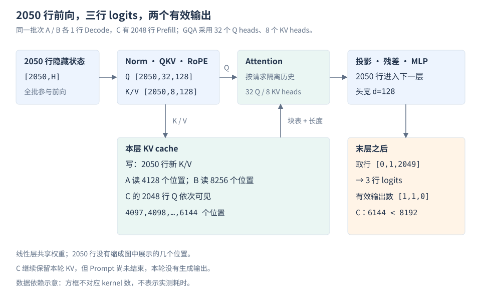
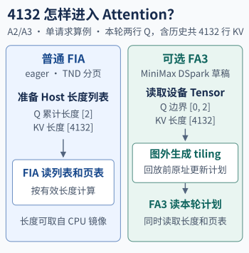
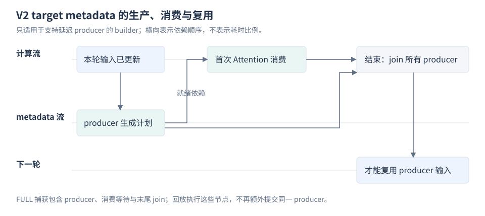

# 从一轮调度到一次前向

上一章的混部调度排出了第二轮：`R1 D：1 + R2 D：1 + R3 P：4096 + R4 P：4094 = 8192`。调度器决定了每条请求本轮算多少个 Token。接下来，Runner 要把这些 Token 交给模型，找到它们的历史 KV，并保存本轮算出的新 KV。

本章用两条 Decode 请求和一条分块 Prefill 请求，走完输入准备、模型前向、采样和下一轮输入。随后加入投机解码，说明为什么一次候选拒绝会影响下一轮的长度，以及 tiling 下沉怎样减少由此产生的 CPU 等待。

> 本章使用 Ascend ModelRunnerV2。基础算例采用文本、稠密 Decoder、标准因果 Attention，先固定单卡、无投机、无图填充。请求长度和页号为教学构造，图不表示实测耗时。源码入口为 [Ascend V2 Runner](https://github.com/vllm-project/vllm-ascend/blob/f9c8e0bd/vllm_ascend/worker/v2/model_runner.py) 及其继承的 [vLLM GPU Runner](https://github.com/vllm-project/vllm/blob/ced6857a/vllm/v1/worker/gpu/model_runner.py)；后者路径中的 `v1` 是引擎命名空间。

## 本轮要计算哪些 Token？

请求 A 的 Prompt 长 4096 个 Token，到这一轮已经生成了 32 个 Token。请求 B 的 Prompt 长 8192 个 Token，已经生成了 64 个。两条请求都在 Decode。本轮，模型分别读入它们上一次采样得到的 Token，再预测下一个。

为什么已经输出的 Token 还要再输入模型？因为采样只选出了它的词表 ID，还没有计算它自己的 K、V。以 A 为例，上轮用位置 4126 的隐藏状态预测出了位置 4127 的 Token；本轮才把位置 4127 的 Token 送入模型。因此，A 已有 KV 的 Token 数是 `4096 + 32 − 1 = 4127`。

C 的 Prompt 有 8192 个 Token，前 4096 个已经完成 Prefill。本轮继续处理 2048 个，之后还剩 2048 个。

| 请求 | 本轮工作 | 本轮开始前已有 KV 的 Token 数 | 本轮输入 Token 数 | 本轮输入在请求中的位置 |
| --- | --- | --- | --- | --- |
| A | Decode | 4127 | 1 | 4127 |
| B | Decode | 8255 | 1 | 8255 |
| C | 分块 Prefill | 4096 | 2048 | 4096～6143 |

表中的位置从 0 开始。本轮一共输入 `1 + 1 + 2048 = 2050` 个 Token。

这些请求的 KV 已经保存在设备上。调度器只需告诉 Runner 本轮选中了哪些请求、各算多少个 Token，以及是否新增了 KV 页，不必每轮重传历史 KV。Runner 据此更新请求信息，再准备输入。[V2 请求更新与输入准备](https://github.com/vllm-project/vllm/blob/ced6857a/vllm/v1/worker/gpu/model_runner.py#L1631-L1660)

## 怎样准备输入，并找到新 KV 的写入位置？

### 把 Token 拼起来，保留每条请求的边界

本轮按 A、B、C 的顺序拼接输入。A、B 的 Token 来自上轮采样结果，C 的 Token 来自已经知道的 Prompt。

```text
input_ids       = [ a4127, b8255, c4096, c4097, …, c6143 ]
positions       = [  4127,  8255,  4096,  4097, …,  6143 ]
query_start_loc = [ 0, 1, 2, 2050 ]
seq_lens        = [ 4128, 8256, 6144 ]
```

`a4127` 只是为了阅读方便，表示 A 在位置 4127 的 Token；实际数组保存的是词表 ID。示例只列出了 C 的部分输入，实际参加计算的有 2048 个 Token。

拼接之后，还要告诉 Attention 每个 Token 属于哪条请求，否则它无法确定应该读取谁的 KV。`query_start_loc` 保存各请求在输入数组中的分界：A 使用 `[0,1)`，B 使用 `[1,2)`，C 使用 `[2,2050)`。例如，C 从数组下标 2 开始，到下标 2049 结束，共 2048 个 Token。

`positions` 记录各 Token 在自己请求中的位置，供位置编码等计算使用。`seq_lens` 则记录每条请求算完本轮后的总长度，也就是“原有 KV 长度 + 本轮输入 Token 数”。A 本轮只输入一个 Token，但它的 Attention 需要考虑包括该 Token 在内的 4128 个位置。

<!-- DETAILS: V2 源码怎样生成这几个输入数组 -->

V2 按本轮各请求的输入 Token 数累加得到 `query_start_loc`。`prepare_prefill_inputs()` 从已保存的 Prompt 取出 C 的片段；`prepare_pos_seq_lens()` 读取设备上的 `num_computed_tokens`，生成 `positions` 和 `seq_lens`；`combine_sampled_and_draft_tokens()` 填入 A、B 上轮的采样结果。这里没有投机候选，所以 A、B 各填一个 Token。[Ascend V2 输入准备](https://github.com/vllm-project/vllm-ascend/blob/f9c8e0bd/vllm_ascend/worker/v2/model_runner.py#L1046-L1092) · [输入准备内核](https://github.com/vllm-project/vllm/blob/ced6857a/vllm/v1/worker/gpu/input_batch.py)

<!-- /DETAILS -->

### 用页表把 Token 位置换成 KV 写入位置

KV Cache 按页分配。这里的 block 和 page 都指页，`block_size=128` 表示一页能存 128 个 Token 的 KV。页池在初始化时建立，调度器从中给请求分配物理页，模型把本轮算出的 K、V 写进去。

一条请求的位置 0～127 使用第一页，128～255 使用第二页，依此类推。这些页在物理存储中不必连续，所以每条请求都有一张**页表 `block_table`，记录各逻辑页对应的物理页号**。已知 Token 在请求中的位置 `position`，查找方法是：

```text
页表下标 = position // block_size
页内偏移 = position % block_size
物理页号 = block_table[页表下标]
```

`//` 表示整除，`%` 表示取余。以 A 的位置 4127 为例，`4127 ÷ 128 = 32 余 31`，所以查页表下标 32；假设查到物理页号 81，就把这个 Token 的 KV 写到**物理页 81、页内偏移 31**。

写缓存的算子用一个整数表示这两个数，保存在源码字段 `slot_mapping` 中：

```text
slot_mapping = 物理页号 × block_size + 页内偏移
             = 81 × 128 + 31
             = 10399
```

这里的 31 是页内偏移，10399 包含了物理页号和页内偏移；两者都以 Token 为单位，不是字节地址。`slot_mapping` 在本轮有 2050 项，每个输入 Token 对应一项。实际一页占多少字节，还要看 KV 的形状和数据类型。


这样，写入新 KV 用 `slot_mapping` 定位；读取历史 KV 用页表找到各页，并按有效长度限制读取范围。每条请求使用自己的页表和边界，即使输入拼在一起，C 也不会读取 A、B 的历史。[V2 页表](https://github.com/vllm-project/vllm-ascend/blob/f9c8e0bd/vllm_ascend/worker/v2/block_table.py) · [slot_mapping 计算内核](https://github.com/vllm-project/vllm-ascend/blob/f9c8e0bd/vllm_ascend/ops/triton/v2/block_table/compute_slot_mappings.py)

这里先看单卡、单层。实际页大小受缓存配置和后端约束；不同层在各自的缓存中使用对应页号。TP、CP 会进一步影响每张卡存哪些 KV，以及如何计算本地位置，见[并行时的 KV 分片](上下文并行与Attention归并.md)。页池建立、前缀复用和释放流程见[KV 缓存管理与后端访问](KV缓存布局与递归状态.md)。

## 模型怎样计算，为什么 C 本轮没有输出？

### 输入 Token 经过各层，逐层保存新 KV

输入经过 Embedding 后，变成形状为 `[2050,H]` 的隐藏状态，H 是隐藏维度。**这里一行就是一个输入 Token 的向量。** 后面张量中的“行”都按这个含义使用。

在每一层，模型先做归一化与 QKV 投影，再用 `positions` 进行位置编码。Attention 后端把本轮的新 K、V 写入缓存，然后让每个 Q 读取所属请求的 KV。因果 Attention 只允许看到自己及此前的位置：A 可以看到 4128 个位置；C 的第一个输入可以看到 4097 个位置，最后一个可以看到 6144 个位置。

Attention 的结果继续经过输出投影、残差和 MLP，再进入下一层。下图按计算依赖展开；实际算子可能融合其中若干操作。



<!-- DETAILS: metadata 怎样把输入信息交给 Attention 后端 -->

这里的 metadata 是一次 Attention 调用需要的辅助信息，包括请求边界、有效长度、页表和 `slot_mapping`。Runner 的 `prepare_attn()` 取得页表和 `slot_mapping`，再由 `model_state.prepare_attn()` 按 Attention group 调用 metadata builder，组织成后端需要的格式。有些字段是设备 Tensor，有些后端还需要 CPU 上的长度。

Python 对象构造完成，只说明这些字段已经组织起来；如果其中的 Tensor 还在设备上计算，Attention 仍要等数值准备好。[V2 Attention 准备](https://github.com/vllm-project/vllm/blob/ced6857a/vllm/v1/worker/gpu/model_runner.py#L1710-L1825)

普通 GQA 缓存 K、V；MLA 缓存压缩 latent 与位置编码部分；稀疏 Attention 还涉及索引或压缩缓存。它们使用不同的缓存布局和访问流程，见[各 Attention backend 的缓存路径](KV缓存布局与递归状态.md)。

<!-- /DETAILS -->

<!-- DETAILS: 用张量形状和计算量检查这个批次 -->

固定无并行、32 个 Q heads、8 个 KV heads、head_dim 为 128 的 GQA 配置，每层 Q 为 `[2050,32,128]`，新 K、V 各为 `[2050,8,128]`。

对每个 Q head，A 有一个 Q，要与 4128 个 K 计算；B 要与 8256 个 K 计算；C 有 2048 个 Q，各自可见的 K 数从 4097 增长到 6144。因此，有效 query–key 配对数为：

```text
4128 + 8256 + (4097 + 6144) × 2048 / 2 = 10,499,168
```

C 占了其中绝大部分计算。这个数描述因果计算范围，不能直接当作 HBM 读取量；实际读取还取决于片上复用和内核实现。[GQA 与缓存形状](KV缓存布局与递归状态.md)

<!-- /DETAILS -->

### 2050 个输入 Token，三行 logits，两个有效输出

模型末层得到 2050 行隐藏状态，但预测下一个 Token 只需要每条请求最后一个输入的结果。本例没有投机候选，V2 取 A、B、C 对应的第 0、1、2049 行，经过 LM Head 计算三行 logits。每行 logits 给出词表中各个 Token 作为该请求下一个 Token 的分数。[选行内核](https://github.com/vllm-project/vllm/blob/ced6857a/vllm/v1/worker/gpu/input_batch.py) · [V2 选行与 LM Head](https://github.com/vllm-project/vllm/blob/ced6857a/vllm/v1/worker/gpu/model_runner.py#L1512-L1540)

A、B 可以使用采样结果继续生成，分别得到 a4128 和 b8256。C 才处理到 Prompt 的第 6144 个 Token，后面还有已知的 Prompt，不应该在这里开始生成。因此，采样计数函数把 C 的有效输出数 `num_sampled` 设为 0；A、B 各为 1。[采样后的有效计数](https://github.com/vllm-project/vllm/blob/ced6857a/vllm/v1/worker/gpu/sample/sampler.py)

C 本轮没有输出，仍然完成了 2048 个 Token 的前向，并保存了它们的 KV。下一轮从 Prompt 位置 6144 继续。

## 采样之后，下一轮从哪里接上？

### 保存计算进度和采样结果

每轮结束后，V2 在设备上更新各请求已经计算的 Token 数，并保存最后一个有效采样 Token。A 的 KV 长度从 4127 变为 4128，同时保存采样结果 a4128，供下一轮输入。C 没有采样输出，但计算进度仍从 4096 增加到 6144。[V2 采样后更新](https://github.com/vllm-project/vllm/blob/ced6857a/vllm/v1/worker/gpu/model_runner.py#L1590-L1619) · [设备状态更新内核](https://github.com/vllm-project/vllm/blob/ced6857a/vllm/v1/worker/gpu/input_batch.py#L552-L650)

下一轮可以改变请求顺序。例如排成 `[B,C,A]` 时，Runner 仍从各自的请求状态找到 b8256 和 a4128，并从 C 的 Prompt 取出剩余 2048 个 Token。C 完成这一块后到达 Prompt 末尾，才可以产生第一个输出。

<!-- DETAILS: 请求顺序变了，V2 怎样找到原来的状态？ -->

`req_states` 保存请求状态，`idx_mapping` 记录本轮各请求对应的数组下标。例如 A、B、C 的状态分别保存在下标 6、2、9，本轮顺序是 `[A,B,C]`，则 `idx_mapping=[6,2,9]`；下一轮顺序变成 `[B,C,A]`，映射就变成 `[2,9,6]`。这是请求状态数组的下标，与 KV 页号、页内偏移无关。请求结束后，这个下标可以被新请求复用。[请求状态容器](https://github.com/vllm-project/vllm/blob/ced6857a/vllm/v1/worker/gpu/states.py) · [idx_mapping 的生成](https://github.com/vllm-project/vllm/blob/ced6857a/vllm/v1/worker/gpu/model_runner.py#L1217-L1268)

输入准备时，V2 通过这个映射找到各请求的进度和页表；采样之后，`postprocess_sampled()` 调用 `post_update()`，通过同一映射更新 `num_computed_tokens` 和 `last_sampled_tokens`。本轮输入数减去拒绝数，就是计算进度的增加量。普通 Decode 没有拒绝；下面看投机场景。

<!-- /DETAILS -->

### 拒绝投机候选后，哪些 KV 还能使用？

回到本轮开始前，A 原有 KV 长度仍为 4127。这次让它做投机验证：除了上轮采样出的 a4127，再输入三个候选 d1、d2、d3。

```text
输入 Token = [ a4127, d1,   d2,   d3   ]
位置       = [ 4127,  4128, 4129, 4130 ]
```

前向会为四个输入都计算 KV，临时长度达到 4131。假设验证接受 d1、d2，拒绝 d3，并在拒绝处采样得到 x。本轮有效输出是 `[d1,d2,x]`，但有效 KV 只到位置 4129：位置 4130 留下的是被拒绝的 d3 的 KV，x 还没有作为输入计算过自己的 KV。

因此，V2 将有效 KV 长度更新为 `4127 + 4 − 1 = 4130`，并保存 x 作为下一轮输入。如果下一轮只带一个候选 e1，输入就是 `[x,e1]`，位置是 `[4130,4131]`，本次 Attention 使用的总长度为 4132。[V2 拒绝采样](https://github.com/vllm-project/vllm/blob/ced6857a/vllm/v1/worker/gpu/spec_decode/rejection_sampler.py) · [接受与输出边界](投机解码与流式指标.md)


这次回退不需要擦除整页，也没有跨过页边界。只要后续读取遵守有效长度，下一轮就可以用 x 的 KV 覆盖 d3 留下的内容；页的保留或归还由缓存管理决定。

到这里，下一轮的 Token 和准确长度都可以在设备上准备。接下来还要看 Attention 算子：它能直接使用设备上的长度 4132，还是要先把这个数复制回 CPU，才能安排计算？这就是 tiling 下沉要解决的问题。


## Tiling 下沉怎样减少 CPU 等待？

### 算子为什么还需要一份 tiling 计划？

Q 和 KV 都已准备好，Attention 还要解决一个问题：这些数据怎样分批计算？历史 KV 很长时，片上存储放不下整段数据，需要分段读取。请求多了，还要把各请求、各个 head 的工作分给不同计算单元。

把计算切成小块，安排每个计算单元处理哪些块、循环多少次，这些工作称为 **tiling**。它生成的计划会交给 Attention 内核，告诉内核怎样完成本轮计算。[FlashAttention 的分块与片上计算](https://arxiv.org/abs/2205.14135)

先看一个不加因果掩码的教学例子：有 4 行 Q，要读取 130 行 KV。假设每个计算块放 2 行 Q，每次最多读 64 行 KV，那么 Q 分成两组；每组都要读三段 KV，段长依次为 `[64,64,2]`。最后一段不足 64 行，内核必须知道只有两行有效。

读完一段 KV，还不能把这一段的 softmax 结果直接作为最终输出。因为 softmax 要在整段可见历史上归一化，内核需要保留已经处理部分的最大值、归一化分母和加权 V 累计值，再把下一段合并进来。三段都处理完，才能得到整段历史的 Attention 结果；不能简单平均三段各自的 softmax。


如果有效 KV 长度从 130 变成 129，存储容量可以不变，最后一段却只剩一行有效。依靠精确长度生成计划的接口必须据此更新计划。有些接口允许按长度上界安排计算，再由内核读取设备上的真实长度来屏蔽无效位置；能否这样做，要看接口是否支持，不能仅凭 Tensor 形状没变就继续使用旧计划。

实际因果 Attention 还会按 Q 所在的位置屏蔽未来的 KV，整块都不可见时可以跳过。选择多大的计算块、是否把一段 KV 分给多个计算单元再归并，取决于具体算子。图中的 2 和 64 只是教学取值。

还要分清计算块和 KV 物理页。物理页由缓存管理分配，页表告诉内核去哪里找历史 KV；计算块决定找到数据后，每次搬多少到片上处理。上面的 64 不是 KV 页容量，也不是某个 CANN 内核的实际配置。

<!-- DETAILS: 源码对照：tiling 计划可以包含哪些参数 -->

Ascend C 的 Host tiling 接口可以准备以下内容：

| 参数 | 内核用它做什么 |
| --- | --- |
| `TilingData` | 读取切分参数，例如每次搬运多少数据、循环多少次、末块有多少有效元素 |
| `block_dim` | 确定启动的分块数 |
| `TilingKey` | 选择相应的内核实现分支 |
| workspace 大小 | 为执行所需的临时工作区预留空间 |

具体 Attention 接口未必公开这些字段，但仍需要让内核知道本轮怎样分工、数据读到哪里为止。[Ascend C 的 Host tiling 接口](https://www.hiascend.com/doc_center/source/zh/canncommercial/80RC1/developmentguide/opdevg/Ascendcopdevg/CANN%208.0.RC1%20Ascend%20C%E8%87%AA%E5%AE%9A%E4%B9%89%E7%AE%97%E5%AD%90%E5%BC%80%E5%8F%91%E6%8C%87%E5%8D%97%2001.pdf)

<!-- /DETAILS -->

### 请求 metadata 与 tiling 计划是什么关系？

前面为请求 A 准备了 query 边界、有效长度 4132、页表和 KV 写入位置。这些信息说明本轮有哪些输入、哪些 KV 有效、数据存在哪里。具体的 Attention 实现，也就是 Attention 后端，还要结合数据布局、head 数和宽度、掩码等条件，生成执行计划。

代码里，这两类信息都可能叫 metadata。可以从使用者区分两者。后端根据请求信息准备这次调用，Attention 内核按执行计划分块计算。

沿用 A 的数字，把这一轮缩成单请求、两行 Q。两行都属于 A，所以 query 边界是 `[0,2]`。两行加上历史后的有效 KV 长度是 4132。V2 的公共 metadata 分开保存设备上的 `query_start_loc`、`seq_lens` 和各请求的页表，再把它们交给所在 Attention 组的 builder。下面用这组数读两条可选后端的接口。[V2 公共字段](https://github.com/vllm-project/vllm-ascend/blob/92b6354a/vllm_ascend/worker/v2/attn_utils.py#L470-L487) · [按组构造并交给对应层](https://github.com/vllm-project/vllm-ascend/blob/92b6354a/vllm_ascend/worker/v2/attn_utils.py#L568-L588)

**普通 FIA 怎样拿到 4132？** 取 A2/A3 上使用普通 FIA 的稠密 GQA，按 eager、TND、无滑窗、无 sink 的分页路径读。Runner 的 `prepare_pos_seq_lens` 用设备上的计算进度写出长度。FIA builder 还需要 Python 列表，它取 query 边界的尾端得到 `actual_seq_lengths_q=[2]`，另取有效 KV 长度得到 `seq_lens_list=[4132]`。后端把两个列表连同页表交给 `torch_npu.npu_fused_infer_attention_score`。这段 Python 代码能查到提交给算子的长度和地址，具体分块要继续查看算子内部实现。[设备长度的产生](https://github.com/vllm-project/vllm-ascend/blob/92b6354a/vllm_ascend/worker/v2/model_runner.py#L1040-L1048) · [两种长度列表](https://github.com/vllm-project/vllm-ascend/blob/92b6354a/vllm_ascend/attention/attention_v1.py#L345-L399) · [分页参数](https://github.com/vllm-project/vllm-ascend/blob/92b6354a/vllm_ascend/attention/attention_v1.py#L921-L935) · [TND 调用](https://github.com/vllm-project/vllm-ascend/blob/92b6354a/vllm_ascend/attention/attention_v1.py#L1075-L1096) · [设备封装](https://github.com/vllm-project/vllm-ascend/blob/92b6354a/vllm_ascend/device/device_op.py#L326-L357)

定位 CPU 等待时，要追到这个列表取自哪里。`_select_seq_lens` 默认优先选 CPU 长度镜像。若镜像已就绪，`.tolist()` 只是读 CPU 内存。若所选分支用 NPU Tensor 生成列表，或 Runner 必须先等待上一轮纠正过的进度复制完成，等待才发生在相应位置。[长度来源与分支](https://github.com/vllm-project/vllm-ascend/blob/92b6354a/vllm_ascend/attention/utils.py#L692-L726) · [进度复制和下一轮等待](https://github.com/vllm-project/vllm-ascend/blob/92b6354a/vllm_ascend/worker/v2/model_runner.py#L1479-L1516)

**改用设备计划时，4132 去了哪里？** 看另一个实例配置。A2/A3 的 MiniMax M3 系列 target 搭配适用的 DSpark 草稿模型时，草稿的稠密层可选外部包 `flash_attn_npu_3`。这里取 FP16 或 BF16、同精度 KV、128 个位置一页，PP、PCP、DCP 都为 1。选择器还检查硬件能力、草稿架构、外部包与其他特性开关。条件满足并选中该后端时，才走下图的设备路径。[选择顺序](https://github.com/vllm-project/vllm-ascend/blob/92b6354a/vllm_ascend/platform.py#L323-L345) · [MiniMax 与 DSpark 的选择条件](https://github.com/vllm-project/vllm-ascend/blob/92b6354a/vllm_ascend/platform.py#L1863-L1924) · [页大小](https://github.com/vllm-project/vllm-ascend/blob/92b6354a/vllm_ascend/attention/flash_attention_v3.py#L49-L60)



<!-- DETAILS: 从草稿输入内核追到读取计划的 Attention 调用 -->

草稿有自己的输入缓冲区。DSpark 接入的输入准备内核先从验证批次扣除拒绝项，找出最后有效位置，再加上草稿本轮的 query 行数。沿用本例，若最后有效位置为 4129、草稿输入两行，且长度未触及模型上限，它会写入 `4129 + 1 + 2 = 4132`。这次草稿调用自己的 `query_start_loc` 和 `seq_lens` 就是 builder 的长度来源。[DSpark 输入准备入口](https://github.com/vllm-project/vllm-ascend/blob/92b6354a/vllm_ascend/worker/v2/spec_decode/dspark/speculator.py#L267-L274) · [剔除拒绝项、找到最后有效位置](https://github.com/vllm-project/vllm-ascend/blob/92b6354a/vllm_ascend/ops/triton/spec_decode/prepare_dflash_inputs.py#L144-L185) · [写入草稿边界和长度](https://github.com/vllm-project/vllm-ascend/blob/92b6354a/vllm_ascend/ops/triton/spec_decode/prepare_dflash_inputs.py#L244-L262)

下面只保留调用中与长度和计划有关的参数。builder 用已有的 CPU query 边界辨认有效请求，再切出设备上的边界与长度。它把这两份设备 Tensor 交给 AICPU 上的计划生成算子，每组相同的层参数只需准备一份计划。Attention 在各层按相同的参数键取用它。[有效请求与边界](https://github.com/vllm-project/vllm-ascend/blob/92b6354a/vllm_ascend/attention/flash_attention_v3.py#L138-L169) · [计划生成](https://github.com/vllm-project/vllm-ascend/blob/92b6354a/vllm_ascend/attention/flash_attention_v3.py#L180-L205) · [Attention 读取计划](https://github.com/vllm-project/vllm-ascend/blob/92b6354a/vllm_ascend/attention/flash_attention_v3.py#L330-L354)

```text
get_scheduler_metadata(cu_seqlens_q=[0,2], cache_seqlens=[4132], …)
    → 本轮 tiling Tensor
flash_attn_with_kvcache(query, K_cache, V_cache,
    cu_seqlens_q=[0,2], cache_seqlens=[4132], page_table=页表,
    scheduler_metadata=本层对应的 tiling Tensor, …)
```

**图回放时，Attention 从同一地址读取本轮的新计划。** 对匹配的捕获档位，builder 首次为计划保留设备空间，按输入缓冲区地址、档位等信息加上层参数找到它。下一轮即使输入形状相同，有效长度也可能变了。builder 在进入模型图之前重新求 tiling，检查原空间足够，再把新值写回原地址。图中的 Attention 仍从捕获时记录的地址取计划，所以该后端的 `update_graph_params()` 无须逐层改 Host 任务参数。[图档位与缓冲区键](https://github.com/vllm-project/vllm-ascend/blob/92b6354a/vllm_ascend/attention/flash_attention_v3.py#L158-L188) · [原址刷新与容量检查](https://github.com/vllm-project/vllm-ascend/blob/92b6354a/vllm_ascend/attention/flash_attention_v3.py#L206-L227) · [回放更新接口](https://github.com/vllm-project/vllm-ascend/blob/92b6354a/vllm_ascend/attention/flash_attention_v3.py#L270-L281)

<!-- /DETAILS -->

### “下沉”改变的是哪条依赖？

如果计划由 CPU 生成，而且需要精确长度，执行顺序就是：设备完成接受/拒绝判断，把长度传回 CPU，CPU 准备计划，再提交 Attention。CPU 可能要等长度回传后才能提交下一轮 Attention。

tiling 下沉把计划生成也放到设备端。设备得到精确长度后，直接生成计划，随后开始 Attention。在这条路径上，CPU 有机会直接提交后续工作，无须等待精确长度回传。输出 Token 最终仍要回传给客户端，所以它不会取消所有设备到主机的复制，也就是 D2H。


因此，在设备上算出正确长度还不够。只要后面的某一步仍要求 CPU 长度列表，回读就还在。还可以把计划生成放到单独的设备执行流，尝试与其他独立计算同时进行；但它必须等长度准备好，Attention 也必须等计划生成完。这是下沉之后的另一项优化。[Host Tiling Elimination RFC](https://github.com/vllm-project/vllm-ascend/issues/19523)

V2 已经区分了需要回读和可以跳过回读的路径。需要回读时，它在采样后把设备上的计算进度复制到 CPU；下一轮等复制完成，再用它生成 CPU 长度。不需要回读时，后续输入准备仍从设备状态取得精确值。能否跳过，必须同时检查验证模型、草稿模型，以及并行和 KV 传输分支：只要其中一处还需要精确 CPU 长度，就仍需等待长度回传。[V2 长度回读与跳过条件](https://github.com/vllm-project/vllm-ascend/blob/f9c8e0bd/vllm_ascend/worker/v2/model_runner.py#L1348-L1472)

<!-- DETAILS: 源码对照：V2 在哪里复制长度、在哪里等待 -->

需要精确 CPU 长度的投机路径，在 `postprocess_sampled()` 后调用 `_copy_num_computed_tokens_to_cpu()`，由侧流复制设备计算进度。下一轮的 `_update_seq_lens_cpu()` 等待 `num_computed_tokens_event` 完成，再生成 CPU `seq_lens`。

`_can_skip_spec_cpu_length_sync()` 判断当前路径能否跳过这份回读。`prepare_pos_seq_lens()` 仍从设备上的精确状态生成位置和长度。若下游仍要把设备上的精确长度转成 Python 列表，Host 要在取值时等这份数据就绪。

<!-- /DETAILS -->

### 为什么路线图按模型与后端推进？

投机解码同时运行验证模型和草稿模型。即使验证模型已经直接使用设备长度，草稿模型仍可能要求 CPU 长度。同一个模型内部也可能有不同的 Attention 实现，分别使用 FIA、MLA 或稀疏 Attention。要去掉这一轮的长度回读，必须把这些实际执行的路径逐个检查清楚。

Q4 路线图与独立 RFC 列出了消除 Host tiling 所需的改动，涉及 Attention 算子、metadata 准备、草稿生成和 Runner。各模型的支持情况还需逐项核实。[投机解码路线图](https://github.com/vllm-project/vllm-ascend/issues/18827) · [多模型迁移要求](https://github.com/vllm-project/vllm-ascend/issues/19523)

所查实现中，部分 FlashAttn 和 FlashMLA 路径已支持在设备上生成计划。部署时需核对下表中的条件。现有输入准备实验未测量这些模型下沉 tiling 后的端到端收益。

<!-- DETAILS: 已接入的模型路径与尚未合入的工作 -->

表中的 target 指验证模型，draft 指草稿模型；eager 指逐次提交算子，不走图回放。

| 路径 | 已核实的实现或范围 | 仍需核对的条件 |
| --- | --- | --- |
| A5 GLM DSA target 与 DFlash2 draft | 新 CANN FlashAttn 路径使用设备长度与计划，相关接入已合入 | 本章固定源码中，这条 DFlash2 草稿后端只在 eager 模式下选择；其他草稿图路径未必使用它 |
| A5 MLA Decode | 外部 FlashMLA 已为符合条件的 V2 Decode 接入设备 metadata | 外部包、设备、数据类型和形状都有要求，不能推广到全部 MLA 分支 |
| FIA、其他 FlashAttn／FlashMLA 接口 | RFC 继续推进设备 metadata 和多硬件覆盖 | 精确设备长度、图捕获与回放、上下文并行等组合仍须逐条验证 |
| Kimi／MiniMax 等 target、draft 组合 | RFC 分别跟踪后端接入和 CPU 长度同步消除 | 固定源码已有部分跳过条件；新增组合仍须检查各自 PR 的支持范围与状态 |

来源：[FlashAttn 接入](https://github.com/vllm-project/vllm-ascend/pull/18717)、[FlashMLA 接入](https://github.com/vllm-project/vllm-ascend/pull/18742)、[后端选择条件](https://github.com/vllm-project/vllm-ascend/blob/f9c8e0bd/vllm_ascend/platform.py#L1663-L1712)及上述 RFC。

截至 2026-11-18，两项相关 PR 仍处于 Open。判断部署行为要读实际分支。对未启用 DCP 的 DSpark，草稿辅助函数只在 MLA 且未走全 FlashMLA 时复制精确长度到 CPU。如果所有已初始化的草稿 MLA 组都选中 FlashMLA，这次草稿复制已经可以跳过。整轮是否还要取回 target 进度，由 Runner 另行判断。Kimi K3 的专项 PR 还讨论 DCP 下的同步条件。[草稿后端检查与精确长度复制](https://github.com/vllm-project/vllm-ascend/blob/92b6354a/vllm_ascend/worker/v2/spec_decode/dspark/speculator.py#L253-L286) · [Runner 的跨轮判断](https://github.com/vllm-project/vllm-ascend/blob/92b6354a/vllm_ascend/worker/v2/model_runner.py#L1385-L1428) · [Kimi K3 / DSpark 专项 PR](https://github.com/vllm-project/vllm-ascend/pull/19037)

另一项 PR 提议在 A2/A3 接入 FIA v2 的设备 metadata，在 A5 接入相应 FA／MLA 算子。这套提案与上图已经可以选择的外部 FA3 走不同的算子入口。[跨硬件设备 metadata 提案](https://github.com/vllm-project/vllm-ascend/pull/15336)

<!-- /DETAILS -->

计划算好以后，能不能给多层共用，也要看哪些输入相同。A5 的 CANN FlashAttn 草稿实现（`fa_v1.py`）在本次 metadata 对象中保存计划。同一 Attention 组、同一步草稿计算中的多层，可以按 head 数、head 宽度、滑动窗口和布局查找可复用的计划。

这些查找条件没有包含长度，因此计划只能在相应 metadata 对象的使用范围内复用。请求顺序换了、接受数变了，或者进入下一步草稿计算，都要重新确认计划与输入一致。只凭 Tensor 形状相同，无法确定下一轮还能否使用旧计划。[计划的查找条件与使用范围](https://github.com/vllm-project/vllm-ascend/blob/f9c8e0bd/vllm_ascend/attention/fa_v1.py#L70-L114)

## 异步提交与图回放要等哪些数据就绪？

下一轮需要的 Token、有效长度和执行计划，都有各自的准备过程。异步执行允许 CPU 提前安排工作，图回放允许重复使用已经捕获的执行结构；但用到某份数据之前，仍要等它准备好。

### 提前调度后，下一轮从哪里取得 Token？

EngineCore 可以在前一批结果尚未取回时，继续提交后续工作。此时 Scheduler 记录的是“已经安排了多少工作”，不表示 NPU 已经完成。Worker 为下一轮选 Token 时，读取的仍是前面介绍的设备请求状态。

输出回传和下一轮准备因此可以同时推进：一边把结果送回 CPU，一边更新设备状态，并在适用路径继续生成草稿。如果某个 Attention 后端还需要精确 CPU 长度，这里仍会遇到上一节的复制等待。

判断异步有没有起作用，要连起来看三件事：EngineCore 是否继续调度，Worker 是否继续提交，设备是否还在等必要的数据。只看到 CPU 提前排了下一批，不能说明设备已经开始计算。

<!-- DETAILS: 源码对照：V2 的输出复制与状态更新顺序 -->

V2 创建 `AsyncOutput`，发起结果和有效输出数的异步复制；随后更新设备状态，并在相应路径上生成下一批候选 Token。后台取输出时，等待复制完成，再按 `num_sampled` 裁掉无效部分。需要精确 CPU 长度的后端，还会受到 `num_computed_tokens_event` 的等待约束。

[引擎批队列](https://github.com/vllm-project/vllm/blob/ced6857a/vllm/v1/engine/core.py) · [V2 输出与状态更新顺序](https://github.com/vllm-project/vllm/blob/ced6857a/vllm/v1/worker/gpu/model_runner.py#L2070-L2130) · [异步输出回收](https://github.com/vllm-project/vllm/blob/ced6857a/vllm/v1/worker/gpu/async_utils.py)

<!-- /DETAILS -->

### 图中地址稳定，数值仍按轮更新

图捕获保存了执行结构，以及执行时使用的缓冲地址。回放时可以继续使用这些地址，但缓冲中的数据要按本轮输入更新。本轮输入换成 `[x,e1]` 后，Token、位置、长度、页表和 KV 写入位置都要更新；为匹配捕获档位而填充的行也要排除在有效请求之外。

FlashMLA 的计划缓冲就是一个例子。初始化时先确定它需要多大空间，再分配设备内存。这时只准备了存放计划的位置，还没有算出本轮计划。每轮运行前，代码更新精确长度和 query 边界，重新生成计划，再写入同一块缓冲。[FlashMLA 的缓冲分配与逐轮更新](https://github.com/vllm-project/vllm-ascend/blob/f9c8e0bd/vllm_ascend/attention/flashmla.py#L335-L461)

<!-- DETAILS: 源码对照：FlashMLA 怎样更新同一块计划缓冲 -->

初始化通过 Meta device 查询 schedule 所需容量，再分配真实设备 buffer。每轮 refresh 更新精确长度、query 边界等输入，然后执行：

```python
flash.schedule.copy_(
    flash.adapter.build_metadata(flash.cache_lens, flash.cu, flash.used_q)
)
```

这段 refresh 在哪条流执行，要按该后端的实际调用检查。框架中有 metadata 侧流，并不说明所有后端都已把计划生成与其他计算重叠起来。

<!-- /DETAILS -->

有些 V2 验证模型的后端允许稍后再启动 metadata 计算。普通 eager 执行时，准备好输入就提交任务；完整图捕获时，则把这些计算、Attention 使用结果前的等待，以及结束前的等待一起放进图。之后每次回放先更新输入，再由图运行这些任务，CPU 不再重复提交同一份 metadata 计算。[V2 metadata 任务的捕获与回放](https://github.com/vllm-project/vllm-ascend/blob/f9c8e0bd/vllm_ascend/worker/device_metadata.py#L174-L252)

这套管理代码名为 `TargetDeviceMetadata`，适用于接入了它的 builder。它与上面的 FlashMLA 更新过程需要分别核对，不能把一条路径的执行方式套到所有后端。



图里有两处等待。第一处保证 Attention 拿到完整的本轮计划。第二处保证下一轮不会过早覆盖输入：上一轮的计划生成任务可能还在读取它，即使这一轮最终没有用到那份计划，也要等任务结束。

异步复制也有同样的要求。数据从 CPU 送往设备时，也就是 H2D，源内存必须保留到 DMA 读完。图回放省去了重新建立执行结构的工作，这些数据准备和内存复用的先后关系仍然要遵守。

跨 DP 且包含 EP 通信时，还多了一项要求：相关 rank 必须共同确定图模式和捕获档位，并保证需要参与集体通信的 rank 都执行相应操作。完整过程见[跨 DP 的图捕获与回放](https://tflowers-0129.github.io/inference-wiki/ep-communication.html#ep-communication-6)。

## 回到 Trace：这一轮到底卡在哪里？

排查时，先沿一轮执行依次标出输入准备、metadata／tiling、模型前向、采样与状态更新、输出回收。选择运行稳定的一段，把 CPU 提交、设备内核、数据复制和流间等待放到同一条时间线上，并保留能认出同一批次的标识。

先找“哪一步在等”，再找“它在等谁”。一段空白可能来自长度回读、计划生成，也可能来自通信或结果回收，不能只凭空白的位置就认定是 metadata 开销。采集期间也不要临时打印设备 Tensor，以免打印本身引入数值回读。

| 看到的现象 | 先检查什么 | 需要找到的证据 |
| --- | --- | --- |
| CPU 在提交前向计算前出现等待 | 哪一步需要 CPU 长度，是否在等结果队列 | 把等待和对应的设备到 CPU 复制关联起来；长度等待可沿 `num_computed_tokens_event` 查找 |
| 工作已提交，Attention 却没开始 | 计划生成、复制或通信是否尚未完成 | 找到 Attention 正在等待的具体事件，以及它何时完成 |
| 短内核很多，提交之间有间隙 | 输入准备和计划生成分别提交了哪些操作 | 用相同输入对照设备任务数、CPU 区间和整轮耗时，不能只比较内核个数 |
| 设备一直在忙，上下文越长耗时越大 | 有效长度、KV 读取范围和实际 Attention 后端 | 先对齐工作量和执行模式，再判断主要受计算还是访存限制 |
| Worker 持续运行，客户端收到内容的间隔仍很大 | 输出回收、发送批次、PD 交接和服务排队 | 分开记录设备完成、结果取回和客户端收到内容的时间 |

### 设备连续忙时，再算线性层与 KV 的工作量

如果设备没有明显等待，接着要看它实际处理了多少数据。线性层的一个特点是，多行输入可以共用同一份权重。批内行数增大，会增加计算量，也会让更多行分摊权重读取；实际效果还受切块、量化、片上容量和工作区影响。

Attention 的工作量则与历史长度有关。同样是 200 条 Decode 请求，2K 和 32K 上下文要读取的 KV 规模不同。并行切分、缓存和片上复用还会改变实际访存，不能直接把逻辑 KV 大小当成实测 HBM 流量。

<!-- DETAILS: 用公式估算线性层计算量、KV 数据规模与时间下界 -->

对线性层 `Y=XW`，输入 `X=[T,H]`，权重 `W=[H,F]`。T 是输入行数，H 是输入宽度，F 是输出宽度。一次乘加计两次浮点运算，则计算量约为：

```text
C ≈ 2THF
```

如果输入与权重各读一次、输出写一次，每元素占 s 字节，理想数据量为：

```text
M ≈ s(TH+HF+TF)
```

公式里的权重项 HF 不随输入行数 T 增长，说明为什么更多输入行可以分摊权重读取；实际搬运量仍取决于实现。[矩阵乘法计算与访存](https://docs.nvidia.com/deeplearning/performance/dl-performance-matrix-multiplication/index.html)

普通 Decode 的全 Attention，可按下面的式子估计跨层逻辑 KV 数据规模：

```text
2 × L × Hkv × dh × sKV × ΣS_i
```

其中，2 对应 K、V，L 是层数，Hkv 是 KV head 数，dh 是 head 宽度，sKV 是每个 KV 元素的字节数，S_i 是各请求的历史长度。这是逻辑数据规模，不是实测 HBM 字节数。

简化的 Roofline 估算把纯计算和纯搬运所需时间分别算出，取较大者作为时间下界：

```text
max(C/P, M/B)
```

P 是相应精度下的计算上限，B 是带宽上限。这个下界不包含提交间隙和通信等待。[性能约束分析](https://docs.nvidia.com/deeplearning/performance/dl-performance-gpu-background/)

<!-- /DETAILS -->

<!-- DETAILS: 原始 Trace 对照：MatMul 周围的 ND → FRACTAL_NZ 转换 -->

下图选中的事件把输入从 ND 格式转成 FRACTAL_NZ，后面才出现矩阵乘法 MatMul。统计开销时，应分别记录格式转换和矩阵乘法的耗时，再结合输入形状判断它们在整轮中占了多少时间。这张工作坊截图只支持图中事件的观察，不能证明某个 V2 配置的端到端收益。


<!-- /DETAILS -->

要验证 tiling 下沉，实验还需要分别回答三个问题：CPU 是否不再等待精确长度，计划生成是否与其他独立计算同时执行，以及整轮和端到端耗时是否改善。比较时要固定模型、后端、硬件、query 与上下文长度分布，以及图模式。Trace 里多出一个 metadata 内核，并不能证明这三个问题都已解决。

投机接受数怎样改变每轮工作量，一次验证又怎样对应客户端收到的内容，接着看[《投机解码与流式指标》](投机解码与流式指标.md)。
