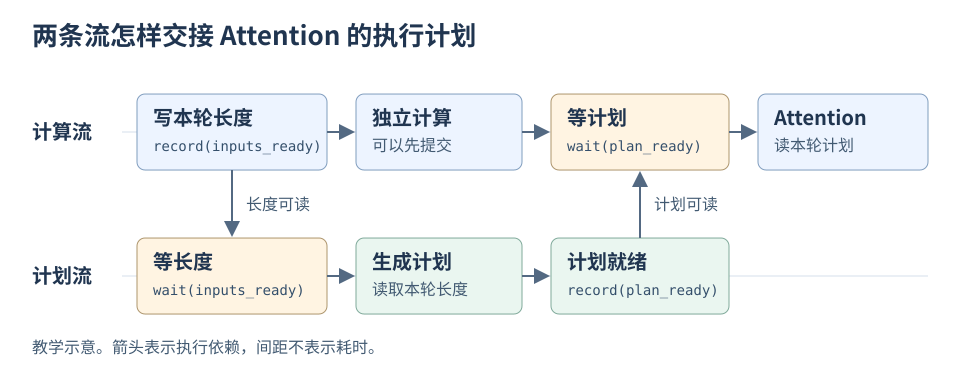
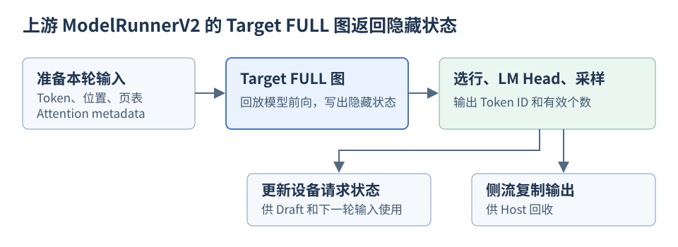
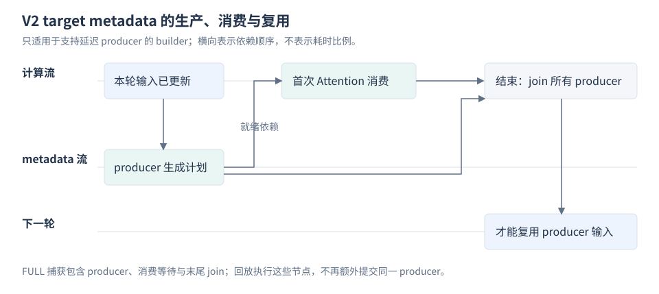
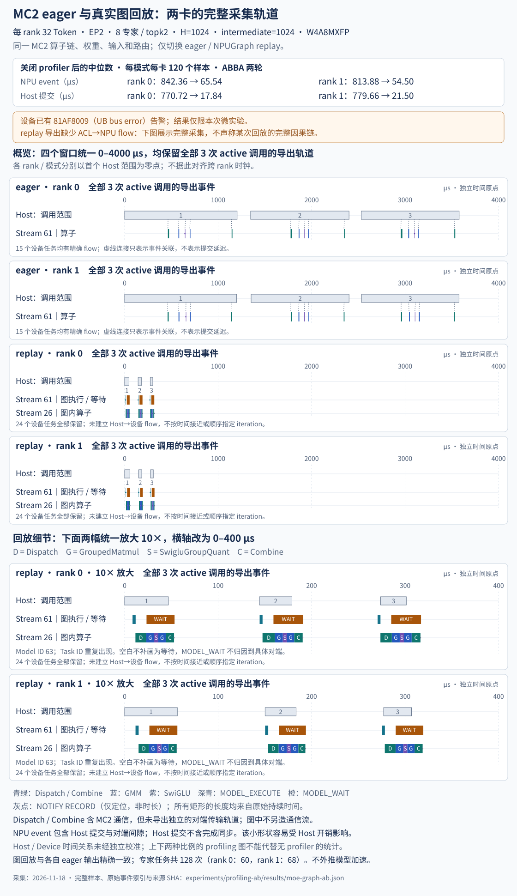

# 图模式：捕获、回放与异步执行

同一条 Decode 请求，上一轮读了 128 个位置的 KV，这一轮要读 129 个。如果模型每次只输入一行，为什么还能回放同一张图？图在捕获时记住了前向要提交的设备工作和使用的缓冲区地址。运行时，Runner 可以更新地址里的 Token 和长度，再把这一轮交给已经捕获的图。

这里从单卡普通 Decode 出发，沿 ModelRunnerV2 追到 LM Head、采样、异步调度和跨流等待，再进入投机验证与 P/D 分离。CUDA、Ascend 的档位算例取 2026-11-25 核查的公开主线源码。设备结果沿用站内已有的 A5 算子微实验，其他数字按源码或教学条件推算。

## 一张图捕获了什么？

在 eager 前向里，Host 逐次提交算子。用 CUDA Graph 时，框架先以占位批次预热，再捕获某个形状下的设备操作及依赖。以普通 PyTorch stream capture 为例，捕获期走过的 Python 分支已经决定了哪些操作进入图，回放直接执行设备节点。输入缓冲区地址保持可用，里面的值可以逐轮更新。图回放减少 Host 逐算子提交，仍需执行 Attention、矩阵乘与通信。[PyTorch CUDA Graph 语义](https://docs.pytorch.org/docs/stable/notes/cuda.html#cuda-graphs) · [NVIDIA 图与流捕获](https://docs.nvidia.com/cuda/cuda-programming-guide/04-special-topics/cuda-graphs.html)

设两个请求各有一个输入 Token，图捕获了两行输入。第二次回放仍用两行缓冲区。第一行换成新 Token，请求的 KV 长度从 128 涨到 129。图中算子可以从同一个地址读取新的长度，按后端支持的方式处理这段历史。如果变化要求不同的算子序列、超出工作空间或改变捕获接口的形状，Runner 就要寻找兼容的图或换执行路径。更多档位可以减少补齐，也会增加启动时要捕获的图数。实际显存占用还取决于图池能否复用以及算子的工作空间。[vLLM 的图档位与支持条件](https://docs.vllm.ai/en/latest/design/cuda_graphs/)

<!-- DETAILS: 跟一次预热、捕获和运行时回放 -->

上游 V2 的 `CudaGraphManager._init_candidates()` 生成 `BatchExecutionDescriptor`。完整 Decode 图的描述符含模式、请求槽数、总 Token 行数和统一的单请求 Query 宽度。该方法也会按配置生成混合批次的候选图。[描述符生成](https://github.com/vllm-project/vllm/blob/0772d298/vllm/v1/worker/gpu/cudagraph_utils.py#L290-L389)

`capture()` 为描述符准备占位输入，用 `NONE` 做 warmup，再为 FULL 档位建立 `torch.cuda.CUDAGraph()`。在 `torch.cuda.graph(...)` 内调用前向，把图按描述符保存。运行时 `dispatch()` 找到兼容描述符，Runner 更新输入，`run_fullgraph()` 调用对应图的 `replay()`。Ascend 的 V2 `ModelAclGraphManager` 继承上游管理器，用 ACLGraph/`torch.npu.NPUGraph` 执行，并按实际 Attention 后端处理回放参数。[CUDA 捕获](https://github.com/vllm-project/vllm/blob/0772d298/vllm/v1/worker/gpu/cudagraph_utils.py#L474-L551) · [CUDA 派发和回放](https://github.com/vllm-project/vllm/blob/0772d298/vllm/v1/worker/gpu/cudagraph_utils.py#L561-L620) · [Ascend 图管理器](https://github.com/vllm-project/vllm-ascend/blob/66f6ef21/vllm_ascend/worker/v2/aclgraph_utils.py#L84-L154) · [Ascend 图模式](https://github.com/vllm-project/vllm-ascend/blob/66f6ef21/docs/source/user_guide/feature_guide/graph_mode.md#L14-L46)

<!-- /DETAILS -->

<!-- DETAILS: 用同一个输入地址回放两次 -->

下面用逐元素加一代替模型前向。先用侧流预热，再捕获固定的两行输入，最后在原地址分别写入 3 和 5。示例按 PyTorch CUDA Graph 的用法写成，输出是手算期望值。

```python
import torch

static_input = torch.ones(2, device="cuda")
main = torch.cuda.current_stream()
warmup = torch.cuda.Stream()
warmup.wait_stream(main)
with torch.cuda.stream(warmup):
    for _ in range(3):
        static_output = static_input + 1
main.wait_stream(warmup)

graph = torch.cuda.CUDAGraph()
with torch.cuda.graph(graph):
    static_output = static_input + 1

for value in (3, 5):
    static_input.fill_(value)
    graph.replay()
    print(static_output.tolist())  # [4.0, 4.0]，随后 [6.0, 6.0]
```

`fill_()` 修改捕获地址里的两行输入。`replay()` 每次把结果写到同一个输出缓冲区，示例在回放后读回结果。如果后续消费者要跨流继续读取这份输出，下一次回放前要保护它的读取时间；如果要让输出保留更久，可以先复制到另一块缓冲区。模型 Runner 也要遵守同样的缓冲生命周期。[PyTorch 回放示例](https://docs.pytorch.org/docs/stable/notes/cuda.html#whole-network-capture)

<!-- /DETAILS -->

## 一条流和两条流分别怎样排队？


流（stream）是设备工作队列。同一条流里的算子按提交顺序执行。Host 提交一个算子就可以接着提交下一个。不同流可以提交独立工作，实际是否重叠还取决于数据是否就绪、设备资源和调度。

假设计算流先写长度，侧流根据长度生成计划，计算流中的 Attention 随后读计划。两条流之间需要两次交接。`inputs_ready.record(compute_stream)` 把标记排在长度写入之后。`plan_stream.wait_event(inputs_ready)` 让侧流后续任务等该标记。生成计划后，侧流再记录 `plan_ready`，计算流到要用 Attention 时才等它。计算流中排在等待之前、且独立于计划的工作可以继续推进。[PyTorch Stream 接口](https://docs.pytorch.org/docs/main/generated/torch.cuda.Stream_class.html) · [PyTorch Event 接口](https://docs.pytorch.org/docs/stable/generated/torch.cuda.streams.Event.html)



<!-- DETAILS: 用流和事件写出这两条依赖 -->

下面只示意提交顺序。`update_lengths()`、`build_plan()`、`run_attention()` 代表在当前流上提交设备工作。

```python
compute = torch.cuda.current_stream()
planner = torch.cuda.Stream()
inputs_ready = torch.cuda.Event()
plan_ready = torch.cuda.Event()

update_lengths()
inputs_ready.record(compute)
with torch.cuda.stream(planner):
    planner.wait_event(inputs_ready)
    build_plan()
    plan_ready.record(planner)

compute.wait_event(plan_ready)
run_attention()
```

长度写入排在第一个 record 前，Attention 排在第二个 wait 后。第一次 wait 可以由同流执行省掉，前提是计划生成也排在长度写入之后。第二次 wait 前还能放不消费计划的计算。若两个执行分支共用同一个计划缓冲区，还要确保上一轮 Attention 已读完，再开始下一次写入。

<!-- /DETAILS -->

| 调用 | 谁等谁 |
| --- | --- |
| `event.record(producer_stream)` | 事件在生产者流先前的工作完成后到达 |
| `consumer_stream.wait_event(event)` | 消费者流中排在等待之后的工作等该事件，Host 可继续提交 |
| `event.synchronize()` | 当前 Host 线程等该事件到达，再读取结果或继续提交 |
| `stream.synchronize()` / `torch.cuda.synchronize()` | Host 分别等待指定流或指定设备的工作完成 |

同一次 CUDA 捕获可以通过事件把侧流接进图。结束捕获前，加入的侧流需要汇回发起流。这样，图内保留从生产者到消费者的依赖，也有明确的结束边界。如果要在这段捕获中等待设备并在 CPU 上读取结果，就得把这次读取放在捕获边界外。内存还有一条约束，例如 `Tensor.record_stream()` 可告诉 PyTorch 分配器该张量仍被侧流使用。计算次序由流顺序和事件负责。[多流捕获的分叉和汇合](https://docs.nvidia.com/cuda/cuda-programming-guide/04-special-topics/cuda-graphs.html#cross-stream-dependencies-and-events) · [PyTorch CUDA 流与内存生命周期](https://docs.pytorch.org/docs/stable/notes/cuda.html#cuda-streams)

## FULL 图在哪里结束，LM Head 和采样在哪里做？

从常规文本生成的 ModelRunnerV2 看，Runner 在 `execute_model()` 准备输入、页表、写槽和 Attention metadata。匹配 FULL 图时，它回放模型前向，得到隐藏状态。后续 `sample_tokens()` 用选出的隐藏状态行做词表投影（LM Head），应用需要的掩码，再调用常规采样器或投机拒绝采样器。因此，**在这条 Target 路径上，LM Head 和采样位于 Target 前向图之后**。Ascend 的 V2 LM Head TP 分支也在 `sample()` 中选行、计算 logits，再采样。图外的投影和采样仍可由设备执行。[上游准备 Attention](https://github.com/vllm-project/vllm/blob/0772d298/vllm/v1/worker/gpu/model_runner.py#L2069-L2091) · [上游 FULL 回放](https://github.com/vllm-project/vllm/blob/0772d298/vllm/v1/worker/gpu/model_runner.py#L2171-L2182) · [上游词表投影与采样](https://github.com/vllm-project/vllm/blob/0772d298/vllm/v1/worker/gpu/model_runner.py#L1739-L1819) · [Ascend LM Head TP 与采样](https://github.com/vllm-project/vllm-ascend/blob/66f6ef21/vllm_ascend/worker/v2/model_runner.py#L1240-L1306)



FULL 的范围要跟到 capture 回调。若采样过程也适合捕获，图可以覆盖它需要的投影、随机数和设备操作。比如上游 DSpark 的 FULL Draft 路径把块前向和从左到右的采样放进同一个草稿调用。PyTorch 支持图中的 CUDA 随机数操作，并提供适用于图的生成器状态接口。如果运行时需要把设备结果交给 Python 决定下一步，或需要改变捕获的算子形状，就要重新确定捕获边界。[DSpark FULL 草稿实现](https://github.com/vllm-project/vllm/blob/c410543d/vllm/v1/worker/gpu/spec_decode/dspark/speculator.py#L1-L26) · [PyTorch 捕获约束与随机数](https://docs.pytorch.org/docs/stable/notes/cuda.html#constraints)

## 异步调度能提前走到哪里？

跟上游 V2 的同一轮采样。采样刚完成，Runner 建立 `AsyncOutput`。复制流先等主流完成采样，再复制 Token ID 和有效个数，并记录复制完成事件。主流接着更新设备上的请求进度和最后采样 Token，再按需调用 Draft。Host 真正回收输出时，`get_output()` 才等待复制事件，按有效个数裁掉尾部。这让输出复制有机会与状态更新、下一组候选提议重叠。[状态更新与提议顺序](https://github.com/vllm-project/vllm/blob/0772d298/vllm/v1/worker/gpu/model_runner.py#L2373-L2448) · [复制流和 Host 回收](https://github.com/vllm-project/vllm/blob/0772d298/vllm/v1/worker/gpu/async_utils.py#L117-L207)

`EngineCore.step_with_batch_queue()` 可以在队列还有容量时先提交后续批次，异步 Scheduler 用 `num_output_placeholders` 等字段记住尚未回收的输出。以第四章的请求 R 为例，Host 可以先按调度上界安排工作，设备仍按顺序完成本轮验证，把准确的有效 KV 长度改成 11，下一轮的输入内核才能从 `x@11` 开始。**异步调度重叠的是 Host 准备和设备执行。** 对同一条请求，本轮采样结果仍是下一轮的输入依赖。图回放则减少某段前向的 Host 提交工作，两种机制可以同时开启。[异步批队列](https://github.com/vllm-project/vllm/blob/0772d298/vllm/v1/engine/core.py#L746-L842) · [异步调度占位](https://github.com/vllm-project/vllm/blob/0772d298/vllm/v1/core/sched/async_scheduler.py#L18-L51) · [R 的有效 KV 起点](../dist/speculation.html#speculation-5)

有两处 Host 等待容易混在一起。输出复制供引擎回收结果，通常可以留到回收时再等。某些 Ascend Attention 路径还要求 Host 上的精确 KV 长度，这时下一轮准备 metadata 前会等进度复制。前者可以和候选提议重叠，后者可能卡住下一轮设备提交。Trace 上要找对应的生产者、复制事件和消费者。见[精确长度与 tiling 的三条路径](#graph-metadata-tiling)。

## 引擎怎样从批次挑一张图？

先分清配置策略和本轮实际模式。下表描述所查 vLLM 策略。Attention 后端能力、模型和并行配置决定能捕获和回放的组合，运行时可以从请求批次退回 eager。[图模式和能力分级](https://docs.vllm.ai/en/latest/design/cuda_graphs/) · [模型和后端检查](https://github.com/vllm-project/vllm/blob/c410543d/vllm/config/compilation.py#L1536-L1645)

| 配置 | 捕获与执行范围 |
| --- | --- |
| `NONE` | eager 设备提交 |
| `PIECEWISE` | 捕获可用的子段，其余算子按 eager 路径提交，常见边界是 Attention |
| `FULL` | 在后端支持时，为非等宽批次捕获整图，兼容容量的 Decode 批次也能复用 |
| `FULL_DECODE_ONLY` | 为兼容的 Decode 批次捕获整图，普通 Prefill、混部和无匹配图的批次走 eager |
| `FULL_AND_PIECEWISE` | 为兼容 Decode 捕获整图，为其他能执行的批次保留分段图 |

编译和捕获各有入口。编译可以融合或改写算子，捕获记录调用哪些设备工作。只看本轮的图模式 `NONE`，能确认本轮没有回放，是否仍走编译代码要看编译配置。显式 `--enforce-eager` 的路径会关闭常规编译与图捕获。[上游 eager 配置处理](https://github.com/vllm-project/vllm/blob/0772d298/vllm/config/vllm.py#L1874-L1899)

普通 Decode 的单请求 Query 宽度是 1。投机验证如果每条请求都排进三个候选，Target 用 `1+3=4` 行，仍可构成等宽 Decode 批次。Manager 先按 Query 宽度找兼容图，再挑装得下这批请求的最小档位。单个请求的 KV 历史长度可以不同，算子靠本轮 metadata 得到历史边界。[Decode 图的匹配条件](https://github.com/vllm-project/vllm/blob/0772d298/vllm/v1/worker/gpu/cudagraph_utils.py#L115-L142) · [档位派发](https://github.com/vllm-project/vllm/blob/0772d298/vllm/v1/worker/gpu/cudagraph_utils.py#L561-L605)

### P 固定 eager，D 的档位怎样自动产生？

取 P/D 分离的一组教学条件。P 用 eager 做 prompt 前向。D 用 `FULL_DECODE_ONLY`，保持默认档位，取 DSpark、固定 `K=3`、`max_num_seqs=256`、每批 Token 预算 2048、balanced 性能模式、单 DP，关闭自适应验证，并假定后端支持四行验证图。P 的 KV 先按连接器的就绪条件交给 D，D 随后按自己的批次选图。D 接手请求时可能还有 prompt 尾行要算，这一轮是否能进图由实际 Query 和后端资格共同判断。下面取已进入稳态、每条请求都有三个已排入候选的 Target 批次。[Ascend P/D 交接](https://docs.vllm.ai/projects/ascend/en/latest/developer_guide/Design_Documents/disaggregated_prefill.html) · [V2 对接手尾行的判定](https://github.com/vllm-project/vllm/blob/c410543d/vllm/v1/worker/gpu/model_runner.py#L1427-L1479)

在所查 Ascend 路径，平台先给出容量 `min(256×4, 512)=512`。默认 Token 候选为 `1, 2, 4, 8, 16, 24, …, 248, 256, 272, …, 512`。按每请求四行换算，用向上取整、去重及容量约束得到 FULL 验证图的请求槽 `1, 2, 4, 6, 8, …, 62, 64, 68, …, 128`。图容量是请求槽乘四。H100 在这组条件下也落在 512 行。当前上游 CUDA 主线在 B200 所属的 SM100 路径使用单独的 Decode 请求档位，包含 5 槽，并可覆盖到本算例的 256 条请求。[Ascend 默认上限](https://github.com/vllm-project/vllm-ascend/blob/66f6ef21/vllm_ascend/platform.py#L2151-L2196) · [Ascend 配套上游折算](https://github.com/vllm-project/vllm/blob/c410543d/vllm/config/vllm.py#L2668-L2712) · [CUDA 平台默认值](https://github.com/vllm-project/vllm/blob/0772d298/vllm/platforms/cuda.py#L640-L652) · [CUDA 请求档位解析](https://github.com/vllm-project/vllm/blob/0772d298/vllm/config/vllm.py#L2835-L2884) · [请求档位步长](https://github.com/vllm-project/vllm/blob/0772d298/vllm/config/compilation.py#L122-L125)

| D 本轮真实请求 | 真实 Query 行 | Ascend 图 | CUDA H100 图 | CUDA B200 图 |
| --- | --- | --- | --- | --- |
| 5 | 20 | 6 槽，24 行 | 6 槽，24 行 | 5 槽，20 行 |
| 7 | 28 | 8 槽，32 行 | 8 槽，32 行 | 8 槽，32 行 |
| 129 | 516 | eager | eager | 144 槽，576 行 |
| 本例最大档位 | 按每请求 4 行 | 128 槽，512 行 | 128 槽，512 行 | 256 槽，1024 行 |

表中是配置规则与匹配条件的推算。模型、Draft 方法、预算、并行或手工上限改变时，实际捕获集合可能跟着变。以这组 Ascend 的 5 条请求为例，FIA 的等宽分支把原边界 `[0,4,8,12,16,20]` 补成 `[0,4,8,12,16,20,24]`。第六槽供图占位，真实行仍是 20。页表、长度、写槽、有效行掩码和采样索引都要符合各自消费者的形状。[第四章算出的有效位置与输出](../dist/speculation.html#speculation-5) · [Ascend 的等宽图边界补齐](https://github.com/vllm-project/vllm-ascend/blob/66f6ef21/vllm_ascend/worker/v2/model_runner.py#L1571-L1624)

如果有的请求只排进一个候选，单请求 Query 便可能变成 2 行。这时要查看当前后端有没有匹配的 Decode 图。上游也为支持自适应验证的后端提供有 Query 上界的变长 Decode 图。它使用固定 Token 容量，实际边界随本轮输入变化。Ascend 的 FIA 自适应路径在设备重新分配部分候选预算时仍会回读 Query 边界，该分支还会回读精确长度。[上游变长图描述符](https://github.com/vllm-project/vllm/blob/0772d298/vllm/v1/worker/gpu/cudagraph_utils.py#L306-L356) · [Ascend 的部分预算边界回读](https://github.com/vllm-project/vllm-ascend/blob/66f6ef21/vllm_ascend/worker/v2/model_runner.py#L1673-L1684) · [FIA 精确长度回读](https://github.com/vllm-project/vllm-ascend/blob/66f6ef21/vllm_ascend/worker/v2/model_runner.py#L1098-L1110)

<a id="target-draft-graphs"></a>

## 一次投机迭代会回放哪几张图？

沿用第四章的 R。Target 刚接受 d1、d2 并采出 `x@11`，有效 KV 长度是 11。Draft 以这个结果提新候选，下一次 Target 验证它们。`K=3` 的不同提议法使用的图形状可以不同，图容量还要乘当轮选中的请求槽数。

| 执行段 | 单请求的实际布局 | 图怎样接续 |
| --- | --- | --- |
| DSpark 的块提议 | `sample_from_anchor=True` 时，x 加两个占位，3 行 | Draft 用自己的块提议图。上游 FULL 路径可覆盖块前向和逐位置采样。 |
| MTP 的首个提议步 | 沿用上一轮的 4 行布局，从最后一条有效行采 e1 | 首个草稿前向由自己的管理器选图，满足条件时可以复用 Target 的部分 metadata。源码称此步为 draft prefill。 |
| MTP 后续提议步 | 提 e2、e3 时，每步每请求 1 行 | 有独立的单行图档位。可捕获一个单步，支持设备 metadata 更新的路径还能捕获多步循环。 |
| 下一轮 Target 验证 | 三个候选都被调度时，`[x,e1,e2,e3]` 占 4 行 | Target 按本轮批次选择验证图。上一轮的有效 KV 长度决定起点。 |

第四章保留了每一行的 Token、位置和采样关系。实际执行要分别核对 Target 和 Draft 的后端。例如 D 的 Target 可以跑 FULL，DSpark 的嵌套 `enforce_eager` 仍可让 Draft 走 eager。记录吞吐和接受率时，同时记录两边实际模式。[第四章的提议输入](../dist/speculation.html#speculation-5) · [DSpark 的 FULL 草稿图](https://github.com/vllm-project/vllm/blob/c410543d/vllm/v1/worker/gpu/spec_decode/dspark/speculator.py#L2-L24) · [MTP 首步派发与回放](https://github.com/vllm-project/vllm/blob/c410543d/vllm/v1/worker/gpu/spec_decode/target_dependent_ar/speculator.py#L171-L216) · [单行和多步草稿捕获](https://github.com/vllm-project/vllm/blob/c410543d/vllm/v1/worker/gpu/spec_decode/autoregressive/speculator.py#L107-L149) · [Ascend Draft 的 eager 开关](https://github.com/vllm-project/vllm-ascend/blob/66f6ef21/vllm_ascend/worker/v2/spec_decode/dspark/speculator.py#L145-L153)

<a id="graph-padding-cases"></a>

### 生产案例 · Q 段、KV 行与 LM Head 容量怎样对齐？

在 A5 的一条 DSpark 复现中，服务能启动，前几个批次也能出结果。出错的那一轮，3 条真实请求落进了 4 个请求槽的 Draft FULL 图。Attention builder 为 Q 尾部补齐额外生成了一条记录。草稿随后把 Q 的段尾位置改为 `[5,10,15,20]`，KV 长度列表和块表却各留了 5 条记录。FIA 接到 4 段 Q 和 5 份 KV 元数据，报形状错误。已合入的修复在 Draft 重写 Q 边界时，也把对应的 KV 长度和块表裁到 4 条。PR 作者在 A5 回归了 DSpark 与 DFlash，并在 DFlash2 上复现了原错误。DFlash2 继承了 DFlash 修复，作者未报告该方法修复后的端到端结果。[Draft Attention 的形状复现与修复](https://github.com/vllm-project/vllm-ascend/pull/22156)

Target 图里的补齐行如果被当成真实 Token，会产生额外的专家任务。Kimi-K3 的一组记录里，相同的填充输入被派给相同的专家，拖长了对应 rank 的计算和其他 rank 的 Combine 等待。主线修复让 Target Runner 在回放前更新 `is_padding`。在启用 `VLLM_MOE_SKIP_PADDING`、未启用 PCP 分片且能取得该掩码的正常请求路径里，MC2 和 Fused-MC2 用它过滤补齐行。DFlash／DSpark 也要刷新自己那份掩码。修复过程中的回归日志显示，如果 Draft 仍读到捕获时全为 `True` 的掩码，它会连真实草稿行一起跳过，DeepSeek-V4 DSpark 的接受率随之下降。[Target 与 Draft 的掩码修复及回归记录](https://github.com/vllm-project/vllm-ascend/pull/20242)

**MTP Draft 的 LM Head 容量。** 当 Target FULL 图在空 DP rank 上补出更多请求槽时，草稿前向仍要保持图要求的输入容量。LM Head 的 TP 采样容量则取 DP 同步后的请求计数。如果前向补到 6 个槽，采样容量是 5，把 6 都交给 LM Head 就会越过容量。已合入的实现对这条运行时 dummy 路径用 `min(num_reqs, pad_size)` 限制采样和结果写回。补齐后的前向行数、Attention metadata 和图捕获的请求槽数沿用原值。回归测试用 6 个槽、24 行前向和容量 5 检查了这个边界。[MTP Draft LM Head 容量修复与测试](https://github.com/vllm-project/vllm-ascend/pull/22231)

<a id="graph-metadata-tiling"></a>

## 同一档位回放时，Attention 的计划怎样更新？

第二章解释了 tiling 怎样划分 Attention 的工作。换到图回放，问题变成：谁拿本轮的长度生成计划，计划写在哪里，图中的首个消费者什么时候可以读？沿 DSpark 的算例，三个草稿输入行的设备边界是 `[0,3]`，草稿 KV 长度是 `[14]`。Target 下一轮若仍验证三个候选，它使用的则是四行和长度 15。两个后端可能分别需要准备计划。[请求 metadata 与 tiling 的关系](../dist/execution.html#execution-5) · [DSpark 的长度 14 怎样算出](../dist/speculation.html#speculation-5)

| 路径 | 数据和计划的交接 |
| --- | --- |
| Host 要求精确长度 | 设备完成采样与进度修正，侧流复制进度。Runner 在需要 CPU 长度镜像时等复制事件，再生成长度列表。 |
| 设备生成计划，回放前提交 | Builder 把设备长度和边界交给设备计划算子。计划写进图会读取的稳定缓冲区，Attention 等当轮写入完成。 |
| 设备生成计划，任务捕获进 FULL 图 | 回放前刷新持久输入。回放执行已捕获的计划生成与等待节点，Attention 等相关计划就绪，轮末保护输入与计划缓冲的复用。 |

<a id="fa3-plan-replay"></a>

### FA3 回放时，4132 与 tiling 计划各由谁写？

做两次同形状的草稿调用。两次都只有 A、两行 query，边界都是 `[0,2]`，输入沿用同一组设备缓冲。第一次草稿开始前有 4130 个有效 KV 位置，本次长度是 `4130+2=4132`。如果另一次验证多拒绝一个候选，其他长度条件相同，草稿开始前只有 4129 个位置，本次长度就变成 `4129+2=4131`。两次可以匹配同一个图档位，Attention 却需要各自的长度和计划。

在这个 FA3 算例中，每页可放 128 个位置。两次都跨过 `32×128=4096`，都需要第 33 张页。第一页从位置 0 算起时，这张页的起点是 4096；两次尾页分别有 36 和 35 个有效位置。假定页表也沿用原分配，块号和缓冲区地址都能一样，**页表只告诉算子第 33 张页在哪，有效长度才告诉它尾页能读到哪**。这解释了为什么图可以复用，精确长度和计划仍要按轮准备。[FA3 页大小](https://github.com/vllm-project/vllm-ascend/blob/913f9d79f/vllm_ascend/attention/flash_attention_v3.py#L49-L60)

1. **Runner 和草稿输入准备写长度。** Python builder 用现成的 CPU query 边界识别活跃请求数，再对设备的 `seq_lens`、query 边界和页表取视图。Python 在这里知道有一条请求、两行 query，精确 KV 长度继续留在设备张量里。[活跃请求与设备视图](https://github.com/vllm-project/vllm-ascend/blob/913f9d79f/vllm_ascend/attention/flash_attention_v3.py#L210-L240)
2. **Builder 在模型图外生成当轮计划。** `get_scheduler_metadata(cache_seqlens=seq_lens, cu_seqlens_q=query_start_loc, ...)` 提交 AICPU 计划生成。对可捕获形状，计划缓冲按三个输入缓冲的地址、Token 档位、单请求 query 上界、是否 causal 和层算子规格区分。第一次预留容量，沿用缓冲时先校验容量，再 `buffer.resize_(tiling.shape).copy_(tiling)`。因此两次即使指向同一个计划地址，也会把各自长度对应的计划写到那里。源码并未承诺两个相邻长度一定生成不同字节的计划。[缓存键、计划生成与写回](https://github.com/vllm-project/vllm-ascend/blob/913f9d79f/vllm_ascend/attention/flash_attention_v3.py#L241-L289)
3. **Attention 读取当轮输入。** `flash_attn_with_kvcache()` 同时消费设备长度、页表、query 边界和该层规格对应的计划。图内读取前，设备要完成计划生成与写回。回看 Trace 时，先区分同流顺序与跨流事件，再判断设备侧有多少等待。[Attention 的实参](https://github.com/vllm-project/vllm-ascend/blob/913f9d79f/vllm_ascend/attention/flash_attention_v3.py#L449-L463)

普通需要精确 Host 长度的分支，上一轮从侧流复制 `num_computed_tokens`，下一轮 `_update_seq_lens_cpu()` 在使用它前等待 `num_computed_tokens_event`。跳过条件成立时，这对复制和 Host 等待可以省下。仅凭某一层选用 FA3，仍要检查 Runner 的跳过条件和整组 Target／Draft 的后端。把普通 FIA 与 FA3 的 Trace 放在一起可以解释数据依赖，两种不同算子的整轮差值还包括算子本身的变化。[Runner 的后端判断](https://github.com/vllm-project/vllm-ascend/blob/913f9d79f/vllm_ascend/worker/v2/model_runner.py#L1360-L1377) · [进度复制与下一轮等待](https://github.com/vllm-project/vllm-ascend/blob/913f9d79f/vllm_ascend/worker/v2/model_runner.py#L1503-L1550)

拿同一批次标识去 Trace 里找两条链：一条从上轮采样后的进度 D2H 找到下一轮 Host 等待及前向提交，另一条从设备写长度找到 AICPU 计划生成、计划缓冲写回、图回放中的首个消费者。把 eager 和 replay 分开看，核对同档位及真实行数。若有能保持同一后端和同一输出的开关，才用它测回读依赖移除前后的整轮变化。如果只能换后端，分别报告两条链和整轮差异。这里的 4132 与 4131 用于核对生产者、地址和消费者，仍待用同条件设备 Trace 找到这些事件。

[回看普通 FIA 的 Host 长度从哪里来](../dist/execution.html#fia-host-length) · [核对三个带 Flash Attention 名称的 Ascend 后端](../dist/model-layers.html#ascend-fa-variants)

### Draft 后端是否也要精确 Host 长度？

继续追踪 DSpark 的长度 14。取 950DT 上 GLM 稀疏目标模型搭配 Qwen3 GQA 草稿，草稿查询用 FP16/BF16、KV 未量化，且头维度和其他条件满足选择规则时，草稿层可以使用 CANN FlashAttn。它的 metadata builder 直接取 NPU 上的 query 边界和序列长度。本例向 `flash_attn_metadata` 传入 [0, 3]、[14] 及布局、掩码等参数。它返回本次计算的 tiling 计划，随后 `flash_attn` 用该计划和块表读取 KV。同一草稿步、同一 Attention 组内，头数、头维度、窗口、布局与因果属性都相同的层可以复用这份计划。[后端选择条件](https://github.com/vllm-project/vllm-ascend/blob/92b6354a/vllm_ascend/platform.py#L1771-L1829) · [设备上的边界、长度与块表](https://github.com/vllm-project/vllm-ascend/blob/92b6354a/vllm_ascend/attention/fa_v1.py#L20-L51) · [计划怎样生成、复用并交给 Attention](https://github.com/vllm-project/vllm-ascend/blob/92b6354a/vllm_ascend/attention/fa_v1.py#L102-L154)

把这次调用按源码里的参数名展开，最容易看出两个算子各读什么。下面只保留单请求、无填充情形的相关字段，省略其余参数：

```text
cu_seqlens_q = [0, 3]              # NPU 上的 query 边界
seqused_kv   = [14]                # 草稿步的 KV 长度
plan = flash_attn_metadata(..., cu_seqlens_q=..., seqused_kv=..., ...)
flash_attn(query, key_cache, value_cache, block_table=..., metadata=plan, ...)
```

换成 GLM 的 MLA 草稿，在 DCP=1 且使用普通 FIA 时，FIA 需要精确的 Host 长度。草稿 builder 会把活动请求的 `input_buffers.seq_lens` 复制到 CPU。如果所有 MLA 草稿组都选中了外部 FlashMLA，这个辅助函数跳过该次回读，Attention 接口消费已生成的 `flash.schedule`。[DSpark 的 MLA 分支](https://github.com/vllm-project/vllm-ascend/blob/92b6354a/vllm_ascend/worker/v2/spec_decode/dspark/speculator.py#L251-L294) · [FlashMLA 消费 schedule](https://github.com/vllm-project/vllm-ascend/blob/92b6354a/vllm_ascend/attention/mla_v1.py#L3028-L3043)

Runner 还有另一处复制：采样修正进度后，侧流把每个请求已计算的 token 数传到 CPU，下一轮 Host 等待该事件，再加本轮调度行数。前一处复制的是草稿 Attention 要读的长度，后一处维护跨轮进度镜像。对于上述 GLM + GQA 组合，所有草稿层均使用 FlashAttn，且 PP、PCP、DCP 均为 1、关闭稀疏 KV 卸载和自适应验证等条件成立时，Runner 可以跳过这次进度复制及对应等待。能否缩短整轮时间，还需要在同一模型、负载和并行配置下采样验证。[FIA 草稿读取精确长度](https://github.com/vllm-project/vllm-ascend/blob/92b6354a/vllm_ascend/worker/v2/spec_decode/dspark/speculator.py#L276-L296) · [检查已初始化的草稿后端](https://github.com/vllm-project/vllm-ascend/blob/92b6354a/vllm_ascend/worker/v2/model_runner.py#L1398-L1428) · [进度快照的生产者与消费者](https://github.com/vllm-project/vllm-ascend/blob/92b6354a/vllm_ascend/worker/v2/model_runner.py#L1469-L1516)

### FlashMLA 怎样刷新固定计划缓冲？

FlashMLA 初始化时先确定计划需要多大空间，再分配设备内存。这时只准备了存放计划的位置，还没有算出本轮计划。每轮运行前，代码更新精确长度和 query 边界，重新生成计划，再写入同一块缓冲。[FlashMLA 的缓冲分配与逐轮更新](https://github.com/vllm-project/vllm-ascend/blob/f9c8e0bd/vllm_ascend/attention/flashmla.py#L335-L461)

<!-- DETAILS: 源码对照：FlashMLA 怎样更新同一块计划缓冲 -->

初始化通过 Meta device 查询 schedule 所需容量，再分配真实设备 buffer。每轮 refresh 更新精确长度、query 边界等输入，然后执行：

```python
flash.schedule.copy_(
    flash.adapter.build_metadata(flash.cache_lens, flash.cu, flash.used_q)
)
```

这段 refresh 在哪条流执行，要按该后端的实际调用检查。框架中有 metadata 侧流，并不说明所有后端都已把计划生成与其他计算重叠起来。

<!-- /DETAILS -->

### 图内的 metadata 任务怎样和 Attention 汇合？

有些 V2 验证模型的后端允许稍后再启动 metadata 计算。普通 eager 执行时，准备好输入就提交任务；完整图捕获时，则把这些计算、Attention 使用结果前的等待，以及结束前的等待一起放进图。之后每次回放先更新输入，再由图运行这些任务，CPU 不再重复提交同一份 metadata 计算。[V2 metadata 任务的捕获与回放](https://github.com/vllm-project/vllm-ascend/blob/f9c8e0bd/vllm_ascend/worker/device_metadata.py#L174-L252)

这套管理代码名为 `TargetDeviceMetadata`，适用于接入了它的 builder。它与上面的 FlashMLA 更新过程需要分别核对，不能把一条路径的执行方式套到所有后端。



图里有两处等待。第一处保证 Attention 拿到完整的本轮计划。第二处保证下一轮不会过早覆盖输入：上一轮的计划生成任务可能还在读取它，即使这一轮最终没有用到那份计划，也要等任务结束。

异步复制也有同样的要求。数据从 CPU 送往设备时，也就是 H2D，源内存必须保留到 DMA 读完。图回放省去了重新建立执行结构的工作，这些数据准备和内存复用的先后关系仍然要遵守。

## 哪些等待必须保留，怎么在 Trace 里找？

回看前面的两条设备流。用到数据前得先等它写完，覆盖同一片存储前得先等旧读者用完。这两个顺序在 eager、图回放和异步调度里都成立。实际等待时间有多长，要看生产者完成时，消费者是否已经走到了该处。跨 Rank 有另一个要求，参与同一组 collective 的 Rank 需要以相容的顺序提交。跨 DP 的图模式和档位协调，以及空 Rank 的参与规则，见[EP 篇的逐 Rank 算例](../dist/ep-communication.html#ep-communication-6)。P/D 则沿连接器看 D 的 KV 何时就绪，见 [PD 请求交接](../dist/pd-disaggregation.html#pd-disaggregation-3)。

| 应核对的依赖 | Trace 里怎样确认 |
| --- | --- |
| 本轮输入或 tiling 写完，Attention 才能读 | 用同一批次的 record / wait 或同流顺序，把产生长度、生成计划、Attention 串起来 |
| 上轮读者完成，这轮才能覆盖共用缓冲区 | 查两轮使用的地址及完成事件，包含拷贝流和计划生成流 |
| 结果回收或 Host metadata 需要设备上的值 | 查 D2H 的生产者、复制流完成事件、Host 首次访问的时间和实际等待 |
| 换图、回退或外部 KV 改变了 batch | 查选图前后描述符、真实行数、补齐行数和各 Rank 的实际执行模式 |

例如，上游 CUDA V2 在回放前调用 offloader 的 `sync_prev_onload()`。启用相关 offload 路径时，上一轮 eager 预取可能仍在复制，当前图捕获的内部事件并没有记录那次图外复制。这个衔接点保护回放时要复用的静态缓冲区。[CUDA V2 的回放入口](https://github.com/vllm-project/vllm/blob/0772d298/vllm/v1/worker/gpu/cudagraph_utils.py#L607-L620)

有些空档在设备流上，有些发生在 Host 还没提交回放时。先固定一轮的请求与输出范围，再把前向图、LM Head、采样、Draft、metadata、复制和通信分别打点。看到 Replay 时长变短，还要找到下一次提交和客户端下一次内容到达的时间。跨 Rank 的 Trace 若没有校准时钟，按各 Rank 独立起点对照。[站内的多 Rank Trace 对照口径](../dist/ep-communication.html#ep-communication-6)

### 已有设备对照能证实哪一段？

A5 双卡的 MC2 实验用同一组 W4A8MXFP 权重、输入和路由，对照 eager 与图回放。每 Rank 32 行，两种模式分别采 120 条无 profiler 样本，共 480 条。Rank 0 的 Host 提交中位数从 770.7 µs 到 17.8 µs，NPU event 区间中位数从 842.36 µs 到 65.54 µs。两边都检查了输出和专家计数。它覆盖指定的 MoE 算子链，端到端服务的 TTFT、ITL、TPOT 与吞吐仍需同条件实测。回放 Trace 还有 Host 与 Device 的 flow 导出缺口。[MC2 实测方法和结果](https://github.com/Tflowers-0129/inference-wiki/tree/main/experiments/profiling-ab#mc2-eager-与真实图回放)



如果要核对整模型，先固定模型、权重、后端、硬件、输入与上下文分布、并发、采样约束和候选策略。对照 eager 与目标图模式时，记录实际回放率和各档位的真实行数，验证输出或采样统计，再关 profiler 进行重复性能测量。随后打开 profiler 采同条件的前后 Trace，核对多 Rank 的计算、拷贝、通信和同步。若还要比较异步调度或 tiling 下沉，另做固定图策略的一组对照。整轮时延、吞吐和客户端指标各按自己的边界计算。[站内特性前后对照流程](https://github.com/Tflowers-0129/inference-wiki/tree/main/experiments#特性前后对照的固定流程)
