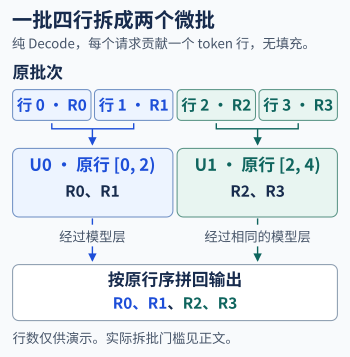
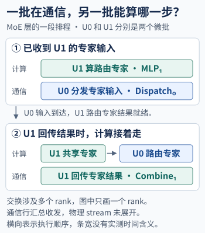

# 微批次流水：两批 MoE 工作怎样重叠

四条请求在同一轮 Decode。每条都要把一行激活送给选中的专家。如果四行一起发，专家要等这一次分发把输入送来。要是先发前两行，后两行能不能利用这段时间先做 Attention 和路由？Dual Batch Overlap（DBO）把一次前向分成两个小批，让一批的通信有机会和另一批的计算同时进行。

跟着这四行看两个时点。发起分发（Dispatch）后，另一批可以做已经准备好的计算。这一批的专家仍要等自己的输入到达，算好后再把结果送回原位（Combine）。[MoE 的 Dispatch 与 Combine](EP通信与通算融合.md) · [vLLM 的 DBO 设计](https://github.com/vllm-project/vllm/blob/5df63a72/docs/design/dbo.md#L3-L27)

## 四个 Decode 请求怎样拆成两批？

取上游 GPU ModelRunnerV2 的一轮纯 Decode。设有两个 DP rank，启用 EP 和 DBO，使用 DeepEP 的低延迟后端，按 eager 方式执行。固定 TP=1。两个 rank 本轮各有四个请求，每个请求只推进一个 token。下面只给其中一个 rank 的请求命名，按本轮输入行顺序排列为 R0、R1、R2、R3。另一个 rank 处理自己的四个请求。[GPU 配置示例](https://github.com/vllm-project/vllm/blob/5df63a72/docs/design/dbo.md#L30-L42) · [V2 微批入口](https://github.com/vllm-project/vllm/blob/5df63a72/vllm/v1/worker/gpu/model_runner.py#L1888-L1898)

调度器已经选好了本轮要跑的 token。第一章的 Chunked Prefill 把长提示分到多个调度轮次，这里的两份微批则在**同一轮前向**中处理已选好的行。

本例特意把纯 Decode 门槛调为 4（`--dbo-decode-token-threshold 4`）。该快照的默认值是 32。所有 rank 都允许拆批后，Runner 用组内最小的实际 token 数检查门槛，达到门槛就可以拆。两个 rank 都有四行，因此无须在 rank 之间补行。若一个 rank 只有三行，即使两边合计七行，本轮仍过不了门槛。[门槛默认值](https://github.com/vllm-project/vllm/blob/5df63a72/vllm/config/parallel.py#L257-L271) · [大于等于门槛的条件](https://github.com/vllm-project/vllm/blob/5df63a72/vllm/v1/worker/ubatch_utils.py#L140-L148) · [DP 组内协调](https://github.com/vllm-project/vllm/blob/5df63a72/vllm/v1/worker/gpu/dp_utils.py#L99-L138)

四个请求的 query 起点连同结束位置是 `[0,1,2,3,4]`。Runner 在第 2 行之前切开。微批 0 取全批的行区间 `[0,2)`，微批 1 取 `[2,4)`。后者用原来的起止数组片段 `[2,3,4]` 减去 2，本批的 query 边界便成为 `[0,1,2]`。所以两批都有“本批第 0 行”，一行属于 R0，另一行属于 R2。R2 在自己序列里的 token 位置沿用原 `positions`，只在微批缓冲区中排到了第 0 行。[按 token 切片](https://github.com/vllm-project/vllm/blob/5df63a72/vllm/v1/worker/ubatch_utils.py#L176-L206) · [请求映射与位置](https://github.com/vllm-project/vllm/blob/5df63a72/vllm/v1/worker/gpu/ubatch_utils.py#L163-L191) · [query 起点换算](https://github.com/vllm-project/vllm/blob/5df63a72/vllm/v1/worker/gpu/ubatch_utils.py#L202-L216)

Attention 还要知道去哪里读写历史。块表按请求取行，因此微批 1 得到 R2、R3 的块表。`slot_mappings` 按 token 取列，因此它同时得到这两个新 token 原定的 KV 写入位置。Runner 用切出的块表、写入位置和本批序列长度构建 Attention 元数据。这里每请求恰有一行。碰到一次调度多个 token 的 Prefill，切点还可能落在同一请求内部，此时两批各取属于自己的 query 行，前半批的可见序列长度也要截到切点。[每批 Attention 的入参](https://github.com/vllm-project/vllm/blob/5df63a72/vllm/v1/worker/gpu/ubatch_utils.py#L343-L385) · [跨过切点的请求](https://github.com/vllm-project/vllm/blob/5df63a72/vllm/v1/worker/gpu/ubatch_utils.py#L219-L238)

## 一批在通信时，另一批能做什么？

以低延迟 Dispatch 为例。微批 0 已经知道 R0、R1 各找哪些专家，先把它们的激活发出去。从发出数据到专家收到可用的输入，中间有一段等待。微批 0 暂停提交工作时，负责 R2、R3 的微批 1 可以接着提交自己的计算。

<!-- DETAILS: DeepEP 在哪里交出提交机会 -->

DeepEP 发起分发后，返回接收回调和本次分发的句柄。MoE 内核把回调登记到另一微批的上下文，再调用 `dbo_yield()`。当前 Host 线程让出提交机会，另一条 Host 线程被唤醒。[DeepEP 发起 Dispatch](https://github.com/vllm-project/vllm/blob/5df63a72/vllm/model_executor/layers/fused_moe/prepare_finalize/deepep_ll.py#L286-L322) · [登记回调并让出线程](https://github.com/vllm-project/vllm/blob/5df63a72/vllm/model_executor/layers/fused_moe/modular_kernel.py#L1210-L1247) · [Host 线程交接](https://github.com/vllm-project/vllm/blob/5df63a72/vllm/v1/worker/ubatching.py#L92-L103)

<!-- /DETAILS -->

图截取上游设计里相邻的两段。第一段开始前，微批 1 已经收到专家输入，所以微批 0 发起 Dispatch 后，设备能接着算微批 1 的专家 MLP。第二段开始前，微批 0 也收到了输入。此时微批 1 发起 Combine，计算侧可接着做微批 1 的共享专家以及微批 0 的专家 MLP。图中可以换批的那一刻，取决于另一批是否已有可执行的工作。[设计中的计算与通信顺序](https://github.com/vllm-project/vllm/blob/5df63a72/docs/design/dbo.md#L14-L27)

接收回调在约定的交接处运行。微批 0 恢复后取到本批的专家输入，才能计算专家 MLP。随后 Combine 把专家输出送回原 token 所在的 rank，按路由权重归并。两批同时有通信在途时，DeepEP 按微批编号保存 Dispatch 句柄，Combine 取回本批的句柄。因此即使两批选择了同一个专家，R0 的专家结果仍会回到 R0。Combine 也提供接收回调，给另一批的专家计算留下可重叠的区间。[回调归属](https://github.com/vllm-project/vllm/blob/5df63a72/vllm/v1/worker/ubatching.py#L184-L188) · [Combine 的句柄、路由与权重](https://github.com/vllm-project/vllm/blob/5df63a72/vllm/model_executor/layers/fused_moe/prepare_finalize/deepep_ll.py#L382-L406) · [Combine 交接点](https://github.com/vllm-project/vllm/blob/5df63a72/vllm/model_executor/layers/fused_moe/modular_kernel.py#L1390-L1422)

Combine 解决的是**一层之内**专家结果回到哪一行。到整个模型前向结束，Runner 还有一次按行拼接。它按微批编号保存输出，等两条线程结束，先取微批 0 的两行，再取微批 1 的两行。这样得到的 hidden states 仍按 R0、R1、R2、R3 排列。采样沿用全批的 `logits_indices`，每个原请求取回本轮应采样的行。[按微批编号合并](https://github.com/vllm-project/vllm/blob/5df63a72/vllm/v1/worker/gpu/ubatch_utils.py#L498-L527) · [按行拼接](https://github.com/vllm-project/vllm/blob/5df63a72/vllm/v1/worker/gpu/ubatch_utils.py#L263-L279) · [合并后的采样输入](https://github.com/vllm-project/vllm/blob/5df63a72/vllm/v1/worker/gpu/ubatch_utils.py#L89-L101)

**试一试。** R2 在微批 1 的第 0 行。即使微批 1 先算完，拼回全批后，R2 应该在第几行？如果按完成先后拼，会错在哪里？

<!-- DETAILS: 核对答案 -->

从 0 开始计数，R2 应该回到第 2 行。若把先算完的微批 1 放在最前面，第 0 行就成了 R2，采样时原本属于 R0 的位置会读到 R2 的结果。Runner 按微批编号拼回，保住了原来的请求顺序。

<!-- /DETAILS -->

## 怎样判断重叠带来了收益？

拆成微批后，这四行仍由各自选中的专家处理，但一次专家矩阵乘能一起处理的行数可能减少，每层还要分别为两个微批发起通信。另一批的计算如果在接收完成前就已做完，剩下的通信仍在本轮的关键路径上。比较两种配置时，可以先问两个问题。开 DBO 后，每次专家矩阵乘处理多少行？从第一批开始前向到两批输出都可采样，整个区间缩短了多少？[每微批的专家通信](https://github.com/vllm-project/vllm/blob/5df63a72/vllm/v1/worker/gpu/ubatch_utils.py#L395-L425)

### 同样四行，重叠 7 格，整轮为什么只少 5 格？

先算一层的教学例子。固定 R0–R3 的路由。设只有一条计算轨道和一条通信轨道，同一轨道上串行，两条轨道独立可并行。只数专家段，假设四行整批走 Dispatch 8 格、专家 GEMM 12 格、Combine 6 格。拆批后，每批的 Dispatch 4 格、Combine 3 格，但小 GEMM 每批要 7 格。表里的区间从 0 数，给出一种满足依赖的排法。

| 排法 | 通信轨道（Dispatch；Combine） | 计算轨道 | 两批全就绪 |
| --- | --- | --- | --- |
| 整批 | `[0,8)`；`[20,26)` | 四行 `[8,20)` | 第 26 格 |
| 拆批 | 微批 0 `[0,4)`、微批 1 `[4,8)`；微批 0 `[11,14)`、微批 1 `[18,21)` | 微批 0 `[4,11)`、微批 1 `[11,18)` | 第 21 格 |

拆批后，`[4,8)` 的分发和 `[11,14)` 的回传各有一段被计算覆盖，合计 7 格。GEMM 加起来却多花 `7+7−12=2` 格，所以专家段缩短 5 格。头上的 4 格和尾部的 3 格依然暴露在关键路径上。如果小 GEMM 要 10 格，两批计算改为 `[4,14)` 和 `[14,24)`，最后一批到第 27 格才就绪。此时同样有重叠，整个专家段反而长 1 格。这个例子只验证依赖与算术。完整 DeepEP 执行顺序及整轮是否更快，需要把 Attention、共享专家、Host 交接和通信资源争用一并放回实际 Trace。

设备验证要让关闭和开启 DBO 的两组使用同一权重、后端、请求序列、并发和图配置。先核对输出及逐请求归属，在关闭 profiler 时重复测量吞吐、TTFT 和逐 token 间隔。再对同条件下的一轮采集所有相关 rank 的 Host、计算、通信和同步事件，按微批配对 Dispatch、专家计算与 Combine，核对通信和计算重叠后整轮还有多少等待。跨 rank 对齐需要校准时钟。若只有独立起点，只能比较各 rank 本地的事件与依赖。[项目实操流程](https://github.com/Tflowers-0129/inference-wiki/blob/main/experiments/README.md#特性前后对照的固定流程)

以上调用链取自上游 GPU ModelRunnerV2。2026-11-18 核查的 vLLM-Ascend 快照会提示忽略 `enable_dbo` 并把它重置为 False，默认 V2 模型状态也要求 `ubatch_idx == 0`。图中的四行用于复算切分与归并，本章尚无这组 GPU 配置的前后 Trace 和服务指标。[Ascend 平台配置](https://github.com/vllm-project/vllm-ascend/blob/92b6354a/vllm_ascend/platform.py#L1083-L1087) · [Ascend 的 V2 模型状态](https://github.com/vllm-project/vllm-ascend/blob/92b6354a/vllm_ascend/worker/v2/model_states/default.py#L432-L441)
