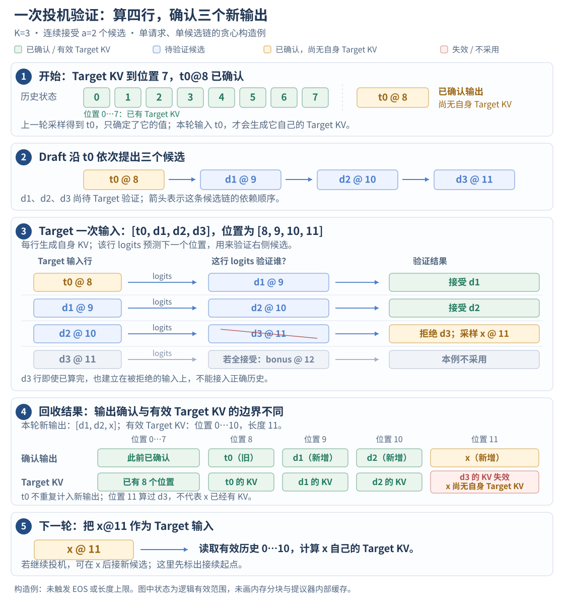
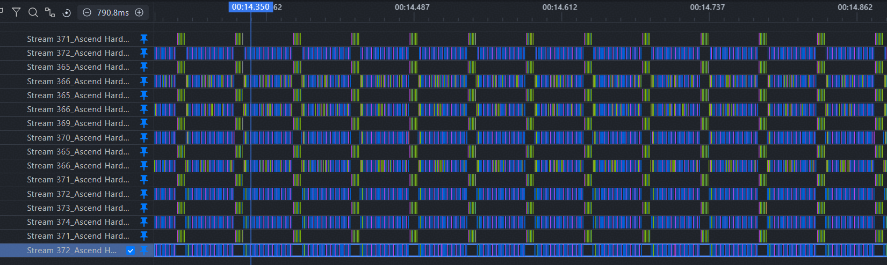
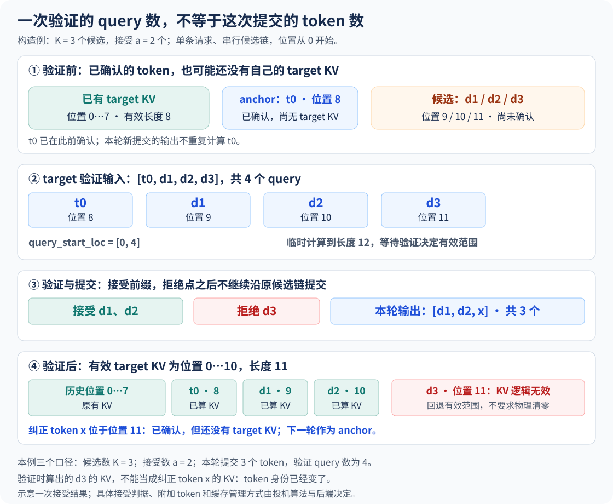
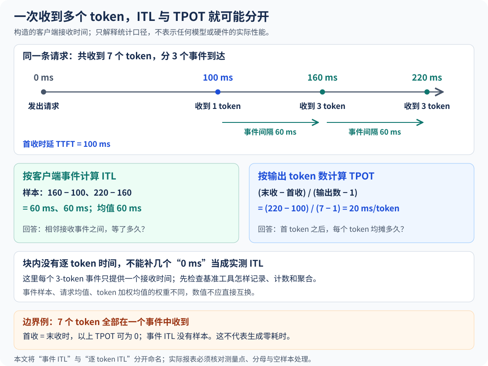

# 投机解码：一轮验证怎样改写下一轮输入

上一章里，一条普通 Decode 请求通常只给本轮增加一行输入。现在让它一次带来三个候选：目标模型算了四行，最后提交三个输出。调度进度该加几？下一轮从哪里开始？如果客户端一次收到三个 Token，ITL 又在量哪段时间？

这章只追踪一条请求 R：K=3，前两个候选接受，第三个拒绝。先把这次执行的账算清，再沿源码看结果怎样传到下一轮。图和播放器都是构造例，时间线也不代表设备实测。

## 1. 验证开始前，R 手里已经有什么？

Target 的 KV 已覆盖位置 0～7。上一次采样得到 t0@8，已经确认输出；但 Target 还没有把 t0 当作输入计算它自己的 KV。Draft 从 t0 开始，依次提出 d1、d2、d3。下面把这条候选链拆成八步播放。

<!-- SPEC_PLAYER -->

先停在起点，比较“已确认输出”与“已有 Target KV”；再逐步生成候选，观察 Target 怎样一次计算四行。默认连续接受两个候选：本轮新输出为 `[d1,d2,x]`，有效 Target KV 到位置 10；x@11 留到下一轮输入。切换接受长度后，输出和 KV 边界会一起变化。

<!-- COLLAPSIBLE_FIGURE: 一图回看完整过程 · 下载可编辑 SVG -->


### 1.1 对照提供的 profiling 原图

工作坊中的 `draft-model-graph-mode-fixed.png` 展示了真实 Ascend 设备时间线：左侧可读到 Stream 371、372 等标签，同一横轴上分布着多行密集事件。上方播放器可切换完整泳道，把 Host 准备、Draft 提议、Target 验证分别画出来，便于追踪依赖；角色行不代表三个独立设备，也未使用截图中的 stream 编号。

<!-- COLLAPSIBLE_FIGURE: 展开工作坊 profiling 原图 · 可放大查看 stream -->


截图中的色块不能直接对应动画中的 d1、d2、d3。要从实际采集还原同一轮，需要同时记录请求与轮号、Draft／Target 的执行范围，以及接受结果。这里的 K=3、a=2 是教学条件；原图用来展示真实时间线的形态，不据它计算加速比。[素材来源与校验信息](../dist/assets/profile-sources.json)

## 2. 把四行送进 Target，第三个候选在哪里被拒绝？

本例的目标输入和 Metadata 可以写成：

```text
query tokens：    [t0, d1, d2, d3]
positions：       [ 8,  9, 10, 11]
query_start_loc： [0, 4]      # 本例只有一条请求
临时序列长度：   12          # 8 个历史位置 + 4 行 query
```

t0 行的 logits 预测 d1，d1 行预测 d2，d2 行预测 d3。贪心示例中，前两处匹配，第三处目标模型选择 x，于是本轮输出是 `[d1,d2,x]`。d3 行也可能已经计算完成，但它建立在错误的 d3 输入上，不能继续从那里接正确历史。并行计算这些行不破坏因果性：每行只能读取历史及截至本行的候选前缀，不能看后面的候选。

若三个候选全接受，d3 行的预测还能给出一个 bonus Token。随机采样不能只比较两个模型选中的 Token；经典算法按目标／草稿概率决定接受，并在首次拒绝处使用校正分布，才能保持目标采样分布。下文手选接受长度只演示记账。单链流程在未触发 EOS 或长度上限时提交 `a+1` 个输出，a 是连续接受的候选数。[经典接受与校正算法](https://proceedings.mlr.press/v202/leviathan23a.html)



四行是这个 anchor 布局的结果，不是所有投机方案必须满足的 K+1 定义。真正的 query 边界、位置、因果掩码和 KV 写入映射，仍要对照使用的后端。

## 3. 提交三个输出后，下一轮不能从长度 12 接着算

a=2 时，Target 本轮计算过 t0、d1、d2、d3；正确路径只保留前三者的 KV。账本变为：

```text
有效目标 KV：  位置 0 … 10，长度 11
无效候选尾部：d3@11
新提交输出：  d1@9、d2@10、x@11，共 3 个
下一轮 anchor：x@11，尚无自己的目标 KV
```

**位置 11 算过 d3，不等于位置 11 的 x 已经有 KV。** x 是从 d2 行的分布采样出来的；下一轮还要输入 x，才能计算它自己的状态。若直接沿临时长度 12 继续，位置会偏一，还可能把错误候选当作正确历史。

| 接受候选数 a | 本轮新输出 | 有效目标 KV 长度 | 无效候选位置 | 下一轮 anchor |
| --- | --- | --- | --- | --- |
| 0 | x | 9 | 9、10、11 | x@9，无目标 KV |
| 2 | d1、d2、x | 11 | 11 | x@11，无目标 KV |
| 3 | d1、d2、d3、x | 12 | 无 | bonus x@12，无目标 KV |

有效长度是 `8+1+a`，其中 1 是 t0；无效尾部是 `3−a`。三行都守恒到临时长度 12。回退先改逻辑有效范围和访问关系，不要求逐字节清零，也不意味着立刻归还一整块。预留的 lookahead 槽位只是容量条件，不能计入已确认输出。[KV 块与缓存管理](https://docs.vllm.ai/en/latest/design/prefix_caching/)

## 4. 源码怎样从接受结果找到正确的采样行？

看 Ascend 的 `prepare_inputs_padded_kernel`。它先从候选数的累计和还原每请求 K，再读取 `valid_count`，核心关系可摘成：

```python
rejected = K + 1 - valid_count
query_end = query_start_loc[req_index + 1]
index_to_sample = query_end - 1 - rejected
```

本例 `valid_count=3`，包含 d1、d2 和 x；因此 `rejected=3+1−3=1`。本请求从批内索引 0 开始、末端为 4，采样索引就是 `4−1−1=2`：落在 d2 行，恰好是给出 x 的那一行。它不是 x 已存在于 query 中的证据。

这段属于 **drafter 的 padded 输入准备**。调用方 `prepare_inputs_padded` 保留批形状，把被拒绝的尾部当作 padding，再通过索引选择正确的接续位置，随后把目标 Token、位置、隐藏状态与 `next_token_ids` 交给提议器。不能把这几行代码叫作“构建全部 Target Attention Metadata”；它也没有单独完成所有 seq_len 修正。[设备侧拒绝数与索引](https://github.com/vllm-project/vllm-ascend/blob/main/vllm_ascend/ops/triton/v1/spec_decode/utils.py)、[调用方与 padded 输入](https://github.com/vllm-project/vllm-ascend/blob/main/vllm_ascend/worker/v1/spec_decode/llm_base_proposer.py)

DFlash 的另一条输入准备路径会在 `_prepare_dflash_inputs_kernel` 中融合 query/context positions、slot mapping、采样映射和图 padding。它属于该 proposer 的准备流程；上面的 `prepare_inputs_padded_kernel` 则通过有效计数选择接续行，二者要按各自调用方阅读。[DFlash 输入准备](https://github.com/vllm-project/vllm-ascend/blob/main/vllm_ascend/ops/triton/v2/spec_decode/prepare_dflash_inputs.py)

多请求时，`query_end` 是扁平 batch 中的边界，不能把所有请求都代入 4。各请求 K、接受数和起始偏移都可能不同；一个统一的 D 请求数已经不足以恢复本轮工作量。

还要区分源码里的两种累计数组：候选数的累计和不带开头的零，两条请求分别有 3、1 个候选时，它是 `[3,4]`；本轮 query 边界若各自带一个 anchor，则是 `[0,4,6]`。前者用于还原 K，后者用于找 batch 中的行。把两者混用，会得到看似合法却属于另一条请求的索引。

读计数变量也要沿生产者核对。本例 a=2 是接受的草稿数，`valid_count=3` 是有效采样输出数，不能看到名字里有 accepted 就都代入 2。这里公式中的额外 1 已经包含纠正或 bonus；再次补一个会把采样索引向前多退一行。源码还对没有候选的请求把拒绝数置零，避免把普通 Prefill／Decode 行套进这次投机回退。

## 5. Host 已排下一轮，Device 怎样纠正 R 的位置？

### 5.1 接受结果先确定下一轮的起点

异步调度允许 Host 在上一轮结果尚未完整回传时安排下一轮。Host 可以按候选全接受估计容量和批形状；Device 执行前，R 的起点必须从上界 12 纠正为有效 KV 长度 11，才能输入 x@11。

batch 行号也可能变化。假设上一轮顺序是 `[R,S]`，下一轮是 `[S,T,R]`，当前请求到上一轮的映射就是 `[1,−1,0]`。T 是新请求，使用 Host 提供的初始进度；R 则通过映射取回自己的接受结果。

`update_num_computed_tokens_for_batch_change` 按映射读取上一轮 Device 进度、有效采样数和候选数。对参加过投机的旧请求，它用 `prev_gpu + valid_count` 修正进度。本例为 `8+3=11`：输出侧的三个 Token 是 d1、d2、x，建立有效 KV 的三个输入却是 t0、d1、d2。[请求映射与进度修正](https://github.com/vllm-project/vllm-ascend/blob/main/vllm_ascend/worker/spec_decode_utils.py)

若后续 builder 需要精确的 Python 长度，Host 还需等待 D2H 完成，再修正自己的长度镜像。Device 上的消费者可以沿流依赖使用已修正的 Tensor。执行章第 5 节分别说明了缓冲区复用、计数回传和 Device 流之间的等待。[Host / Device 输入准备](从一轮调度到一次前向.md)

### 5.2 下一轮 K 从 3 改为 1，会改哪些字段？

上一轮仍按 `K_prev=3` 计算拒绝数：`3+1−valid_count=1`，先把有效 KV 长度纠正到 11。下一轮若实际只带一个候选，即 `K_next=1`：

```text
query tokens    = [x,e1]
positions       = [11,12]
query_start_loc = [0,2]
seq_lens        = [13]
```

若仍带三个候选，则 query 为 `[x,e1,e2,e3]`，positions 为 `[11,12,13,14]`，边界为 `[0,4]`，临时序列长度为 15。两种选择都从同一个正确起点 11 开始。

| 字段或工作 | 使用哪一轮的信息 | K 改变后怎样处理 |
| --- | --- | --- |
| 拒绝数与有效 KV 起点 | 上一轮 K 和实际接受结果 | 先完成回退，不能拿新 K 代入旧计数 |
| query 边界、候选累计数、采样行 | 本轮实际候选列表 | 重新累加并构造索引 |
| positions、seq_lens、slot_mapping | 已纠正起点和本轮 query | 按新行数生成位置与读写范围 |
| 调度预算、lookahead 空间 | 本轮实际工作与预留要求 | 分别记录真实输入行数和预留容量 |
| 图执行与 padding | 后端支持和捕获档位 | 选择可用图或回退，更新有效边界与映射 |

K=0 时，这个 anchor 布局仍需要输入 x，计算一行普通 Decode。改变候选预算没有消除自回归接续所需的输入。

本页的下一轮 metadata 面板固定上一轮 K=3，用所选接受长度确定起点，再切换下一轮 K。它演示字段变化，不选择最佳 K，也不预测加速比。

### 5.3 动态策略怎样产生本轮候选列表？

按 batch size 查表的实现，会用本轮已调度请求数选择共享的 `num_spec_tokens_to_schedule`，交给 proposer 生成供后续验证的候选。这个预算控制新候选的生成；当前 Target 验证的 Ki 则来自已送达、经调度后的每请求候选列表。预算相同，请求实际带来的候选也可能不同。[动态提议预算](https://github.com/vllm-project/vllm/blob/main/docs/features/speculative_decoding/dynamic_speculative_decoding.md)、[Scheduler 与候选调度](https://github.com/vllm-project/vllm/blob/main/vllm/v1/core/sched/scheduler.py)

Ascend `worker/v1` 的置信度策略还可以先生成候选，再按每请求预算裁剪验证长度；`worker/v2` 的 adaptive verification 则有独立的重分配和 query 紧凑化路径。构建 metadata 时，最终都要使用这次实际参与计算的列表和边界。v2 的部分后端需要把重排后的边界读回 Host，因此也要核对这条路径上的 Host 等待点。[v1 候选裁剪](https://github.com/vllm-project/vllm-ascend/blob/main/vllm_ascend/worker/v1/spec_decode/utils.py)、[v2 自适应验证](https://github.com/vllm-project/vllm-ascend/blob/main/vllm_ascend/worker/v2/model_runner.py)、[Ascend 功能说明](https://github.com/vllm-project/vllm-ascend/blob/main/docs/source/user_guide/feature_guide/speculative_decoding.md)

K 变化会影响提议、验证及状态维护成本。图的容量 shape 可能仍落在同一捕获档位，也可能需要改选图或回退；即便容量未变，也要更新真实输入、有效边界和采样索引。[图执行的 batch 描述](https://docs.vllm.ai/en/latest/design/cuda_graphs/)

## 6. 三次接收事件，为什么能算出两种时延？

现在换到客户端。构造一条请求在 0 ms 发出，收到如下内容；最后的统计和结束消息不另算内容事件：

| 客户端本地时间 | 本次新 Token 数 | 累计输出数 |
| --- | --- | --- |
| 100 ms | 1 | 1 |
| 160 ms | 3 | 4 |
| 220 ms | 3 | 7 |

逐行计算：首内容事件在 100 ms，TTFT 为 100 ms；后两次到达分别减前一次，得到 `[60,60] ms`。若客户端把相邻内容事件间隔叫作 ITL，其均值就是 60 ms。本算例把末内容事件视作 E2EL 的结束边界，因此请求 TPOT 为 `(220−100)/(7−1)=20 ms/Token`。实际工具常用 `(E2EL−TTFT)/(O−1)`；若 E2EL 还包含尾部控制消息或结束处理，其结束边界就不必等于末内容事件，须先核对工具实现。

这个客户端并没有观察到“每个 Token 都隔 20 ms”。它观察到两次各 60 ms 的停顿，然后把总时间摊给 6 个后续输出。当前官方 benchmark 也分别按输出事件记录间隔、按请求计算 TPOT，同事件内多个 Token 不额外生成零间隔样本。[客户端计时与聚合口径](https://docs.vllm.ai/en/latest/benchmarking/cli/#understanding-the-latency-metrics)



投机的一轮执行可产生多个输出 Token，发送端又可能合并事件，所以执行轮、输出事件和 Token 数需要分别统计。ITL 与 TPOT 的数值差异还取决于接受结果与发送行为。

## 7. 先排除发送分组，再解释客户端停顿

把三种构造场景摆在一起：

| 场景 | 客户端时间与每次 Token 数 | TPOT | 输出事件 ITL 均值 |
| --- | --- | --- | --- |
| 逐 Token | 100～280 ms，每 30 ms 一个 | 30 ms/Token | 30 ms |
| 投机式成组 | 100、160、220 ms；1、3、3 个 | 20 ms/Token | 60 ms |
| 代理缓冲 | 100、190、280 ms；1、3、3 个 | 30 ms/Token | 90 ms |

第三行内部仍按第一行逐 Token 生成，只是代理攒批后发送。相同的 `[1,3,3]` 分组既可能来自验证结果，也可能来自缓冲；仅凭客户端块大小不能证明启用了投机。

同一块里 Token 的生成先后不可观测，不能把它们都贴上同一个到达时间，补几个零以后称作设备 ITL。若第一块包含多个 Token，首块内部的间隔也丢失了。极端情况下，所有输出一块到达，按上式 TPOT 为 0、事件间隔样本为空；O≤1 时分母没有意义，应单独标记，不拿它冒充正常请求的 TPOT。

汇总时还有权重问题：一条请求有 1 个 100 ms 间隔，另一条有 10 个 10 ms 间隔。逐请求 TPOT 均值是 55 ms，合并 11 个间隔的均值约 18.18 ms。先核对请求集与权重，再比较两个均值。

## 8. 沿同一个输出定位客户端停顿

从 R 的一次验证建账，别只在压测末尾保留均值。设备侧按 request_id、验证轮号记录提议／验证起止、实际 query 行数及 padding、接受数和提交数；服务端输出边界接着记单调时间、输出序号、本次确认的 Token ID 数和累计数。代理与客户端沿用请求和输出关联信息，各记自己的接收、发送事件。

客户端收到 SSE 后先分离完整消息，排除无内容的角色、usage 和结束消息，再对有效内容事件打本地单调时间。总 O 优先核对服务端 usage 或最终 Token ID；单靠每段文本分别 tokenize，可能因跨段拼接边界得到错误计数。若拿不到每事件 Token 数，就明确缺这一列，不能用 chunk 数代替。不同机器的时钟未经校准时，先比较各自内部间隔，不能直接相减当网络耗时。

对照前面的构造时间线，客户端账本至少能逐行还原为：

```text
request=R  output=1  recv_ms=100  delta_tokens=1  total=1
request=R  output=2  recv_ms=160  delta_tokens=3  total=4
request=R  output=3  recv_ms=220  delta_tokens=3  total=7
```

其中 `recv_ms` 是收到完整内容消息时的本地打点，Token 数来自这里额外给定的构造条件。实际协议若只传文本，客户端不能假装知道这两列；可以在服务端输出边界记录 Token ID 计数，再按关联号补齐。代理若合并了消息，需要保留原输出序号范围，否则一条客户端事件无法准确对应哪几次提交。最后核对总数为 7，再算两个间隔，避免把结束消息误算成第三个间隔。

拿到这本账，可以沿同一轮逐段排查。若目标验证区间本身增长，先对齐 query、padding、上下文及执行路径，确认长停顿是否已经出现在设备完成时间里；接受 a 较大仍可能被更贵的提议或验证抵消。若验证已经结束、设备随后出现空档，则把下一次提交时间与 CPU 的计数等待、Metadata 准备、采样依赖对齐，查是否在 D2H event 处断了流水。只看到 CPU 忙，不能证明它在关键路径上。

若服务端已经按小间隔连续输出，而代理出口或客户端成组到达，停顿应继续往缓冲与传输查。反过来，服务端从一开始就只在每次验证结束后交付一组，客户端的大间隔可能只是批次交付的直接表现。请求号和输出序号把这些证据连起来，才能避免把代理等待归咎于 Attention。

比较普通与投机时固定模型、输入、输出约束、采样策略和负载。每轮的提议、验证及状态维护成本要按实际提交量摊销；流水线重叠和排队又决定端到端体验。接受率只是账本中的一列，不是最终结论。

## 9. 核对有效 KV 与客户端时延

回到 R：本轮四行 query，确认三个新输出，有效目标 KV 从 8 到 11，下一轮仍要输入 x@11。如果日志把进度写成 12、把 x 标成已有 KV，或者下一轮按旧 batch 行号读取了别人的接受数，应先修正确性，再谈加速。

客户端账本则是 TTFT 100 ms、两个 60 ms 输出事件间隔、O=7、TPOT 20 ms/Token。它们可以同时正确。下一次看到“投机后 TPOT 变小，停顿却没变短”，先沿提交、发送、接收三条边界核对，确定改善的是哪一段、用户实际看到的又是哪一段。
