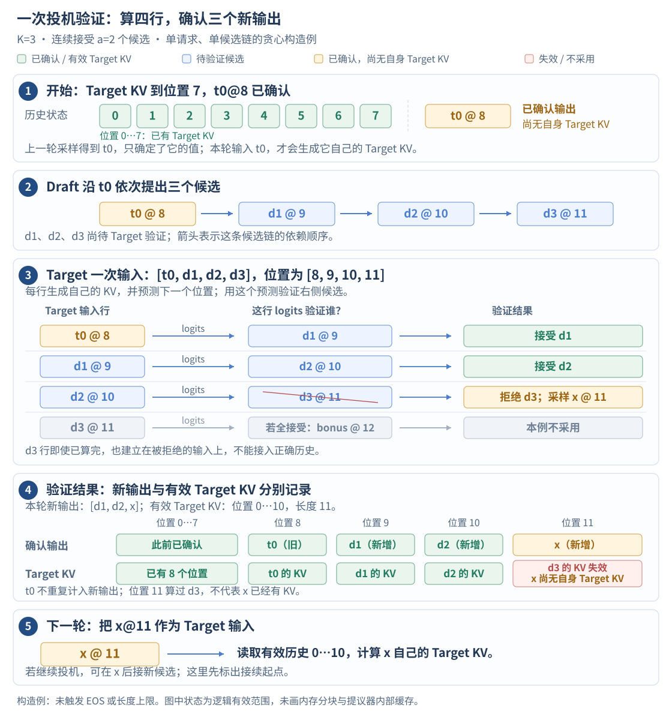
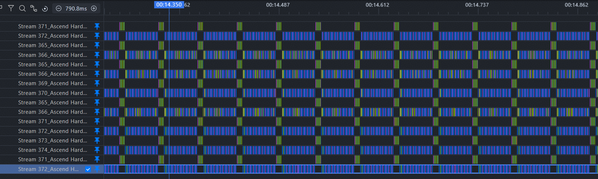
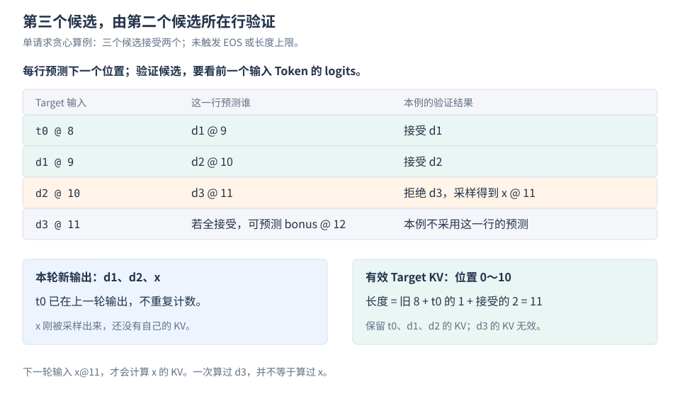
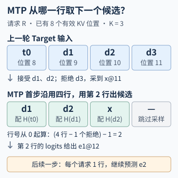
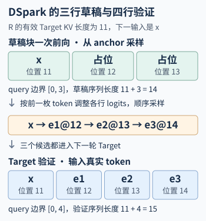
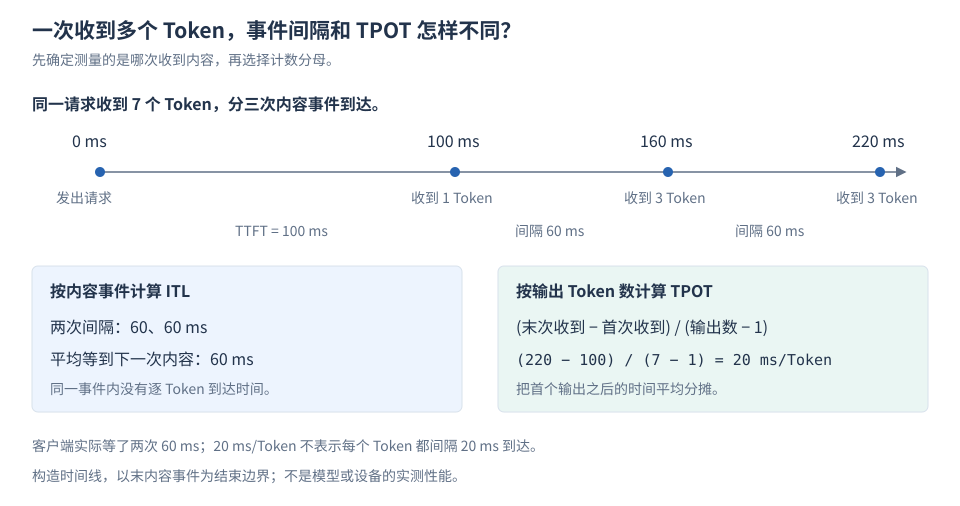

# 投机解码：一轮验证怎样改写下一轮输入

普通 Decode 一轮通常只输入一个 Token 来预测下一个。要是一轮就能确认多个，模型怎样知道前面猜的几个 Token 可以连着用？投机解码在提议阶段（Draft）先猜接下来的几个 Token，目标模型（Target）再用一次前向验证这组候选。客户端可以收到验证和采样之后确认的一组输出。

假设请求 R 这一轮猜了三个，前两个猜中，第三个被拒绝。换掉第三个之后，下一轮从哪里接着算？跟着 R 数一遍本轮确认的输出，再数哪些位置的目标 KV 还能读。等这些 Token 成组到达客户端时，可以再数一次实际等了几个间隔。

播放器和流程图使用教学算例。设备截图与 SSE 实验的采集条件随各自结果说明。

<!-- DETAILS: 算例条件与 Runner 源码 -->

本章沿 ModelRunnerV2 的单链投机路径说明，固定普通文本生成、PP=1，关闭 PCP、模型自定义采样器和提前停止。Ascend 入口为 `worker/v2/model_runner.py`。共享状态与采样链位于上游 `vllm/v1/worker/gpu/`，路径中的 `v1` 是引擎目录名。[Ascend Runner](https://github.com/vllm-project/vllm-ascend/blob/f9c8e0bd/vllm_ascend/worker/v2/model_runner.py#L139-L147) · [ModelRunnerV2 采样链](https://github.com/vllm-project/vllm/blob/ced6857a/vllm/v1/worker/gpu/model_runner.py#L1997-L2181)

<!-- /DETAILS -->

## 验证前的 Target KV 与 Draft 候选

采样只选出 Token 的词表 ID；把它送入 Target 前向后，才会得到它自己的 KV。因此，最后一个已确认输出的 Token 可能还没有对应的 KV。

以请求 R 为例。Target 的 KV 已覆盖位置 0～7，上次采样得到的位置 8 的 Token 记为 `t0@8`。t0 已确认，但还没有自己的 Target KV。Draft 从 t0 开始，依次提出 d1、d2、d3。位置编号只用来展示候选关系，不代表实际 Prompt 通常只有八个 Token。

<!-- SPEC_PLAYER -->

先停在起点，比较“已确认输出”与“已有 Target KV”；再逐步生成候选，观察 Target 怎样一次计算四个输入 Token（每个 Token 对应一行隐藏状态）。默认连续接受两个候选：本轮新输出为 `[d1,d2,x]`，有效 Target KV 到位置 10；x@11 留到下一轮输入。切换接受长度后，输出和 KV 边界会一起变化。

<!-- COLLAPSIBLE_FIGURE: 一图回看完整过程 · 下载可编辑 SVG -->


### 工作坊中的 Ascend 设备时间线

工作坊中的 `draft-model-graph-mode-fixed.png` 展示了真实 Ascend 设备时间线：左侧可读到 Stream 371、372 等标签，各行分别显示同一时间段内的设备事件。上方播放器可切换完整泳道，把 Host 准备、Draft 提议、Target 验证分别画出来，便于追踪依赖；角色行不代表三个独立设备，也未使用截图中的 stream 编号。

<!-- COLLAPSIBLE_FIGURE: 展开工作坊 profiling 原图 · 可放大查看 stream -->


截图中的色块不能直接对应动画中的 d1、d2、d3。要从实际采集还原同一轮，需要同时记录请求与轮号、Draft／Target 的执行范围，以及接受结果。这里的 K=3、a=2 是教学条件；原图用来展示真实时间线的形态，不据它计算加速比。[素材来源与校验信息](../dist/assets/profile-sources.json)

## Target 算了四行，第三个候选由哪一行判定？

Target 的每个输入 Token 都会生成一行隐藏状态；这一行给出的 logits 用来预测下一个位置。因此，验证一个候选要看它前一行的预测结果。本例的输入为：

```text
query tokens：    [t0, d1, d2, d3]
positions：       [ 8,  9, 10, 11]
query_start_loc： [0, 4]      # 本例只有一条请求
临时序列长度：   12          # 8 个历史位置 + 4 行 query
```

t0 行的 logits 预测 d1，d1 行预测 d2，d2 行预测 d3。贪心示例中，前两处匹配，第三处目标模型选择 x，于是本轮输出是 `[d1,d2,x]`。d3 行也可能已经算完。由于该行的输入是被拒绝的 d3，它的预测不能用于继续生成。并行计算这些行不破坏因果性：每行只能读取历史及截至本行的候选前缀，不能看后面的候选。

若三个候选全部接受，采样器还能根据 d3 行的预测，多采样一个 Token（bonus Token）。单链流程在未触发 EOS 或长度上限时提交 `a+1` 个输出，a 是连续接受的候选数。



这里把已确认、下一轮还要输入的 Token 称为 anchor，本例就是 t0。四行来自“一个 anchor 加三个候选”，不是所有投机方案都必须使用同一种输入布局。真正的 query 边界、位置、因果掩码和 KV 写入映射，仍要对照使用的后端。

### 随机拒绝与校正采样

经典拒绝采样在已接受前缀上比较候选 d 的两个概率。设 Draft 实际提议分布为 `q`，Target 经采样参数处理后的分布为 `p`。对从 q 抽到的 d，以 `min(1,p(d)/q(d))` 的概率接受。首次拒绝时，采样器将该位置的 `max(p−q,0)` 归一化，按得到的分布抽取一个校正 Token。本轮只提交此前接受的候选和这个校正 Token。[经典算法与分布推导](https://proceedings.mlr.press/v202/leviathan23a.html)

仍看请求 R 的位置 11，这次改用随机采样。设 d1、d2 已接受，d2 行预测位置 11。词表简化为 `[d3,x,y]`，该位置 `q=[3/4,1/4,0]`、`p=[1/2,1/3,1/6]`。若 Draft 抽到 d3，接受概率为 `(1/2)/(3/4)=2/3`。均匀随机数取 0.8 时拒绝。剩余权重 `[0,1/12,1/6]` 归一化为 `[0,1/3,2/3]`。如果校正抽到 x，输出仍是 `[d1,d2,x]`。在同一已接受前缀上重复这一步时，x 的输出概率由直接接受的 `1/4` 和拒绝后的 `1/4×1/3` 组成，合计 `1/3`，与 Target 一致。

## 提交三个输出后，下一轮不能从长度 12 接着算

接受结果决定哪些 KV 仍可使用。a=2 时，本轮虽计算了 t0、d1、d2、d3，正确历史只保留前三者的 KV：

```text
有效目标 KV：  位置 0 … 10，长度 11
无效候选尾部：d3@11
新提交输出：  d1@9、d2@10、x@11，共 3 个
下一轮 anchor：x@11，尚无自己的目标 KV
```

位置 11 原先存的是 d3 的 KV。换成 x 后，这一格的 KV 暂时无效。x 是用 d2 那一行的分数采样出来的，下一轮还要把 x 当输入，才会算出它自己在位置 11 的 KV。若直接沿临时长度 12 继续，位置会偏一，还可能读到错误候选的历史。

| 接受候选数 a | 本轮新输出 | 有效目标 KV 长度 | 无效候选位置 | 下一轮 anchor |
| --- | --- | --- | --- | --- |
| 0 | x | 9 | 9、10、11 | x@9，无目标 KV |
| 2 | d1、d2、x | 11 | 11 | x@11，无目标 KV |
| 3 | d1、d2、d3、x | 12 | 无 | bonus x@12，无目标 KV |

有效长度是 `8+1+a`，其中 1 是 t0；无效尾部是 `3−a`。表中各例的有效长度加无效尾部长度都为 12。回退先改逻辑有效范围和访问关系，不要求逐字节清零，也不意味着立刻归还一整块。为候选预留的 lookahead 空间只是容量条件，不能计入已确认输出。[KV 块与缓存管理](https://docs.vllm.ai/en/latest/design/prefix_caching/)

**试一试。** 把播放器的连续接受数改为 1。先猜第几个候选会被换掉、新输出有几个，再跳到「提交与回退」核对。

<!-- DETAILS: 核对答案 -->

接受 d1 后，d2 在位置 10 被换成采样出的 x，d3 也随候选尾部一起失效。客户端新增 d1 和 x 两个 Token。Target 的有效 KV 到位置 9 为止，共 10 个位置。x@10 留给下一轮输入。

<!-- /DETAILS -->

## 采样结果与有效计数怎样决定下一轮输入？

采样器返回 Token 时，还要说明其中多少个有效。R 的有效结果是 `[d1,d2,x]`，所以 `num_sampled=3`。输出回收只读取这三个 Token；预留缓冲后面的内容不能算成输出，也不能靠统计非负 Token ID 来猜有效数。

状态更新还要区分输入和输出：本轮三个输出是 d1、d2、x，新增有效 KV 却来自 t0、d1、d2。前者交给客户端，后者决定下一轮从位置 11 接续。下面的源码计数正是为了同时保留这两个边界。

<!-- DETAILS: V2 怎样选择 logits、统计有效数并更新请求状态 -->

先看这几个数由谁产生。Ascend ModelRunnerV2 按每请求实际候选数加一得到 logits 行数。R 有三个候选，因此 `cu_num_logits=[0,4]`；`combine_sampled_and_draft_tokens()` 从该请求 query 的尾部选出四行，`logits_indices=[0,1,2,3]`。`sample()` 取这些末层隐藏状态做词表投影，再把 logits、`InputBatch` 与 proposer 提供的可选 `draft_logits` 交给 `RejectionSampler`。[构造 logits 边界](https://github.com/vllm-project/vllm-ascend/blob/f9c8e0bd/vllm_ascend/worker/v2/model_runner.py#L955-L982) · [选择行](https://github.com/vllm-project/vllm/blob/ced6857a/vllm/v1/worker/gpu/input_batch.py#L397-L493) · [输出头与采样分派](https://github.com/vllm-project/vllm/blob/ced6857a/vllm/v1/worker/gpu/model_runner.py#L1512-L1564)

标准拒绝采样按各请求的 `cu_num_logits` 边界验证，返回采样缓冲和 `num_sampled`。本例的 `num_sampled=3` 包含接受的 d1、d2 和在拒绝位置采样的 x。如果候选全部接受，最后额外采样的 bonus Token 也计入有效输出。V2 的缓冲按最大候选数预留，范围外元素不能读取；这条实现并不承诺用 `-1` 填满无效尾部。因此有效数来自采样器，不能靠统计缓冲中非负 ID 重新猜测。[验证与计数](https://github.com/vllm-project/vllm/blob/ced6857a/vllm/v1/worker/gpu/spec_decode/rejection_sampler.py#L288-L329) · [分配输出与插入末 Token](https://github.com/vllm-project/vllm/blob/ced6857a/vllm/v1/worker/gpu/spec_decode/rejection_sampler_utils.py#L1175-L1283)

`get_num_sampled_and_rejected()` 再得到 `num_rejected = num_logits − num_sampled`。本例是 `4−3=1`。`postprocess_sampled()` 随后调用设备端 `post_update()`，在请求状态数组中保存 R 的最后一个有效采样 Token，并推进有效计算进度：

```text
num_sampled = 3                   # d1、d2、x
num_rejected = 4 − 3 = 1
last_sampled_tokens[R] = sampled_tokens[R, 2] = x
num_computed_tokens[R] = 8 + (4 − 1) = 11
```

输出侧的三个 Token 是 d1、d2、x，建立有效 KV 的三个输入却是 t0、d1、d2。`post_update()` 使用 `query_len − num_rejected` 更新进度；没有候选的普通 Decode 是 `1−0`，未完成的 Prefill 则把有效输出数和拒绝数都设为 0，计算进度仍按本轮处理的 query 行数增加。[有效数与拒绝数](https://github.com/vllm-project/vllm/blob/ced6857a/vllm/v1/worker/gpu/input_batch.py#L497-L549) · [持久状态更新](https://github.com/vllm-project/vllm/blob/ced6857a/vllm/v1/worker/gpu/input_batch.py#L551-L650)

更新完成后，Target 已保存下一轮所需的起点和 Token。随后 `speculator.propose()` 接收本轮输入、隐藏状态、有效数、拒绝数和更新后的 `last_sampled_tokens`，生成下一组候选。EAGLE、MTP、DFlash 等 proposer 的输入布局各不相同，每个输入准备内核只处理对应的草稿路径，不能代表 Target 准备全部 metadata 的过程。[更新后再提议](https://github.com/vllm-project/vllm/blob/ced6857a/vllm/v1/worker/gpu/model_runner.py#L2110-L2168) · [Ascend proposer 选择](https://github.com/vllm-project/vllm-ascend/blob/f9c8e0bd/vllm_ascend/worker/v2/spec_decode/__init__.py#L32-L106)

多请求时仍要区分两种边界。若两条 Decode 请求分别有 3、1 个候选，query 边界与 logits 边界恰好都是 `[0,4,6]`；如果批次里再加入一条尚未完成 Prefill 的请求，本轮为它处理三行输入，那么 query 会增加三行，logits 只增加一行，二者便不同。`query_start_loc` 按前向行计，`cu_num_logits` 按送入词表投影的行计，不能因为一个纯 Decode 算例中相等就互换。

<!-- /DETAILS -->

## 拒绝候选后，Target、MTP 和 DSpark 各自读哪几行？

### 请求重排后的有效 KV 起点

异步调度允许 Host 在上一轮结果尚未完整回传时安排下一轮。Host 的容量和进度上界可以仍为 12，Device 的 `post_update()` 已把 R 的精确状态写为 11。下一轮 `prepare_pos_seq_lens()` 按 R 对应的数组下标读取这个 11，再构造位置与长度；不能用 Host 上界覆盖它。[设备端位置与长度](https://github.com/vllm-project/vllm/blob/ced6857a/vllm/v1/worker/gpu/input_batch.py#L339-L394)

<!-- DETAILS: 请求重新排序后，怎样找到原来的状态 -->

V2 的 `RequestState` 用数组保存各请求的进度和采样结果。`idx_mapping` 记录本轮各请求对应的数组下标。例如 R、S、T 的状态保存在下标 7、3、9，本轮顺序 `[S,T,R]` 就对应 `[3,9,7]`。设备按下标 7 找到 R 的进度 11 与 x，无需沿用上一批的请求顺序。新请求初始化自己的数组位置，请求结束后该位置可被复用。这里的下标与 KV 页号、页内偏移无关。[请求状态的分配与释放](https://github.com/vllm-project/vllm/blob/ced6857a/vllm/v1/worker/gpu/states.py#L28-L134)

这里读的是设备上的请求状态。回收输出 Token、读取精确 CPU 长度各有自己的复制和等待，生产者与消费者见[异步调度与输出回收](../dist/graph-mode.html#graph-mode-4)和[图回放前的长度准备](../dist/graph-mode.html#graph-metadata-tiling)。

<!-- /DETAILS -->

### 候选数从 3 改为 1 后的 metadata

下一轮候选数可以改变，但它不能改变上一轮已经确定的正确历史。R 的有效 KV 长度已经是 11；如果下一轮只带一个候选，即 `K_next=1`，输入是 x 和新候选 e1：

```text
query tokens    = [x,e1]
positions       = [11,12]
query_start_loc = [0,2]
seq_lens        = [13]
```

<!-- DETAILS: 候选数变化时，哪些字段要重新生成 -->

上一轮拒绝数仍按 `K_prev=3` 和实际接受结果计算；不能把 `K_next` 代入上一轮的计数。

若仍带三个候选，则 query 为 `[x,e1,e2,e3]`，positions 为 `[11,12,13,14]`，边界为 `[0,4]`，临时序列长度为 15。两种选择都从同一个正确起点 11 开始。

| 字段或工作 | 使用哪一轮的信息 | K 改变后怎样处理 |
| --- | --- | --- |
| 拒绝数与有效 KV 起点 | 上一轮 K 和实际接受结果 | 先完成回退，不能拿新 K 代入旧计数 |
| query 边界、logits 累计边界、采样行 | 本轮实际候选列表 | 重新累加并构造索引 |
| positions、seq_lens、slot_mapping | 已纠正起点和本轮 query | 按新行数生成位置与读写范围 |
| 调度预算、lookahead 空间 | 本轮实际工作与预留要求 | 分别记录真实输入行数和预留容量 |

<!-- /DETAILS -->

K=0 时，本轮没有新候选，仍要输入 x，计算一行普通 Decode。

本页的下一轮 metadata 面板固定上一轮 K=3，用所选接受长度确定起点，再切换下一轮 K。它演示字段变化，不选择最佳 K，也不预测加速比。

**试一试。** 从同一个 `x@11` 接续。一次用 `K_next=0`，另一次排进候选 `e1@12`，但 Target 在第一枚候选处拒绝它。假定两次都在位置 12 贪心采到 y。两次的输入行数、提交输出和下一轮起点各是多少？

<!-- DETAILS: 核对两条路径的真实行数 -->

普通 Decode 只算 `x@11` 一行。投机验证算 `x@11` 和 `e1@12` 两行，先临时写出 e1 的 KV，再把这一个候选位置判为无效。两次都用 x 行的 logits 选出 y，只提交一个新输出。有效 Target KV 到位置 11，共 12 个位置，下一轮仍从 `y@12` 输入。两次输出相同，但投机路径多做了一行验证。这里数的是前向输入行，设备实际执行容量还要看[图档位如何补齐](../dist/graph-mode.html#graph-mode-5)。

<!-- /DETAILS -->

### 一轮实际验证多少个候选？

配置给出候选数的上限。proposer 实际生成多少个候选、其中有多少个进入本轮验证，要分别统计。V2 在采样后保存新草稿并交给 draft-token handler；下一轮输入准备从 `scheduled_spec_decode_tokens` 逐请求取实际候选数，再形成 query 和 logits 边界。不能把配置上限直接乘请求数，当成本轮已经验证的行数。[新候选的保存与交付](https://github.com/vllm-project/vllm/blob/ced6857a/vllm/v1/worker/gpu/model_runner.py#L2158-L2187) · [本轮实际列表](https://github.com/vllm-project/vllm-ascend/blob/f9c8e0bd/vllm_ascend/worker/v2/model_runner.py#L955-L982)

Ascend ModelRunnerV2 的 adaptive verification 还可以重新分配候选，并将参与验证的 query 行紧凑排列：`compact_batch()` 处理计划边界，`reallocate_drafts()` 给出实际设备边界与候选总数。普通 FIA 分支随后把重排后的 query 边界及精确 seq_lens 读回 Host；不能把它概括成完全没有回读的 Device 准备。构建 metadata 和采样索引时，必须使用该路径真正参与验证的边界。[V2 自适应验证与 Host 读取](https://github.com/vllm-project/vllm-ascend/blob/f9c8e0bd/vllm_ascend/worker/v2/model_runner.py#L984-L1072)

这些是真实输入行。K 变小时，设备执行容量还取决于图档位及后端跳过补齐行的方式。[从真实 Query 到捕获档位](../dist/graph-mode.html#graph-mode-5)

### MTP 怎样从最后一条有效验证行接着提议？

上面算的是验证模型（Target）下一轮要读哪些位置。回到生成候选的那一刻：R 刚接受 d1、d2，拒绝 d3，已知下一个 token 是 x。MTP 要用哪一行来预测 x 后面的 e1？下面取普通 MTP、MLA 的 FIA 后端，单请求、无填充，关闭图回放、上下文并行与自适应验证。R 正在 Decode，代码中的 draft prefill 指草稿模型为这轮提议做的第一次前向。[普通 MTP 的选择与实现](https://github.com/vllm-project/vllm-ascend/blob/92b6354a/vllm_ascend/worker/v2/spec_decode/__init__.py#L86-L101) · [Ascend 与上游共享的草稿循环](https://github.com/vllm-project/vllm-ascend/blob/92b6354a/vllm_ascend/worker/v2/spec_decode/mtp/speculator.py#L17-L29)



Runner 在更新请求状态后，将 Target 的 hidden states、原批次、`num_sampled=3`、`num_rejected=1` 和最后一次采出的 x 交给 proposer。草稿输入仍占四行，以便沿用 Target 的 query 边界 `[0,4]`。输入准备内核计算有效行数 `4−1=3`，将有效输入左移一格，再在末尾填 x。前三行对应 `(H8,d1)、(H9,d2)、(H10,x)`，这里 H10 就是 Target 输入 d2@10 时算出的隐藏状态。行号从 0 数，第四行仍占一个位置，采样跳过它。于是 `last_token_indices=[2]`。草稿模型执行后，用其第 2 行的输出采出 e1。它用的是位置 10 的 Target 状态和位置 11 的 x，预测位置 12 的 token。[请求更新与 proposer 入参](https://github.com/vllm-project/vllm/blob/ba15685a/vllm/v1/worker/gpu/model_runner.py#L2352-L2385) · [移位与有效行](https://github.com/vllm-project/vllm/blob/ba15685a/vllm/v1/worker/gpu/spec_decode/target_dependent_ar/speculator.py#L466-L505) · [选行采第一候选](https://github.com/vllm-project/vllm/blob/ba15685a/vllm/v1/worker/gpu/spec_decode/target_dependent_ar/speculator.py#L350-L388)

相同的行布局让首步有机会复用 Target 的 Attention metadata 和写槽。实际分支检查 `can_reuse_target_attn_metadata`。成立时直接沿用，不成立时拿 Target 已准备的块表和写槽，交给草稿 Attention 组自己的 builder。Ascend 的首步只把属于草稿层的 metadata 传给前向。若有 MLA 图填充，还会单独裁剪多出的 query 结束位置。本例没有填充行。[首步的复用与重建](https://github.com/vllm-project/vllm/blob/ba15685a/vllm/v1/worker/gpu/spec_decode/speculator.py#L392-L425) · [过滤层与裁剪填充边界](https://github.com/vllm-project/vllm-ascend/blob/92b6354a/vllm_ascend/worker/v2/spec_decode/target_dependent_ar/speculator.py#L311-L333) · [首步实际使用的层](https://github.com/vllm-project/vllm-ascend/blob/92b6354a/vllm_ascend/worker/v2/spec_decode/target_dependent_ar/speculator.py#L495-L525)

**提议 e2 时只用一行。** 草稿模型将上一行选出的隐藏状态与 e1 配对，把草稿位置从 10 推到 11，设备端 `seq_lens` 按 `12−1+1=12` 更新。这里的 12 分别有两种来历：式首的 12 是 Target 验证时的临时长度（8 个历史位置加 4 行），式末的 12 是草稿在单行步骤上的长度。循环按当前位置查页表、重新计算写槽，并用 `num_query_per_req=1` 构建 Attention metadata。e1 的语义位置比这次送给草稿模型的位置大一，是因为草稿采用“前一位置的状态配后一位置的 token”的输入方式。若还要 e3，草稿继续传递 e2 和本步的隐藏状态。e1、e2、e3 都要等下一轮 Target 验证。[后续步的输入与设备长度](https://github.com/vllm-project/vllm/blob/ba15685a/vllm/v1/worker/gpu/spec_decode/target_dependent_ar/speculator.py#L596-L616) · [逐步构造写槽与单行 metadata](https://github.com/vllm-project/vllm/blob/ba15685a/vllm/v1/worker/gpu/spec_decode/autoregressive/speculator.py#L225-L268) · [更新下一步的 token 和状态](https://github.com/vllm-project/vllm/blob/ba15685a/vllm/v1/worker/gpu/spec_decode/target_dependent_ar/speculator.py#L653-L688)

<!-- DETAILS: 顺着 MTP 的字段核对 Device 长度与 FIA 的 Host 长度 -->

同一个草稿步里，还能在代码中看到另一个长度。按上述单请求算例，忽略最大长度截断，摘成三行计算：

```text
last_token_indices[0] = 4 − 1 − 1 = 2       # 首步从哪一行采 e1
Device seq_lens[0]    = 12 − 1 + 1 = 12    # 后续第 1 步，已扣掉拒绝行
FIA seq_lens_list[0]  = 12 + 1 = 13        # Target 的 Host 长度基数 + step
```

前两式按草稿输入准备内核推算。第三式来自 Ascend 的 `_calc_next_seq_lens_cpu()`，源码注明 Host 这条计算省略了本轮拒绝数。后续步构建 metadata 时调用 `_update_decode_attn_metadata()`，把 query 结束位置 [1] 和 KV 长度列表 [13] 写入 decode metadata。MLA/FIA 将这两个字段作为 `actual_seq_qlen` 和 `actual_seq_kvlen` 传入算子。这里可以追到公开的长度参数；内核内部如何分块仍需算子实现或设备记录来确认。[构建后续步时更新字段](https://github.com/vllm-project/vllm-ascend/blob/92b6354a/vllm_ascend/worker/v2/spec_decode/target_dependent_ar/speculator.py#L570-L588) · [写入 query 和 KV 长度](https://github.com/vllm-project/vllm-ascend/blob/92b6354a/vllm_ascend/worker/v2/spec_decode/target_dependent_ar/speculator.py#L677-L710) · [Host 计算式及其限制](https://github.com/vllm-project/vllm-ascend/blob/92b6354a/vllm_ascend/worker/v2/spec_decode/target_dependent_ar/speculator.py#L803-L823) · [FIA 的长度参数](https://github.com/vllm-project/vllm-ascend/blob/92b6354a/vllm_ascend/attention/mla_v1.py#L2918-L2931) · [eager 调用](https://github.com/vllm-project/vllm-ascend/blob/92b6354a/vllm_ascend/attention/mla_v1.py#L2998-L3007)

<!-- /DETAILS -->

### 第 13 个槽会改变 e2 吗？

沿本例的普通 causal MTP MLA/FIA，先核对实际分支。对应的投机 Decode 用 `TND_NTD`、`sparse_mode=3` 和 `decode_meta.attn_mask`。长度列表 `[13]` 和 query 结束位置 `[1]` 一起传给 `npu_fused_infer_attention_score_v2`。页表即使能寻到逻辑位置 12（从 0 数的第 13 个位置），它是否有非零权重，还要考虑算子怎么把长度与掩码结合。源码能追到算子实参，仍需查看设备输出。[设备分支和掩码](https://github.com/vllm-project/vllm-ascend/blob/92b6354a/vllm_ascend/attention/mla_v1.py#L2814-L2846) · [算子参数与 eager 调用](https://github.com/vllm-project/vllm-ascend/blob/92b6354a/vllm_ascend/attention/mla_v1.py#L2918-L2929) · [读取 V 投影之前的结果](https://github.com/vllm-project/vllm-ascend/blob/92b6354a/vllm_ascend/attention/mla_v1.py#L3006-L3013)

用一个能手算的探针。分配覆盖第 13 个位置的真实页，固定一行全零 Q、全零的 RoPE 输入与前 12 个位置的全零 latent。只把第 13 槽其中一个 latent 分量从 0 改成 13。Q 为零时，所有可见位置的分数相等。若只看前 12 槽，这个输出分量始终为 0。若第 13 槽也可见，它应从 0 变为 `13/13=1`。用同样的页、张量形状、精度和掩码分别测 `actual_seq_kvlen=[12]` 和 `[13]`，每个长度各跑两种第 13 槽值。记录 FIA 原始输出和该槽的物理地址，避免 V 投影或采样掩盖差异。若两个长度都不随第 13 槽变化，再用一个**已知可见**的槽做正对照，确认探针生效。该算例的 0 和 1 是参考值，目标 CANN 与实际 MTP 权重下的结果仍待验证。

### DSpark 提三个候选，草稿和目标各算几行？

沿用请求 R。上一轮验证结束后，Target 留下位置 0 到 10 的 KV，新采样的 x 在位置 11。现在让 DSpark 提三个候选，固定候选数，选择从 anchor 预测第一枚候选的草稿权重（`sample_from_anchor=True`）。先前验证中被拒绝的尾行要从有效上下文中扣掉。输入准备内核读取最后一个有效位置 10，用 10 + 1 作为草稿块的起点。第一行填入 x，后两行填模型约定的占位 token。[两种草稿布局](https://github.com/vllm-project/vllm/blob/ba15685a/vllm/v1/worker/gpu/spec_decode/dspark/speculator.py#L53-L70) · [Ascend 为 DSpark 接入输入准备内核](https://github.com/vllm-project/vllm-ascend/blob/92b6354a/vllm_ascend/worker/v2/spec_decode/dspark/speculator.py#L253-L274) · [扣除拒绝行、写入位置与输入 ID](https://github.com/vllm-project/vllm-ascend/blob/92b6354a/vllm_ascend/ops/triton/spec_decode/prepare_dflash_inputs.py#L140-L205)



草稿模型一次前向得到三行隐藏状态。随后，采样循环用 x 调整第一行 logits 并选出 e1，用 e1 调整第二行再选 e2，最后用 e2 得到 e3。x@11 这一行预测位置 12，第一个占位行（位置 12）预测位置 13，第二个占位行预测位置 14。若三枚都被调度，Target 再以 x、e1、e2、e3 为输入做四行验证。

草稿 Attention 的长度 14 描述本次块前向能寻址的范围。该步结束时，Target 仍持有先前的 11 个有效位置，直到验证结果更新它的状态。图中的三行草稿也有适用条件：若权重配置从第一个占位位置开始采样（`sample_from_anchor=False`），草稿输入会变成 x 加三个占位，候选数仍为三。[采样行、预测位置与草稿长度](https://github.com/vllm-project/vllm-ascend/blob/92b6354a/vllm_ascend/ops/triton/spec_decode/prepare_dflash_inputs.py#L221-L247) · [按前一枚 token 调整 logits](https://github.com/vllm-project/vllm/blob/ba15685a/vllm/v1/worker/gpu/spec_decode/dspark/speculator.py#L242-L296) · [Target 读取实际调度的候选](https://github.com/vllm-project/vllm-ascend/blob/92b6354a/vllm_ascend/worker/v2/model_runner.py#L892-L936)

这个草稿调用的长度 14 和下一轮 Target 的长度 15 各有消费者。长度是否回到 Host、哪个后端生成 tiling、两边怎样补齐并回放，接着看[图模式篇的 metadata 更新](../dist/graph-mode.html#graph-metadata-tiling)。[Target 与 Draft 的补齐案例](../dist/graph-mode.html#graph-padding-cases)对照了 Q/KV 记录数、专家掩码和 LM Head 容量三个实际故障。

## 成组返回后，ITL 和 TPOT 各按什么计数？

客户端在每次收到输出内容时记一个时间。一条消息可以一口气带来多个 Token。相邻内容消息隔了多久，这里记作 ITL。首个输出之后的等待按剩余输出 Token 平均分摊，这里记作 TPOT。

假设客户端在 0 ms 发出一条请求，随后收到三次输出。最后的统计和结束消息不另算内容事件：

| 客户端本地时间 | 本次新 Token 数 | 累计输出数 |
| --- | --- | --- |
| 100 ms | 1 | 1 |
| 160 ms | 3 | 4 |
| 220 ms | 3 | 7 |

客户端在 100 ms 收到第一次输出，所以 TTFT 为 100 ms。后两次内容事件的间隔都是 60 ms，按事件计算的 ITL 均值就是 60 ms。TPOT 则把首内容事件之后的时间摊给后续输出：

```text
TPOT = (E2EL − TTFT) / (O − 1)
     = (220 − 100) / (7 − 1) = 20 ms/Token
```

O 是输出 Token 总数。本例以末内容事件为 E2EL 的结束边界；实际工具若把尾部控制消息或结束处理计入 E2EL，就要按工具的真实边界计算。

这个客户端并没有观察到“每个 Token 都隔 20 ms”。它观察到两次各 60 ms 的停顿，然后把总时间摊给 6 个后续输出。当前官方 benchmark 也分别按输出事件记录间隔、按请求计算 TPOT，同事件内多个 Token 不额外生成零间隔样本。[客户端计时与聚合口径](https://docs.vllm.ai/en/latest/benchmarking/cli/#understanding-the-latency-metrics)



投机的一轮执行可产生多个输出 Token，发送端又可能合并事件，所以执行轮、输出事件和 Token 数需要分别统计。ITL 与 TPOT 的数值差异还取决于接受结果与发送行为。

<!-- SPEC_STREAM -->

## 逐 Token、成组返回与代理缓冲

下面三个示例中，客户端都收到七个 Token。

| 场景 | 客户端时间与每次 Token 数 | TPOT | 输出事件 ITL 均值 |
| --- | --- | --- | --- |
| 逐 Token | 100～280 ms，每 30 ms 一个 | 30 ms/Token | 30 ms |
| 投机式成组 | 100、160、220 ms；1、3、3 个 | 20 ms/Token | 60 ms |
| 代理缓冲 | 100、190、280 ms；1、3、3 个 | 30 ms/Token | 90 ms |

第三行内部仍按第一行逐 Token 生成，只是代理攒批后发送。相同的 `[1,3,3]` 分组既可能来自验证结果，也可能来自缓冲；仅凭客户端块大小不能证明启用了投机。

客户端只能记录整块的到达时间，无法知道块内相邻 Token 的生成间隔。如果用同一个到达时间给块内每个 Token 计时，就会人为产生零间隔。第一块含多个 Token 时也有这个问题。极端情况下，所有输出一块到达，按上式 TPOT 为 0、事件间隔样本为空；O≤1 时无法计算每个后续 Token 的平均耗时，应将 TPOT 标为未定义。

汇总时还有权重问题：一条请求有 1 个 100 ms 间隔，另一条有 10 个 10 ms 间隔。逐请求 TPOT 均值是 55 ms，合并 11 个间隔的均值约 18.18 ms。先核对请求集与权重，再比较两个均值。

为验证缓冲对指标的影响，实验在 Linux 回环接口上通过 socket 连接 HTTP/SSE 服务、独立缓冲代理和客户端。生成线程按设定的 30 ms 周期产生七个已知输出标签，各阶段都用同一进程的单调时钟记录时间。两轮实验交换了各场景的运行顺序，收到的内容和输出数一致。角色信息、usage 和 `[DONE]` 单独记录。[SSE 实操脚本与原始打点](https://github.com/Tflowers-0129/inference-wiki/tree/main/experiments)

| 实测发送方式 | 两轮客户端内容事件间隔 | 两轮 TPOT / ms 每输出 |
| --- | --- | --- |
| 七次逐项发送 | 各 6 个间隔，范围 29.99～30.05 ms | 30.004、30.002 |
| 代理缓冲 [1,3,3] | 分别 [89.967,90.035]、[89.977,90.048] ms | 30.000、30.004 |
| 七项全部放一块 | 无相邻内容事件样本 | 两轮均为 0 |
| 只有一个输出 | 无相邻内容事件样本 | 分母为 0，记录为未定义 |

计算表中的 TPOT 时，都以客户端收到最后一条内容消息的时刻为终点。单块七项的结果为 0，仅说明首、末内容接收时刻相同，不能描述内部生成速度。本实验没有模型或投机执行，验证的是代理缓冲如何改变客户端的计时结果。30 ms 是生成线程设定的周期，实验另行记录了实际的生成、发送和接收时间。[实测结果](https://github.com/Tflowers-0129/inference-wiki/blob/main/experiments/results/sse-buffering.json)

## 沿同一个输出定位客户端停顿

如果客户端在 100 ms 收到第一条内容，隔了 60 ms 才收到第二条，先用同一请求号和输出序号，找出这条消息在服务端和代理上各走到了哪里。压测的平均值无法还原这个过程。

1. 设备侧按 `request_id`、验证轮号记录提议和验证的起止时间。保留实际 query 行数、padding、接受数和提交数。
2. 服务端每次交付输出时，用单调时钟记时间，同时保留输出序号、本次确认的 Token ID 数和累计数。
3. 代理记录收到和转发各条消息的时间。客户端记录收到的时间。两侧都保留请求号与输出序号。

客户端收到 SSE 后先分离完整消息，排除无内容的角色、usage 和结束消息，再用本地单调时钟记录各次内容到达的时间。统计输出 Token 总数 O 时，优先核对服务端的 usage 或最终 Token ID。把每段文本单独分词再求和，可能因分段位置不同而算错。若拿不到每事件 Token 数，就明确缺这一列，不能用 chunk 数代替。不同机器的时钟未经校准时，先比较各自内部间隔，不能直接相减当网络耗时。

对照前面的构造时间线，客户端记录至少应包含：

```text
request=R  output=1  recv_ms=100  delta_tokens=1  total=1
request=R  output=2  recv_ms=160  delta_tokens=3  total=4
request=R  output=3  recv_ms=220  delta_tokens=3  total=7
```

其中 `recv_ms` 是客户端收到完整内容消息的本地时间，示例另外给出了每次收到的 Token 数。实际协议若只传文本，可以在服务端交付输出时统计 Token ID，再根据请求号和输出序号补齐每次的新增数和累计数。代理若合并了消息，需要保留原输出序号范围，否则一条客户端事件无法准确对应哪几次提交。最后核对总数为 7，再算两个间隔，避免把结束消息误算成第三个间隔。

有了这些记录，就可以沿同一轮逐段排查。若目标验证区间本身增长，先对齐 query、padding、上下文及执行路径，检查设备端是否已经出现同样的延迟。即使接受的候选数 a 较大，提议或验证耗时增加也可能抵消收益。若验证已经结束、设备随后出现空档，则把下一次提交时间与 CPU 的计数等待、Metadata 准备、采样依赖对齐，检查下一次提交是否在等待设备到主机的复制完成。只看到 CPU 忙，不能证明它在关键路径上。

若服务端已经按小间隔连续输出，而代理出口或客户端成组到达，可以根据代理收发时间和客户端到达时间，继续检查缓冲和传输。反过来，服务端从一开始就只在每次验证结束后交付一组，客户端的大间隔可能只是批次交付的直接表现。请求号和输出序号把这些证据连起来，才能避免把代理等待归咎于 Attention。

比较普通与投机时固定模型、输入、输出约束、采样策略和负载。每轮的提议、验证及状态维护成本要按实际提交量摊销；不同阶段的重叠和请求排队也会影响端到端时延。接受率只是其中一个指标，仍要结合耗时和客户端接收结果判断。

## 怎样核对设备进度与客户端接收？

回到 R：本轮四行 query，确认三个新输出，有效目标 KV 从 8 到 11，下一轮仍要输入 x@11。如果日志把进度写成 12、把 x 标成已有 KV，或者下一轮的 `idx_mapping` 指向了另一条请求的状态数组位置，就要先查明请求状态或位置计算出错的原因，再比较性能。

客户端记录则是 TTFT 100 ms、两个 60 ms 输出事件间隔、O=7、TPOT 20 ms/Token。它们可以同时正确。下一次看到“投机后 TPOT 变小，停顿却没变短”，可以分别核对服务端每次提交的 Token 数、消息发送时间和客户端接收时间，确定耗时缩短在哪一步。
