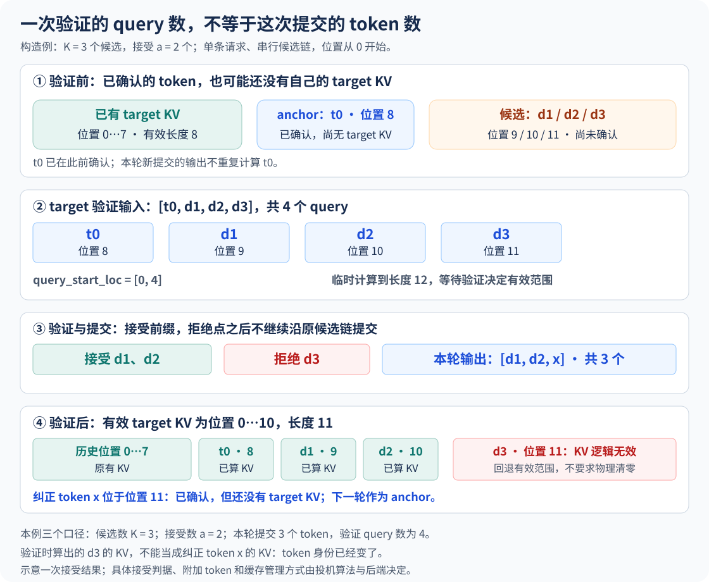
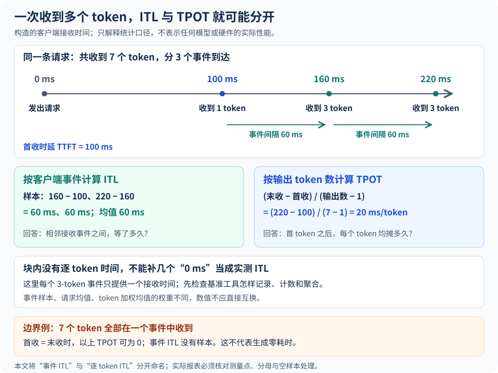

# 投机解码：一轮验证怎样改写下一轮输入

上一章里，一条普通 Decode 请求通常只给本轮增加一行输入。现在让它一次带来三个候选：目标模型算了四行，最后提交三个输出。调度进度该加几？下一轮从哪里开始？如果客户端一次收到三个 Token，ITL 又在量哪段时间？

这章只追踪一条请求 R：K=3，前两个候选接受，第三个拒绝。先把这次执行的账算清，再沿源码看结果怎样传到下一轮。图和播放器都是构造例，时间线也不代表设备实测。

## 1. 验证开始前，R 手里已经有什么？

R 的目标模型 KV 已覆盖位置 0～7。最后一次采样得到 t0，位置为 8；它已经确认输出，却还没作为目标模型输入计算自己的 KV。我们把它叫作本轮 anchor。Draft 沿 t0 继续提出 d1、d2、d3。

```text
已确认、已有目标 KV：位置 0 … 7
已确认、尚无目标 KV：t0@8
尚待验证的候选：    d1@9、d2@10、d3@11
```

这里有三个不同的进度：哪些输出已经确认，目标模型算过哪些输入，哪些候选还没有确认。若用一个“当前长度”包办三者，后面的差一就很难查。t0 已经确认，不能再算作本轮新输出；但本轮目标计算仍然要处理它，才能得到验证 d1 的分布。客户端何时收到它，是后半章另外一条时间线。

提议路径可以是独立草稿模型，也可以复用目标模型的预测头或其他机制。下面只取一条因果候选链，不把某种提议器的内部布局当成通用规范。[投机解码概览](https://docs.vllm.ai/en/latest/features/speculative_decoding/)

## 2. 把四行送进 Target，第三个候选在哪里被拒绝？

本例的目标输入和 Metadata 可以写成：

```text
query tokens：    [t0, d1, d2, d3]
positions：       [ 8,  9, 10, 11]
query_start_loc： [0, 4]      # 本例只有一条请求
临时序列长度：   12          # 8 个历史位置 + 4 行 query
```

t0 行的 logits 预测 d1，d1 行预测 d2，d2 行预测 d3。贪心示例中，前两处匹配，第三处目标模型选择 x，于是本轮输出是 `[d1,d2,x]`。d3 行也可能已经计算完成，但它建立在错误的 d3 输入上，不能继续从那里接正确历史。并行计算这些行不破坏因果性：每行只能读取历史及截至本行的候选前缀，不能看后面的候选。

若三个候选全接受，d3 行的预测还能给出一个 bonus Token。随机采样不能只比较两个模型选中的 Token；经典算法按目标／草稿概率决定接受，并在首次拒绝处使用校正分布，才能保持目标采样分布。下文手选接受长度只演示记账。单链流程在未触发 EOS 或长度上限时提交 `a+1` 个输出，a 是连续接受的候选数。[经典接受与校正算法](https://proceedings.mlr.press/v202/leviathan23a.html)



四行是这个 anchor 布局的结果，不是所有投机方案必须满足的 K+1 定义。真正的 query 边界、位置、因果掩码和 KV 写入映射，仍要对照使用的后端。

## 3. 提交三个输出后，下一轮不能从长度 12 接着算

a=2 时，Target 本轮计算过 t0、d1、d2、d3；正确路径只保留前三者的 KV。账本变为：

```text
有效目标 KV：  位置 0 … 10，长度 11
无效候选尾部：d3@11
新提交输出：  d1@9、d2@10、x@11，共 3 个
下一轮 anchor：x@11，尚无自己的目标 KV
```

**位置 11 算过 d3，不等于位置 11 的 x 已经有 KV。** x 是从 d2 行的分布采样出来的；下一轮还要输入 x，才能计算它自己的状态。若直接沿临时长度 12 继续，位置会偏一，还可能把错误候选当作正确历史。

| 接受候选数 a | 本轮新输出 | 有效目标 KV 长度 | 无效候选位置 | 下一轮 anchor |
| --- | --- | --- | --- | --- |
| 0 | x | 9 | 9、10、11 | x@9，无目标 KV |
| 2 | d1、d2、x | 11 | 11 | x@11，无目标 KV |
| 3 | d1、d2、d3、x | 12 | 无 | bonus x@12，无目标 KV |

有效长度是 `8+1+a`，其中 1 是 t0；无效尾部是 `3−a`。三行都守恒到临时长度 12。回退先改逻辑有效范围和访问关系，不要求逐字节清零，也不意味着立刻归还一整块。预留的 lookahead 槽位只是容量条件，不能计入已确认输出。[KV 块与缓存管理](https://docs.vllm.ai/en/latest/design/prefix_caching/)

## 4. 源码怎样从接受结果找到正确的采样行？

看 Ascend 的 `prepare_inputs_padded_kernel`。它先从候选数的累计和还原每请求 K，再读取 `valid_count`，核心关系可摘成：

```python
rejected = K + 1 - valid_count
query_end = query_start_loc[req_index + 1]
index_to_sample = query_end - 1 - rejected
```

本例 `valid_count=3`，包含 d1、d2 和 x；因此 `rejected=3+1−3=1`。本请求从批内索引 0 开始、末端为 4，采样索引就是 `4−1−1=2`：落在 d2 行，恰好是给出 x 的那一行。它不是 x 已存在于 query 中的证据。

这段属于 **drafter 的 padded 输入准备**。调用方 `prepare_inputs_padded` 保留批形状，把被拒绝的尾部当作 padding，再通过索引选择正确的接续位置，随后把目标 Token、位置、隐藏状态与 `next_token_ids` 交给提议器。不能把这几行代码叫作“构建全部 Target Attention Metadata”；它也没有单独完成所有 seq_len 修正。[设备侧拒绝数与索引](https://github.com/vllm-project/vllm-ascend/blob/main/vllm_ascend/ops/triton/spec_decode/utils.py)、[调用方与 padded 输入](https://github.com/vllm-project/vllm-ascend/blob/main/vllm_ascend/worker/v1/spec_decode/llm_base_proposer.py)

多请求时，`query_end` 是扁平 batch 中的边界，不能把所有请求都代入 4。各请求 K、接受数和起始偏移都可能不同；一个统一的 D 请求数已经不足以恢复本轮工作量。

还要区分源码里的两种累计数组：候选数的累计和不带开头的零，两条请求分别有 3、1 个候选时，它是 `[3,4]`；本轮 query 边界若各自带一个 anchor，则是 `[0,4,6]`。前者用于还原 K，后者用于找 batch 中的行。把两者混用，会得到看似合法却属于另一条请求的索引。

读计数变量也要沿生产者核对。本例 a=2 是接受的草稿数，`valid_count=3` 是有效采样输出数，不能看到名字里有 accepted 就都代入 2。这里公式中的额外 1 已经包含纠正或 bonus；再次补一个会把采样索引向前多退一行。源码还对没有候选的请求把拒绝数置零，避免把普通 Prefill／Decode 行套进这次投机回退。

## 5. CPU 已排下一轮，设备怎样纠正 R 的位置？

异步调度想在上一轮结果尚未完整回到 CPU 时，先安排下一轮。Host 可以按全部候选接受的乐观长度做容量和批形状计划；但设备实际执行时，R 必须从有效 KV 长度 11 接 x，不能从上界 12 接。

还有一个容易漏的变化：batch 行号可能变了。假设上一轮顺序是 `[R,S]`，下一轮是 `[S,T,R]`。当前三行到上一轮的映射应为 `[1,−1,0]`；T 是新请求，不能拿上一轮第 1 行的接受数充数。

`update_num_computed_tokens_for_batch_change` 正是在这个映射上 gather 上轮设备进度、有效采样数和候选数。对确实参加过投机的旧请求，它用 `prev_gpu + valid_count` 纠正进度；新请求和未参加该路径的请求使用 CPU 提供值。沿本例，基准 8 加有效计数 3 得到 11。这里的 3 在输出侧是 d1、d2、x，在本轮输入侧对应 t0、d1、d2；数目相同，Token 集合不同。[请求映射与进度纠正](https://github.com/vllm-project/vllm-ascend/blob/main/vllm_ascend/worker/spec_decode_utils.py)

随后必须用纠正后的设备状态生成 positions 和 KV 访问范围。若某个消费者需要精确的 Python 长度，设备结果仍要 D2H。Ascend 的另一条执行路径会异步复制计数，再由 `_update_seq_lens_cpu` 等待 event 后读取；满足跳过条件时，Host 可保留乐观上界，设备的 `prepare_pos_seq_lens` 使用拒绝纠正后的状态。**提前排好，不等于不再等待数据依赖。** 要查的是谁消费精确值、等待发生在哪里。[设备计数回传及 CPU 消费者](https://github.com/vllm-project/vllm-ascend/blob/main/vllm_ascend/worker/v2/model_runner.py)

例如下一轮仍给 R 三个候选，输入变成 `[x,e1,e2,e3]`，真实 positions 是 `[11,12,13,14]`，验证时临时序列长度为 15。Query 行数仍是四，绝对位置却不能沿上轮的乐观值从 12 开始。图回放可以复用同样的四行形状，但必须拿到这次的输入值、位置与映射；“形状没变”不能代替状态纠正。

调度预算与图捕获也要按实际 query 检查：本例一请求四行，不能继续套 `D预算=N_D×1`。统一多行 query 可能匹配捕获图；候选长度、padding、功能和后端条件变了，路径也可能变。接受率高不能抵消无限增加的提议、验证和 KV 成本。[图执行的 batch 描述](https://docs.vllm.ai/en/latest/design/cuda_graphs/)

## 6. 三次接收事件，为什么能算出两种时延？

现在换到客户端。构造一条请求在 0 ms 发出，收到如下内容；最后的统计和结束消息不另算内容事件：

| 客户端本地时间 | 本次新 Token 数 | 累计输出数 |
| --- | --- | --- |
| 100 ms | 1 | 1 |
| 160 ms | 3 | 4 |
| 220 ms | 3 | 7 |

逐行计算：首内容事件在 100 ms，TTFT 为 100 ms；后两次到达分别减前一次，得到 `[60,60] ms`。若客户端把相邻内容事件间隔叫作 ITL，其均值就是 60 ms。本算例把末内容事件视作 E2EL 的结束边界，因此请求 TPOT 为 `(220−100)/(7−1)=20 ms/Token`。实际工具常用 `(E2EL−TTFT)/(O−1)`；若 E2EL 还包含尾部控制消息或结束处理，其结束边界就不必等于末内容事件，须先核对工具实现。

这个客户端并没有观察到“每个 Token 都隔 20 ms”。它观察到两次各 60 ms 的停顿，然后把总时间摊给 6 个后续输出。当前官方 benchmark 也分别按输出事件记录间隔、按请求计算 TPOT，同事件内多个 Token 不额外生成零间隔样本。[客户端计时与聚合口径](https://docs.vllm.ai/en/latest/benchmarking/cli/#understanding-the-latency-metrics)



因此不能笼统说两者“开始计时的时间越来越不同”。投机让执行轮、输出事件和 Token 不再一一对应，更容易暴露口径差异；数值是否拉开，还取决于接受结果与发送行为。

## 7. 先排除发送分组，再解释客户端停顿

把三种构造场景摆在一起：

| 场景 | 客户端时间与每次 Token 数 | TPOT | 输出事件 ITL 均值 |
| --- | --- | --- | --- |
| 逐 Token | 100～280 ms，每 30 ms 一个 | 30 ms/Token | 30 ms |
| 投机式成组 | 100、160、220 ms；1、3、3 个 | 20 ms/Token | 60 ms |
| 代理缓冲 | 100、190、280 ms；1、3、3 个 | 30 ms/Token | 90 ms |

第三行内部仍按第一行逐 Token 生成，只是代理攒批后发送。相同的 `[1,3,3]` 分组既可能来自验证结果，也可能来自缓冲；仅凭客户端块大小不能证明启用了投机。

同一块里 Token 的生成先后不可观测，不能把它们都贴上同一个到达时间，补几个零以后称作设备 ITL。若第一块包含多个 Token，首块内部的间隔也丢失了。极端情况下，所有输出一块到达，按上式 TPOT 为 0、事件间隔样本为空；O≤1 时分母没有意义，应单独标记，不拿它冒充正常请求的 TPOT。

汇总时还有权重问题：一条请求有 1 个 100 ms 间隔，另一条有 10 个 10 ms 间隔。逐请求 TPOT 均值是 55 ms，合并 11 个间隔的均值约 18.18 ms。先核对请求集与权重，再比较两个均值。

## 8. 真要定位慢在哪里，就把同一个输出追到客户端

从 R 的一次验证建账，别只在压测末尾保留均值。设备侧按 request_id、验证轮号记录提议／验证起止、实际 query 行数及 padding、接受数和提交数；服务端输出边界接着记单调时间、输出序号、本次确认的 Token ID 数和累计数。代理与客户端沿用请求和输出关联信息，各记自己的接收、发送事件。

客户端收到 SSE 后先分离完整消息，排除无内容的角色、usage 和结束消息，再对有效内容事件打本地单调时间。总 O 优先核对服务端 usage 或最终 Token ID；单靠每段文本分别 tokenize，可能因跨段拼接边界得到错误计数。若拿不到每事件 Token 数，就明确缺这一列，不能用 chunk 数代替。不同机器的时钟未经校准时，先比较各自内部间隔，不能直接相减当网络耗时。

对照前面的构造时间线，客户端账本至少能逐行还原为：

```text
request=R  output=1  recv_ms=100  delta_tokens=1  total=1
request=R  output=2  recv_ms=160  delta_tokens=3  total=4
request=R  output=3  recv_ms=220  delta_tokens=3  total=7
```

其中 `recv_ms` 是收到完整内容消息时的本地打点，Token 数来自这里额外给定的构造条件。实际协议若只传文本，客户端不能假装知道这两列；可以在服务端输出边界记录 Token ID 计数，再按关联号补齐。代理若合并了消息，需要保留原输出序号范围，否则一条客户端事件无法准确对应哪几次提交。最后核对总数为 7，再算两个间隔，避免把结束消息误算成第三个间隔。

拿到这本账，可以沿同一轮逐段排查。若目标验证区间本身增长，先对齐 query、padding、上下文及执行路径，确认长停顿是否已经出现在设备完成时间里；接受 a 较大仍可能被更贵的提议或验证抵消。若验证已经结束、设备随后出现空档，则把下一次提交时间与 CPU 的计数等待、Metadata 准备、采样依赖对齐，查是否在 D2H event 处断了流水。只看到 CPU 忙，不能证明它在关键路径上。

若服务端已经按小间隔连续输出，而代理出口或客户端成组到达，停顿应继续往缓冲与传输查。反过来，服务端从一开始就只在每次验证结束后交付一组，客户端的大间隔可能只是批次交付的直接表现。请求号和输出序号把这些证据连起来，才能避免把代理等待归咎于 Attention。

比较普通与投机时固定模型、输入、输出约束、采样策略和负载。每轮的提议、验证及状态维护成本要按实际提交量摊销；流水线重叠和排队又决定端到端体验。接受率只是账本中的一列，不是最终结论。

## 9. 用同一份账检查结果

回到 R：本轮四行 query，确认三个新输出，有效目标 KV 从 8 到 11，下一轮仍要输入 x@11。如果日志把进度写成 12、把 x 标成已有 KV，或者下一轮按旧 batch 行号读取了别人的接受数，应先修正确性，再谈加速。

客户端账本则是 TTFT 100 ms、两个 60 ms 输出事件间隔、O=7、TPOT 20 ms/Token。它们可以同时正确。下一次看到“投机后 TPOT 变小，停顿却没变短”，先沿提交、发送、接收三条边界核对，确定改善的是哪一段、用户实际看到的又是哪一段。
