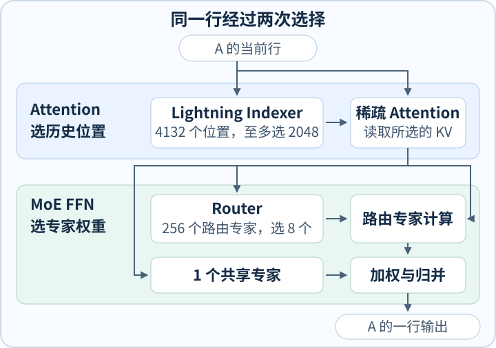

# 一条 Token 怎样走过模型的一层：Attention、FFN 与 MoE

假设你正在续写 `SELECT name FROM`，这一轮只处理请求 A 的一个新位置。Runner 已经把这行放进输入，也给了模型读写历史所需的地址。走进模型的一层后，这一行要回答两个问题。前面的哪些内容和我有关？带上这些信息后，用哪套权重变换我？前一个问题由 Attention 或递归模块处理，后一个由 FFN 处理。MoE 把 FFN 分成多套专家权重，每行只选择其中一部分。

本章数的是模型文本主干的层和逻辑张量。手算按单行、无 TP 切分、无图补齐展开。遇到真实部署，再看模型构造、backend 实例和各 rank 的本地形状。[从调度到模型输入的过程](从一轮调度到一次前向.md)

- Qwen3-8B → Qwen3-30B-A3B。[四行怎样分给专家？](#qwen-gqa-moe)
- DeepSeek-V3.2 → V4.1-Flash。[两次 TopK 各选什么？](#deepseek-two-topk) · [后层怎样借用 KV？](#deepseek-v41-cross-layer)
- Qwen3.5-35B-A3B、GLM-5.3-Flash。[混合层怎样选 FFN？](#hybrid-layer-selection) · [KeyPool 选组后读什么？](#keypool-vs-lightning)
- Kimi K3。[专家为何只算 3584 维？](#kimi-latent-moe)
- Hy4-Flash。[两种 MLA 各调什么算子？](#hy4-flash-attention)

## 一行 `[1,4096]` 怎样穿过 Qwen3-8B 的一层？

先看一层最容易顺着代码读的模型。Qwen3-8B 有 36 层，隐藏宽度 4096。每层都用 GQA 和稠密 FFN。这里读上游 vLLM 的 `Qwen3DecoderLayer`，忽略 TP 和残差的融合实现，沿一行看形状。[模型配置](https://huggingface.co/Qwen/Qwen3-8B/blob/main/config.json) · [层构造和 `forward()`](https://github.com/vllm-project/vllm/blob/c410543d9/vllm/model_executor/models/qwen3.py#L165-L236)

| 调用 | A 的一行发生了什么 |
| --- | --- |
| `qkv_proj` | 从 4096 个输入元素投影出 Q `[1,32,128]`，新 K 和 V 各 `[1,8,128]` |
| `q_norm`、`k_norm`、`rotary_emb` | 在对应的头和位置上准备 Q、K，然后交给内层 Attention |
| `attn` → `o_proj` | 新 K/V 按写槽保存。每组四个 Q heads 共用一个 KV head，查询各自可见的历史。Attention 输出按 32 个 heads 拼接，再投回 `[1,4096]` |
| `gate_up_proj` → `act_fn` → `down_proj` | 同一行映射成两份 12288 元素，一份做 SiLU，再逐元素乘另一份。所得 `[1,12288]` 投回 `[1,4096]` |

在 Python 层，`Qwen3Attention.forward()` 把 Q、K、V 交给 `self.attn(q,k,v)`。分页后端才用 metadata 完成 KV 写入和读取。当前层的残差跟着这条行传递，FFN 不再查询请求的 KV 页。上游把部分残差相加和下一次 norm 合并，并携带 `residual`。表里数的是每步的逻辑形状。[Qwen3 投影与 Attention 调用](https://github.com/vllm-project/vllm/blob/c410543d9/vllm/model_executor/models/qwen3.py#L140-L163) · [稠密 MLP 的乘门与降维](https://github.com/vllm-project/vllm/blob/c410543d9/vllm/model_executor/models/qwen2.py#L80-L114) · [KV 页和写槽](KV缓存布局与递归状态.md)

把代码停在两步之间。Attention 返回后，FFN 的输入还要过一次 `post_attention_layernorm`。下面是该层前向的后半段，`residual` 和 FFN 输出一起返回给后续层。[层内调用的实际顺序](https://github.com/vllm-project/vllm/blob/c410543d9/vllm/model_executor/models/qwen3.py#L228-L236)

```python
hidden_states = self.self_attn(positions=positions, hidden_states=hidden_states)
hidden_states, residual = self.post_attention_layernorm(hidden_states, residual)
hidden_states = self.mlp(hidden_states)
return hidden_states, residual
```

**试一试。** 暂且假设 BF16，每个元素 2 B。这一层新增的一个历史位置占多少逻辑 KV？若令同样的 32 个 Q heads 各自拥有独立 K/V，又是多少？

<!-- DETAILS: 核对 GQA 的字节数 -->

GQA 是 `2×8×128×2=4096 B`。若改为 Q/KV 各 32 heads，则是 `2×32×128×2=16384 B`。都只数该层的一个新位置，实际设备页还可能补齐，TP 下也要检查每 rank 的本地 heads。

<!-- /DETAILS -->

## Attention 选历史，MoE 选权重。两次 TopK 各选了什么？

<a id="qwen-gqa-moe"></a>

### Qwen3 换上 MoE 后，四行输入为什么要做 32 次专家任务？

换成 Qwen3-30B-A3B，同一行先经过 GQA（32 个 Q heads、4 个 KV heads），再进入 `Qwen3MoeSparseMoeBlock`。构造时，层把 `GateLinear` 交给 `FusedMoE`。执行时，MoE 收到一行，gate 给它产生 128 个专家分数，再按配置选 8 个专家并汇总加权结果。每个专家使用自己的 FFN 权重，这个检查点的专家中间宽度是 768；混合后的结果仍对应原来的一行，隐藏宽度 2048。四行在同一层都走 MoE 时是 `4×8=32` 次路由专家任务。几条输入选中同一个专家时，可以合在一组矩阵乘里。有 EP 时，再按物理专家所在的 rank 分发并归还结果。[模型配置](https://huggingface.co/Qwen/Qwen3-30B-A3B/blob/main/config.json) · [Router 与专家执行](https://github.com/vllm-project/vllm/blob/c410543d9/vllm/model_executor/models/qwen3_moe.py#L172-L247) · [层里的 Attention 与 MoE](https://github.com/vllm-project/vllm/blob/c410543d9/vllm/model_executor/models/qwen3_moe.py#L346-L415) · [EP 的 Dispatch 与 Combine](EP通信与通算融合.md)

沿原来的四行看，Qwen3-8B 的稠密 MLP 直接收下四行，整批在同一套权重上做 `gate_up_proj` 和 `down_proj`。Qwen3-30B-A3B 中，若 A、B 都选到专家 E7，E7 会收到 A、B 两行。计算完成后，A 的这份结果用 A 对 E7 的路由权重加回 A，B 的那份回到 B。剩余专家同样归并，因此这 32 次专家任务最后只交还四行。沿源码读时，先找 `self.experts(hidden_states=…, router_logits=…)`，再在 [EP 的 AllToAllV 算例](../dist/ep-communication.html#ep-communication-2) 对照专家行怎样展开和逆重排。[Qwen3 稠密 MLP](https://github.com/vllm-project/vllm/blob/c410543d9/vllm/model_executor/models/qwen2.py#L80-L114) · [MoE 入口](https://github.com/vllm-project/vllm/blob/c410543d9/vllm/model_executor/models/qwen3_moe.py#L225-L247)

<a id="deepseek-two-topk"></a>

### DeepSeek-V3.2 的 2048 个位置和 8 个专家分别去哪？

DeepSeek-V3.2 在同一层里能看到两次选择。先取它的第 12 层，索引从 0 开始。前三层用稠密 FFN，第 12 层已是 MoE。它的 DSA 用 Lightning Indexer 为当前行挑历史位置，最多 2048 个，再用选出的索引读取历史的 MLA 缓存。MoE Router 对 Attention 之后的表示打分，从 256 个路由专家中选 8 个，另外还有一个共享专家。若当前共有 4132 个可见位置而 Indexer 选满，Attention 使用的是其中 2048 个位置；MoE 的 8 表示该行要交给的专家数，此外共享专家也处理该行。一个输出仍回到本行。[V3.2 模型配置](https://huggingface.co/deepseek-ai/DeepSeek-V3.2/blob/main/config.json) · [构造 Attention、稠密层和 MoE 层](https://github.com/vllm-project/vllm/blob/c410543d9/vllm/model_executor/models/deepseek_v2.py#L1250-L1356) · [Ascend SFA 读取 TopK 索引](https://github.com/vllm-project/vllm-ascend/blob/913f9d79f/vllm_ascend/attention/sfa_v1.py#L2272-L2311)



所以看到 `TopK` 时先看它输出的 ID 被谁消费。如果作为 `topk_indices` 交给 Sparse Flash Attention，它要和逻辑历史、物理页对上。如果 Router 输出的是专家 ID 和权重，执行器接下来关心的是专家位置、消息和每个专家分到了几行。把这两份输出分别记下来，就能区分是历史读取变化了，还是同一行的专家计算变了。[稀疏 KV 的索引与回填](稀疏KV卸载与HiSparse.md) · [逻辑专家到物理槽](负载均衡与专家并行.md)

## 历史越长，下一行一定要读更多 KV 吗？

在 GQA 的全量 Attention 中，一行 Q 要与本请求因果可见的所有位置计算。MLA 把每位置写到缓存里的 K/V 表示压成 latent 及模型所需的 Key 分量，能减少每位置的缓存规模。**是否还要读遍历史**看模型有没有再做位置选择。例如 Kimi K3 的全量 MLA 仍读可见历史，DeepSeek-V3.2 的稀疏 MLA 先筛位置再读主 KV。Indexer 自己也要处理候选历史，主 Attention 读得少还要加上索引工作。[Kimi 选层源码](https://github.com/vllm-project/vllm-ascend/blob/913f9d79f/vllm_ascend/models/kimi_k3/kimi_k3.py#L691-L723) · [Attention 与辅助缓存拆分](KV缓存布局与递归状态.md)

<a id="keypool-vs-lightning"></a>

### KeyPool 把四个位置合成一条，为什么主 Attention 还要读四条？

在 DeepSeek-V3.2 的 Lightning Indexer 里，每个历史 Token 有一条索引 Key。当前 query 给各位置打分，得到最多 2048 个原始位置。举例说，位置 4 很相关、位置 5 关系很弱，两者可以一个入选、一个落选。主 Attention 再拿选中的位置查自己的 MLA KV 页。[DeepSeek-V3.2 技术报告 §2.1](https://modelscope.cn/models/deepseek-ai/DeepSeek-V3.2/resolve/master/assets/paper.pdf) · [Ascend 逐位置索引](https://github.com/vllm-project/vllm-ascend/blob/f643a9363/vllm_ascend/device/device_op.py#L577-L635)

GLM-5.3-Flash 把筛选搬到组上。`key_pool` 用模型的门控和位置参数，把 4 个连续位置的索引 Key 汇成一条。`pool_key_indexer` 给完整组打分，选中覆盖 `4–7` 的组就会把 4、5、6、7 都交给主 Attention。`pack_keypool_indices()` 还会附加因果可见、尚未凑成一组的末尾位置。最终 SFA 拿到的是原始位置索引和主 KV 页表，所以它仍能给这四条 512 维 latent 分别算注意力权重。[模型配置](https://huggingface.co/zai-org/GLM-5.3-Flash/blob/46a050be/config.json) · [生成组 Key](https://github.com/vllm-project/vllm-ascend/blob/f643a9363/vllm_ascend/attention/indexer_kpool.py#L1093-L1115) · [组打分](https://github.com/vllm-project/vllm-ascend/blob/f643a9363/vllm_ascend/attention/indexer_kpool.py#L1167-L1198) · [写入尾部索引](https://github.com/vllm-project/vllm-ascend/blob/f643a9363/vllm_ascend/ops/triton/glm5_next_cann_keypool.py#L139-L175) · [SFA 消费位置索引](https://github.com/vllm-project/vllm-ascend/blob/f643a9363/vllm_ascend/attention/sfa_v1.py#L2293-L2305)

固定 **4099 个因果可见位置**，含当前 Token，数一次 Decode query 的逻辑工作量。

- **Lightning Indexer** 给 4099 个位置打分，选满时保留 2048 个。主 Attention 读 2048 条 KV。
- **KeyPool** 给 `4096÷4=1024` 个完整组打分，选满时保留 `2048÷4=512` 组。再附加尾部位置 4096、4097、4098，主 Attention 读 `512×4+3=2051` 条 KV。

索引侧对完整历史打分的候选约为原来的四分之一，组内四个位置一起入选。主 KV 仍逐位置保存。对照设备时间时，分开看 `key_pool` 的状态维护、`pool_key_indexer` 的打分和 SFA 的主 KV 读取。表里的比例只数逻辑候选。[主 KV、索引 Key 和 tail 的实际布局](../dist/kv-cache-layouts.html#kv-cache-layouts-9)

<a id="deepseek-v41-cross-layer"></a>

### DeepSeek-V4.1-Flash 借用别层的 KV 后，还要自己选历史位置吗？

V3.2 的 DSA 在当前层选中原始位置后，从当前层的 MLA 缓存取对应记录。V4.1-Flash 的 CSA2 多了两种复用：全局历史可以用一条记录表示多个原始位置，后面的层也能借用前面层的全局 KV、Indexer K 或 TopK。它的 `wkv` 直接生成供多个 Q heads 共用的 K/V 向量，这和 V3.2 的 MLA 投影各有自己的张量组织。[V3.2 技术报告 §2.1](https://modelscope.cn/models/deepseek-ai/DeepSeek-V3.2/resolve/master/assets/paper.pdf) · [V4.1 CSA2](https://arxiv.org/html/2609.19969v1#S2.SS3) · [V4.1 的 `wkv` 投影](https://github.com/vllm-project/vllm-ascend/blob/f643a9363/vllm_ascend/models/deepseek_v41/model.py#L443-L483)

V4.1-Flash 的 40 层各有 128 位置滑窗，额外的全局 KV 与 Indexer K 由层 2、8、14、20 写入。借到全局 KV 后，有的层会用自己的索引 Q 重新选位置，有的层直接接过上一个选择者的 TopK。拿层 20、24、26 演示这两种情况，层号从 0 开始。[层型与所有者配置](https://huggingface.co/deepseek-ai/DeepSeek-V4.1-Flash/blob/314113f8/config.json) · [模型层角色](https://github.com/vllm-project/vllm-ascend/blob/f643a9363/vllm_ascend/models/deepseek_v41/model.py#L604-L647)

| 层号 | 这一层怎样取得 TopK | 主 Attention 用谁的历史 |
| --- | --- | --- |
| 20 | 为后续层提供 Indexer K，运行自己的选择 | 层 20 的滑窗与本层全局 KV |
| 24 | 用层 24 的索引 Q、层 20 的 Indexer K 重新选择 | 层 24 的滑窗与层 20 的全局 KV |
| 26 | 读层 24 留下的 TopK | 层 26 的滑窗与层 20 的全局 KV |

走读 `dsa_v41.py` 时，先看层 26 进入 `not self.role.is_index_source` 分支，从 `shared.topk_indices` 取索引。接着 `_forward_attention()` 用 `long_kv_source_prefix` 找到层 20 的全局缓存，把它和层 26 的滑窗缓存一起传给算子。两次查找的所有者可以不同。[索引的生产与复用](https://github.com/vllm-project/vllm-ascend/blob/f643a9363/vllm_ascend/attention/dsa_v41.py#L660-L707) · [两份 KV 的算子入参](https://github.com/vllm-project/vllm-ascend/blob/f643a9363/vllm_ascend/attention/dsa_v41.py#L704-L781)

Attention 返回后，本层 `hc_post()` 先更新残差流，随后第二次 `hc_pre()` 和 `post_attention_layernorm()` 给 `self.mlp()` 准备当前行。MoE 用本层的 `gate` 和 `FusedMoEFactory`，每行从 384 个路由专家选 6 个，另有 1 个共享专家。这次选择和先前读到的历史 TopK 分属两条调用链。层 26 即使沿用层 24 的历史位置，仍要为**层 26 的专家权重**计算自己的路由。[归并残差、进入本层 FFN](https://github.com/vllm-project/vllm-ascend/blob/f643a9363/vllm_ascend/models/deepseek_v41/model.py#L1105-L1138) · [路由与共享专家配置](https://github.com/vllm-project/vllm-ascend/blob/f643a9363/vllm_ascend/models/deepseek_v41/model.py#L264-L332)

## 看一眼模型配置，能猜出这一层的 A 和 FFN 吗？

<a id="hybrid-layer-selection"></a>

### Qwen3.5 和 GLM 的第 0 层都写着 linear attention，FFN 为什么不同？

把两个检查点的 `layer_types[0:4]` 展开。它们开头都是三个 `linear_attention`，第 3 层换回能查历史位置的 Attention。到这一层为止，两份配置读起来很像。再看 `self.mlp` 的构造，就能看出差异。[Qwen3.5 配置](https://huggingface.co/Qwen/Qwen3.5-35B-A3B/blob/main/config.json) · [GLM-5.3-Flash 配置](https://huggingface.co/zai-org/GLM-5.3-Flash/blob/46a050be/config.json)

| 检查点 | 第 0 层 A → FFN | 第 3 层 A → FFN |
| --- | --- | --- |
| Qwen3.5-35B-A3B | GDN → MoE | GQA → MoE |
| GLM-5.3-Flash | KDA → 稠密 FFN | KeyPool 稀疏 MLA → MoE |

Qwen 的 `Qwen3_5DecoderLayer` 按 `layer_type` 选 GDN 或 GQA。这个检查点的 `model_type=qwen3_5_moe_text`，两种层都构造 `Qwen3NextSparseMoeBlock`。GLM 的 `Glm5NextDecoderLayer` 则分别读 `layer_types` 和 `mlp_layer_types`。`mlp_layer_types[0]` 是 `dense`，`mlp_layer_types[3]` 是 `sparse`。因此一个服务只把第 0 层切到另一种 Attention 后端时，是否需要专家通信仍由该层的 FFN 和 EP 配置决定。[Qwen 两处构造](https://github.com/vllm-project/vllm/blob/c410543d9/vllm/model_executor/models/qwen3_5.py#L143-L184) · [GLM 两处构造](https://github.com/vllm-project/vllm-ascend/blob/f643a9363/vllm_ascend/models/glm5next/model.py#L320-L379)

假设 A 又走了一步，历史从 4099 增到 4100。在第 0 层，GDN 或 KDA 读上一步保留的短卷积状态和递归矩阵，用当前行更新它们。只增加这个请求的历史长度时，单份递归矩阵的形状沿用原值。在第 3 层，Qwen 的 GQA 读 4100 个因果可见位置并写当前位置的 K/V。GLM 的稀疏 MLA 刚把 4096–4099 凑成一个新组，这四个位置从尾部进入完整组的候选集合，随后按新的 TopK 读取主 KV。于是同一个位置在两层留下了不同的数据，捕获这轮 Trace 时也会看到不同的操作。[GDN 的读写状态](https://github.com/vllm-project/vllm-ascend/blob/f643a9363/vllm_ascend/attention/gdn.py#L1079-L1098) · [GLM 的 KDA 与状态](https://github.com/vllm-project/vllm-ascend/blob/f643a9363/vllm_ascend/models/glm5next/kda.py#L882-L917) · [KeyPool 尾部计数](https://github.com/vllm-project/vllm-ascend/blob/f643a9363/vllm_ascend/attention/indexer_kpool.py#L861-L868) · [递归状态形状](../dist/kv-cache-layouts.html#kv-cache-layouts-11)

<a id="kimi-latent-moe"></a>

### Kimi K3 的 Router 收到 7168 维，为什么路由专家只算 3584 维？

先在 `AscendKimiDecoderLayer` 找 `is_kda_layer()`。KDA 层携带卷积和递归状态，MLA 层用分页 KV。两条分支最后都给 `self.mlp` 交回隐藏宽度 7168 的一行。是否进 MoE，看接下来的 `is_moe_layer_idx()`。这个检查点首层用稠密 FFN，其余主干层用 Latent MoE。[Kimi K3 配置](https://huggingface.co/moonshotai/Kimi-K3/blob/f831ab66/config.json) · [两次选层](https://github.com/vllm-project/vllm-ascend/blob/f643a9363/vllm_ascend/models/kimi_k3/kimi_k3.py#L691-L746)

把 A 的一行送进 `AscendKimiMoE.forward()`。`self.gate(hidden_states)` 先在完整的 7168 维上算 896 个专家分数。然后 `self.experts` 接到这一行和 `router_logits`。执行器用前者准备两个输入：路由分支通过 `routed_input_transform` 得到 3584 维，给选中的 16 个路由专家。共享分支保留原宽度。路由结果归并后，`routed_output_transform` 把 3584 维投回 7168 维，再和共享输出合到 A 的一行里。[Router 与专家投影](https://github.com/vllm-project/vllm-ascend/blob/f643a9363/vllm_ascend/models/kimi_k3/kimi_k3.py#L382-L498) · [执行器分开准备并合并两支](https://github.com/vllm-project/vllm-ascend/blob/f643a9363/vllm_ascend/ops/fused_moe/fused_moe.py#L191-L291)

```text
当前行 [1,7168]
  gate → [1,896] 路由分数 → 选 16 个专家
  routed_input_transform  → [1,3584] → 专家计算与加权归并
  routed_output_transform → [1,7168] ← 与共享分支的 [1,7168] 合并
```

手算一次相同精度下的激活。如果两份表示都用 BF16，完整的一行占 `7168×2=14 KiB`，降维后的路由输入占 `3584×2=7 KiB`。若 Dispatch 传送的是这份降维后的 BF16 激活，同一个目的 rank 的一份逻辑载荷就按 7 KiB 计。合计传了多少还要看远端目的地、去重、真实传输精度与 scale。Router 读的输入宽度和它为当前行选出的专家数继续沿用配置。[按目的 rank 复用激活的计数](../dist/ep-communication.html#ep-communication-3)

### 模型结构速查

表中层数指文本主干。查看部署时，用下一节对照 Prefill、Decode 和实际 KV dtype。

| 检查点 | A 怎样接触历史 | FFN 怎样处理当前行 |
| --- | --- | --- |
| [Qwen3-8B](https://huggingface.co/Qwen/Qwen3-8B/blob/main/config.json) | 36 层 GQA，Q/KV heads 为 32/8 | 各层稠密，SwiGLU 的中间宽度 12288 |
| [Qwen3-30B-A3B](https://huggingface.co/Qwen/Qwen3-30B-A3B/blob/main/config.json) | 48 层 GQA，Q/KV heads 为 32/4 | 每层 MoE，128 选 8 |
| [Qwen3.5-35B-A3B](https://huggingface.co/Qwen/Qwen3.5-35B-A3B/blob/main/config.json) | 30 层 GDN、10 层 GQA | MoE，256 选 8，另有共享专家分支 |
| [DeepSeek-V3.2](https://huggingface.co/deepseek-ai/DeepSeek-V3.2/blob/main/config.json) | 61 层稀疏 MLA，Indexer 的历史位置上限 2048 | 前 3 层稠密，其余为 256 选 8、另加 1 个共享专家 |
| [DeepSeek-V4.1-Flash](https://huggingface.co/deepseek-ai/DeepSeek-V4.1-Flash/blob/314113f8/config.json) | 40 层各有 128 位置滑窗，部分层写或借全局 KV | MoE，384 选 6，另有 1 个共享专家 |
| [Kimi K3](https://huggingface.co/moonshotai/Kimi-K3/blob/f831ab66/config.json) | 24 层全量 MLA、69 层 KDA | 首层稠密，其余为 Latent MoE，896 选 16，另有 2 个共享专家 |
| [GLM-5.3-Flash](https://huggingface.co/zai-org/GLM-5.3-Flash/blob/46a050be/config.json) | 11 层稀疏 NoPE MLA、34 层 KDA | `mlp_layer_types` 指定 3 层稠密、42 层 MoE，MoE 为 288 选 8、另有 1 个共享专家 |
| [Hy4-Flash](https://github.com/Tencent-Hunyuan/Hy4-flash#model-introduction) | 30 层滑窗 MLA、12 层 IndexPool MLA，`kv_lora_rank` 都为 512 | 首层稠密，其余为 Latent MoE，512 选 16，另有 1 个共享专家 |

## `attention/` 里的文件多，当前层到底进哪个？

Ascend 通用选择器读 `use_mla`、`use_sparse` 与 `use_compress`，结合硬件、算子包和配置选后端。选完类后，这一层的 `forward()` 还会看本轮形状。以普通 GQA 为例，`attention_v1.py` 只有在纯 Decode、无滑窗且满足 PA 条件时才调 `_npu_paged_attention`，其余常规路径交给 FIA。专用模型也能直接指定后端，例如 V4.1 由自己的层构造和缓存角色决定读哪份历史。[平台选择器](https://github.com/vllm-project/vllm-ascend/blob/f643a9363/vllm_ascend/platform.py#L447-L496) · [GQA 算子分流](https://github.com/vllm-project/vllm-ascend/blob/f643a9363/vllm_ascend/attention/attention_v1.py#L1328-L1349) · [V4.1 层构造](https://github.com/vllm-project/vllm-ascend/blob/f643a9363/vllm_ascend/models/deepseek_v41/model.py#L1007-L1037)

<a id="ascend-attention-operators"></a>

### 同一层进入 Prefill 和 Decode，各调什么算子？

以下是 2026 年 11 月 24 日对应源码快照里的调用入口。FIA 指 `torch_npu.npu_fused_infer_attention_score`，FIA V2 指 `torch_npu.npu_fused_infer_attention_score_v2`。同一行列出多个入口时，按列中的条件找实际路径。

| 模型与层型 | Prefill / Decode 的主算子与选择条件 |
| --- | --- |
| Qwen3 · 稠密 GQA | 常规 Prefill 和 Decode 用 **FIA**。满足 PA 条件的纯 Decode 可走 `_npu_paged_attention`，有 attention sink 的分支可用 **FIA V2**。[FIA 与 sink](https://github.com/vllm-project/vllm-ascend/blob/f643a9363/vllm_ascend/attention/attention_v1.py#L920-L1035) · [PA 条件](https://github.com/vllm-project/vllm-ascend/blob/f643a9363/vllm_ascend/attention/utils.py#L312-L330) |
| DeepSeek-V3/R1、Kimi K3 · 全量 MLA | `mla_v1.py` 常规 **Prefill 用 FIA，Decode 用 FIA V2**。A5 上兼容的 MRv2、head 数、KV 布局与 CANN 包可让 Decode 走 `flash_mla`。`quant_flash_mla` 还要满足适用的 Kimi DSpark 草稿条件。[Prefill](https://github.com/vllm-project/vllm-ascend/blob/f643a9363/vllm_ascend/attention/mla_v1.py#L1744-L1807) · [Decode](https://github.com/vllm-project/vllm-ascend/blob/f643a9363/vllm_ascend/attention/mla_v1.py#L3077-L3129) · [FlashMLA 条件](https://github.com/vllm-project/vllm-ascend/blob/f643a9363/vllm_ascend/attention/mla_v1.py#L1181-L1222) |
| DeepSeek-V3.2、GLM-5、Kimi K3.1 · DSA | 先用 `npu_lightning_indexer` 或量化 Indexer 选位置，再用 **`npu_sparse_flash_attention`（SFA）**读选中的 KV。packed INT8/FP8 KV 分支用 **`npu_kv_quant_sparse_flash_attention`（QSFA）**，部分条件走带 `_vllm` 后缀的自定义实现。[Indexer](https://github.com/vllm-project/vllm-ascend/blob/f643a9363/vllm_ascend/device/device_op.py#L577-L635) · [SFA/QSFA](https://github.com/vllm-project/vllm-ascend/blob/f643a9363/vllm_ascend/device/device_op.py#L638-L790) |
| GLM-5.3-Flash · KeyPool 稀疏 MLA | `key_pool` 和 `pool_key_indexer` 先给出位置。官方示例的 **A3 INT8 主 KV、A5 FP8 主 KV** 各走 NoPE C8 的 `npu_kv_quant_sparse_flash_attention_vllm`。无 C8 时，NoPE 可依据计划走 CANN `sparse_flash_mla` 或 `npu_sparse_flash_attention`。主 KV 和 Indexer 的 dtype 分别配置。[部署参数](https://github.com/vllm-project/vllm-ascend/blob/f643a9363/docs/source/tutorials/models/GLM5.3-Flash.md#L277-L382) · [NoPE 分流](https://github.com/vllm-project/vllm-ascend/blob/f643a9363/vllm_ascend/attention/sfa_v1.py#L174-L248) · [C8 调用](https://github.com/vllm-project/vllm-ascend/blob/f643a9363/vllm_ascend/device/device_op.py#L764-L790) |
| DeepSeek-V4 / V4.1-Flash · 压缩 Attention | **V4** 普通路径按设备和 KV 格式选 `npu_sparse_attn_sharedkv`、CANN `sparse_flash_mla` 或 `mixed_quant_sparse_flash_mla`。**V4.1** 的非 packed 路径用 `_C_ascend.npu_sparse_flash_mla`，A5 packed 路径用 `mixed_quant_sparse_flash_mla`。这次调用同时接收滑窗与可用的全局 KV。[V4 分流](https://github.com/vllm-project/vllm-ascend/blob/f643a9363/vllm_ascend/attention/dsa_attn_kv_plan.py#L229-L283) · [V4.1 非 packed](https://github.com/vllm-project/vllm-ascend/blob/f643a9363/vllm_ascend/attention/dsa_v41.py#L704-L781) · [V4.1 packed](https://github.com/vllm-project/vllm-ascend/blob/f643a9363/vllm_ascend/models/deepseek_v41/mixed_quant_attention.py#L246-L293) |
| MiniMax-M3 / M3.1-Flash · MSA | 稀疏 Decode 用 **CANN `generic_block_sparse_attention`（GBSA）**。源码中的 Prefill 分支根据形状和可用的算子包走 GBSA、`npu_sparse_attention_score_prefill` 等路径。在稀疏层里，TopK 交给主 Attention 的是 KV 块索引。[MSA 的 Prefill 和 Decode](https://github.com/vllm-project/vllm-ascend/blob/f643a9363/vllm_ascend/models/minimax_m3/ops/msa_m3_npu.py#L723-L860) |
| Qwen3.8-Flash-Next · QSA | **短 Prefill 用 FIA V2，长 Prefill 与 Decode 用 GBSA**。Prefill 按 **24K 逻辑 KV** 分流，跨过阈值的那个 chunk 仍可走 FIA V2。[请求分流](https://github.com/vllm-project/vllm-ascend/blob/f643a9363/vllm_ascend/models/qwen4_exp/attention_dispatch.py#L11-L51) · [FIA V2 调用](https://github.com/vllm-project/vllm-ascend/blob/f643a9363/vllm_ascend/models/qwen4_exp/fia.py#L155-L176) · [GBSA 调用](https://github.com/vllm-project/vllm-ascend/blob/f643a9363/vllm_ascend/models/qwen4_exp/gbsa.py#L75-L97) |
| Qwen3.5/3.6 · GDN | Prefill 按 dtype、设备和上下文并行等条件在 `fla_npu` 的 `chunk_gated_delta_rule_fwd`、`npu_chunk_gated_delta_rule` 和 Triton 分块实现之间选择。普通 Decode 用 `recurrent_gated_delta_rule` 更新状态。[Prefill 分流](https://github.com/vllm-project/vllm-ascend/blob/f643a9363/vllm_ascend/attention/gdn.py#L941-L1074) · [Decode](https://github.com/vllm-project/vllm-ascend/blob/f643a9363/vllm_ascend/attention/gdn.py#L1080-L1097) |
| Kimi K3、GLM-5.3-Flash · KDA | Prefill 用 `fla_npu` 的 `chunk_kda_fwd` 扫一批输入并写回最终状态。Decode 用 `recurrent_kda` 更新当前请求的状态。[两次调用](https://github.com/vllm-project/vllm-ascend/blob/f643a9363/vllm_ascend/ops/kda.py#L9-L100) |

拿一条 QSA 请求走过阈值。历史已有 24,000 个位置，本次 Prefill 加 1024 行，当前逻辑长度是 25,024。虽然已经超过 `24×1024=24,576`，`QSARequest.fia_query_end` 看到这一块**从阈值之前开始**，仍把整块交给 `qsa_fia_attention()`。下一块开始时已有 25,024 个位置，就交给 `qsa_gbsa_attention()`。随后单行 Decode 也走 GBSA。查 Trace 时，将每块的起始历史长度与是否 Prefill 一起对照，才知道为什么同一个 QSA 层先出现 FIA V2，后出现 GBSA。[跨阈值判断](https://github.com/vllm-project/vllm-ascend/blob/f643a9363/vllm_ascend/models/qwen4_exp/attention_dispatch.py#L31-L51) · [同批分发到两条算子路径](https://github.com/vllm-project/vllm-ascend/blob/f643a9363/vllm_ascend/models/qwen4_exp/attention_dispatch.py#L108-L182)

<a id="hy4-flash-attention"></a>

### Hy4-Flash 的滑窗 MLA 和 IndexPool MLA 怎样跑？

继续用位置 4098，当前共有 4099 个可见位置。滑窗层固定取 `4098−511=3587` 到 4098，共 512 个位置。IndexPool 层按内容对历史分组选择，预算最多 2048 个位置，有机会读到 3587 之前的内容。两种层都用 512 维 KV latent，并带 RoPE Key。一个参数回答怎样表示历史，另一个机制回答当前看哪段历史。[模型结构与窗口大小](https://github.com/Tencent-Hunyuan/Hy4-flash#model-introduction)

把这两个 layer type 追到 Ascend 的公开 950DT 适配 PR。符合条件的 **SWA Prefill** 先收集并解量化窗口涉及的 FP8 KV，再调 `torch_npu.npu_fusion_attention`。这里 `sparse_mode=4`、`pre_tockens=window−1`、`next_tockens=0`，就是前 511 个加当前。**IndexPool Prefill** 的 C8 路径则把选择结果和 packed KV 一起交给 CANN `kv_quant_sparse_flash_attention`。Trace 里看到前者之前有 gather/解量化，或后者之前有索引选择，都可以沿相应入参查回页表和位置。[SWA Prefill](https://github.com/LostFox11/vllm-ascend/blob/c7031e87/vllm_ascend/models/hy_v4_flash/c8_kvqsfa.py#L115-L181) · [IndexPool Prefill](https://github.com/LostFox11/vllm-ascend/blob/c7031e87/vllm_ascend/models/hy_v4_flash/c8_kvqsfa.py#L28-L90)

**分页 Decode** 有拆开执行的路径。先用滑窗位置或 IndexPool 结果 gather KV，再做 QK、带 learned sink 的 softmax 和 PV，最后接 V 投影。比如一个请求有多条验证 query，相邻滑窗可以从同一段已读回的 KV 取各自的窗口。要核对实际镜像的算子，应以运行版本和批次条件为准。官方部署文档提供 950DT 实验镜像，以上调用链来自截至所查快照仍在审查的适配 PR。[共享窗口读取](https://github.com/LostFox11/vllm-ascend/blob/c7031e87/vllm_ascend/models/hy_v4_flash/attention.py#L1203-L1254) · [Decode 的 QK / softmax / PV](https://github.com/LostFox11/vllm-ascend/blob/c7031e87/vllm_ascend/models/hy_v4_flash/attention.py#L1751-L1773) · [官方实验部署](https://docs.vllm.ai/projects/ascend/en/latest/tutorials/models/HY4-Flash.html) · [适配 PR](https://github.com/vllm-project/vllm-ascend/pull/22839)

<a id="ascend-fa-variants"></a>

### 三个带 Flash Attention 名称的后端，各用谁的计划？

先在实际选中的类里找导入来源。`flash_attention_v3.py` 的 `flash_attn_npu_3` 路径先调 `get_scheduler_metadata()`，再调 `flash_attn_with_kvcache()`。`fa_v1.py` 用另一套 CANN `flash_attn_metadata` → `flash_attn`，例如适用的 A5 GLM 或 MiniMax 草稿。另一个 `fa3_v1.py` 通过 `flash_attn_npu_v3`，由训练与推理一致性配置启用。在 Trace 里要先认出是哪一条调用，再找精确长度与计划分别在哪准备。[设备 tiling FA3](https://github.com/vllm-project/vllm-ascend/blob/f643a9363/vllm_ascend/attention/flash_attention_v3.py#L241-L289) · [CANN FlashAttn](https://github.com/vllm-project/vllm-ascend/blob/f643a9363/vllm_ascend/attention/fa_v1.py#L102-L153) · [训练一致性分支](https://github.com/vllm-project/vllm-ascend/blob/f643a9363/vllm_ascend/platform.py#L2123-L2148)

例如两轮草稿各有两行，图档位相同，验证多拒绝一项会让有效长度从 4132 变成 4131。`flash_attention_v3.py` 可以把本轮计划写进原地址，所以同一张图读到的是更新后的内容。与普通 FIA 对照时，要沿设备进度 D2H、CPU 等待和 FA3 的计划生产者各追一次。[FIA 如何取得 4132](../dist/execution.html#fia-host-length) · [FA3 两轮回放与 Trace 取证](../dist/execution.html#fa3-plan-replay)

## Trace 里同一行突然变慢，先查历史还是专家？

先记录这行的 `request_id`、本轮 batch 和层号。低成本地做两种对照。一组保持批行数，改历史长度，记录 A 的实际后端、可见长度、Indexer 的候选与 TopK、读到的 KV 或状态。另一组固定历史长度与后端，对照专家路由，记录每行的 TopK、每个目的 rank 的任务数、Dispatch 与 Combine 及其等待。要单独验证一种专家布局时，应固定逻辑路由和权重。完整模型里上下文会改变激活和路由，所以跨请求比较还要同时记录两侧的工作量。

最终在同一轮找出哪个阶段延后了下一层或采样。A 侧 `TopK=2048` 只能说明一个选择上限，FFN 侧 `top_k=8` 也只说明每行的专家任务数。实际受限于哪段，需要该模型、设备和合法配置的采样。本章的形状、字节数及层内顺序来自配置、源码和手算。[前向的 Trace 排查](从一轮调度到一次前向.md) · [专家通信的设备对照](EP通信与通算融合.md)
