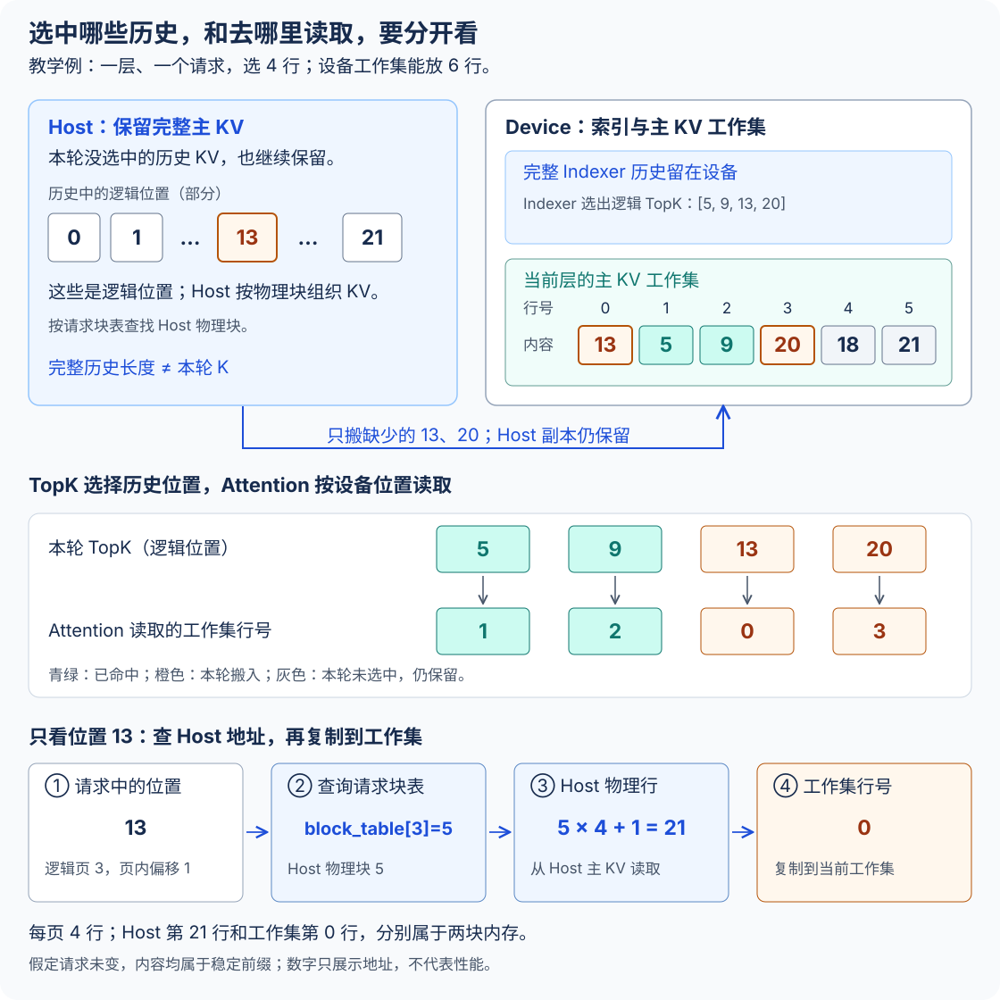
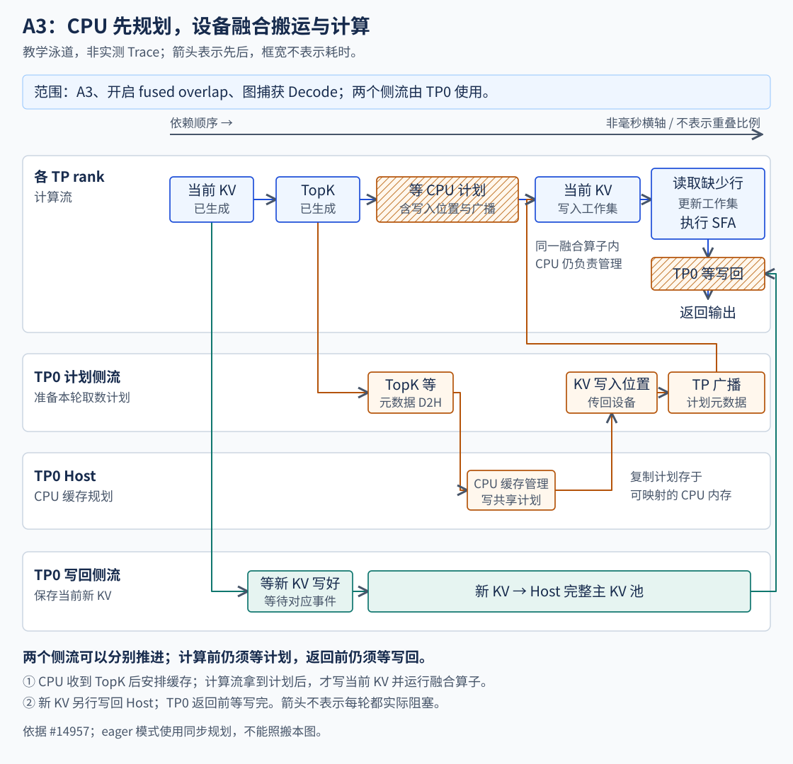
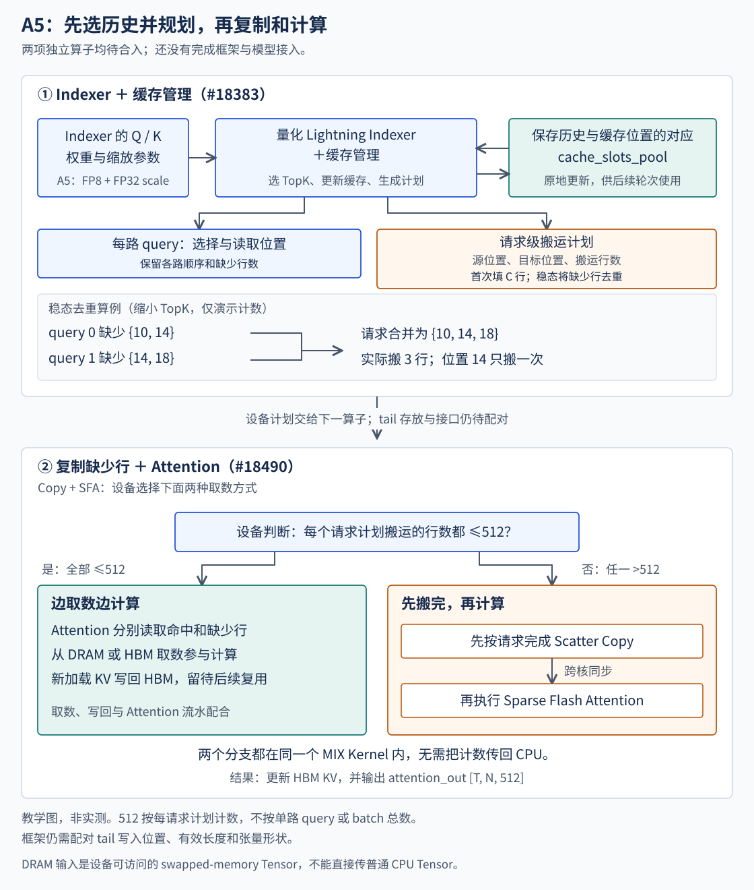
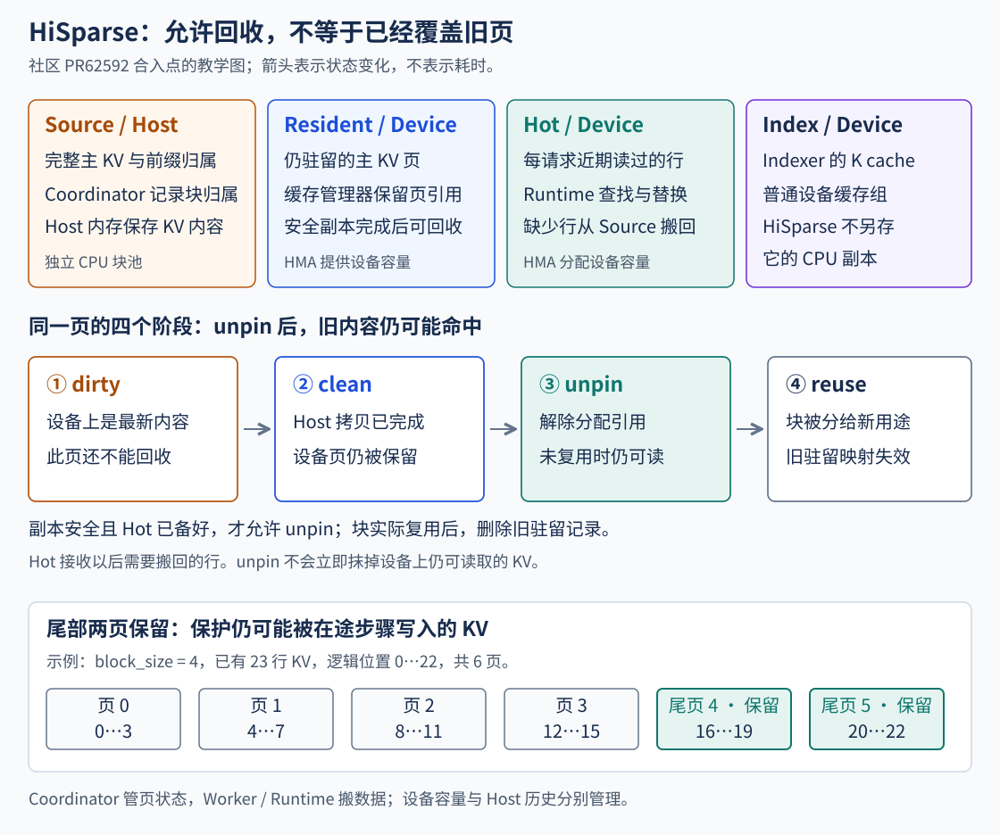
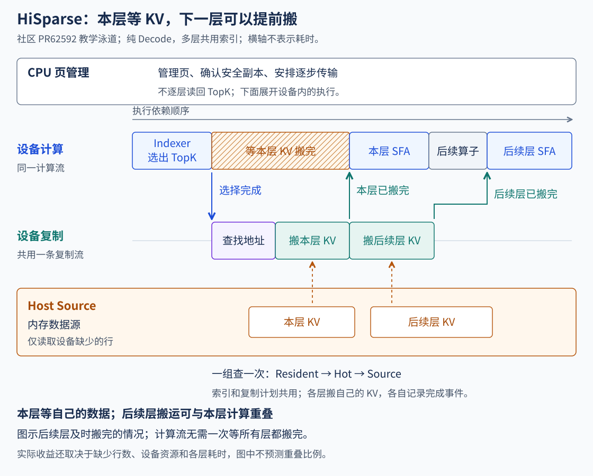

# 稀疏 KV：从 Decode Offload 到 HiSparse

稀疏 Attention 每轮只读取选中的历史位置。DeepSeek-V3.2 用 Lightning Indexer 做这项选择，结果称为 TopK。上下文很长时，可以把主 KV 历史放在主机内存（Host），设备（Device）每轮只取回需要的历史位置的 KV，以减少设备常驻的主 KV。 [KV 缓存布局与递归状态](KV缓存布局与递归状态.md)

这里有两个问题：选中的 KV 现在放在哪里，何时能读？Indexer 给出的是 token 在请求中的逻辑位置。要找到对应的 KV，还需查询缓存映射。设备上已有有效副本时，Attention 可以直接读取。未命中时，则要等所需的 KV 从 Host 复制到设备。

> 本章用缓存算例解释取数与等待过程。图和泳道都是教学示意，横轴不表示实测时间。初版、A3、A5 和社区 HiSparse 各有自己的实现和接入条件。

为便于读图，本章把物理页展平成按 Token 排列的表：“一行 KV”表示一个历史位置保存的主 KV 向量，行号以这份向量为单位，不是字节地址。Host 和设备是两份存储，行号要分别计算。物理页（block/page）把多行放在一起分配，`block_size` 表示每页能容纳多少个历史位置。

## TopK 是 2048，为什么还要保存完整历史？

TopK 每轮都可能改变。即使本轮只读 2048 行，下一轮仍可能选中其他历史位置，因此主 KV 要保留完整历史。

Decode Offload 初版把完整 Main MLA KV 放在 TP 组共享的 Host pool，把 Indexer 的完整 K/scale 缓存留在设备。设备还保留一个固定大小的主 KV 工作集：最近搬过且仍有效的行可以继续使用，不必每轮重搬。

Main MLA KV 保存的是压缩向量（latent）与 RoPE 部分，不是普通 MHA 的完整 K、V 两份。源码中即使有 `k_cache`、`v_cache` 这样的变量名，也要按实际张量拆分理解。 [初版框架与张量组织](https://github.com/vllm-project/vllm-ascend/pull/13026/files)



例如下面的 BF16 算例，每轮选中的 2048 行如果全部不在设备工作集中，每个 TP rank 在这一层为一行 query 搬回的主 KV 就有 2.25 MiB。命中越多，需要搬运的数据就越少。耗时还取决于小块复制的启动开销、地址准备和同步。

<!-- DETAILS: 容量复算：选中行、设备工作集与有效载荷 -->

假设一层主 KV 的 latent 为 512 维、RoPE 为 64 维，均用 BF16，单行有效载荷为：

```text
每行 Main MLA KV = (512 + 64) × 2 = 1152 B
K = 2048，全部 miss：2048 × 1152 = 2.25 MiB
C = 4096，Device 工作集：4096 × 1152 = 4.5 MiB
```

**2.25 MiB 是单个 TP rank 在一层中为一行 query 搬回的 KV 数据量**，只计算未命中的 KV，未计入索引、描述符、对齐和其他缓冲。假设命中率为 80%，需要搬回的数据约为 0.45 MiB。小块复制仍有启动开销，时延还取决于地址准备和同步。

<!-- /DETAILS -->

设备暂存空间还随 query 行数分配。MTP 会让一条请求带来多行 query，所以不能只用请求数乘上单行工作集容量。卸载后，完整 Host 历史与设备上的完整 Indexer 缓存仍随序列增长。 [分配与描述符实现](https://github.com/vllm-project/vllm-ascend/pull/13026/files)

<!-- DETAILS: 暂存容量和搬运参数缓冲 -->

最大 query 行数为 `R=min(max_num_batched_tokens, max_num_seqs×(1+num_speculative_tokens))`。因此 MTP 的容量预算需要按 R 计算，不能只按请求数乘 4.5 MiB。

初版为每个缓存未命中的行（miss），分别生成 latent 和 RoPE 的源地址、目标地址及长度。最大参数缓冲为 `40×R×K+4 B`。常规规划分支会把整块最大容量缓冲送回设备；跨层 `skip_topk` 分支则复用描述符。

复制参数与复制 KV 是两次不同的数据传输。不能只按本轮有效描述符数量估计实际参数传输。

<!-- /DETAILS -->

## 一轮 Decode 的 TopK 解析与 KV 回填

一轮 Decode 既要保存当前新算出的 KV，也要找到本层 Attention 选中的历史。PreAttention 先生成当前 Token 的 latent/RoPE，TP0 将它们写入共享 Host pool；Indexer 再根据设备上的索引历史给出本层 TopK。初版随后把选择结果交给 CPU 检查缓存。 [Attention 及 manager 调用链](https://github.com/vllm-project/vllm-ascend/pull/13026/files)

```text
设备 Indexer 选出 TopK
  → 把 TopK、请求和前缀信息送到 CPU
  → CPU 检查缓存，决定缺少的行放到哪里
  → 把源地址、目标地址和长度送回设备
  → TP 同步，确认当前新 KV 已写好
  → 搬回缺少的 KV，并给出设备读取位置
  → Sparse Attention 读取设备工作集
```

CPU 使用 LRU 管理工作集，也就是优先替换较久未用的内容。它先检查选中位置是否仍缓存在当前 query 行对应的工作集中；没命中时才选择可替换位置。对每个未命中的位置，CPU 还要查这条请求的块表，才能算出 Host 上的源地址。

看一个缩小的例子：工作集有 6 行，本轮选 4 行。原内容为 `[2,5,9,11,18,21]`，按最近使用顺序，第 0 行最旧、第 5 行最新。请求没有改变，所有条目都属于稳定前缀。

本轮选择 `[5,9,13,20]`。5、9 已在工作集第 1、2 行；13、20 没有命中，替换第 0、3 行。因此 Attention 按 `[1,2,0,3]` 读取，仍与原 TopK 一一对应。

逻辑位置 13 的 KV 也不一定放在 Host 第 13 行。若每页 4 行、`block_table[3]=5`，它位于 Host 第 `5×4+1=21` 行，这次要复制到设备工作集第 0 行。请求中的位置、Host 地址和设备读取位置，要分别计算。

<!-- OFFLOAD_LAB -->

### 请求没变，命中的 KV 为什么仍会失效？

缓存命中还必须意味着内容没变。初版为每层、每条 query 行保存映射：这行换了请求，旧映射就清空。MTP 的临时后缀也可能被重写，即使逻辑位置相同，也不能复用上一次候选的 KV。

源码用 `stable_prefix_len=actual_seq_len−当前 query span` 确定稳定前缀，并使工作集中位于该边界及之后的条目失效。否则“命中”会读到旧内容。 [请求归属与稳定前缀失效](https://github.com/vllm-project/vllm-ascend/pull/13026/files)

Graph 模式可以通过当前计算流上的 Host callback 执行 LRU，但仍要先得到 TopK，再规划、复制，最后运行 Attention。跨层 `skip_topk` 可以复用描述符并调整基址，省去部分索引准备；这本身不证明搬运已经与其他层计算重叠。

### Prefill 按层换入完整历史

Prefill 和稀疏 Decode 需要的数据不同。按层卸载的 Prefill 会换入该层完整历史，用少量设备缓冲轮转；稀疏 Decode 只换入本轮选中的行。

Prefill 一层通常有较多计算，可以尝试同时搬下一层。Decode 则要等本层刚生成的 TopK 才知道搬什么，不能直接套用相同的重叠安排。总体卸载方案分别设计这两部分。 [Layerwise Prefill 与 sparse Decode 方案](https://github.com/vllm-project/vllm/issues/48203)

### PD 交接中主 KV 与 Indexer 的去向

初版正常卸载时，D 不保留完整的设备主 KV。因此 P→D 交接要把主 KV 送进 D 的 Host pool，同时让完整 Indexer 缓存在 D 的设备上可用。仅把传输目的指针由设备改成 Host，还不能说明交接完成：布局、交接信息、完成事件和缓存保留条件都要相互匹配。

初版支持范围是 DSA/SFA、PD 分离的 Decode、TP 及对应 Runner 路径。`keep_device_kv_cache` 保留完整设备主 KV 的分支用于调试，不能用它证明正常卸载节省了多少设备容量。部署时还要按目标版本确认 P→D connector 的实际实现、布局和完成事件。 [初版支持边界](https://github.com/vllm-project/vllm-ascend/pull/13026)

## A3 如何在 CPU 上规划、在设备上搬运和计算？

初版先把缺少的 KV 搬完，再单独运行稀疏 Attention（SFA）。A3 用同一个算子 `npu_fused_sparse_attention_overlap` 读取未命中的行、更新设备工作集并计算 Attention。算子内部按流水方式执行这些操作。

这项融合没有取消 CPU 缓存管理。完整 KV 仍在共享 Host 内存，CPU 仍负责规划；设备算子接过规划结果，再取数据和计算。 [A3 融合实现](https://github.com/vllm-project/vllm-ascend/pull/14957)

TopK 等信息先送到 TP0 的 CPU。C++ planner 检查缓存并写出紧凑计划，放进可映射的 CPU membership 缓冲。设备算子按计划从共享 Host KV 读取缺少的行，填入 selection 缓冲；当前新 KV 则直接从计算结果写入 selection。这里的 selection 就是该路径供 Attention 读取的设备工作集。 [A3 实现与算子说明](https://github.com/vllm-project/vllm-ascend/pull/14957/files)



图中展示的是启用 fused overlap 的 Decode 分支。该分支使用已捕获的图，本轮不含 Prefill。TP0 把“新 KV 写回 Host”和“准备取数计划”放在不同侧流。计划侧流先等 TopK，再传到 CPU 规划，将当前 KV 写入位置传回设备，并在 TP 组内广播计划信息。

计算流拿到计划后，先写入当前 KV，再执行融合算子。TP0 返回前仍要等新 KV 写回 Host 完成。eager 的同步安排不同，不能套用这张图。

图中的广播只传计划信息，并帮助各 rank 确认数据已可见，不是把完整 KV 在 TP ranks 间做 All-to-All。各 rank 共用 Host KV 视图，但各有自己的设备计算和 selection 缓冲。

现有材料没有可复用的 A3 实测 Trace。这张图只说明哪些步骤可以并行、哪些步骤必须等待，不表示已隐藏了多少时间。

## A5 的 Indexer + Manage 与 Copy + SFA

A5 尝试把两处工作分别融合。第一处是 Lightning Indexer + Manage：设备选出 TopK 后，继续检查命中、分配缓存位置并生成复制计划。第二处是 Copy + SFA：按计划搬运 C8 主 KV，并计算 Attention。

这两项仍是待合入的独立算子，框架与整模型接入尚未完成，不能把图理解成已经可直接运行的整条路径。 [Indexer + Manage 实现](https://github.com/vllm-project/vllm-ascend/pull/18383) · [Copy + SFA 实现](https://github.com/vllm-project/vllm-ascend/pull/18490)



### 逐 query 的 TopK 与请求级搬运计划

MTP 会让一条请求有多路 query，每路有自己的 TopK。同一历史位置可能被多路同时选中：Attention 要保留各路的选择顺序，复制时却只需搬一次。

<!-- DETAILS: 接口对照：每路 Attention 索引与每请求复制计划 -->

| 元数据 | 含义 | 交给哪一步使用 |
| --- | --- | --- |
| `cache_slots_pool` | 记录已缓存的源 token 与 HBM 槽位的对应关系，供后续步骤复用 | 后续步骤的缓存管理 |
| `topk_src_ids / topk_dst_slots` | 每路 query 选中的源 token 编号及目标槽位 | 每路 Attention |
| `topk_miss_counts` | 每路 TopK 列表开头连续未命中的项数 | 本路 query 读取 KV |
| `miss_src_ids / miss_dst_slots / miss_counts` | 每条请求的复制计划。稳态时合并各路 query 未命中的行并去重，首次卸载时按计划填充前缀缓存 | 复制 KV |

<!-- /DETAILS -->

稳态时，两路 query 如果分别缺 `[10,14]` 和 `[14,18]`，合并去重后只需搬 `[10,14,18]` 三行，这就是请求级 miss union。两路 Attention 仍各自引用需要的行。

首次进入卸载则不同。`request_state=-2` 会生成 C 行前缀初填计划，可能包含本轮 TopK 之外的行。因此实际复制不能始终按“本轮缺几行”理解。LI+Manage 只生成映射和计划，KV 由下游复制；上面的三行是教学算例。 [LI+Manage 的算子接口](https://github.com/vllm-project/vllm-ascend/pull/18383/files)

### Copy + SFA 如何按每个请求的搬运量选择分支？

Copy-SFA 根据本批每个请求的计划复制行数选择执行分支。所有请求都不超过 512 行时，Attention 取数时直接读取 DRAM 中缺少的行，参与计算后写入 HBM，供以后复用。

只要有一个请求超过 512 行，就先完成请求级 Scatter Copy，等各核同步后再做 SFA。两个分支都在同一个 MIX kernel 内，设备可以直接读取计数并选择分支，无需把计数传回 CPU。稳态时，判断的计数对应去重后的 miss union。 [Copy-SFA 算子实现](https://github.com/vllm-project/vllm-ascend/pull/18490/files)

比较 512 这个阈值时，每个请求单独计数。首次卸载取初填计划的行数，稳态取各路 query 合并去重后的未命中行数。

<!-- DETAILS: C8 行宽与 DRAM 输入类型 -->

C8 有效行宽为 `512×FP8 + 64×BF16 + 4×FP32 = 656 B`，内部缓冲对齐后为 672 B，两个数的口径不同。测试用带 DRAM backing 的 NPU tensor 表示 `dram_kv_bytes`，不能直接接普通 CPU tensor。

<!-- /DETAILS -->

### Tail 的存放与可见范围

请求末尾还在变化的一段 KV 称为 tail。LI+Manage 把连续 tail 放在前缀缓存预算之后，由上层写入和维护；它不进入持久 prefix pool，也不进入 miss-copy plan。Copy-SFA 则必须明确能读到哪些 tail 位置。

要把两项 PR 接入同一个框架，除了核对每个请求的 miss 张量维度，还要确认上层写入 tail 的位置都在 Copy-SFA 的可读范围内。

LI+Manage 源码已经按 tail 长度安排连续位置，但部分说明仍保留旧的固定 256 与取模规则。接入时要核对配对源码，不能沿用旧说明来决定 tail 写到哪里、Attention 能读哪些位置。 [LI+Manage 的当前改动](https://github.com/vllm-project/vllm-ascend/pull/18383/files)

## A5 算子段的测量条件与结果

把复制与 Attention 合到一个算子里，并不保证每种负载都会更快。Copy-SFA 作者报告了下面两组对照，条件相同：950、MTP3、上下文 65536、cache budget 12288。

| 每请求 miss | Batch | Split Copy+SFA | Fused Copy+SFA | Split / Fused |
| --- | --- | --- | --- | --- |
| 100 | 1 | 79.629 µs | 86.070 µs | 约 0.925× |
| 100 | 32 | 421.410 µs | 352.642 µs | 约 1.195× |

这是 PR 作者的算子段测量，不是本项目实测。batch=1 的这一项融合后更慢，batch=32 的这一项更快。结果只覆盖被测 Copy/SFA 内核，不能换算成整模型、TPOT 或服务吞吐收益。 [原始性能表与条件](https://github.com/vllm-project/vllm-ascend/pull/18490)

LI+Manage 的说明还把“融合总时延减 LI 时延”列为管理开销。这个差值可以为负，但不表示 CPU 或 NPU 管理任务花了负时间。比较时应保留 batch、MTP query 数、精度、命中情况、计时起止，以及是否计入缓冲恢复。 [LI+Manage 测量说明](https://github.com/vllm-project/vllm-ascend/pull/18383/files)

卸载可以让设备装下更多请求，同时也可能增加单请求等待搬运的时间。容量扩大与时延下降要分别验证，最终吞吐还受并发、调度和其他模型层影响。没有整模型或服务端测量时，结论止于被测算子段。

## HiSparse 的动态驻留与缓存分工

前面的卸载路线固定把完整主 KV 放在 Host，设备只留 Indexer 和工作集。即使低负载时 HBM 还有空间，请求也仍走这条取数路径；Prefill 与 Decode 的主 KV 也缺少统一的驻留管理。 [问题与适配动机](https://github.com/vllm-project/vllm-ascend/issues/19293)

HiSparse 允许根据容量决定主 KV 放在哪里。设备空间充足时，主 KV 页可以继续留在设备；压力增大时，先保证 Host 副本安全，再让部分设备页可被回收。

完整历史仍要保留，但“某页属于这条请求”和“这一刻它还在设备上”由不同信息记录。下面四个名字分别表示这套管理中的缓存用途。 [社区 HiSparse 设计](https://github.com/vllm-project/vllm/blob/70cb50da/docs/design/hisparse.md)

| 名称 | 保存什么 | 由谁管理 |
| --- | --- | --- |
| Source | 主 KV 的完整历史，以及每个前缀对应的 Host 块 | 独立 CPU block pool 与 Source 管理 |
| Resident | Device 上仍然存在的主 KV 页 | Resident 管理与 Coordinator |
| Hot | 每请求的 Device 热行区域，接收选中但不驻留的行 | Hot 管理与设备 resolver |
| Index | Indexer 的历史 K cache | 普通 Device KV group 的对应职责 |

设备侧的 Resident、Hot、Index 由 HMA 管理容量；Host 上 Source 的 CPU 块池独立管理。所以不能说所有缓存都由 HMA 持有。Indexer 的完整历史也仍在设备上，HiSparse 没有同时提供它的卸载机制。 [社区设计与管理边界](https://github.com/vllm-project/vllm/blob/70cb50da/docs/design/hisparse.md)

## Resident 页的写回、Unpin 与复用



刚写好的 Resident 页包含最新 KV，Host 副本尚未完成，状态叫 dirty。复制到 Host 完成后变为 clean，但设备上的页仍然存在。

只有容量策略允许，Coordinator 才对已封存（sealed）且有安全副本的页解除分配引用，这一步叫 unpin，表示块池可以把它分给别的用途。**unpin 不会立刻抹掉内容：只要物理块还没实际复用，旧 KV 仍可读取。** [Coordinator 与页状态](https://github.com/vllm-project/vllm/blob/70cb50da/vllm/v1/hisparse/coordinator.py)

因此，页进入空闲队列后，下一轮仍可能命中尚未覆盖的 Resident，不一定马上从 Host 重搬。真正复用时，才要删除旧页的驻留记录；否则可能拿旧块号读到别的内容。

这一清理发生在 `_on_block_reused()` 中，具体由 `_lose_page()` 删除记录。

社区实现会保留末尾仍可能变化的两页 KV（active tail）。回收其余页时，除了检查剩余容量，还要考虑 Hot 需要的空间和请求准入条件。成功分配 Hot 后，才可以解除已封存且已完成写回的 Resident 页的分配引用。 [分配、转换与尾页约束](https://github.com/vllm-project/vllm/blob/70cb50da/vllm/v1/hisparse/coordinator.py)

<!-- DETAILS: 回收阈值与驻留变化的源码接口 -->

本章引用的实现使用 `watermark=max(hot_cost, num_blocks//10)`，同时考虑 admission window。常量和条件应随实际运行版本核对。

哪些页仍在设备上，称为 residency。它的变化和普通块表追加分开传递：`take_residency_updates()` 取出 `SparseKVResidencyUpdate(pages, block_ids)`，原块表仍只追加，不重写已有条目。早期 RFC 的字段表不能直接当作这一实现的接口。 [Residency 更新结构](https://github.com/vllm-project/vllm/blob/70cb50da/vllm/v1/hisparse/types.py)

<!-- /DETAILS -->

### D 侧导入目标：Resident 或 Host

PD 交接时，D 先决定收到的完整前缀放在哪里。社区 HiSparse 的 NIXL 方案中，设备池装得下就直接写 Resident；装不下时，如果 Host Source 容量和设备固定工作集空间足够，可以选择 Host。

选择 Host 后，数据先经过 D 的有限设备暂存池，再拷入已注册 Host 内存；马上要用的页还会写到相应 Resident。准入重试保留原先选择，进入 Decode 后两条路径都由同一个 resolver 查找数据。 [NIXL 导入路径设计](https://github.com/vllm-project/vllm/blob/70cb50da/docs/design/hisparse.md#L149-L161)

Host 导入没有结束前，Coordinator 记录它仍在进行。只有连接器成功完成，才标记已导入的完整页，并安排末页恢复。Indexer 历史仍由 NIXL 交接到设备组。

这里是社区设计与源码行为。本项目 A5 Mooncake 实验使用普通 FullAttention，只实测了设备到设备交接，不能代替这条 Host 导入路径的验证。 [Host 导入的完成处理](https://github.com/vllm-project/vllm/blob/70cb50da/vllm/v1/hisparse/coordinator.py#L539-L565) · [Indexer 的 NIXL 去向](https://github.com/vllm-project/vllm/blob/70cb50da/docs/design/hisparse.md#L163-L175) · [PD 分离系统与 KV 生命周期](PD分离系统与KV生命周期.md)

<!-- DETAILS: Host 导入完成的函数 -->

在途导入保存在 `_pending_imports`。连接器结束后，`finish_host_import()` 调用 `complete_host_import()` 标记完成整页，并处理末页恢复。

<!-- /DETAILS -->

## HiSparse 的 TopK 解析与逐层回填

CPU 上的 Coordinator 决定页何时保留、写回和回收；每轮 TopK 到实际地址的转换，则由设备上的 resolver 完成。resolver 就是按缓存映射查找每个选中位置的那一步，不需要每个 Token 都把 TopK 回传 CPU。 [运行时设计](https://github.com/vllm-project/vllm/blob/70cb50da/docs/design/hisparse.md)

查找顺序是：先看该页是否仍在 Resident，再看该行是否已在 Hot；两处都没有，才从 Host Source 搬回。resolver 生成要复制的行与目标位置，由 gather 执行搬运，再把设备地址按原 TopK 顺序交给 Attention。 [Index Group](https://github.com/vllm-project/vllm/blob/70cb50da/vllm/v1/attention/backends/mla/index_group.py) · [Runtime](https://github.com/vllm-project/vllm/blob/70cb50da/vllm/v1/hisparse/runtime.py)

<!-- DETAILS: TopK 查找与回填的调用入口 -->

调用从 `HiSparseMLAIndexGroup.convert_logical_to_physical_topk()` 经 `HiSparseCacheHandle.swap_in()`、`HiSparseRuntime.swap_in()`，到达 `_resolve_and_stage_group()`。resolver 把需要从 Source 搬回的行及其目标位置整理成紧凑的复制计划。

<!-- /DETAILS -->



多层可以共用同一组索引。产生索引的层称为 leader，沿用索引的后续层称为 follower。复制流先等 TopK 生成，再解析地址，依次为 leader 和 follower 搬 KV，每搬好一层就记录该层的完成事件。

计算流只在使用某层 KV 前等待该层的事件。因此，本层必须先查地址、搬数据、再算 Attention，但这不等于整轮没有重叠：搬后续层的 KV 可以与前一层计算同时进行。各层共用索引，不共用 KV 内容。

### Attention 索引与 gather 计划的张量形状

播放器中的 HiSparse 例子有 23 行历史，每页 4 行。看选中的逻辑位置 10：它不在 Resident，也不在 Hot，需要从 Source 搬回。查 Source 块表得到 Host 第 `8×4+2=34` 行，resolver 为它安排设备第 101 行。

本轮八个选择中，五个直接读 Resident，一个命中 Hot，只有位置 10、14 两行需要搬回。Attention 仍按原选择顺序读取，不按数据来源重新排序。 [Runtime 的 resolver 参数](https://github.com/vllm-project/vllm/blob/70cb50da/vllm/v1/hisparse/runtime.py#L942-L1012)

<!-- DETAILS: 复算八个 TopK 的地址与输出张量 -->

Source 块表为 `[7,3,8,5,9,6]`。Resident 逻辑页 0、4、5 分别位于物理块 7、2、9，Hot 已保存逻辑位置 6，对应设备位置 100。TopK 为 `[1,2,6,10,14,17,20,21]`。位置 10 从 Host 行 34 搬到 101，位置 14 从 Host 行 22 搬到 102，最终 Attention 读取 `[29,30,100,101,102,9,36,37]`。

本例中，Attention 缓存的块轴步幅等于每页的行数，因此设备物理行号可以直接作为 Attention 索引。实际运行时，resolver 还要读取 Attention 缓存的块轴步幅。

共享 index group 预分配下面的输出缓冲，均用 `int32`。设调用中有 `R` 条 query row、TopK 宽度为 `K`，runtime 从共享缓冲截取对应的 `R` 行。

| 字段 | 本轮形状 | 本例内容及用途 |
| --- | --- | --- |
| `physical_topk_indices` | `[R,K]` | 8 个设备索引按 TopK 原顺序交给 Attention |
| `valid_topk_counts` | `[R]` | 需要计数的后端可取 8，用于区分有效索引与填充 |
| `swap_host_physical_rows`、`swap_device_physical_rows` | 各 `[R,K]` | gather 读取两个有效配对，34→101 与 22→102 |
| `swap_counts` | `[R]` | 2，限定这行计划的有效配对数 |

计划张量按最大宽度分配，gather 只读取计数范围内的有效配对。同一请求的多条 query 会共同保护本步选中的行；选中相同 Source miss 时，可以共用一个回填位置，Attention 仍各自保留引用。

follower 复用同一组索引和复制计划，但每层搬的是自己在 Host 上的 KV，并各自记录完成事件。 [共享缓冲的形状与 dtype](https://github.com/vllm-project/vllm/blob/70cb50da/vllm/v1/hisparse/runtime.py#L648-L662) · [gather 与逐层事件](https://github.com/vllm-project/vllm/blob/70cb50da/vllm/v1/hisparse/runtime.py#L1014-L1073) · [多 query 约束](https://github.com/vllm-project/vllm/blob/70cb50da/docs/design/hisparse.md)

<!-- /DETAILS -->

## Ascend 适配与融合算子的接入边界

移植到 Ascend，首先要让这套流程能使用目标设备的内存注册、缓存算子、格式视图、进程间事件和 DMA。Scheduler、Coordinator 以及 KV 的归属和回收策略可以继续沿用社区实现。

社区已合入平台后端接口：`Platform.get_hisparse_backend_cls()` 选择后端，`HiSparseBackend` 提供上述设备相关能力。 [后端抽象源码](https://github.com/vllm-project/vllm/blob/70cb50da/vllm/v1/hisparse/backend.py) · [平台抽象合入记录](https://github.com/vllm-project/vllm/pull/62592)

文奇的 Ascend 初版适配先保留社区流程，替换设备相关算子。地址查找与搬运仍分开，Attention 仍先调用 `swap_in()` 请求换入数据，再进行计算。打包的 KV 还要转换成 CANN SFA 所需的 latent/RoPE 视图，同时保留原索引顺序和重复项。

这种接法先复用社区管理和 Host→Device 搬运，便于逐层检查正确性。 [Ascend 适配实现](https://github.com/vllm-project/vllm-ascend/pull/19109)

仍在评审的适配包含 A5 C8 优化配置与兼容性检查，本项目尚未运行该组合。验证时要使用各 PR 指定的 Core 版本、设备和图模式。 [Ascend workspace 和 Host pool](https://github.com/vllm-project/vllm-ascend/blob/b32088ea/vllm_ascend/distributed/kv_transfer/hisparse/backend.py#L18-L74) · [当前适配与限制](https://github.com/vllm-project/vllm-ascend/pull/19109) · [后端基础 PR](https://github.com/vllm-project/vllm-ascend/pull/20926)

<!-- DETAILS: Ascend 工作区、Host pool 与部署限制 -->

所查较新后端由 leader 分配 resolver workspace，follower 从 leader 的 cache ops 取得同一份工作区，因此绑定顺序必须先有 leader。该后端为每个 TP rank 使用独立 Host pool，并关闭共享 Host pool 能力。

另有独立的后端基础 PR，包含实验性部署配置；不能把不同 PR 的能力直接合成一种可用配置。

<!-- /DETAILS -->

### 连续前缀边界，为什么不能直接替代 Resident 页表？

A5 的 LI+Manage / Copy-SFA 用一个连续边界区分 Host 历史前缀和设备 tail。但 HiSparse 的设备页可以不连续：页 0 还在，页 1、2、3 已被复用，页 4、5 又作为 tail 保留。仅凭前缀长度无法判断哪些中间页仍然驻留。

要接入这条融合路线，算子必须识别页级 Resident 映射，对每个 TopK 先查 Resident，再查 Hot，最后才从 Source 取。连续 tail 的快捷处理仍可保留，却不能代替中间离散页的判断。这项融合适配仍处于设计阶段。 [融合适配提议](https://github.com/vllm-project/vllm-ascend/issues/19293)

<!-- DETAILS: 接入检查：已有社区流程与后续融合改动 -->

| 要核对的事项 | 初版适配沿用的社区机制 | 融合适配需要确认的问题 |
| --- | --- | --- |
| 页的归属与回收 | 复用 Source/Resident/Hot 与 Coordinator | 设备看到的 residency 更新与复用失效一致 |
| TopK 解析 | resolver 产生物理索引与 compact plan | LI+Manage 是否接收离散 Resident 页表 |
| miss 数据就绪 | 每层 gather 完成后记录就绪事件 | 融合算子如何从 Source、Hot、Resident 取数，何时报告完成 |
| Prefill 历史 | Runtime 的历史 staging 路径 | 怎样把 Prefill 所缺的历史从 Host 复制到设备。Decode 的 TopK 只覆盖本轮选中的位置 |
| MTP 与 tail | 社区请求、有效范围和索引组流程 | union 保护、临时后缀失效、tail 槽范围及回滚 |

<!-- /DETAILS -->

用融合算子替换 `gather()` 时，需要逐项核对源地址和目标地址，并确定 Attention 何时可以读取、缓存何时可以回收。Prefill 还要读取历史 chunk，所需数据与 Decode TopK 不同；原来只面向 PD 分离 Decode 的实现，必须补上这部分。 [融合与 Prefill 适配提议](https://github.com/vllm-project/vllm-ascend/issues/19293)

## 采集 Decode Trace 时要对齐的事件

本章泳道只说明先后关系。要判断是否缩短一轮 Decode，比较时应固定模型、上下文、batch、MTP、精度、缓存命中和执行模式。采集至少要看清：何时选出历史，何时知道地址，何时搬完，以及 Attention 等待了多久。

<!-- DETAILS: 各路线需要关联的具体事件 -->

- 初版：Indexer 完成、TopK D2H、CPU LRU callback、描述符 H2D、miss copy、SFA；TP0 新 KV D2H 与 TP 同步另外标出。
- A3：计划侧流、新 KV 写回侧流、Host planner、scatter 当前 KV、融合算子、最终 writeback wait。能看到两个侧流，不代表两段都离开了关键路径。
- A5：LI+Manage、请求级 copy plan 计数、融合 copy-SFA 的分支、当前 tail 写入。区分首次初填与稳态 miss union，不能用每路 miss 代替请求级计划解释阈值。
- HiSparse：residency 更新、resolver、各层 gather-ready、compute wait、Source miss；同时记下 Resident/Hot 命中以及 unpin 与实际 reuse 的时点。

<!-- /DETAILS -->

按 TP rank 记录相关执行流，检查哪项工作还没完成、哪项工作因此等待。例如后续层已提前搬运，但本层 SFA 仍在等数据，重叠收益可能发生在其他层。复制字节变少而等待未缩短时，还要检查地址准备、小块搬运、同步和算子内部选择。

报告时分开列算子段、单轮模型耗时、TPOT 和稳态吞吐。Decode Offload 已提供一条节省设备主 KV 容量的路径，社区 HiSparse 则进一步统一管理并按需保留设备页。是否采用融合实现，仍取决于配对实现的正确性和同条件测量。

## 实现边界与参考资料

下表供对照代码和部署时查阅。下表的公开状态核查日期为 **2026-11-12**。社区 HiSparse 机制按平台抽象合入点说明，Ascend 适配引用各自的公开 PR 或源码快照。

<!-- DETAILS: 展开实现状态与社区资料 -->

| 材料 | 负责什么 | 公开状态 |
| --- | --- | --- |
| [RFC #48203](https://github.com/vllm-project/vllm/issues/48203) | Layerwise Prefill 与 sparse Decode 的总体方案 | 讨论中 |
| [Ascend #13026](https://github.com/vllm-project/vllm-ascend/pull/13026) | Host 主 KV、Device 工作集、CPU LRU 与 SFA 接入 | 已合入 |
| [Ascend #14957](https://github.com/vllm-project/vllm-ascend/pull/14957) | A3 fused sparse attention overlap 与框架接入 | 已合入 |
| [Ascend #18383](https://github.com/vllm-project/vllm-ascend/pull/18383) | A5 量化 Lightning Indexer + cache manage | 未合入，独立算子 |
| [Ascend #18490](https://github.com/vllm-project/vllm-ascend/pull/18490) | A5 C8 miss copy + Sparse Flash Attention | 未合入，独立算子 |
| [vLLM #62592](https://github.com/vllm-project/vllm/pull/62592) | HiSparse 平台后端接口，供 Ascend 等平台实现设备相关操作 | 已合入 |
| [Ascend #19109](https://github.com/vllm-project/vllm-ascend/pull/19109) | Ascend HiSparse 后端与 Attention 适配 | 未合入，配对与验证仍在推进 |
| [Ascend #20926](https://github.com/vllm-project/vllm-ascend/pull/20926) | Ascend HiSparse 后端基础与实验性配置 | 未合入 |
| [Ascend RFC #19293](https://github.com/vllm-project/vllm-ascend/issues/19293) | 复用社区管理、接入已有融合算子的后续设计 | 讨论中 |

总体方案包括逐层卸载的 Prefill 和稀疏 Decode。Ascend 初版框架实现了其中的稀疏 Decode，主要用于 PD 分离的 D 节点。A3 的融合实现和社区 HiSparse 各有独立的实现记录。

初版框架 PR 自身没有引入完整 P→D connector，其 guide 中的连接器名称也不能在该合入点找到对应实现，不能将其中的启动示例视作已核验命令。部署前仍需在目标版本中核对实际使用的连接器。

<!-- /DETAILS -->
