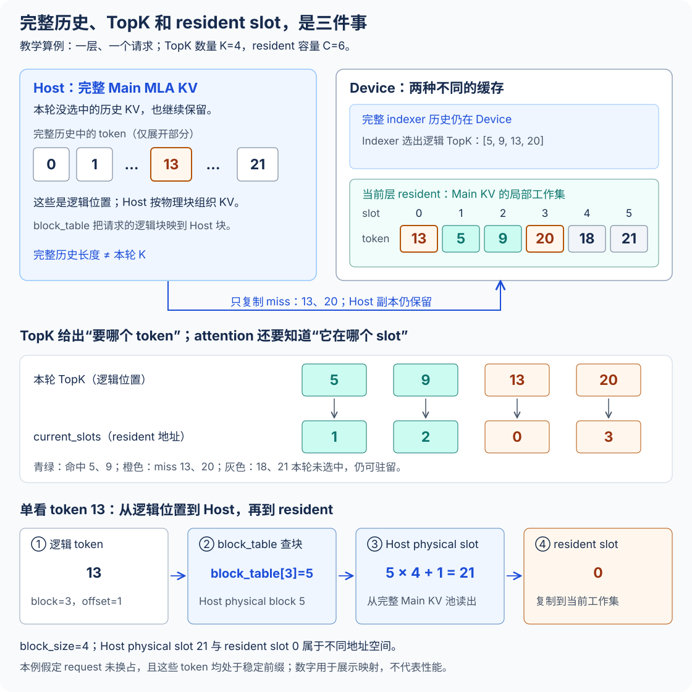
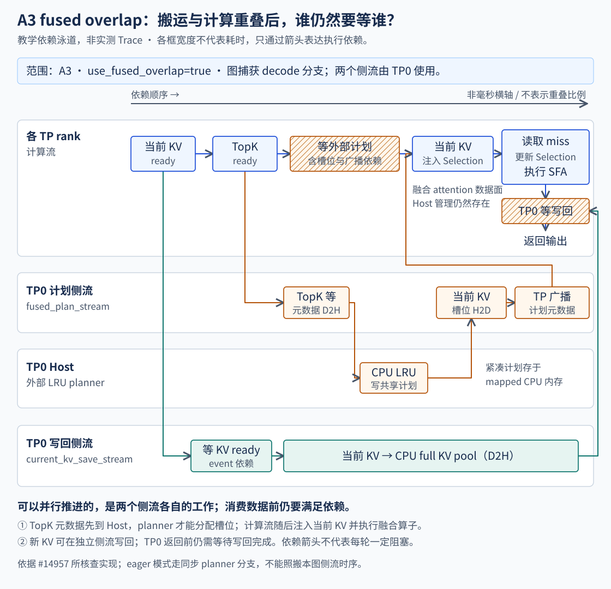
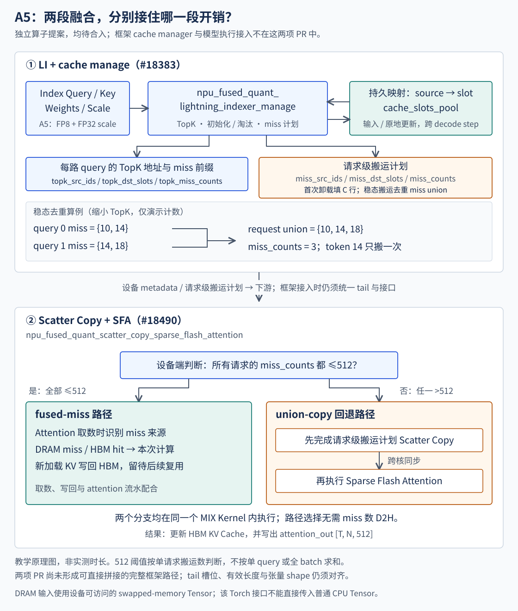
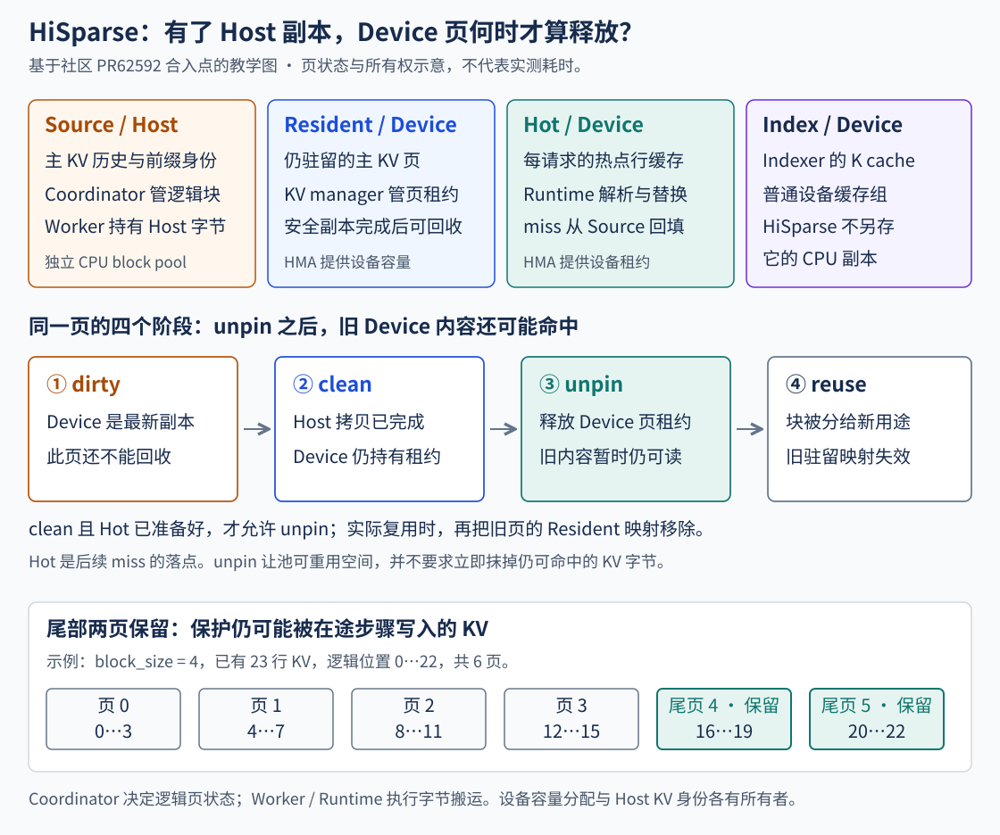
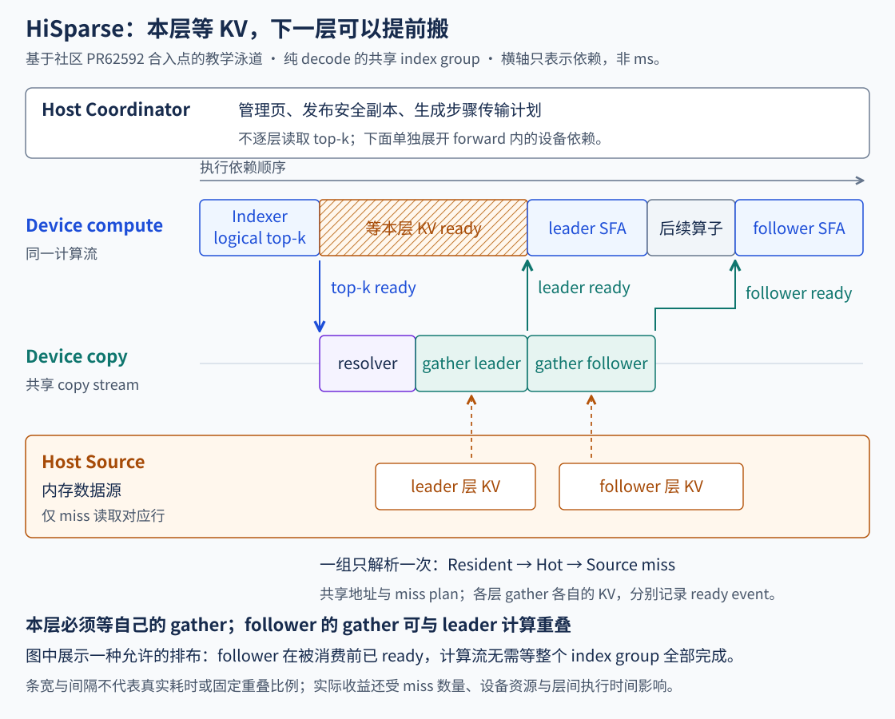

# 稀疏 KV：从 Decode Offload 到 HiSparse

前面算过 Lightning Indexer 与 DSA 的缓存：Indexer 每轮只选 TopK，不代表其余历史 KV 可以丢掉。下一轮选中的位置可能完全不同，完整历史仍要保存。长上下文把主 KV 撑大后，一个直接的办法是把历史放到 Host，每轮只把需要的行搬回 Device。

这样做把问题从“HBM 能否装下”推进到了“一轮 Decode 要等多久”。TopK 是逻辑位置，搬运需要物理地址；缓存命中需要知道这行属于哪个请求、内容是否仍然有效；Attention 则必须等本次需要的数据可读。框架、索引管理、拷贝算子和 Attention 的边界，正是在这里接起来的。

> 本章用具体缓存算例解释地址与数据依赖。原理图和泳道均为教学示意，横轴没有实测时间含义。

## 1. TopK 是 2048，为什么还要保存完整历史？

先把一次稀疏 Attention 需要的数据分开：完整 Main MLA KV 保存在共享 Host pool；Indexer 的完整 K/scale cache 仍在 Device；Device 另有固定大小的主 KV 工作集，用来复用前几轮已搬入的行。下面沿这条 Decode Offload 初版路径展开。

这里的 Main MLA KV 是压缩 latent 与 RoPE 部分，并非普通 MHA 的完整 K、V 两份。源码中某些变量叫 `k_cache`、`v_cache`，需要沿实际张量拆分确认含义。[初版框架与张量组织](https://github.com/vllm-project/vllm-ascend/pull/13026/files)



假设一层主 KV 的 latent 为 512 维、RoPE 为 64 维，均用 BF16，单行有效载荷为：

```text
每行 Main MLA KV = (512 + 64) × 2 = 1152 B
K = 2048，全部 miss：2048 × 1152 = 2.25 MiB
C = 4096，Device 工作集：4096 × 1152 = 4.5 MiB
```

2.25 MiB 的口径是 **每 query row、每层、每 TP rank 的 miss KV payload**，没有计入索引、描述符、对齐与其他缓冲。若构造 80% 命中，只剩约 0.45 MiB 的 payload；这只是乘法推导，不能据此断言时延也降到五分之一。小而散的搬运还受启动、地址准备和同步影响。

初版工作集按 query rows 预留。最大行数 `R=min(max_num_batched_tokens, max_num_seqs×(1+num_speculative_tokens))`，因此 MTP 会放大暂存容量，不能只用请求数乘 4.5 MiB。完整 Host 历史与完整 Device Indexer 也仍随序列增长。[分配与描述符实现](https://github.com/vllm-project/vllm-ascend/pull/13026/files)

这条路径为每个 miss 的 latent、RoPE 分别生成源地址、目标地址和长度；最大参数缓冲容量为 `40×R×K+4 B`。初版常规规划分支会把整块最大容量参数缓冲传回 Device，跨层 `skip_topk` 分支则复用描述符。它与随 miss 数变化的 KV payload 是不同的流量口径，不能只算有效描述符数量就代替实际 H2D。

## 2. 一轮 Decode：从逻辑 TopK，走到可读的工作集

初版链路中，新 KV 与选历史 KV 是两条相关路径。PreAttention 先产生当前 token 的 latent/RoPE；TP0 将它们写入 TP 组共享的 Host pool。Indexer 根据 Device 上的索引历史，产出本层逻辑 TopK。随后进入缓存命中与地址规划。[Attention 及 manager 调用链](https://github.com/vllm-project/vllm-ascend/pull/13026/files)

```text
Device Indexer → logical TopK
  → TopK / request / prefix metadata D2H
  → CPU LRU：检查命中、失效、选择目标槽
  → miss 源/目标描述符 H2D
  → TP 同步，保证新 KV 写入可见
  → miss KV H2D + TopK 槽号回传
  → Sparse Attention 读取 Device 工作集
```

这里的 CPU LRU 不是给每个 TopK 简单加一个地址偏移。它先判断某个逻辑位置是否仍在当前 row 的缓存里，再为 miss 找到可替换的槽。生成 Host 源地址时，还要经过请求的 block table。

取教学缩比 `K=4、C=6`，同一请求、稳定前缀覆盖所有条目。原有槽内容为 `[2,5,9,11,18,21]`，LRU 从旧到新为槽 `[0,1,2,3,4,5]`。本轮选 `[5,9,13,20]`：5、9 命中槽 1、2；13、20 替换槽 0、3。最终给 Attention 的物理槽顺序是 `[1,2,0,3]`，仍对应原 TopK 顺序。

logical token 13 也不是 Host 行 13。若 `block_size=4`、`block_table[3]=5`，其 Host 行为 `5×4+1=21`；它这次要写入的 Device 槽却是 0。逻辑身份、源地址、目标地址各有自己的映射。

<!-- OFFLOAD_LAB -->

### 请求相同，命中就一定有效吗？

初版映射按 layer × query row 维护。row 换了请求，旧映射必须清空；MTP 的临时后缀即使 token 位置相同，内容也可能已重写。源码用 `stable_prefix_len=actual_seq_len−当前 query span` 划出稳定前缀，使 resident 中位于该边界及之后的条目失效。否则缓存会“命中”旧内容，结果比多搬一次更严重。[请求归属与稳定前缀失效](https://github.com/vllm-project/vllm-ascend/pull/13026/files)

Graph 模式可在当前计算流安排 Host callback 来做 LRU，仍须满足 TopK→规划→miss copy→Attention 的数据依赖。跨层 `skip_topk` 复用描述符并调整基址，省掉部分索引准备；仅凭这一分支，不能画成跨层异步搬运已经覆盖了计算。

### Prefill 为什么不能直接套用 Decode 的搬运方式？

在按层卸载方案中，Prefill 按层换入完整历史，以少量 Device buffer 轮转；稀疏 Decode 则根据索引，只换入本轮需要的行。Prefill 一层通常有较多计算，可尝试覆盖下一层搬运；Decode 的本层 Attention 依赖刚生成的 TopK，不能直接套用这一重叠假设。两者在总体卸载方案中分别设计。[Layerwise Prefill 与 sparse Decode 方案](https://github.com/vllm-project/vllm/issues/48203)

### P 节点与 D 节点的交接还要单独接线

初版的正常模式不在 D 节点保留完整 Device Main KV。P→D 连接器必须把主 KV 交接到 D 侧 Host pool，并让完整 Indexer cache 可在 D 侧 Device 使用。只把原来 Device→Device 的目的指针改成 Host 指针，并不足以证明元数据、完成事件和生命周期都已对齐。

这条初版路径限定了 DSA/SFA、PD 分离 Decode、TP 和相应 Runner 路径；`keep_device_kv_cache` 保留完整 Device 主 KV 的分支是调试路径，不能拿它证明正常卸载的容量收益。部署时还需按目标版本核对 P→D connector 的实现、布局和完成事件。[初版支持边界](https://github.com/vllm-project/vllm-ascend/pull/13026)

## 3. A3：融合的是 miss 数据面，Host planner 仍然在

上一节先搬完 miss，再独立执行 SFA，Attention 要等搬运完成才能开始。A3 路径将 miss 读取、selection 更新与稀疏 Attention 放进 `npu_fused_sparse_attention_overlap`，在算子内部组织流水；共享 Host KV、外部 LRU planner 与 selection buffer 仍各有职责，CPU 管理器也仍然存在。[A3 融合实现](https://github.com/vllm-project/vllm-ascend/pull/14957)

TopK 等元数据仍先到 TP0 Host，C++ planner 产出 compact plan，写入映射的 CPU membership 缓冲。NPU 算子消费计划，从共享完整 Host KV 取 miss 并填 selection；当前新 KV 则从计算结果直接 scatter 到 selection。CPU 管理和设备数据面各自承担一段职责。[A3 实现与算子说明](https://github.com/vllm-project/vllm-ascend/pull/14957/files)



图对应 graph capture、fused overlap、无 Prefill 等条件下的相关分支：TP0 将新 KV D2H 与计划侧流分开；计划侧流等待 TopK，经历 metadata D2H、CPU planner、current slots H2D 和 TP metadata broadcast。计算流等待计划，注入当前 KV，再调用融合算子；TP0 返回前还会等待新 KV 写回完成。eager 分支的同步安排不同，不能把这张图套到所有执行模式。

注意图里的 broadcast 是计划元数据与可见性同步，不是 TP ranks 间对完整 KV 做 All-to-All。主 KV 是共享 Host 视图；每个 rank 仍有自己的设备计算与 selection 消费。当前可引用材料没有给出可复用的 A3 实测 Trace，因此图只解释依赖，不表示任何一段实际被隐藏了多少微秒。

## 4. A5：Indexer + Manage，与 Copy + SFA 两段如何衔接

除了 miss 搬运，Indexer 产出 TopK 后，还要完成命中判断、槽位分配和计划生成。A5 把这段数据流分为两处融合：量化 Lightning Indexer + Manage 在设备侧产出 TopK 和缓存计划；Copy + SFA 消费 miss 计划，完成 C8 主 KV 的搬运和 Attention。两者目前均为待合入的独立算子，框架与整模型接入尚未完成。[Indexer + Manage 实现](https://github.com/vllm-project/vllm-ascend/pull/18383) · [Copy + SFA 实现](https://github.com/vllm-project/vllm-ascend/pull/18490)



### 逐 query 的 TopK，和请求级搬运计划不是同一个数组

一个 MTP 请求有多路 query。每路都需要按自己的 TopK 顺序读 Attention 输入，但多个 query 可能选中相同历史 token。传输侧应合并这些 miss，不能简单把每路的数量相加。

| 元数据 | 含义 | 下游消费者 |
| --- | --- | --- |
| `cache_slots_pool` | 持久的 source token→HBM slot 映射 | 后续步 cache manage |
| `topk_src_ids / topk_dst_slots` | 每路 query 的源身份与目标槽 | 每路 Attention |
| `topk_miss_counts` | 每路 TopK 中 miss 前缀的长度 | 本路取数路径 |
| `miss_src_ids / miss_dst_slots / miss_counts` | 请求级 copy plan：稳态为多 query miss union；首次卸载为初填计划 | 实际 KV copy |

稳态时，例如两路 query 分别缺 `[10,14]`、`[14,18]`，请求级 union 为 `[10,14,18]`，只需搬三行；两路仍保留各自的 Attention 索引。首次进入卸载的 `request_state=-2` 则会生成 C 行 prefix 初填计划，可包含本轮 TopK 之外的行，不能拿稳态 miss union 解释全部状态。LI+Manage 负责映射和计划，实际 KV 传输归下游。这一边界来自 [LI+Manage 的算子接口](https://github.com/vllm-project/vllm-ascend/pull/18383/files)，三行例子是教学构造。

### Copy + SFA 并非所有 miss 数都走同一条流水

Copy-SFA 的分支条件是 **每个请求 copy plan 的计数**，稳态对应 union miss 数：全部请求均不超过 512 时，采用 source-aware fused 路径，在 Attention 取数中读取 DRAM miss、参与本次计算并写 HBM；任一请求超过 512，则在同一 MIX kernel 内先完成请求级 Scatter Copy，经跨核同步再执行 SFA。判断留在设备，不为读这个计数再做一次 D2H。[Copy-SFA 算子实现](https://github.com/vllm-project/vllm-ascend/pull/18490/files)

这里的 512 既不是 batch miss 总和，也不是某一路 query 的 miss 数。C8 有效行宽为 `512×FP8 + 64×BF16 + 4×FP32 = 656 B`；内部缓冲的 672 B 对齐行宽是另一个口径。`dram_kv_bytes` 在测试中以 DRAM backing 的 NPU tensor 表示，不能直接照普通 CPU tensor 的接口来接线。

### 接入前仍需对齐 tail 和地址空间

这两项 PR 还不能直接拼成已完成的框架例子。请求 miss 张量维度需要适配；更关键的是 LI+Manage 将连续 tail 放在 prefix cache budget 之后，由上层维护，tail 不进入持久 prefix pool 与 miss-copy plan，而 Copy-SFA 还要明确其可寻址 KV 范围。

LI+Manage 源码已按 tail 长度安排连续槽，部分说明仍保留旧的固定 256 与取模规则。接入时应以配对源码核对 slot 范围、tail 写入与 Attention 可见性，不能把旧说明当作稳定接口。[LI+Manage 的当前改动](https://github.com/vllm-project/vllm-ascend/pull/18383/files)

## 5. 看性能表，要先确认测的是哪一段

融合减少了边界，不代表所有 batch 和 miss 分布都加速。Copy-SFA 作者报告的同一组条件为 950、MTP3、上下文 65536、cache budget 12288；摘取其中两行：

| 每请求 miss | Batch | Split Copy+SFA | Fused Copy+SFA | Split / Fused |
| --- | --- | --- | --- | --- |
| 100 | 1 | 79.629 µs | 86.070 µs | 约 0.925× |
| 100 | 32 | 421.410 µs | 352.642 µs | 约 1.195× |

这两行都是 **PR 作者的算子段测量**，不是本项目实测；较小 batch 的这一项回退，较大 batch 的这一项获益。表中 Copy/SFA kernel 时延不能直接换成整模型加速、TPOT 或服务吞吐。[原始性能表与条件](https://github.com/vllm-project/vllm-ascend/pull/18490)

LI+Manage 的算子说明另报告了 LI 与 LI+Manage 的典型单算子时延。其管理开销按“融合总时延减 LI 时延”计算，负值不能被读成 CPU 或 NPU 管理任务耗时为负。比较应保留 batch、MTP query 数、精度、命中状态、计时边界和缓冲恢复是否计时等条件。[LI+Manage 测量说明](https://github.com/vllm-project/vllm-ascend/pull/18383/files)

容量收益与时延收益也要分开验证：卸载可能使更多请求装得下，却增加单请求的搬运等待；最终吞吐还受并发、调度和其他模型层影响。没有整模型与服务端证据时，结论止于被测算子段。

## 6. 为什么还要接社区 HiSparse？

现有路线为了尽快落地，把完整 Main KV 固定放在 Host，把 Indexer 留在 Device，在原有框架之外准备工作集。即使低负载时 HBM 还有空间，请求仍要走卸载与 miss 路径。它也缺少统一管理 Prefill 与 Decode 主 KV 驻留的能力。[问题与适配动机](https://github.com/vllm-project/vllm-ascend/issues/19293)

HiSparse 将“完整历史的身份”和“此刻是否驻留 Device”分开：容量足够时保留主 KV Resident；压力上来后，先保证 Host 安全副本，再逐步让 Device 页可回收。这样，卸载从固定部署选择，变成受页状态与容量控制的运行过程。[社区 HiSparse 设计](https://github.com/vllm-project/vllm/blob/70cb50da/docs/design/hisparse.md)

| 名称 | 保存什么 | 由谁管理 |
| --- | --- | --- |
| Source | Host 上主 KV 的逻辑完整历史、前缀身份 | 独立 CPU block pool 与 Source 管理 |
| Resident | Device 上仍然存在的主 KV 页 | Resident 管理与 Coordinator |
| Hot | 每请求的 Device 热行区域，接收选中但不驻留的行 | Hot 管理与设备 resolver |
| Index | Indexer 的历史 K cache | 普通 Device KV group 的对应职责 |

HMA 为 Resident、Hot、Index 等 Device group 管理容量；Source 的 CPU KV 身份由独立 CPU pool 管理，不能概括为“所有缓存都由 HMA 持有”。HiSparse 也没有偷偷把 Indexer 完整历史一起卸载；那需要另一个明确的卸载机制。[社区设计与管理边界](https://github.com/vllm-project/vllm/blob/70cb50da/docs/design/hisparse.md)

## 7. Dirty、Clean、Unpin、Reuse 是四件事



新写的 Resident 页先是 dirty：Host 副本尚未安全完成。D2H 完成后变 clean，但此时页仍在 Device。容量策略允许时，Coordinator 才解除 clean sealed 页的 allocation reference，也就是 unpin，使它可被池复用。**unpin 后内容仍可读，直到物理块实际被复用。** `_on_block_reused()` 再通过 `_lose_page()` 移除对应驻留关系。[Coordinator 与页状态](https://github.com/vllm-project/vllm/blob/70cb50da/vllm/v1/hisparse/coordinator.py)

所以，看到“页进入 free queue”不能立即推断下一轮必然 H2D。resolver 仍可能命中尚未被覆写的 Resident。反过来，实际复用发生后必须及时传播 residency 失效，不能继续拿旧 block ID 当有效 KV。

社区合入点保留两页 active tail。压力转换也不是无条件“剩 10% 就卸载”：watermark 为 `max(hot_cost, num_blocks//10)`，还考虑 admission window；Hot 分配成功后，才有条件释放 clean sealed Resident。常量和条件属于所核查实现，后续运行版本应再核对。[分配、转换与尾页约束](https://github.com/vllm-project/vllm/blob/70cb50da/vllm/v1/hisparse/coordinator.py)

Residency 变化与普通 block table 追加也分开传递。该合入点经 `take_residency_updates()` 取出 `SparseKVResidencyUpdate(pages, block_ids)`；原 block table 保持 append-only。RFC 里的早期字段表有其版本背景，不宜照抄成这里的接口。[Residency 更新结构](https://github.com/vllm-project/vllm/blob/70cb50da/vllm/v1/hisparse/types.py)

## 8. HiSparse 的 Decode 内部，谁解析 TopK，谁负责等？

Host Coordinator 管页生命周期；每层 Decode 内的 TopK 解析由设备 resolver 完成。两者不能混为“CPU 读回 TopK，再做规划”。社区路径不需要为逐 token 决策把 TopK 回读 Host。[运行时设计](https://github.com/vllm-project/vllm/blob/70cb50da/docs/design/hisparse.md)

调用可以沿 `HiSparseMLAIndexGroup.convert_logical_to_physical_topk()` → `HiSparseCacheHandle.swap_in()` → `HiSparseRuntime.swap_in()` 追到 `_resolve_and_stage_group()`。resolver 优先查 Resident，再查 Hot；剩余 Source miss 生成 compact copy plan，交给 gather 回填。返回给 Attention 的是物理 TopK，仍保留本路的选择顺序。[Index Group](https://github.com/vllm-project/vllm/blob/70cb50da/vllm/v1/attention/backends/mla/index_group.py) · [Runtime](https://github.com/vllm-project/vllm/blob/70cb50da/vllm/v1/hisparse/runtime.py)



copy stream 先等 logical TopK ready，再依次执行 resolver、leader 层 gather 和 follower 层 gather，并为每层记录 ready event。compute stream 只在消费某层前等待该层 ready。因此“index manage/H2D 串行”应理解为解析、搬运、本层消费的依赖，不能画成整轮所有层都无重叠：共享 index 的 follower 仍可以提前 gather，与前层计算交叠。

切换上面的缓存示例到 HiSparse：23 行历史、页大小 4，Resident 保留页 0、4、5，Hot 已有 token 6。本次选 8 行，其中 5 行命中 Resident、1 行命中 Hot，只需从 Source 搬 10、14 两行。这里的页号与 K 是教学缩比；真实参数还有后端对齐要求。MTP 多路 query 的缓存更新还要保护同一步选中行的 union，不能刚回填就被另一条 query 换走。

## 9. Ascend 初版复用流程，融合版改变哪个边界？

移植 HiSparse 时，host register、缓存算子、格式视图、IPC event、DMA 等能力需要由目标平台提供，Scheduler、Coordinator、KV 身份与回收策略则可以继续复用社区实现。平台后端抽象已合入：`Platform.get_hisparse_backend_cls()` 提供入口，`HiSparseBackend` 承接上述平台能力。[后端抽象源码](https://github.com/vllm-project/vllm/blob/70cb50da/vllm/v1/hisparse/backend.py) · [平台抽象合入记录](https://github.com/vllm-project/vllm/pull/62592)

文奇的 Ascend 初版适配采用替换算子、保留社区上层流程的策略。baseline 沿 resolver/gather 分界组织，Attention 保留 `swap_in()` 后再计算的路径；packed KV payload 还要桥接成 CANN SFA 所需的 latent/RoPE 视图，并保留有效顺序与重复项。这样先复用社区管理与 H2D 链路，便于逐层核对正确性。[Ascend 适配实现](https://github.com/vllm-project/vllm-ascend/pull/19109)

不过当前公开 PR 已比初版扩大，另有显式 A5 C8 优化 profile 与兼容性检查。它仍未合入；例如 baseline 后端访问的 `group.backend_state`，还需与目标 Core 的 index group 定义对齐，不能将两个 PR 的源码直接视作已验证组合。目标 Core/Ascend 配对、设备、graph、P/D、精度与性能资格仍要一起确认。[Ascend 后端](https://github.com/vllm-project/vllm-ascend/blob/cb176f70/vllm_ascend/distributed/kv_transfer/hisparse/backend.py) · [Core Index Group](https://github.com/vllm-project/vllm/blob/70cb50da/vllm/v1/hisparse/runtime.py) · [当前适配与限制](https://github.com/vllm-project/vllm-ascend/pull/19109/files)

### 连续前缀边界，为什么不能直接替代 Resident 页表？

前面介绍的 A5 LI+Manage / Copy-SFA 路线，建立在“Host 历史前缀 + 连续 Device tail”的来源划分上。HiSparse 的驻留可能离散：页 0 仍在 Device，页 1、2、3 已被复用，页 4、5 又是 Resident tail。一个长度边界无法表达这种分布。

要把这条融合路线接到 HiSparse，管理与取数就需要认识页级 Resident 映射：每个 TopK 先判断 Resident，再判断 Hot，最后才是 Source miss。保留连续 tail 的快捷路径可以减少部分开销，但不能覆盖中间离散驻留页的正确性。这是后续融合适配讨论中的设计方向。[融合适配提议](https://github.com/vllm-project/vllm-ascend/issues/19293)

| 需要对齐的边界 | 初版社区流程复用 | 后续融合适配要确认 |
| --- | --- | --- |
| 页身份与回收 | 复用 Source/Resident/Hot 与 Coordinator | 设备看到的 residency 更新与复用失效一致 |
| TopK 解析 | resolver 产生物理索引与 compact plan | LI+Manage 是否接收离散 Resident 页表 |
| miss 数据就绪 | gather 完成后记录逐层 ready | 融合 copy-SFA 如何承接 Source/Hot/Resident 来源与完成事件 |
| Prefill 历史 | Runtime 的历史 staging 路径 | 为缺失历史补 H2D；不能直接借 Decode TopK 代替 |
| MTP 与 tail | 社区请求、有效范围和索引组流程 | union 保护、临时后缀失效、tail 槽范围及回滚 |

这些是融合接入需要闭合的契约，属于设计与验证工作。它不等于把一个 `gather()` 调用换成融合算子名称。Prefill 还要读取历史 chunk，所需行集与 Decode TopK 不同；原先以 PD 分离 Decode 为范围的实现，需要补齐这段流程。[融合与 Prefill 适配提议](https://github.com/vllm-project/vllm-ascend/issues/19293)

## 10. 真正采一份 Trace，需要把哪些证据对起来？

本章泳道只表达依赖。要判断融合是否缩短一轮 Decode，应在相同模型、上下文、batch、MTP、精度、命中状态和执行模式下采样，至少把下面几组事件对齐：

- 初版：Indexer 完成、TopK D2H、CPU LRU callback、描述符 H2D、miss copy、SFA；TP0 新 KV D2H 与 TP 同步另外标出。
- A3：计划侧流、新 KV 写回侧流、Host planner、scatter 当前 KV、融合算子、最终 writeback wait。能看到两个侧流，不代表两段都离开了关键路径。
- A5：LI+Manage、请求级 copy plan 计数、融合 copy-SFA 的分支、当前 tail 写入。区分首次初填与稳态 miss union，不能用每路 miss 代替请求级计划解释阈值。
- HiSparse：residency 更新、resolver、各层 gather-ready、compute wait、Source miss；同时记下 Resident/Hot 命中以及 unpin 与实际 reuse 的时点。

记录每个 TP rank 的相关 stream，检查哪个生产者让哪个消费者等待。若后续层 gather 提前，但本层 SFA 仍长时间等 ready，收益可能落在别层而非本层；若 miss 字节下降而等待不降，应再查地址准备、细碎搬运、同步或算子内部路径。

最后将算子段、单轮模型耗时、TPOT 与稳态吞吐分开报告。现阶段由 Decode Offload 提供可用的容量承接路径；社区 HiSparse 提供后续共享管理与动态驻留的收敛方向。是否采用融合版，则由配对实现的正确性与同条件测量决定。

## 11. 实现边界与参考资料

下表供对照代码和部署时查阅。状态核对于 **2026-11-03**；社区 HiSparse 机制按平台抽象合入点、Ascend 适配按核查时的公开 PR 源码说明，正文源码链接保留对应快照。

<!-- DETAILS: 展开实现状态与社区资料 -->

| 材料 | 负责什么 | 公开状态 |
| --- | --- | --- |
| [RFC #48203](https://github.com/vllm-project/vllm/issues/48203) | Layerwise Prefill 与 sparse Decode 的总体方案 | 讨论中 |
| [Ascend #13026](https://github.com/vllm-project/vllm-ascend/pull/13026) | Host 主 KV、Device 工作集、CPU LRU 与 SFA 接入 | 已合入 |
| [Ascend #14957](https://github.com/vllm-project/vllm-ascend/pull/14957) | A3 fused sparse attention overlap 与框架接入 | 已合入 |
| [Ascend #18383](https://github.com/vllm-project/vllm-ascend/pull/18383) | A5 量化 Lightning Indexer + cache manage | 未合入，独立算子 |
| [Ascend #18490](https://github.com/vllm-project/vllm-ascend/pull/18490) | A5 C8 miss copy + Sparse Flash Attention | 未合入，独立算子 |
| [vLLM #62592](https://github.com/vllm-project/vllm/pull/62592) | HiSparse 平台后端抽象，为 Ascend 等平台接入提供边界 | 已合入 |
| [Ascend #19109](https://github.com/vllm-project/vllm-ascend/pull/19109) | Ascend HiSparse 后端与 Attention 适配 | 未合入，配对与验证仍在推进 |
| [Ascend RFC #19293](https://github.com/vllm-project/vllm-ascend/issues/19293) | 复用社区管理、接入已有融合算子的后续设计 | 讨论中 |

总体卸载方案同时覆盖 layerwise Prefill 与 sparse Decode；初版 Ascend 框架落地的是后者，主要面向 PD 分离的 D 节点。它并未一次性交付 layerwise Prefill、A3 后续融合或社区 HiSparse。

初版框架 PR 自身没有引入完整 P→D connector，其 guide 中的连接器名称也不能在该合入点找到对应实现，不能将其中的启动示例视作已核验命令。连接器接线仍需对照目标版本单独确认。

<!-- /DETAILS -->
