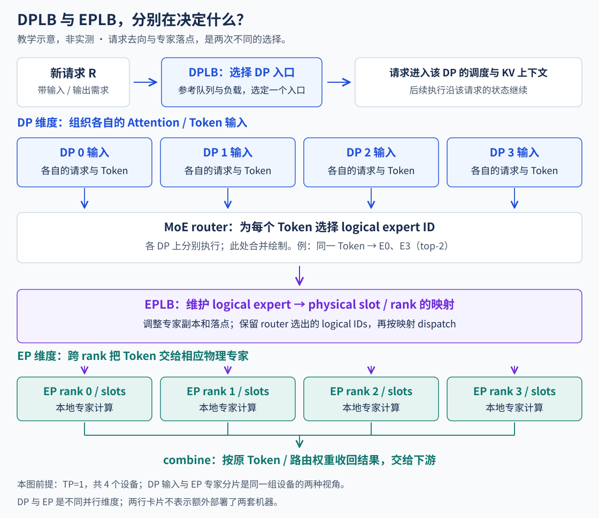
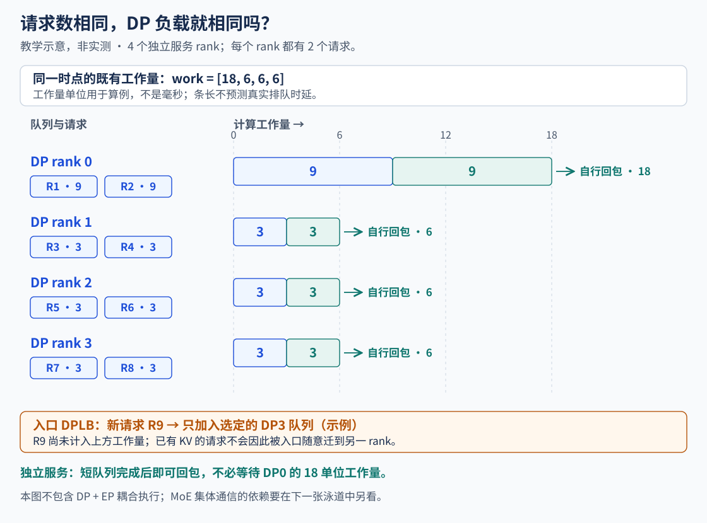
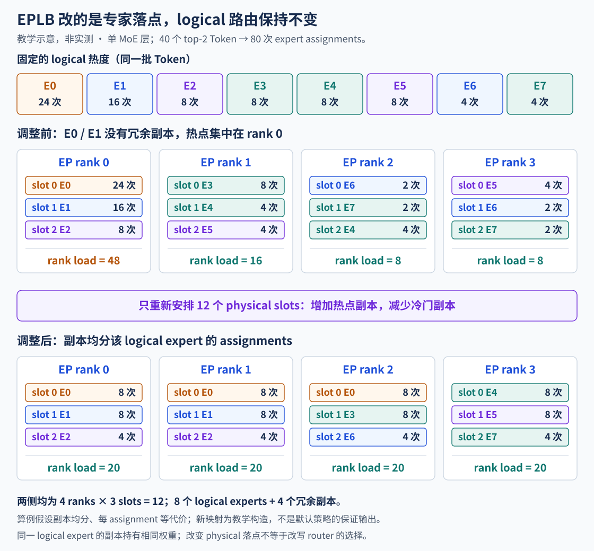
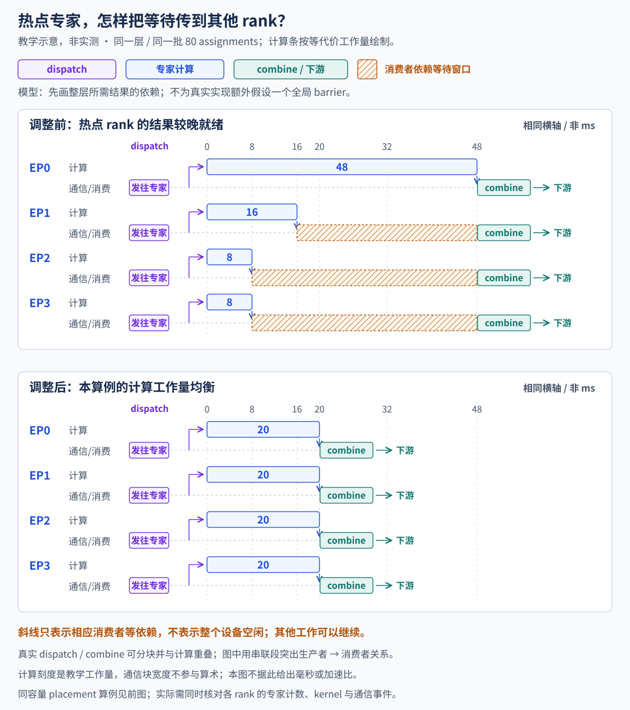
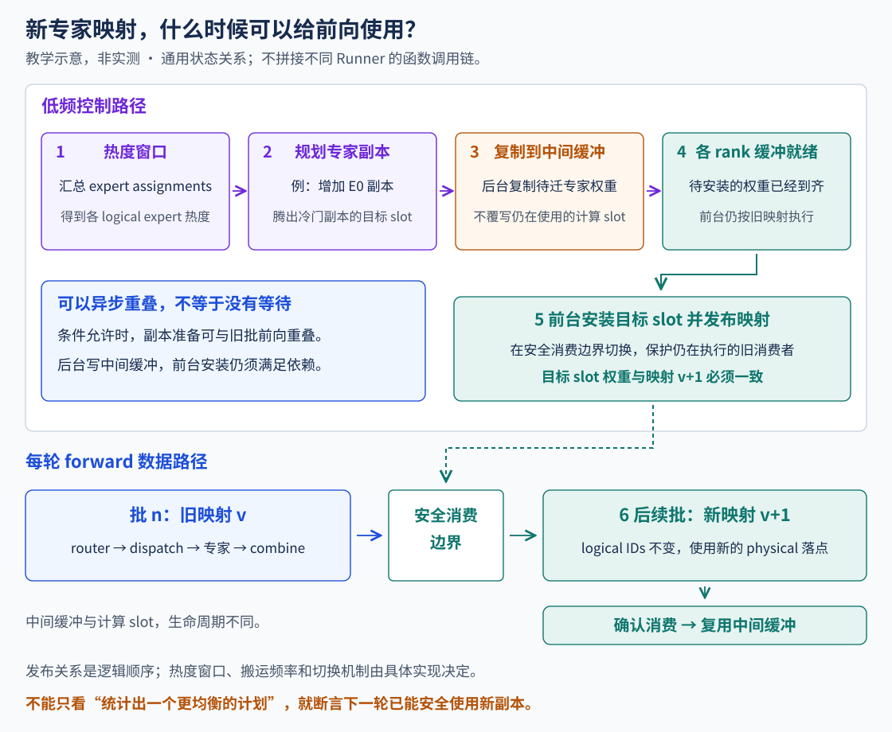

# 负载均衡：请求分给谁，专家放在哪里？

前面沿着一条请求，追到了输入打包、投机验证和下一轮接续。把视角拉到四个 rank，又会遇到一个问题：请求总数不少，为什么有的 rank 持续计算，另一些已经进入通信或等待？

先看请求分布，再看一次 MoE 前向内部的专家分布。DPLB（Data Parallel Load Balancing）处理请求进入哪个 DP engine；EPLB（Expert Parallel Load Balancing）处理逻辑专家由哪些物理副本承载。它们面对的负载不同，观测指标和调整时机也不同。

## 1. 同一张卡，为什么既有 DP rank，又有 EP rank？

DP 侧按请求记账：每个 engine 有自己的调度器、请求队列和 KV Cache。EP 侧按专家权重与 token 路由记账：一层 MoE 的专家分布在多个 worker 上，输入要发到对应专家所在的 rank，算完再把结果送回。

在 Dense 的独立服务副本中，每个副本可以各算各的。使用 DP Attention 加 EP MoE 时，不能再把每个 DP rank 都叫作“完整模型副本”：Attention 按各自 TP 组执行，MoE 专家则跨 EP 组分布。常规 DP、TP、EP 组合下，EP 组大小为 DP 数乘 TP 数。例如 DP=4、TP=2，有四个请求调度单元、八个设备 worker；不是四张卡各放一份全部专家。[DP 部署](https://docs.vllm.ai/en/latest/serving/data_parallel_deployment/) · [EP 部署](https://docs.vllm.ai/en/latest/serving/expert_parallel_deployment/)



图中用 TP=1 简化编号，因此一个设备可以同时标为某个 DP rank 和某个 EP rank。两个标签是在描述同一批资源的不同职责，并非前后连接的两套机器。

| 观察位置 | DPLB | EPLB |
| --- | --- | --- |
| 被分配的对象 | 新请求及其 engine 归属 | 一层 MoE 的专家副本与专家任务 |
| 负载线索 | waiting、running、在途请求、KV 压力等 | 每个逻辑/物理专家收到的有效 token 任务数 |
| 调整的状态 | 请求送往哪个队列 | 专家放置表、逻辑到物理副本的映射 |
| 不会自动完成的事 | 搬走已有请求的 KV 与执行状态 | 把 Router 选中的热门专家换成另一个冷门专家 |

## 2. DPLB 收到一个请求，究竟怎样选 rank？

先看内置请求入口的实现。`DPLBAsyncMPClient.add_request_async()` 调用 `get_core_engine_for_request()`，再把 ADD 消息发给选定 engine。它读的不是设备忙闲截图，而是各 engine 上报的请求与 KV 状态，以及这个 API client 自己记下的在途请求。[入口与选择函数](https://github.com/vllm-project/vllm/blob/main/vllm/v1/engine/core_client.py)

这条路径使用以下量：w 是 waiting，r 是 running，u 是 KV 使用比例，i 是本 API client 尚未结束的请求数，C 是 API client 数。将普通新请求的评分关系写成：

```text
基础分 = max(C × i, w + r)
KV 压力项 = 6 × w × max(0, u − 0.5)
总分 = 基础分 + KV 压力项
```

这里的 6 和 0.5 来自所核查的选择路径，是启发式系数；分数没有毫秒单位，也不是预测完成时间。官方部署文档仍把 KV 感知列为可扩展方向，而该源码路径已经包含这个压力项。阅读部署文档时，要再对照实际运行的 `get_core_engine_for_request()`，不能把两处描述当成同一套策略。

下面固定一个 API client，自己的在途计数暂未高过遥测请求总数：

| DP rank | waiting | running | KV 使用率 | 基础分 | KV 压力项 | 总分 |
| --- | --- | --- | --- | --- | --- | --- |
| 0 | 0 | 8 | 35% | 8 | 0 | 8 |
| 1 | 2 | 2 | 40% | 4 | 0 | **4** |
| 2 | 1 | 1 | 90% | 2 | 2.4 | 4.4 |
| 3 | 0 | 5 | 80% | 5 | 0 | 5 |

只比较请求总数会选 rank 2；加入这里的 KV 压力项后会选 rank 1。rank 3 的 KV 使用率也高，但没有 waiting，这一项为零。不能把这段代码概括为“永远选显存最空的卡”。

<!-- DPLB_LAB -->

### 快照还没更新，又来了一批请求怎么办？

选完目标后，client 会立即给自己的本地 waiting 估计加 C，并增加自己的在途计数，避免所有突发请求都涌向同一个“看起来空闲”的 rank。engine 上报新统计后，再更新快照。完成输出则会减少本 client 的在途计数。上面的交互冻结了遥测，只演示本地信用更新；它没有模拟请求完成、Prefill/Decode 变化或服务耗时。

上报链可以从 `EngineCore._maybe_publish_request_counts()` 追到 `SchedulerStats`，再经 DP coordinator 到 client 的 `lb_engines`。如果现场看到路由持续压向已忙的 rank，先对齐上报时间、client 本地估计和实际队列，不能只拿两个不同时刻的 running 值比较。[engine 统计](https://github.com/vllm-project/vllm/blob/main/vllm/v1/engine/core.py) · [DP coordinator](https://github.com/vllm-project/vllm/blob/main/vllm/v1/engine/coordinator.py)

### internal、external、hybrid 差在谁做选择

internal 在 API server 内选 DP engine；external 由外部 router 选择独立 endpoint；hybrid 先由外部选择节点，再由节点内 API server 选择本地 engine。两级选择没有赋予请求自动迁移能力。外部策略可以使用不同指标，但不能把外部 proxy 的启发式写成内置 DPLB 的默认算法。[三种入口拓扑](https://docs.vllm.ai/en/latest/serving/data_parallel_deployment/)

例如 Ascend 的一个外部 proxy 示例把 `request_length` 加上部分输出上限作为分数；沿调用方看，这个长度来自 `len(req_body)`，实际是请求体字节数，并非分词后的输入 token 数。字节长度与输出 token 上限混合，只能当作这个示例的粗略代理值，不能当成通用工作量公式。Prefix locality 还需知道这个请求能在哪里复用缓存；仅有 KV 使用率并不提供这份命中信息。[外部 proxy 的评分及调用方](https://github.com/vllm-project/vllm-ascend/blob/main/examples/dynamic_bucket_load_balancer/hybrid_proxy_server.py)

## 3. 请求已经分均了，为什么四条泳道仍不一样长？

假设四个独立 Dense 服务 rank 各接两条请求。rank 0 的两条各需要九个工作量单位，另外六条各需要三个单位。请求数都是二，累计工作量却是 `[18,6,6,6]`。这些单位只是构造的剩余工作，不是输入 token 数，更不是测得的时间。



同样是 Decode，上下文更长会改变 KV 访问量；同样是一个请求，长 Prefill 与短 Decode 的本轮工作也不同。请求数量可以帮助路由，却不能完整恢复这些差别。把“各两条”当成“各占相同设备时间”，会漏掉负载均衡最需要解释的部分。

入口 DPLB 可以把后续请求送往轻侧，让热点逐渐排空。已经在 rank 0 建立的 KV、调度进度和流式会话仍属于它，不能只改目的地址就搬到 rank 2。迁移需要额外的请求状态与 KV 交接协议；前一章讨论的 Host/Device 接续，也必须在目标侧继续成立。

### 换成 MoE，轻侧会不会等重侧？

上图是独立服务副本，各自完成即可回包，没有每轮跨 rank 汇合线。DP Attention 加 EP MoE 则不同：各 rank 的输入会参与同一 EP 组的专家通信。某个 DP rank 没有真实请求时，也可能需要 dummy forward 配合集体通信。队列空不等于该设备可以退出这一轮。[MoE 的 DP 协调](https://docs.vllm.ai/en/latest/serving/data_parallel_deployment/)

还要留意 Ascend 的 DyntraLB：它在支持的单节点、PD 分离 Decode 内部 DP 场景，汇总各 rank 的 KV block 负载，暂停本地运行请求、准入等待请求或冻结新准入，并在后续步消费计划。暂停请求保留原 rank 的 KV，不是跨 rank 迁移。它调整的是已经进入系统的调度进度，与上面新请求入口的打分是两处不同控制点。[DyntraLB 的适用场景与行为](https://github.com/vllm-project/vllm-ascend/blob/main/docs/source/user_guide/feature_guide/dyntra_lb.md)

## 4. 到了 MoE 层，Router 已经选好专家，EPLB 还能改什么？

拿一个 token 看：Router 的 top-k 选中逻辑专家 E0、E1，并给出相应权重。假设 E0 在三个 rank 上各有一个内容相同的副本，执行时可以选择其中一个。EPLB 调整这些副本的数量和位置，副本选择再把任务送到某个物理槽；它不把 E0 的任务改算为 E7。

源码中，`BaseRouter._select_experts()` 先得到 `topk_weights` 与逻辑 `topk_ids`，再应用 EPLB 映射。映射后的执行位置变化，逻辑专家及其路由权重保持原来的语义。训练时的负载均衡损失影响模型学到的专家选择分布；推理期 EPLB 承接已经发生的逻辑选择，两者不能互相替代。[Router 与 EPLB 映射](https://github.com/vllm-project/vllm/blob/main/vllm/model_executor/layers/fused_moe/router/base_router.py)

下面只看一层、四个 EP rank、八个逻辑专家。四十个真实 token 使用 top-2，共产生八十次专家任务。可以由这组选择得到：

```text
16 token → (E0, E1)     8 token → (E0, E2)
 8 token → (E3, E4)     4 token → (E5, E6)
 4 token → (E5, E7)
逻辑专家任务数 = [24,16,8,8,8,8,4,4]，合计 80
```

这里统计的是 expert assignments。一个 top-2 token 贡献两次任务，不能把八十写成八十个输入 token；图 padding 也不能混入真实负载。负载与映射按 MoE 层保存，同名 E0 在另一层是另一组权重，不能把全模型的 E0 热度直接相加后搬一次。[每层映射与负载窗口](https://github.com/vllm-project/vllm/blob/main/vllm/distributed/eplb/eplb_state.py) · [专家计数与副本选择](https://github.com/vllm-project/vllm/blob/main/vllm/model_executor/layers/fused_moe/eplb_triton.py)

## 5. 同样十二个物理槽，怎样把热点摊开？

给整个 EP 组预留四个冗余专家槽：八个逻辑专家加四个冗余槽，共十二个物理槽，每个 rank 三个。`num_redundant_experts` 在这里是整个 EP 组的额外槽位数，不是每个 rank 再加四个。

先固定“同一逻辑专家的任务均分给它的副本”这一教学假设。旧放置把冗余槽放在了当前较冷的 E4～E7，E0 和 E1 却挤在 rank 0。新放置把更多副本留给热点，得到下面的计数：



旧 rank 0 承担 E0、E1、E2，即 `24+16+8=48` 次。新布局中 E0 有三个副本，每个八次；E1 两个副本，每个八次；E2 两个副本，每个四次。新 rank 0 是 `8+8+4=20`，另外三个 rank 也各二十。总任务数始终为八十，前后占用的持久物理槽也始终为十二。

<!-- EPLB_LAB -->

这个布局是为了讲清机制构造出来的，不声称它就是某个默认策略的精确输出。实际副本选择采用哈希或查表等后端路径，单批任务未必严格均分。交互中的小数表示均分模型的期望任务量，不能当作半个 token 的真实路由。

上游默认策略会根据逻辑热度分配副本，再在每 rank 固定槽位容量下装箱；满足拓扑条件时还会考虑 expert group 与节点，并尽量保留可复用的原地槽。Ascend 的策略选择另有集成路径，不能把“新增一个热点副本”当成所有后端都使用的完整算法。[上游默认放置策略](https://github.com/vllm-project/vllm/blob/main/vllm/distributed/eplb/policy/default.py)

如果 E0 只有一个副本，它的二十四次任务仍集中在一个 rank；仅把整组 E0 权重换个位置，无法拆开这份热点。冗余副本提供分流空间，但分流是否值得，还要看内存、通信和迁移成本。

## 6. 看不同 rank 的 profiling，等待出现在哪里？

把上面的计数放进一个简化同步路径：dispatch 将任务送到专家，rank 执行自己的专家计算，combine 把结果归还给需要它的 token，后续计算再消费这些结果。为了画出依赖，先假设每次专家任务等成本、dispatch/combine 的比较条件相同。真实算子有 grouped GEMM、不同消息量和分块重叠，不满足这个简单线性模型。



先看旧布局的 rank 1：它的十六次专家任务完成了，但自己的 token 若还要接收 rank 0 的热点结果，后续消费就不能开始。Trace 上可能表现为通信 kernel 很长、等待事件或轮询，也可能被其他计算覆盖。斜线区表示结果依赖窗口，不等于整张卡都在空闲。

再看新布局：在这个等成本构造里，最长的专家工作由四十八次降到二十次，计算侧到达结果交换的时刻更接近。能否缩短实际迭代，仍取决于 dispatch/combine、网络链路和其他层是否成为新的关键路径。`平均任务数/最大任务数` 可以描述计数均衡程度，不能把它或条长比例直接写成真实加速比。

图中的汇合标记表示这组后续消费者所需的结果到齐，不是在源码中额外插了一次全局 barrier。MC2、DeepEP 等路径可以分块、融合或重叠；分析真实 Trace 时，要按实际通信后端追生产者与消费者，不能强行套成三段串行。[Ascend EP 执行与负载记录](https://docs.vllm.ai/projects/ascend/en/latest/developer_guide/Design_Documents/model_runner_v2_eplb.html)

| 真实 Trace 中的现象 | 需要补看的证据 |
| --- | --- |
| dispatch 很早出现，通信区间很长 | 对端 Attention/packing 是否更晚完成；传输本身与等对端分别占什么 |
| 某 rank 的专家计算明显更长 | 同一层各物理专家的有效任务数、真实 GEMM 形状、精度与设备差异 |
| 专家任务数接近，combine 仍拖尾 | 各源/目的消息量、跨节点链路、分块与结果消费依赖 |
| 某些 DP 队列很轻，整轮仍慢 | 是否在参与同一 EP 组，是否为 dummy forward，其他 rank 的前置工作是否拖后 |

## 7. 热度变了，权重和映射怎样安全换过去？

不能先把 E0 的任务指向新槽，再等 E0 权重慢慢搬来。新槽可能仍放着另一位专家，或只收到部分权重。映射切换必须以对应层的权重可消费为前提。



上游异步路径先在后台把某层权重送入中间缓冲，发布待消费结果；前台确认各 rank 的就绪状态，将权重安装到计算实际读取的存储，再提交该层映射，最后通知后台这一份结果已经消费、缓冲可以复用。异步移走了部分搬运等待，没有取消安装、提交和复用之间的依赖。[异步 worker](https://github.com/vllm-project/vllm/blob/main/vllm/distributed/eplb/async_worker.py) · [前台安装与映射提交](https://github.com/vllm-project/vllm/blob/main/vllm/distributed/eplb/eplb_state.py)

`window_size` 控制参与决策的近期负载窗口，`step_interval` 控制尝试重平衡的步间隔。窗口不是搬权重的周期；若上一轮异步搬移未结束，新计划也不能直接覆盖它。统计窗口越短、调整越频繁，就越需要检查是否追着短期噪声来回搬运。交互里的“热度转移”展示了同一放置如何在流量变化后变差，而不是模拟一个瞬间知道未来负载的调度器。[配置定义](https://github.com/vllm-project/vllm/blob/main/vllm/config/parallel.py)

### Ascend 的两条 Runner 路径要分开读

MRv2 使用上游控制器、统计窗口和异步生命周期，Ascend 对接策略、计数、权重通信和映射查表；当前文档明确这条路径只使用异步移动。MRv1 的 legacy dynamic 路径则按热度收集、算法计算、逐层应用组织。两条路径的配置、周期与函数不能拼成一个流程。[MRv2 架构](https://docs.vllm.ai/projects/ascend/en/latest/developer_guide/Design_Documents/model_runner_v2_eplb.html) · [MRv1 架构](https://docs.vllm.ai/projects/ascend/en/latest/developer_guide/Design_Documents/model_runner_v1_eplb.html)

## 8. 专家更均衡了，为什么端到端收益还可能不够？

冗余首先占内存。假设 L 个 MoE 层规格一致，每个完整专家连同随专家搬移的参数占 B 字节，整个 EP 组加 R 个冗余槽，均摊到 G 个 rank：

```text
每 rank 额外持久专家存储 ≈ L × B × R / G
每 rank 总专家存储     ≈ L × B × (E + R) / G
```

第二行是总量，不是新增开销。还要算中间缓冲、负载统计和权重迁移流量。固定设备内存下，增加专家副本可能挤占 KV 空间，让 DPLB 看到更高容量压力，甚至改变请求准入。这也是两层均衡需要一起看的原因。

如果不支持冗余，EPLB 仍可重排完整专家，但不能任意拆开单个热点。在当前 Ascend 文档中，A2 要求冗余数为零；其他硬件、量化格式、Runner 与 offload 组合也有具体限制。上面的十二槽例子讲支持冗余时的机制，不应直接当作任意环境的启动配置。[硬件与功能边界](https://docs.vllm.ai/projects/ascend/en/latest/user_guide/feature_guide/expert_parallelism_load_balancer.html)

任务数一样，也可能因为跨节点消息、专家 GEMM 形状或设备差异而耗时不同；迁移又可能引入额外通信。要检查的是最长依赖链是否缩短，以及 QPS、TTFT、ITL 和 TPOT 是否按目标负载改善。不能只看均衡度变漂亮，就把它当成性能优化完成。

## 9. 怎样把教学泳道换成真实证据？

先固定模型、输入输出分布、并行拓扑、路由策略、专家槽位预算和缓存前提。DPLB 比较还要保留到达节奏；EPLB 比较要在相同层、相近负载窗口看任务分布。多 rank 的 Trace 需要按同一次迭代与通信操作对齐，跨机器时还要核对时钟基准。

| 采集对象 | 至少保留什么 | 能回答的问题 |
| --- | --- | --- |
| 请求入口与各 DP engine | 选择时的 waiting/running/KV、在途估计、目标 rank、请求阶段与长度 | 路由依据是否过期，是否把轻请求与重请求混作同一工作量 |
| 同一 MoE 层 | 逻辑/物理专家任务数、每 rank 放置、实际输入行数与 padding | 热点来自逻辑选择，还是副本分配与放置 |
| 所有 EP rank 的计算/通信流 | dispatch、专家计算、combine、相关 event 的起止及关联关系 | 先慢在前置工作、专家计算，还是传输与结果归还 |
| 重平衡控制路径 | 计划生成、权重搬移、就绪、映射生效、旧缓冲释放 | 新映射是否晚于权重就绪，迁移是否占了关键链路 |
| 客户端 | QPS、TTFT、逐次接收时间、输出 token 数 | rank 侧变化是否传到实际服务指标 |

Ascend 服务 profiling 可以导出设备时间线和算子明细，再结合请求日志、专家计数与映射变化做关联。先定位同一层、同一批数据，再解释“谁在等谁”；某张截图缺少 rank、配置或操作关联时，只能支撑它实际记录到的现象。[服务 profiling 指南](https://docs.vllm.ai/projects/ascend/en/latest/developer_guide/performance_and_debug/service_profiling_guide.html)

继续阅读时可以回到[第二章的 Host/Device 等待](从一轮调度到一次前向.md)和[第三章的客户端输出时间线](投机解码与流式指标.md)：入口分发、层内专家执行、状态交接和客户端接收需要按同一条请求的因果关系接起来。

专家放置和任务分配确定后，输入怎样送到专家、结果怎样归还，以及 AllGather、AllToAll 与融合算子为什么会形成不同执行路径，接着看[《EP 通信与计算重叠》](EP通信与通算融合.md)。
