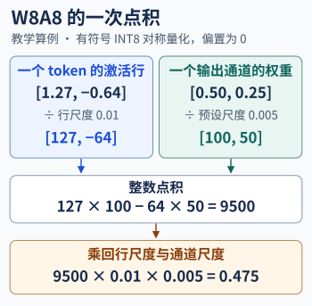

# 量化推理：位宽、尺度与算子执行

把小数 `1.27` 存成整数 `127`，再记住「每一格代表 0.01」，就可以在计算时换回原来的单位。要是一个小数落在相邻两格之间，量化时就得舍入。下面先用两个数算一次，看舍入会怎样改变模型线性层的输出。

模型标着 W8A8 时，W 指权重，A 指参与算子计算的激活。线性层的计算精度与 KV 的存储精度可以分别配置。例如共享池中的前缀块有 128 个 Token，K 和 V 如果仍按原来的 BF16 布局存放，各占 16 KiB，整块仍要搬 32 KiB。[池化算例](KV池化与跨机PD.md) · [线性层分派](https://github.com/vllm-project/vllm-ascend/blob/92b6354a/vllm_ascend/quantization/configs/modelslim_config.py#L847-L866) · [缓存量化配置](https://github.com/vllm-project/vllm-ascend/blob/92b6354a/vllm_ascend/quantization/configs/modelslim_config.py#L1203-L1221)

## 把一行激活写成整数，还能算出原来的点积吗？

线性层为每个输出通道保存一组权重。一个 token 到来时，把它的输入向量与这组权重逐项相乘再求和，就得到这个通道的输出。先把偏置设为零，只算两个输入值：激活取 `[1.27, −0.64]`，权重取 `[0.50, 0.25]`。直接计算得到 `1.27 × 0.50 − 0.64 × 0.25 = 0.475`。

改用 8 位整数计算时，给激活和权重各选一个**尺度（scale）**，表示整数每增加 1，对应的实数增加多少。本例的尺度分别是 0.01 和 0.005，实数零都对应整数零。激活除以 0.01，得到 `[127, −64]`。权重除以 0.005，得到 `[100, 50]`。把对应的整数逐项相乘再加起来，得到 `127×100 − 64×50 = 9500`。每一项都用到了两个尺度，乘回 `0.01 × 0.005` 后得到 0.475。[动态量化的定义](https://github.com/Ascend/op-plugin/blob/255eb455/docs/zh/custom_APIs/torch_npu/torch_npu-npu_dynamic_quant.md#L21-L45) · [量化矩阵乘的计算公式](https://github.com/Ascend/op-plugin/blob/255eb455/docs/zh/custom_APIs/torch_npu/torch_npu-npu_quant_matmul.md#L49-L69)



图中的激活和权重恰好都是各自尺度的整数倍。只把第二个激活从 −0.64 改成 −0.636，实际点积就变成 0.476。按原尺度量化时，−63.6 要舍入成 −64，所以量化点积仍是 0.475。同一个整数代表了一小段输入范围，乘回尺度只能恢复其中一个值。这里用十进制数手算，实际输入和输出还会经过浮点舍入。

**试一试。** 把第二个激活再改成 −0.626，尺度和权重都沿用上例。这次第二个整数会变吗？量化点积是多少？

<!-- DETAILS: 核对答案 -->

这次 `−0.626 / 0.01 = −62.6`，舍入成 −63。整数点积变为 `127×100 − 63×50 = 9550`。乘回两个尺度，得到 0.4775。把原值直接相乘再相加，得到 0.4785。两种结果相差 0.001。

<!-- /DETAILS -->

## 一个批次进来，两组尺度分别从哪里取？

把算例放大。假设本轮有 M 行 token，线性层每行读 K 个特征，写 N 个输出通道。第 i 行与第 j 组权重相乘时，使用**第 i 行的激活尺度**和**第 j 个输出通道的权重尺度**。这样一批输出有 M × N 个数，只需 M 个行尺度和 N 个通道尺度。对不带偏置的二维输入，这一步可写作：

```text
Y[i,j] ≈ 行尺度[i] × 通道尺度[j] × Σ_k (X整数[i,k] × W整数[j,k])
```

在 Ascend 的普通动态 W8A8 线性层中，权重和通道尺度随量化权重文件加载。整数权重起初按 [N, K] 接收，加载后转置成逻辑形状 [K, N]，尺度展平成 [N]，供后面的矩阵乘使用。图里的 0.005 是手算预设的权重尺度。一个实际模型用了多少，读这个通道随权重保存的值即可。[参数形状与加载后处理](https://github.com/vllm-project/vllm-ascend/blob/92b6354a/vllm_ascend/quantization/methods/w8a8/w8a8_dynamic.py#L60-L92) · [权重转置及布局转换](https://github.com/vllm-project/vllm-ascend/blob/92b6354a/vllm_ascend/quantization/methods/w8a8/w8a8_dynamic.py#L136-L144)

激活尺度来自这次前向本身。以非零的普通 BF16 输入行、无平滑系数为例，`npu_dynamic_quant` 取该行最大绝对值除以 127。按上一节的十进制数手算，尺度是 `1.27 / 127 = 0.01`。设备取的是已存为 BF16 的行，1.27 存入时已舍入为 1.2734375，算出的尺度也略有差别。算子输出 INT8 的 [M, K] 激活和 FP32 的 [M] 尺度。随后 `npu_quant_matmul` 读取整数激活、整数权重及两组尺度，写回 [M, N] 的 BF16 输出供下一层使用。若上游已准备好量化输入及尺度，线性层可以直接复用。[动态量化输出](https://github.com/Ascend/op-plugin/blob/255eb455/docs/zh/custom_APIs/torch_npu/torch_npu-npu_dynamic_quant.md#L80-L89) · [两次算子调用与输出类型](https://github.com/vllm-project/vllm-ascend/blob/92b6354a/vllm_ascend/quantization/methods/w8a8/w8a8_dynamic.py#L94-L134)

同一后端也有静态 W8A8 线性层。这个实现从权重文件加载输入尺度和偏移，本轮激活按已给定的参数量化。读 Trace 时，先查这一层实际选中的量化方法，再找生成行尺度或使用固定尺度的算子。仅凭模型名里的 W8A8，无法决定该找哪一种。[静态输入参数](https://github.com/vllm-project/vllm-ascend/blob/92b6354a/vllm_ascend/quantization/methods/w8a8/w8a8_static.py#L59-L87) · [静态量化与矩阵乘](https://github.com/vllm-project/vllm-ascend/blob/92b6354a/vllm_ascend/quantization/methods/w8a8/w8a8_static.py#L104-L150)

## 用哪个位宽算显存，用哪个位宽算传输？

同样是“8 位”，先看这份数据留在哪里、留多久。下面固定一个线性层和一个普通 Attention 层，假设数值在内存中连续排列，先只计算这些数值占用的字节数。额外的尺度、偏移、布局填充和运行工作区要根据实际张量另计。

| 要算的对象 | 教学形状和存活范围 | BF16 | 改用 INT8 后 |
| --- | --- | --- | --- |
| 一层权重 | K=N=1024，加载后供多个请求使用 | 2 MiB | 1 MiB，矩阵乘另读权重尺度 |
| 本轮量化前后的激活行 | 一个 token，K=1024，交给线性层计算 | 2 KiB | 1 KiB，动态量化另产出 1 个 FP32 行尺度。输入与输出缓冲可能同时存在 |
| 一个完整前缀块的 K 和 V | 单层、128 个位置，K/V 各 1 个 64 维头，可跨轮读取 | 32 KiB | **只有 K 和 V 也采用 INT8 存储时**，两份数值才合计 16 KiB |

最后一行只算 `2 × 128 × 1 × 64 × 每元素字节数`。看一个确实量化 KV 的实现：Ascend 的稠密 Attention C8 分支为 K、V 分别加载尺度与偏移。在未配置 KV 传输的执行路径中，后端对本轮有效位置的 K、V 做缩放、舍入和限幅，再将 INT8 结果写入缓存。开启 PD 后还要看两端的角色，源码对 KV 生产端和消费端有不同处理。要算一次真实 PUT 或 P→D 交接的字节量，应读连接器提交的各片段长度，确认实际搬的是哪种表示。[C8 参数及缓存类型](https://github.com/vllm-project/vllm-ascend/blob/92b6354a/vllm_ascend/quantization/methods/kv_cache/kv_c8.py#L108-L145) · [写缓存与 PD 分支](https://github.com/vllm-project/vllm-ascend/blob/92b6354a/vllm_ascend/attention/attention_v1.py#L1460-L1515) · [K、V 的量化公式](https://github.com/vllm-project/vllm-ascend/blob/92b6354a/vllm_ascend/attention/attention_v1.py#L1616-L1637)

## 第五章的 A5 实验里，W4A8 用在哪里？

第五章保留了一次双卡专家并行实验。输入给 Dispatch 的激活是 BF16，拆分执行时，Dispatch 返回按专家排好的 8 位浮点激活及其尺度。第一个分组矩阵乘读取这些激活、打包的 4 位浮点权重和相应尺度，输出 BF16。经过 SwiGLU，下一次矩阵乘又需要 8 位输入，所以激活函数这一步也生成新的量化值和尺度。第二个分组矩阵乘输出 BF16，再进入 Combine。这里的 W4A8MXFP 用的是带共享尺度的低位浮点表示，前面 INT8 点积的舍入公式只适用于前面的整数例子。[A5 实验的输入格式和两次矩阵乘](https://github.com/Tflowers-0129/inference-wiki/blob/03318e8/experiments/a5-moe.py#L131-L225) · [第五章双 rank 记录](EP通信与通算融合.md)

取实验里的隐藏维 1024，只看 Dispatch 输出中的一行激活，1024 个 8 位值占 1024 B。专家还要拿到与这行对应的尺度。仅凭这 1024 B 算不出网卡传输了多少：还需知道该行送到哪些 rank、其中哪些在本地、传输采用的格式，以及尺度和通信协议各占多少。第五章记录的是设备执行事件与专家任务数。它的两条对照链都用了相同的量化权重，回答的是两种实现的输出是否一致、各执行了哪些设备任务。[固定配置和测量范围](https://github.com/Tflowers-0129/inference-wiki/blob/03318e8/experiments/results/a5-moe.json) · [权重与布局的准备](https://github.com/Tflowers-0129/inference-wiki/blob/03318e8/experiments/a5-moe.py#L76-L104)

若要回答“我的模型换量化后，质量和服务速度变了多少”，还差一组浮点基线。先用相同输入和固定前缀对照浮点与量化模型的层输出、logits 和任务指标。性能另按相同硬件、并行配置、输入输出长度和到达负载，分别测 Prefill 与 Decode：关闭 profiler 重复测吞吐、TTFT 和 TPOT，再采同条件多 rank Trace，把矩阵乘、量化、布局转换及通信与整轮时间对齐。本章的手算和已有 A5 记录尚未给出这组服务对照结果。[特性前后对照的固定流程](https://github.com/Tflowers-0129/inference-wiki/blob/03318e8/experiments/README.md#特性前后对照的固定流程)
